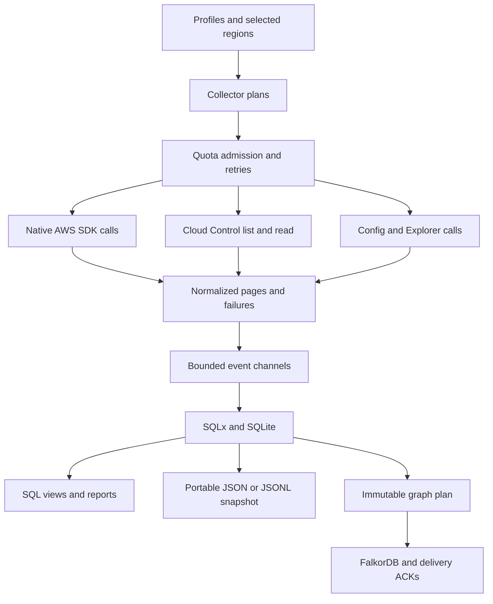

# Architecture and design decisions

> Status: Baseline being replaced. It describes the version 0.6 collector as
> built (typed adapters, Cloud Control, SQLite schema 13, snapshot projection)
> and the first CMDB slice; together with
> [CMDB_ARCHITECTURE.md](CMDB_ARCHITECTURE.md) it is replaced by one document
> at ROADMAP M10.3, and the passages that contradict an owner decision are
> marked below with the decision ID. See [VISION](VISION.md) and
> [ROADMAP](ROADMAP.md).

Implementation coverage of the baseline is in `COLLECTORS.md`; the pinned
service and operation metadata source is `catalog/aws-api.catalog`. Recorded
validation results are in `VERIFICATION.md`.

## 1. Product boundary

The product answers: what AWS resources can these credentials observe, which
architectural relationships connect them, what evidence supports each claim,
and which scopes were not successfully examined?

It combines broad discovery, graph analysis, local SQL, optional existing AWS
inventory services, and Rust execution. The hard part is consistent coverage and
evidence across heterogeneous APIs. Linking an SDK or calling methods beginning
with List does not solve parent traversal, identity, enrichment, permissions,
quotas, or relationships.

The current implementation collects configuration metadata. It does not read
DynamoDB items, download Lambda code, crawl S3 object contents, mutate AWS
resources, or provision inventory services. Application and collector code is
Rust, with native SQLite through SQLx and an external FalkorDB server.

### Principles

1. Preserve observations and failures before deriving a simplified view.
2. Treat scope completion as evidence; never turn a denied call into emptiness.
3. Use stable IDs and deterministic projections so replay is safe.
4. Bound admitted work, retained payloads, retries, and pagination.
5. Make every inventory request attempt consume its quota budget.
6. Keep persistence separate from network request execution.
7. Distinguish implemented behavior, optional capabilities, and future work.

## 2. Logical pipeline

Collectors own SDK call futures and map results. The executor controls each
attempt. SQLite is the durable system of record. FalkorDB is a reconstructible
projection. Collection never depends on graph server availability.
Optional post-scan delivery exports the finalized inventory and then projects
it into an existing FalkorDB server. A failed delivery preserves SQLite data and
completed files and contributes an explicit incomplete overall outcome.

| Component | Owns | Does not own |
|---|---|---|
| `inventory-core` | Observation, scope, page, edge and status models; validation | Runtime, database, network, clock |
| `inventory-engine::limiter` | Admission, pacing, retries, feedback, cancellation and counters | AWS schemas or credential acquisition |
| `inventory-engine::store` | SQLx transactions, provenance, checkpoints, bounded SQL and streams | AWS calls or graph availability |
| `inventory-engine::export` | Versioned JSON/JSONL snapshots, provenance modes, counts, hashing and atomic file publication | AWS requests or database backup/restore |
| `inventory-engine::graph` | Graph plans, bounded replay-safe retries, transport and SQLx delivery ACKs | Discovery or inferred deletion |
| `inventory-aws` | Operations, pages, enrichment, normalization and relationships | Whole-scan accumulation or detached workers |
| CLI | Profiles, snapshots, bounded routing, one writer, shutdown, reporting and explicit scan/delivery workflows | Hidden deployment or provisioning |

## 3. Scan scope and identity

One credential profile or explicitly assumed-role account target creates one scan ID. Multiple profiles can share an
invocation, executor, and SQLite database while retaining independent snapshots.
Two roles in one account may observe the same scope at different times with
different permissions; their first pages must not overwrite one another.

STS resolves the actual account and partition. Explicit regions are deduplicated;
otherwise DescribeRegions discovers enabled regions. Multi-account collection
uses existing profiles or `--organization-role`. The Organizations path requires a
complete account listing, filters ACTIVE accounts, checks explicit account IDs and
`--max-accounts`, then supplies refreshable SDK AssumeRole providers for existing
roles. Identity is verified against each requested target before collection. A
partial account listing stops expansion; role-assumption failures remain explicit
per-target scan failures. Standalone `discover` also exposes optional OU hierarchy
and existing Config/Resource Explorer sources; see `DISCOVERY.md`.

S3, IAM, Route 53 and CloudFront run once per target scan outside the regional
loop. Global service scopes store `region=global`; S3 resources retain their
authoritative bucket region when known. Automatic supplemental discovery runs
only in selected/discovered regional contexts and never provisions an index,
recorder, aggregator or view. Ambiguous source selection remains incomplete.
See `GLOBAL_INVENTORY.md` for field, identity and partition contracts.

A collection scope contains the scanning account, region, collector, optional
parent, and source. It has a page sequence, token chain, completion flag, and
failure state. Child resources include the parent's identity. ECS task status
filters have independent scopes. Resource ownership can differ from the
scanning account, including Config aggregation and RAM-shared networking.

### Resource IDs and references

Returned authoritative ARNs are preferred. EC2 IDs are expanded using partition,
region, resource type, and reported owner when available. Config records without
an ARN receive a namespaced fallback ID rather than a fabricated ARN.

Some network references contain only a resource ID. When the owner is unknown,
the edge retains raw target ID, kind, region, and
`owner_resolution=assumed_scanning_account`. A placeholder with this evidence is
not proof of the target's owning account. Cross-account alias reconciliation is
an expansion item; unresolved shared-network edges must not become verified
ownership assertions.

## 4. Observation and source semantics

Each resource retains ID, owning account, region, kind, optional name, selected
properties, tags, source, and local observation time. Supplemental records also
retain upstream capture/report times in properties. Collecting cached data now
does not make the original data fresh.

| Source | Useful evidence | Coverage limitations |
|---|---|---|
| Direct SDK | Relevant service response and detailed selected fields | Permissions, endpoints, quota, pagination, transient deletion and implemented types |
| Cloud Control | Schema-backed configuration for 421 regional types across 76 families: 397 roots plus 24 reviewed parent-dependent types | Provider read/list support, regional availability, IAM, prerequisite discovery, remaining filter exclusions and selected mappings |
| Config aggregator | Existing recorded configuration across its accounts/regions | Recorder/type scope, aggregation delay, supported types, permissions and query exclusions |
| Resource Explorer view | Broad identities and indexed metadata in its view | Index/type coverage, filters, service-linked role state, delay and permissions |

Current-state selection (`latest_resources`, `latest_edges` and the service views)
is freshness-first: the greatest `observed_at` wins across sources. Source
priority breaks only equal timestamps: Direct (4), Cloud Control (3), Config (2),
Explorer (1). Remaining ties use descending `scan_id`, ascending `scope_key` and
descending `page_number`, never arrival order. All observations are retained and
`latest_resource_sources` exposes independently selected source records.

A newer Config row therefore outranks an older direct row in the cross-scan
convenience view. Source and timestamp remain visible. Per-scan snapshots
(`scan_resources`, `scan_edges`) deliberately keep priority-first selection so
exports and summaries stay reproducible. Future field-level reconciliation needs
provenance per field; a hybrid object must not pretend to have one source.

Supplemental adapters run in addition to selected native collectors. They can
use explicitly selected aggregators/views or discover existing sources with
`--discover-sources`. Discovery requires an unambiguous usable source and records
denials, missing sources and incomplete results. It does not form a selective
enrichment planner or skip direct calls based on cached freshness.

## 5. Request scheduling

The unit of admission is an API **attempt**. Invisible SDK retries would bypass
application rate accounting. Explicit inventory SDK operations use one SDK
attempt; the outer executor owns retries, backoff, timeouts and classification.
Credential-provider work, such as SSO refresh, is outside this inventory budget.

Quota keys include partition, account, region, service and quota group. Some
AWS operations share a budget, while other actions have separate limits. The
current adapters conservatively combine read operations into service families.
Exact-key policy overrides provide differing ceilings; Service Quotas is not
assumed to expose every control-plane throttle limit.

CLI defaults are 128 active attempts globally, four per bucket, and five starts
per second per bucket. Generic engine defaults are 64/8/5. All settings have
static validation ceilings. Policies are immutable once the executor starts.

The executor spaces admission into SDK operation futures. It reserves local
admission, waits without holding global capacity, acquires global capacity, then
rechecks feedback before dispatch. Only one sender per bucket waits for global
capacity. No lock guard survives an await. Cancellation and errors release the
reservations. This controls SDK operation starts, not exact on-wire request
timestamps: credential acquisition and connection establishment can intervene.

A throttle halves the affected bucket's rate; successes recover one unit at a
time up to its ceiling. Transient failures and timeouts use bounded exponential
backoff with full jitter. Denials and permanent errors terminate. Retries pass
through the same admission path and count toward rate and concurrency.

Policies accept integer requests/second or a requests/period form, down to one
request per 300 seconds. Fractional policies use conservative integer-nanosecond
spacing and bounded accumulated recovery credits. Standard Retry-After, AWS
x-amz-retry-after and typed Lambda hints extend a shared bucket cooldown;
invalid or excessive hints close the affected bucket. Standard numeric hints
and Lambda hints are seconds, while AWS's header is milliseconds. The dedicated
scheduler document describes bounds, parsing, cancellation and date-clock limits.

The scheduler is process-local. Two separate processes have separate budgets.
A distributed deployment needs exclusive account/region work ownership or a
shared quota coordinator.

### Throughput versus concurrency

A useful planning approximation is:

`throughput <= min(sum(effective bucket rates), global concurrency / mean latency)`

For example, 1,000 requests/second at 200 ms average request time needs roughly
200 active requests if quotas and all other stages allow it. That is arithmetic,
not a benchmark. It does not require 100,000 live futures.

Hundreds of thousands of planned calls can coexist with bounded active work.
Current collectors lazily traverse page chains and child lists instead of
allocating one task per resource. The SQLx durable queue stores up to 10,000
scan invocations with leased attempts, rather than one job per AWS operation.
It supplies local crash recovery and explicit retry; it is not a distributed
quota coordinator. See `DURABLE_JOBS.md` for fencing, cancellation and the
cross-database at-least-once boundary.

Other bottlenecks include deserialization, normalization, disk sync, SQLx/SQLite
insert work, query work, graph writes, bandwidth, credential refresh and AWS
latency. Rust does not remove them. Measure each stage before raising ceilings.

## 6. Pagination and bounds

A token-dependent page chain is sequential: the next token does not exist until
the preceding response arrives. Parallelism comes from independent accounts,
regions, services, parents, and bounded describe batches. Tokens are never guessed.

Empty pages with a token continue. Terminal empty pages prove that scope's
enumeration succeeded. Cycles, page caps, child caps and denials record failures.
A cap never manufactures a terminal token.

| Boundary | Ceiling |
|---|---:|
| Profiles accepted by CLI | 128 |
| Active profiles | 4 |
| Regions per profile | 64 |
| Active regions per profile | 4 |
| Native collector groups per active region | 8 |
| Cloud Control types active per region | 4 |
| Cloud Control descriptions active per type | 4 |
| Cloud Control child types active per parent | 2 |
| Cloud Control child descriptions active per page | 4 |
| Child-model scopes per root group | 10,000 |
| Distinct child identifiers per root group | 100,000 |
| Active API attempts | Configurable; hard maximum 4,096 |
| Admitted logical operations | 65,536 |
| Quota buckets | 65,536 |
| Native pages per scope | 10,000 |
| Enumerated children per scope | 100,000 |
| Serialized normalized page | 16 MiB |
| Resource property JSON | 1 MiB |
| Central writer channel | 4 events |
| Forwarding channel per active profile | 1 event |
| Persisted events per invocation | 1,000,000 |
| Portable inventory data records | 10,000,000 total across resources, edges, scopes and failures |
| Portable inventory output | 1 TiB; lower caller budget supported |
| Graph rows per batch | 256 |
| Graph query text per batch | 2 MiB |

These are not a proof of fixed process RSS. SDK objects exist before normalization,
and nested service responses have their own sizes. Scale testing must measure
RSS, allocations and queue occupancy with representative/worst permitted data.
Service-specific page and token bounds are detailed in `COLLECTORS.md`.

## 7. SQLx and SQLite

SQLx is the actual inventory and graph-checkpoint database layer; there is no
parallel rusqlite write path. The store uses one writer connection and one
independent read-only/query-only reader, WAL journaling and full synchronous
commits. SQLx executes native SQLite on its worker threads.

Validation, JSON encoding and SHA-256 fingerprinting run on a tracked preparation
worker. A bounded permit survives preparation through the transaction, preventing
concurrent callers from accumulating large prepared pages behind the writer.
The CLI's single consumer applies backpressure when storage is slower than AWS.

The page is the durability unit:

1. Validate identity, fingerprint and contiguous sequence.
2. Insert resource and relationship observations.
3. Persist the page record and continuation checkpoint.
4. Commit once.

A pre-commit crash leaves neither data nor checkpoint for that page. A post-commit
crash allows exact event replay. Different content at the same page identity is
a conflict. Finalized scans reject new observations except exact replay.

The store retains static prepared SQL for singleton chunks and uses SQLx
QueryBuilder statements for chunks of 2–128 resource or edge rows inside each
page transaction. The maximum statement has 1,536 bound
values. A later statement failure rolls back earlier statements and the page
checkpoint. This reduces SQLx worker handoffs without changing the durability
unit or retaining a whole scan in memory. Baseline and candidate local benchmark
outputs are retained under `artifacts/`. The paired repeat reversed the initial
throughput gain under shared-host and concurrent compiler load, so a stable
performance improvement has not been established. The retained change bounds
handoffs; materialized latest-state tables remain a separate future decision.

### Query surface

Service views use familiar Steampipe-style names and selected columns, with
SQLite types and JSON functions. Raw observation tables and scope views expose
the evidence behind convenient service tables.

The arbitrary-SQL interface is isolated on a physical read-only connection for
file databases plus `query_only=ON`. It accepts a single SELECT/WITH statement and
bounds SQL length, rows, columns, cells, serialized output, native VM work and
elapsed time. Native allocation ceilings are set during compilation and checked
at startup. Abandoned query deadlines are reset before connection reuse.

Convenience views use window functions over observation history. Large retained
histories may need materialized views and retention. These optimizations must
preserve provenance and page transaction semantics. WAL is intended for a
suitable local filesystem; shared remote storage requires a separate design.

> Superseded by V22: the first version keeps no history, so there are no
> retained histories to materialize or expire. The store holds current state
> only (VISION 5.4, 5.5).

### Schema evolution and architecture reports

Schema version 2 added typed views for six networking kinds and five ELBv2
component kinds, derived route rows and three load-balancer type aliases.
Upgrades execute in a single `BEGIN IMMEDIATE` transaction: a failed view
creation cannot leave half the upgrade or an advanced user version. Existing
observation data, fingerprints and continuation checkpoints are retained.
Schema version 3 introduces Cloud Control provenance, source priority 4/3/2/1,
ECS task-definition and service target-group fields, and 200 provider-column
views. It rebuilds source-constrained tables using SQLite’s documented migration
procedure, preserving user views, triggers and indexes in the same transaction.
Foreign keys are checked before commit and restored before the Store is exposed.
Schema version 4 adds the native global-service views. Version 5 adds 197
source-specific root views, retaining 397 root views and 4,104 provider columns.
Current schema version 13 adds the 24 parent-type views and 205 columns, for **421
provider views and 4,309 selected columns**. The earlier view definitions remain
unchanged. These additive upgrades do not rebuild inventory rows, replace caller
objects or alter finalized scans; an
added view-name conflict rolls the whole upgrade back.
Opening an older supported file upgrades it, including query/report opens.

`scan_vpc_routes` expands each selected route-table observation within one scan.
`scan_architecture_edges` joins both endpoints using the same scan ID and exposes
whether each endpoint was observed. Neither substitutes a target from another
snapshot. Convenience `aws_*` views retain their last-known-across-scans meaning.

The `architecture` command summarizes eight panels from a finalized scan. Each
panel probes one row beyond its configured output limit and marks actual
truncation. SQLite work, time and output bounds remain active. A blackhole route
is preserved as a blackhole; an internet-facing scheme is not proof of access;
unobserved references are not proof of absent resources. ELBv2 action and route
evidence enable topology investigation without pretending to compute effective
reachability across route priority, security controls, IAM and runtime health.

## 8. Completeness, failure and deletion

States are `running`, `complete`, `partial` and `cancelled`. Complete finalization
is downgraded if a scope failed, a page chain is incomplete, or no scopes exist.
Completion applies to the selected, attempted scope universe. It excludes
unimplemented types, disabled collectors, unknown accounts, filtered views and
fields outside a collector contract.

A scan is not an atomic AWS snapshot. Resources can change during collection.
No absence-based deletion exists: a later scan that misses a resource cannot
erase earlier evidence. Future deletion needs a matching enumeration universe,
completed authoritative scopes, stable identity, a temporal policy and protection
from eventual consistency.

Persisted tokens are evidence/checkpoints. The native CLI does not yet restart
an interrupted live chain from them. Tokens can expire or depend on filters and
resource changes. Resume requires collector-specific validation and enumeration
epochs, not just rereading a string.

## 9. Inventory export and FalkorDB projection

### Portable snapshot files

`export` writes a finalized scan as JSON or JSONL with artifact identity
`aws-inventory.snapshot`, version 1. Normalized mode emits the preferred
resource and edge observations. All-observations mode retains every persisted
observation together with its collection scope and page number. Both include
coverage, failures, original source/timestamps, actual scan status and emitted
counts. Properties and tags remain structured JSON.

The exporter reads SQLx streams sequentially, keeps one bounded record at a time,
and never routes a full inventory through the interactive query API's 10,000-row
limit. It orders records deterministically, hashes all output bytes and publishes
with atomic no-clobber installation. Cancellation drains the owned file writer
before removing its temporary; cleanup failure is a distinct error. Complete
snapshots are the default. Finalized partial/cancelled scans require opt-in;
running scans are always rejected.

This format differs from collection-event ingest JSONL and graph-plan JSONL.
It omits continuation tokens, page fingerprints, jobs and graph ACKs, so retaining
the database is still required for a full backup. See [EXPORT.md](EXPORT.md).

### Graph plan and transport

Export reads immutable snapshots through bounded SQLx streams and creates JSONL
batches with version, graph, scan ID, sequence, stage, rows and Cypher query.
Stages are index, loading marker, resource batches, edge batches and final marker.
Before transport, validation rejects missing end markers, invalid ordering,
sequence gaps, mixed identities, unsupported versions and oversized lines.

The exporter flushes/syncs a temporary file and atomically installs it with a
same-filesystem hard link, refusing to overwrite an existing destination. Nodes
have snapshot-specific IDs; edges use `RELATES_TO` plus `kind`. Nested properties
and tags are JSON strings. Unobserved references are placeholders.

MERGE identities allow replay after an ambiguous network result. The local SQLx
ACK is committed only after server success. Its identity includes a hash of the
destination URL, graph, scan, sequence and batch digest. Changed acknowledged
content is a conflict; the destination URL itself is not stored there. A complete
plan digest also binds its unacknowledged tail. Before transport, each batch must
match the fingerprint captured during full validation, preventing a changed
second read from introducing an unvalidated write.

Delivery is at least once with idempotent graph effects, not a distributed
transaction. A server commit followed by a lost response is replayed. Repeating
the canonical index creation recognizes the specific duplicate-index response.
Other server errors remain errors. A graph reset behind an old local checkpoint
requires a fresh checkpoint. Consumers should use the loading/final scan marker
to distinguish incomplete projection.

Only trusted generated plans should be pushed: they contain executable writes.
Graph delivery reuses `ApiExecutor` as its sole retry owner, with five attempts
per batch by default, bounded backoff and an overall deadline. Typed temporary
transport/server errors can reconnect and retry recognized generated idempotent
queries. Unknown custom query grammar receives one attempt; authentication,
permission, invalid-query and other permanent errors are terminal. Exhaustion
preserves ACKed progress for an explicit later resume. Multi-process simultaneous
projection into the same graph/snapshot is outside the current concurrency
contract. See [GRAPH_DELIVERY.md](GRAPH_DELIVERY.md) for classification, exact
bounds, cancellation and native lost-response integration evidence.

### Scan and delivery workflow

`scan --output-dir DIR` exports each finalized snapshot after collection.
`--falkor` additionally creates and pushes its graph plan to the configured
existing server. `deliver --scan-id ...` repeats delivery from SQLite without
recollecting AWS resources. Each attempt has a new directory and receipt; graph
ACKs persist in the shared output directory's projection database. Completed
inventory metadata remains in the receipt if graph work later fails.

Collection status and delivery status remain separate. A requested delivery
failure makes an otherwise complete invocation partial; it does not change the
stored collection evidence. The provenance option changes the inventory file,
while the graph remains a projection of normalized resource/edge selections.
An active cancellation stops new delivery admission. See [DELIVERY.md](DELIVERY.md).

## 10. Shutdown and observability

Bounded stream combinators own collector futures. The CLI joins collection,
forwarding and storage without detached task spawns. Ctrl-C cancels admission,
active requests and backoff, drains retained pages and finalizes cancellation.
Credential configuration loading has a separate 30-second bound.

A writer failure closes the channel and cancels the executor; producers unwind
and both sides are observed. Hard process termination can leave a running scan,
but committed pages remain durable and cannot be exported as a finalized
inventory or graph while the scan is still running.

Tracing and counters cover attempts, retries, throttles, timeouts, successes,
failures, cancellations, server delays, rejected retry hints, current/peak active
calls and bucket count. This delivery
does not configure an OTLP collector, distributed tracing backend or tokio-console
service. Those remain production observability work.

## 11. SDK catalog and future generation

> Superseded by V01, V02 and V04: collection moves to the service endpoint
> APIs through our own wire engine, driven by the pinned AWS API models. The
> typed-SDK catalog is deleted in ROADMAP M1.7, new services are added as
> overlay data and not as collectors (M5, M9), and Cloud Control is deleted in
> M9.5; only its type list and the reviewed relationship rules are kept. This
> section describes the baseline.

All 437 service crates in the pinned official release have exact versions,
optional features, conditional re-exports, registry checksums, source/model
fingerprints and immutable source origins. Runtime, credential and Smithy
packages remain separately resolved dependencies.

Each additional collector requires more than its SDK:

- Root/child enumeration plan, page inputs/tokens and valid batch sizes.
- Endpoint scope, partitions, regions and IAM actions.
- Identity, meaningful columns, field exclusions, tags and enrichment costs.
- Quota-family mapping and reviewed ceilings.
- Relationships and unresolved-reference policy.
- Deterministic fixtures, error/pagination tests and live-account validation.

The combined 421-type Cloud Control catalog applies that principle to a shared
ListResources/GetResource adapter. It preserves the frozen 397-type root catalog
and adds a separate 24-type parent catalog. Official schemas establish read/list
handlers, identifiers, write-only properties and top-level query columns. A Rust
view generator reproduces the source-specific SQLite views. Its 968 property
relationship rules across 255 types retain field evidence. The 24 additional
runtime `CHILD_OF` workflows bring the number of types with either form of
relationship evidence to 268. Generic property names do not imply arbitrary
links, and a type without applicable evidence does not gain fabricated edges.
The all-schema capability matrix separately records exclusions and source-bound
historical emulator evidence; the current offline report overlays parent plans.

Child-only selection adds the exact reviewed root prerequisite. Siblings share
one root enumeration, and selecting a root alone does not add children. A
successful sanitized parent read supplies the model for every page of that
child's list chain. The child details must match that context before a parent
edge is created. Model and identifier admission are bounded across the root
group, and duplicate models from different parents fail before replaying a
scope. A prerequisite checkpoint completes only after exhaustive successful
parent discovery; unavailable context leaves incomplete evidence. Independent
children already collected remain stored. [PARENT_COLLECTIONS.md](PARENT_COLLECTIONS.md)
defines the six root families, exact bindings, caps and failure behavior.
Native adapters still cover service-specific architecture details. The offline
`plan` command describes both paths without loading credentials. See
`COLLECTION_PLAN.md` for eligibility, identity and regional-support limits.

A separate Rust source auditor inspects all 437 pinned SDKs: 19,617 operation
modules, 3,779 paginators and 407 waiters. This is source inspection and package
verification, not a compilation or live test of every operation. It also verifies
why simply enabling nested SDK retries would violate current admission semantics.
See `SDK_RETRY_AUDIT.md` and `RETRY_AND_WORKFLOWS.md`.

## 12. Production acceptance

> Superseded. Cloud Control parent workflows and further typed collectors are
> not next work (V01, V04); a retention policy is not needed because there is no
> history (V22); the first version is proven on about 10 accounts from local
> profiles (V09). What has to be proven, and where, is VISION section 9 and the
> exit evidence of each ROADMAP package.

Production acceptance requires live multi-account fixtures, denied-scope tests,
throttle observations, representative RSS/disk-pressure measurements, restart
and replay tests, migration compatibility, retention/backup policy and a reviewed
coverage matrix. Routes/gateways and ELBv2 load balancers/targets now have typed
collectors; their remaining enrichment and live validation are tracked separately.
The broad Cloud Control path covers 421 configured regional types; native ECS
task definitions and service target-group links are implemented. Next work is
live regional/account validation, richer native relationships where provider
models are insufficient, further global resources and additional reviewed
parent workflows or dependency levels. ELBv2 listener rules, RDS proxy target
groups and ECS task sets remain outside the parent catalog.
Identity, coverage and enrichment quality remain separate acceptance dimensions.

A polished narrow scanner is weeks of engineering; reliable broad parity with
several mature inventories is a multi-month project plus ongoing AWS maintenance.
That is a planning judgment, not a measured forecast. The current foundation
makes storage, concurrency, evidence and query contracts concrete and testable.
