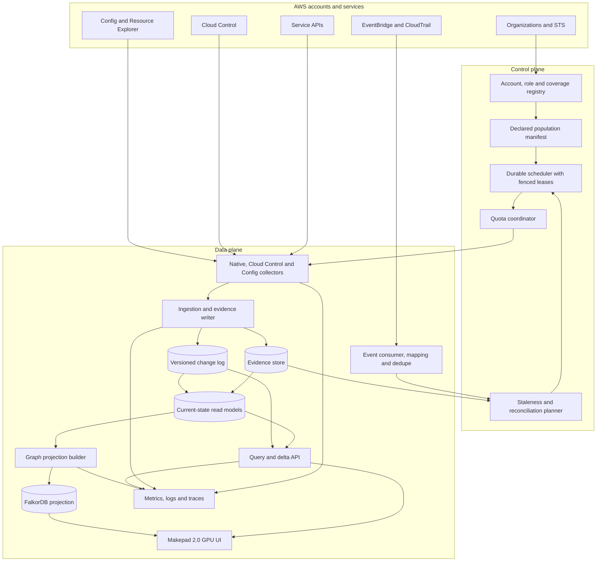
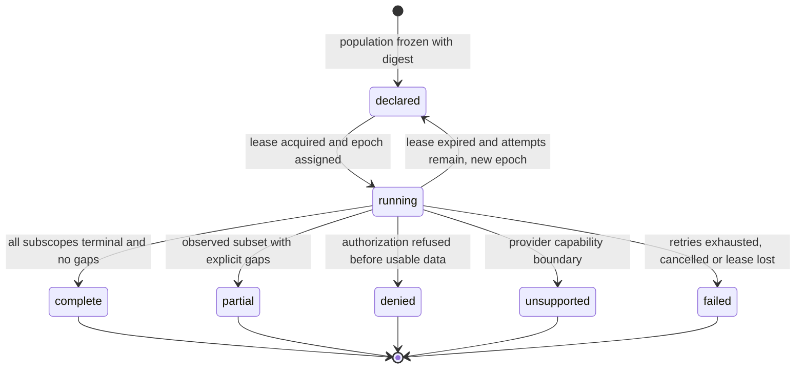

# Continuous CMDB target architecture

> Status: Plan (superseded draft). It is the earlier target architecture for a
> multi-tenant continuous service; the owner's decisions replace it wherever a
> passage is marked below with a decision ID, the unmarked data contracts remain
> reference detail, and it is replaced together with
> [ARCHITECTURE.md](ARCHITECTURE.md) by one document at ROADMAP M10.3. See
> [VISION](VISION.md) and [ROADMAP](ROADMAP.md).

This document specifies the service that the
[performance contract](CMDB_PERFORMANCE_CONTRACT.md) proposed to measure. It
does not assert that proposed components exist, that any candidate budget has
been met, or that the current tree is a deployed multi-tenant service.

Evidence labels used throughout:

- **Implemented** — behavior present in this tree, with the owning source cited.
- **In flight** — staged or being changed in the working tree on 2026-11-13, not
  in the baseline commit. The current tree contains additive schema migrations
  through `013_cloudcontrol_parent_additions.sql`, the account/coverage registry, freshness
  views, `cmdb-bench`, `cmdb-view`, and the Makepad `cmdb-ui` table/DAG.
  The obsolete loopback `cmdb-api` has since been removed (V32, M6.5).
  Treat the checkout as moving until these are committed and
  verified.
- **Proposed** — a contract or design with no accepted implementation evidence.

Unlabelled normative sentences in sections 2, 4, 5, 6 and 8 describe the target
contract. A sentence that describes existing behavior cites its source, and the
gap table in section 9 is authoritative when a component is partial.

The measured baseline is [CMDB_BASELINE_2026-11-13.md](CMDB_BASELINE_2026-11-13.md)
at source commit `57ee7de687be3f445a39bf2e2eb81807e5d68959`: three short runs of
local SQLite ingestion and mock scheduling. It establishes neither fleet
capacity, live AWS behavior, query latency, nor UI frame time. All performance
numbers in this document are candidate targets from `CMDB_PERFORMANCE_CONTRACT.md`,
not measurements.

Related contracts: [STORAGE.md](STORAGE.md) (SQLite schema, page atomicity,
selection), [DELIVERY.md](DELIVERY.md) (export, projection, jobs),
[SCHEDULER.md](SCHEDULER.md) (admission and retry), [DURABLE_JOBS.md](DURABLE_JOBS.md)
(leases), [DISCOVERY.md](DISCOVERY.md) (accounts and sources),
[EXPORT.md](EXPORT.md) (portable snapshots), [GRAPH_DELIVERY.md](GRAPH_DELIVERY.md)
(projection retries), and [ROADMAP.md](ROADMAP.md) (the build plan, which
replaces the stage sequence in section 8).

## 1. Components

> Superseded in part. The first version is one process on one laptop with no
> separate control plane and no multi-tenant service (V08, V09). Collection
> uses the service endpoint APIs through the wire engine, not Cloud Control
> (V01, V04). There is no versioned change log (V22), no query and delta API
> (V32: the Makepad app is planned to read SQLite and FalkorDB in process through
> `cmdb-view`; the obsolete `cmdb-api` has been removed under M6.5), and no event
> consumer (V10). The current architecture diagram is VISION section 5. The
> "current anchor" column below still describes the tree.

The target service separates a **control plane** that decides what must be
collected, by which credential, with which quota, from a **data plane** that
collects, persists evidence, derives current state, and serves read models. Only
the control plane may create collection intent. The query API and the UI are
readers; a user interaction must never enqueue a fleet-wide scan.



Controls, not shown as edge directions: the scheduler owns collection intent;
the quota coordinator owns admission; ingestion accepts only writes carrying a
current lease epoch; the projection is rebuildable and never authoritative.

| Component | Status | Current anchor | Target ownership or missing piece |
|---|---|---|---|
| Account, role and coverage registry | Proposed; discovery is implemented | `crates/aws/src/discovery.rs` (`ListAccounts`, `State == ACTIVE`, `MAX_DISCOVERED_ACCOUNTS = 100_000`, `AssumeRoleOptions`); `src/cli/collection.rs` | Persist account, OU path, partition, role ARN, external-ID reference, onboarding state and last verification. Current discovery is a per-invocation report, not a registry. |
| Declared population manifest | Proposed | `CollectionScope::key()` in `crates/core/src/lib.rs`; `scope_checkpoints` in `crates/engine/sql/001_inventory.sql` | Freeze the account × region × collector × selector population per cycle, with a digest. Current coverage is per emitted scope; a scope the collector never emits is invisible. |
| Durable scheduler | Implemented at whole-scan granularity; task granularity proposed | `crates/engine/src/jobs.rs`, `crates/engine/sql/jobs.sql`, `src/jobs/worker/`; profile input capped at 128 per invocation (`src/scan.rs`) | Transactional claims, bounded attempts, fenced lease acknowledgement, cancellation. Missing account/region/collector work items, fairness, priority, shared queue and per-scope leases. |
| Quota coordinator | Implemented process-local; distributed proposed | `crates/engine/src/limiter.rs`, `crates/aws/src/common/error_classification.rs` | Bucket keys `partition:account:region:service:quota-group`, pacing, AIMD feedback, server cooldowns, bounded retries. Missing cross-process coordination, quota discovery and per-account calibration. |
| Collectors | Implemented subset | `crates/aws/src/scan.rs`; native modules; `crates/aws/src/cloud_control/`; `crates/aws/src/supplemental/` | Native SDK reads for 39 kinds, Cloud Control for 421 reviewed types, Config and Resource Explorer ingestion. Missing EventBridge/CloudTrail consumption and per-collector durable resume across attempts. |
| Event consumer | Proposed | No event-bus dependency or consumer exists in this tree | Deduplicate `(source, event_id)`, map to identity/scope, coalesce, and enqueue targeted refresh through the scheduler. Never writes evidence or completes coverage. |
| Ingestion and evidence writer | Implemented | `crates/engine/src/store.rs`, `crates/engine/src/store/*.rs`, `crates/engine/sql/001_inventory.sql` through `013_cloudcontrol_parent_additions.sql` | Page-atomic observation/edge/checkpoint commits, SHA-256 page fingerprints, source provenance. Missing current-state materialization, change log, tombstones and retention. |
| Reconciler | Proposed; selection views exist | `latest_resources`/`latest_edges`; `Source::priority`; staged `crates/engine/sql/007_freshness.sql` | Cross-source selection and staged freshness-first latest views. Missing field-level provenance, staleness planner, absence evaluation and tombstones. |
| Read models and local queries | Read models implemented as SQL views; HTTP read API removed (V32, M6.5) | `crates/engine/sql/001_inventory.sql` views; `src/cli.rs` local `query`, `neighbors`, `path` | Store-backed `cmdb-view` reads are planned in M6.2; HTTP endpoints, authentication, authorization and delta feeds from the earlier draft are not first-version requirements. |
| Graph projection | Implemented as a replayable snapshot projection | `crates/engine/src/graph.rs`, `crates/engine/src/graph/projection.rs`, `crates/engine/src/store/graph_checkpoint.rs` | Idempotent Cypher `MERGE` batches, per-batch ACK log, retry classification. Missing incremental/versioned projection, stale-writer fencing and a rebuild marker tied to current-state versions. |
| Offline view model | Prototype | `crates/cmdb-view` parses one versioned JSON export into sorted resource pages, an adjacency index, LOD summaries and bounded neighborhoods; no network, database or clock I/O | Not connected to the store or to the UI; the former HTTP wrapper has been removed (V32, M6.5). Its limits are depth 2, 10,000 nodes, 20,000 edges, 2,000,000 resources and 5,000,000 edges parsed. |
| GPU UI | Table and DAG over a synthetic fixture | `crates/cmdb-ui` (`app`, `table`, `dag`, `graph_view`), Makepad 2.0 pinned in its `Cargo.toml` | Filter rail, virtualized table, detail rail and a hierarchical DAG with overlay edges. Missing in-process `cmdb-view` integration (M6.3), level of detail and a frame-time trace; the earlier draft's API client and versioned deltas are superseded by V32/V22. |
| Observability | Partial | `tracing_subscriber` in `src/main.rs`; per-scan summaries in `crates/engine/src/store/scan_state.rs` | Structured logs and scan outcomes only. Missing metrics/trace export, queue age, coverage lag, projection lag and API latency histograms. |
| Synthetic workload and oracle | Prototype | `crates/cmdb-bench` `workload` and `verify` | Deterministic per-account event generation and an independent digest/count oracle over JSONL, verified at 1M and 10M resources. Not yet wired into ingestion, CI or failure injection; see section 7. |

Invariants the target service must preserve:

1. **Evidence precedes views.** An observation is committed before any current
   state, delta or graph mutation derived from it is visible.
2. **Completion is scope-specific.** A successful account-wide scan does not
   imply complete coverage of every region, collector or resource type.
3. **No reader mutates collection intent.** UI and API reads cannot schedule
   fleet enumeration; scheduling is a separate authorized control action.
4. **Leases fence writes, not only acknowledgements.** The existing job queue
   fences a stale worker's terminal acknowledgement (`crates/engine/src/jobs.rs`);
   the target extends the epoch check to evidence and coverage writes.
5. **The graph is rebuildable.** FalkorDB is never the system of record and its
   loss must not change an inventory answer.
6. **Every clock is retained.** Provider, receipt and ingest times remain
   distinguishable; a local receipt time never becomes a provider timestamp.

## 2. Data contracts

Status: target contract. Each subsection states which parts are implemented,
staged or proposed; unlabelled rules are requirements for the target service.

### 2.1 Identity and keys

- **Resource identity**: `(partition, account_id, region, kind, provider_id)`.
  `Resource.id` is the authoritative ARN when returned, otherwise a
  partition/region/type/owner-derived identifier (`crates/core/src/lib.rs`,
  `docs/ARCHITECTURE.md`). The partition is currently inferred during discovery
  and is not a stored column; the target persists it because the same provider ID
  can recur across partitions.
- **Relationship identity**: `(from_id, to_id, relation)`. Source is evidence,
  not identity. Current SQL selection already groups edges by this triple, but
  the FalkorDB `MERGE` includes `source` in the relationship pattern
  (`crates/engine/src/graph.rs`), so one logical relationship can appear as
  parallel edges per source. The target keeps one relationship with a set of
  supporting evidence records; this is a projection/schema gap to close.
- **Scope identity**: current `CollectionScope { account_id, region, collector,
  parent_id, source }` serialized as JSON supplies `scope_key`
  (`CollectionScope::key`). The target adds `population_id`, `selector_digest`,
  `collector_version` and `epoch`. Canonical serialization and stable field order
  are required; separators inside identifiers cannot collide because the key is
  structured JSON.
- **Idempotency identities**: page replay uses
  `(scan_id, scope_key, page_number)` plus a SHA-256 digest of the validated page
  (`collection_pages.fingerprint`); event ingestion uses `(source, event_id)`;
  a target evidence row uses `(scope_epoch, observation_kind, provider_id,
  payload_digest)`.

### 2.2 Coverage state machine

A **declared unit** is one `(account, region, collector, selector)` entry in a
frozen population manifest, together with its expected permission set and
provider-capability expectation. A **coverage attempt** resolves one declared
unit. `complete` is a claim about that unit only: every page returned a terminal
response, no failure was recorded, and the collector's declared resource
population was enumerable.



Normative rules:

- `declared` freezes the population digest. A later account, region or type
  addition is a new population, not a silent extension of the old one.
- `running` always carries a fencing epoch and a lease owner. A write whose epoch
  is below the current attempt's epoch is rejected, not merged.
- `complete` requires a terminal page for every subscope, including successful
  empty scopes. An empty scope needs a terminal empty response; absence of a
  response is not emptiness.
- `partial` records which subscopes or fields are missing. A child denial may
  produce `partial` for the parent even when the parent's own pages completed.
- `denied` and `unsupported` are **resolved but not collected**. They must not
  make a scan report complete coverage, and they must never contribute to a
  deletion decision.
- `failed` includes operator cancellation and exhausted retry budgets. The
  current implementation keeps `cancelled` as a separate scan status; the target
  contract records it as `failed` with reason `cancelled`, retaining the
  distinction in the reason field.
- Terminal states are immutable. Re-running a unit creates a new attempt with a
  new epoch; old evidence and old coverage rows remain.

Current representation and the gap:

| Target state | Current representation | Gap |
|---|---|---|
| `declared` | None. Targets come from CLI arguments and discovery per invocation. | No persisted declared population or digest. |
| `running` | `scans.status = 'running'`; job attempt lease in the separate job database. | No per-unit lease or coverage-attempt epoch. |
| `complete` | `scope_checkpoints.complete = 1`, `failed = 0`; `scan_coverage.coverage_status = 'complete'`; scan status `complete`. | None for emitted scopes; undeclared scopes remain invisible. |
| `partial` | `finish_scan` downgrades a requested `Complete` to `Partial` when any scope is incomplete/failed or no scopes exist (`crates/engine/src/store/scan_state.rs`). | Missing subscope list and reason taxonomy. |
| `denied` | A `collection_failures` row with category derived from `ApiError::Denied`; scope marked failed. | Not a first-class state; cannot distinguish "all reads denied" from "one child denied". |
| `unsupported` | `unsupported_type` rows are retained but excluded from failure accounting by `accounted_category` in `scan_state.rs`, so a catalog drain can still finish complete while the unsupported count is visible. | Not a coverage state or declared-population dimension. |
| `failed` | `scope_checkpoints.failed = 1` with category and bounded message. | No retry/epoch linkage in the inventory database. |

The existing aggregate statuses are `running | complete | partial | cancelled`
(`scans` table). The target coverage API must return the per-unit states above,
not only the aggregate, because an aggregate `partial` cannot tell an operator
whether a region was denied, unsupported, or simply not selected.

### 2.3 Clocks and ordering

| Clock | Definition | Current evidence | Use |
|---|---|---|---|
| Provider time | When the provider says the represented configuration existed, or the provider's capture/report time | Config rows retain `configurationItemCaptureTime`; Resource Explorer retains `last_reported_at` in properties (`crates/aws/src/supplemental/`). Most direct SDK reads expose no provider timestamp. | Freshest-first comparison when comparable; age of authoritative observation. |
| Receipt time | Local time the response or event entered the collector process | Not stored separately. `now_millis()` at mapping time becomes `Resource.observed_at` (`crates/aws/src/common.rs`). | Transport and ingestion lag; duplicate/debounce decisions. |
| Ingest time | Time the evidence transaction committed | Not stored per observation; `scans.started_at`/`finished_at` are scan lifecycle times. | Durable version ordering; last-writer arbitration. |
| Last authoritative success | Ingest time of the most recent `complete` attempt for a declared unit | Absent. `scan_coverage` exposes per-scan scope completion only. | Staleness scheduling and absence eligibility. |

Rules:

- **Do not substitute clocks.** Receipt latency is not provider change latency.
  A cached Config record ingested now is not fresh now. The current
  `Resource.observed_at` is a single local clock used for precedence; the target
  schema keeps provider, receipt and ingest times separately so a query can state
  which basis its freshness uses.
- **Freshness** is `now - provider_time` when a provider timestamp exists,
  otherwise a lower bound `now - ingest_time` labelled `ingest_only`. The API
  returns `freshness_basis` for every item; it must not label an ingest age as a
  provider age.
- **Ordering** uses a monotonic store version (ingest sequence), never wall
  clock. Wall clocks remain for display, retention and provider comparison. Ties
  use the deterministic keys in section 2.5.
- **Future/skewed provider times** are retained raw and flagged when they exceed
  a declared tolerance. They must not silently become "newest" and win every
  conflict.

### 2.4 Absence and tombstone rules

> Superseded by V22: the first version stores no tombstones and no history.
> Deletion is still detected, after a resource is missing from two complete
> enumerations of its scope, and then the row and its edges are removed (VISION
> 5.5, ROADMAP M3.4). The conditions below on when absence may be concluded
> remain the reference.

Absence is a derived claim, never an inference from a missing row. A tombstone
may be created only when **all** of the following hold:

1. The resource identity was previously observed with valid evidence.
2. A frozen population manifest includes the identity's account, region,
   collector and selector.
3. Every declared unit that could enumerate the identity reached `complete`
   (not `partial`, `denied`, `unsupported` or `failed`) in the same cycle.
4. The enumeration was terminal and non-truncated for that population.
5. The provider's consistency model does not make the miss ambiguous. Where it
   does, the policy requires an additional complete cycle after a configurable
   grace window; the window is a policy input, not a constant.
6. No source with authoritative scope for the identity reports it as present.

The tombstone is itself an immutable observation with identity, `deleted_at`,
`reason`, `evidence_attempt_id`, `population_digest` and the successful scope
reference. Current state marks the identity deleted; the graph marks or removes
the node from the current projection; evidence remains readable.

Forbidden regardless of scan status: deleting on a failed/partial/denied/
unsupported scope, deleting when the account's role assumption failed, deleting
when the population changed, deleting because a Config aggregator's declared
scope omitted the account, and deleting because a provider returned an empty page
with a non-null token that was not followed.

Current behavior is explicit: no automatic tombstone or retention job exists.
`latest_resources` and `latest_edges` retain the last observation indefinitely,
and snapshot diffing deliberately does not claim deletion
(`docs/STORAGE.md`, `src/analysis/diff.rs`). The target adds tombstones; it does
not reinterpret existing absence.

### 2.5 Source-conflict policy

The canonical **current-state** selection is freshness-first with source
authority as tie-break. The staged schema-7 view policy is defined by migration
`crates/engine/sql/007_freshness.sql` and described in `docs/STORAGE.md`; it is
not in the baseline commit. `latest_resources` and `latest_edges` order by
`observed_at DESC, source_priority DESC, scan_id DESC, scope_key, page_number DESC`.
The richer provider-time and selection-reason algorithm below remains proposed.
Snapshot views deliberately keep priority-first selection so per-scan exports and
summaries stay reproducible.

The staged schema-7 implementation's freshness key is `observed_at`, the local
timestamp assigned while the adapter maps a response. It orders observations by
when this process saw them, not by when the provider's state changed. Migration
007 therefore prefers the most recently **observed** row and uses
`source_priority` only for equal timestamps. That is a receipt-clock ordering and
must not be reported as provider-to-CMDB freshness. The clock contract in section
2.3 exists to remove that ambiguity.

Selection algorithm for one identity:

1. Validate candidate observations: source, identity, scope completion and
   payload validity.
2. Compare provider times when both sources expose comparable clocks. The
   greatest provider time wins.
3. If one or both provider clocks are absent or known to be incomparable, compare
   observation times when both are available, then fall back to source priority:
   direct `4`, Cloud Control `3`, Config `2`, Resource Explorer `1`
   (`Source::priority` in `crates/core/src/lib.rs`).
4. If provider times are equal, use the same priority order.
5. If priority is equal, use the deterministic order: descending `scan_id`,
   ascending `scope_key`, descending `page_number`. Arrival order never decides.
6. Record the selected evidence ID and a `selection_reason` such as
   `freshest_provider_time`, `freshest_observation_time`,
   `priority_incomparable_clock`, `priority_tie` or `deterministic_tiebreak`.

The selected representation and all alternative evidence remain queryable;
`latest_resource_sources` keeps each source's newest observation. Priority alone
never implies freshness: the API exposes `source`, `provider_time`, `ingest_time`
and `selection_reason`.

Snapshot views (`scan_resources`, `scan_edges`) keep
`source_priority DESC, observed_at DESC, scope_key, page_number DESC` so a
snapshot prefers the most authoritative source and remains byte-reproducible.
This exception must be documented in responses that use snapshot semantics.

Field-level reconciliation is **proposed**, not implemented. It is permitted only
when identity and payload compatibility are established and every field carries
its own provenance; a hybrid object must never claim a single source. Until then,
selection operates on whole observations.

### 2.6 Retries, idempotency and lease epochs

- **Attempt** = one executor-admitted API call. SDK-internal retries are
  disabled for inventory calls so the outer executor owns accounting; retryable
  classes are `Throttled`, `Transient` and `Timeout`; `Denied`, `Permanent`,
  `UnsupportedType`, `Cancelled` and invalid directives are terminal
  (`crates/engine/src/limiter.rs`, `docs/SCHEDULER.md`).
- **Lease** = `(job_id, attempt, owner, token, expiry)` for whole-scan work
  (`crates/engine/src/jobs.rs`, `crates/engine/sql/jobs.sql`). A heartbeat and a
  terminal acknowledgement must match all four and an unexpired lease. Expiry is
  a hard boundary.
- **Epoch** (target) = a monotonically increasing fencing token per scope. Every
  evidence, coverage and outbox write carries `epoch`. A write with an older
  epoch is rejected with a conflict; it is never applied because "the data is
  probably fine". This closes the current gap where the job queue fences only its
  own acknowledgement and the inventory database is a separate transaction
  domain (`docs/DURABLE_JOBS.md`).
- **Idempotency**: exact page replay is a no-op after commit, including after
  finalization; the same page identity with different content is a conflict.
  Target event and evidence writes use the same digest-check pattern. The effect
  is at-least-once with idempotent persistence; no exactly-once claim is made
  across a process failure, and a crash after commit but before acknowledgement
  is resolved by replay.
- **Retry budget**: the executor has a static ceiling of ten attempts and the
  queue a ceiling of 32 attempts per job; backoff is bounded exponential with
  full jitter, and server directives extend a shared bucket cooldown. A retry
  never creates a new coverage epoch; only an expired lease, explicit reschedule
  or operator action does.

Write protocol (target): claim unit with epoch → collect pages → commit evidence
+ coverage attempt + change-log outbox in one transaction → acknowledge lease.
The acknowledgement follows the commit; the reverse order would claim durability
that the store has not established.

### 2.7 Deletion and retention

> Superseded by V22: no change log, no tombstones and no retention in the first
> version. The store holds current state only. History and retention are listed
> under "After 1.0" in the roadmap.

The target current-state model has three lifecycle values: `present`, `deleted`
(only via a valid tombstone) and `unknown` (no complete observation within the
freshness horizon).
`unknown` is not deletion.

Retention separates immutable evidence from derived current state:

| Data | Candidate starting point | Rule |
|---|---|---|
| Raw evidence | 30–90 days hot, older cold/archived | Deletion requires an explicit policy and a backup/restore exercise; never by an opportunistic scan. |
| Current state | Indefinite for live identities | Derived and rebuildable from evidence plus tombstones. |
| Change log / deltas | 7–14 days | Bounded by API cursor lifetime; expired cursors return a resync requirement. |
| Coverage and failure records | 1 year | Operational and audit evidence; bounded by account count. |
| Tombstones | 90–365 days | Prevent resurrection by stale evidence; longer than the evidence horizon. |
| Graph projection | Rebuildable | Never retained as the only copy. |

These are **proposed starting points for measurement**, not commitments. The
performance contract requires retention cost to be measured (disk growth, query
effect, rebuild time) before a policy is accepted. There is no automatic
retention today; the queue also has no retention cleanup and stops at 10,000
retained jobs (`docs/DURABLE_JOBS.md`).

Hard deletion, backup, restore and legal-hold semantics are out of scope for the
current local tool and must be specified before any production rollout.

## 3. Storage plan

Status: the single-host SQLite mode is implemented; the shared PostgreSQL
evaluation and the target logical schema are proposed.

### 3.1 Current SQLite mode (implemented, retained for local use)

`crates/engine/src/store.rs` opens one writer and one query-only reader with WAL,
`synchronous=FULL`, foreign keys, a five-second busy timeout, and an 8 MiB page
cache target. Each collection page commits resources, edges, scope checkpoint and
page fingerprint in one `BEGIN IMMEDIATE` transaction; batches are bounded to
128 rows. The baseline commit uses schema version 6; the current working tree
installs migrations through 13 (freshness views, coverage registry, native views
and the final parent views), and the store accepts versions 0–13. Migration is
transactional and rejects unsupported versions and foreign application IDs.

Current bounds relevant to any scaling claim: 16 MiB page JSON, 10,000 resources
and 100,000 edges per page, 2 MiB per stored record, 10,000 interactive query rows
and 8 MiB query JSON. The preliminary baseline measured 765–1,646 resources/s
for one-resource transactions and 17,280–34,904 resources/s for 100-resource
batches, three short runs on a shared host. Those numbers are not a throughput
target; they show why bounded page batching is retained.

SQLite is sufficient for one local writer and one reader with bounded readers.
It is not a shared control store: there is no cross-host lease, no multi-writer
failover, and a single writer serializes ingestion. Do not describe the current
job queue as a distributed scheduler.

### 3.2 PostgreSQL evaluation gate (proposed, before any other database)

> Superseded by V05 and V08: PostgreSQL is not a near-term gate. SQLite in WAL
> mode is the store on one laptop; PostgreSQL or DuckDB is added only when a
> measurement shows SQLite is the limit (the sweep benchmark, ROADMAP M4.4).

Before adding a second database engine, evaluate PostgreSQL as the shared
control and observation store with the same workload and oracle:

- Write throughput and p95/p99 ingest commit latency for evidence + current-state
  + outbox in one transaction, at 1M and 10M asset fixtures.
- Behavior with multiple concurrent writers and a failing writer; lease
  correctness under transaction retry and serialization failure.
- Query latency for the frozen lookup/filter/one-hop suite, including rows
  examined and plan stability after `ANALYZE`.
- Index build cost, bloat, vacuum/autovacuum behavior, and partition maintenance.
- Backup/restore time and point-in-time recovery, measured on the target volume.
- Operational cost and failure modes compared with the current single-host mode.

A decision record must cite measured evidence. "PostgreSQL is standard" is not
evidence. If evaluation fails a required invariant, the correct outcome is to
keep SQLite local and narrow the deployment claim, not to hide the failure.

The evaluation must reuse the store contract tests (`crates/engine/tests/store.rs`,
`store_properties`, `migrations`, `scan_lifecycle`) where semantics apply, and
must define the SQL dialect boundary explicitly. The current SQL uses SQLite
`json_extract`, `STRICT` tables and `PRAGMA`; these are not portable and cannot
be assumed to translate.

### 3.3 Target logical schema (proposed)

> Superseded by V05, V22 and V24: the schema of the first version is generated
> from the API catalog, one table per resource kind with typed columns and the
> binary record, created fresh as version 14 (ROADMAP M3.2). It has no
> tombstone, change-log or evidence-history tables.

| Table | Purpose | Key columns and constraints |
|---|---|---|
| `accounts` | Onboarding and credential registry | `account_id PK`, partition, org/OU path, `state`, role ARN, external-ID secret reference, `last_verified_at`, `onboarding_state`. |
| `populations` | Frozen declared populations | `population_id PK`, `digest`, declared account/region/collector selector set, `declared_at`, `frozen_by`. |
| `coverage_attempts` | One attempt per declared unit | `attempt_id PK`, population, account, region, collector, selector digest, `epoch`, `state`, lease owner/token, start/finish, failure class, provider request count. |
| `resource_evidence` | Append-only observations | `evidence_id`, identity, source, `provider_time`, `receipt_time`, `ingest_time`, `attempt_id`, `epoch`, payload, `payload_digest`. Unique on `(scope_epoch, identity, digest)`. |
| `edge_evidence` | Append-only relationship observations | Same clocks and provenance; edge identity plus evidence ID. |
| `resource_current` | Selected representation | Identity PK, `evidence_id`, lifecycle, `provider_time`, `ingest_time`, `version`, `selection_reason`. |
| `edge_current` | Selected relationship | Edge identity PK, supporting evidence IDs, lifecycle, version. |
| `tombstones` | Explicit absence evidence | Identity, `deleted_at`, reason, `attempt_id`, population digest, successful scope reference. |
| `change_log` | Ordered deltas | Monotonic `version` PK, identity, operation, versioned payload reference, ingest time. |
| `projection_outbox` / `projection_cursor` | Durable graph work | Batch ID, identity/version, digest, acknowledged cursor, destination. |
| `quota_buckets` / `quota_leases` | Shared admission state | Bucket key, configured and adaptive rate, concurrency, cooldown, owner lease. |
| `auth_audit` | Query/control audit | Principal, action, scope filter, result count, latency, timestamp. |

`resource_evidence` and `edge_evidence` are partitioned by ingest day and, at
scale, by account bucket. `change_log` is the only ordering authority for delta
consumers; current-state version must be assigned in the same transaction as the
evidence that changed it.

### 3.4 Immutable evidence versus current state

The write path is: evidence insert + coverage update + change-log outbox commit
atomically; a separate projector applies the outbox to current state and graph
projection. Current state is a materialized, rebuildable function of evidence and
tombstones. Rebuild must be exercisable without recollection and compared against
the live projection by identity set, field digest, edge set and version.

The current SQLite schema does not have this split: `latest_resources` recomputes
selection over all observations with window functions. That is correct but scans
history on every read and has no incremental current-state or delta table. The
target materializes current state only after the selection policy and tests are
stable; materializing an unstable policy would freeze a bug.

### 3.5 Index plan for the query API

Current indexes cover identity/source/time and scan lookups
(`resource_observation_identity`, `resource_observation_scan`,
`resource_observation_kind`, `edge_observation_identity`). The target adds,
subject to `EXPLAIN` evidence from the frozen query suite:

- `resource_current(account_id, region, kind, id)` for scoped list filters.
- `resource_current(kind, id)` and a unique identity index for detail lookups.
- A JSON/tag equality index (PostgreSQL GIN on the selected tag object; SQLite
  expression index only if measurements justify it) for tag filters.
- `change_log(version)` and `(account_id, version)` for resumable deltas.
- `coverage_attempts(account_id, region, collector, state, finished_at)` for
  coverage and freshness pages.
- `edge_current(from_id, relation, to_id)` and `(to_id, relation, from_id)` for
  one-hop bounded neighborhoods.
- Optional name search index only after a measured query pattern exists; do not
  add a trigram index speculatively.

Every list query must report rows examined and returned. A p95 target without the
work metric is not comparable across data distributions.

### 3.6 FalkorDB projection

Current projection exports a finalized scan as bounded Cypher batches, uses
idempotent `MERGE`, commits a local ACK only after server confirmation, and
retains progress across retries. The node key includes the scan, so a projection
is snapshot-scoped; the graph contains an `InventoryScan` marker.

Target projection is derived from current state plus a projection version:
nodes carry identity and `version`, edges carry relation and supporting evidence,
stale-version batches are rejected in the same way stale lease epochs are, and a
rebuild command reconstructs from evidence. The UI must be able to show a
projection lag and a rebuild state; it must not infer inventory completeness from
node counts. The current graph `MERGE` keying edges by source (section 2.1) is a
known divergence to resolve before the graph is used as a relationship read model.

### 3.7 Migration and version policy

- **SQLite**: forward-only numbered migrations in `crates/engine/sql/`, applied
  in one `BEGIN IMMEDIATE` transaction with `PRAGMA user_version`, foreign keys
  disabled only inside the rebuild window and verified before publication.
  Unknown versions and foreign application IDs fail closed. Version 7 is present
  in the working tree and upgrades version 6 by replacing the two latest views;
  it does not rebuild observations. Preserve caller views/indexes/triggers;
  schema changes must be expand/contract, never a silent destructive rewrite. Existing migration tests (`crates/engine/tests/migrations.rs`,
  `catalog_upgrade.rs`, `parent_catalog_upgrade.rs`) are the executable policy.
- **PostgreSQL** (if accepted): transactional DDL, lock timeouts, expand/contract
  with a dual-read window, and a tested rollback/restore. Migration version is
  exposed by the service.
- **API**: every response carries `schema_version` and, for state reads, the
  `as_of_version` used. Additive fields are minor; removing or changing a field
  requires a new version and a deprecation window.
- **Events and graph plans**: both are versioned formats (`EXPORT.md` version 1,
  `graph_batch_schema_version`); consumers reject unknown versions rather than
  guessing.

## 4. Query API contract

Status: **superseded by V32**. There is no HTTP read API in the first version.
The Makepad app is planned to read SQLite and FalkorDB in process through
`cmdb-view` (ROADMAP M6.2, M6.3). Today `cmdb-view` parses one JSON export and
the UI renders a synthetic fixture. The former loopback `cmdb-api` has been
removed under M6.5, including its direct `axum`, `tower` and `tower-http`
workspace declarations; unrelated transitive dependencies remain. The tenant, authentication and
authorization rules in 4.4 belong to a multi-tenant deployment that is not
planned (V08), and the delta feed to a change log that is not kept (V22). The
contract below is kept as a record of the earlier draft; an HTTP read API is
listed under "After 1.0" in the roadmap.

### 4.1 Resource list

`GET /v1/resources`

| Parameter | Type | Bound / behavior |
|---|---|---|
| `account_id` | string, repeatable | At most 16 values; exact match. |
| `region` | string, repeatable | At most 16 values; exact match. |
| `kind` | string, repeatable | At most 32 values; normalized kind. |
| `source` | enum, repeatable | `direct`, `cloud_control`, `aws_config`, `resource_explorer`. |
| `tag` | `key=value`, repeatable | At most 8; server-side equality on selected tags. |
| `name_prefix` | string | At most 256 bytes; index-backed only if measured, otherwise bounded scan within the account/region filter. |
| `lifecycle` | `present`/`deleted` | Defaults to `present`; deleted items require explicit opt-in. |
| `changed_since_version` | integer | Deltas only; requires `order=version`. |
| `as_of_version` | integer | Snapshot read; rejected if outside retained version window. |
| `limit` | integer | 1–1,000; default 100. |
| `cursor` | opaque string | Keyset cursor; deterministic order `(sort_key, id)`. |
| `sort` | enum | `id`, `name`, `provider_time`, `ingest_time`, `version`; default `id`. |

The server applies all filters and pagination. A client cannot request an
unbounded result, a raw SQL predicate, or a fleet-wide aggregation. The response
returns coverage gaps and freshness for the returned set; it does not silently
omit accounts the caller is unauthorized to see.

### 4.2 Response envelope

```json
{
  "schema_version": 1,
  "as_of_version": 184203,
  "generated_at": "2026-11-13T12:00:00Z",
  "coverage": {
    "complete": false,
    "gaps": [
      {"account_id": "123456789012", "region": "us-east-1", "collector": "ec2", "state": "denied", "attempt_id": "..."}
    ]
  },
  "items": [
    {
      "id": "arn:aws:ec2:us-east-1:123456789012:instance/i-...",
      "account_id": "123456789012",
      "region": "us-east-1",
      "kind": "aws_ec2_instance",
      "name": "web-1",
      "source": "direct",
      "provider_time": "2026-11-13T11:59:58Z",
      "ingest_time": "2026-11-13T12:00:00Z",
      "freshness_basis": "provider",
      "lifecycle": "present",
      "version": 184203,
      "selection_reason": "freshest_provider_time"
    }
  ],
  "next_cursor": "opaque",
  "limits": {"limit": 100, "returned": 100, "truncated": true}
}
```

`provider_time` may be `null`; then `freshness_basis` is `ingest_only` and the
client must not present it as the age of the provider state. `coverage.complete`
applies only to the requested scope; it is not "the fleet is complete".

### 4.3 Other endpoints

| Endpoint | Contract |
|---|---|
| `GET /v1/resources/{id}` | One identity with selected representation, all source evidence references, lifecycle, version and freshness. Deleted identities require `include_deleted=true` and return tombstone evidence. |
| `GET /v1/resources/{id}/neighborhood` | Bounded graph neighborhood. `depth` 1–2, `max_nodes` ≤ 10,000, `max_edges` ≤ 20,000, `relations` allowlist. The prototype `cmdb-view` uses these same ceilings (`MAX_GRAPH_DEPTH`, `MAX_GRAPH_NODES`, `MAX_GRAPH_EDGES`). The UI requests at most the 5,000-node/20,000-edge rendering budget. Returns `truncated`, `frontier_count` and unresolved placeholder identities; never silently drops edges. |
| `GET /v1/coverage` | Per declared unit: state, attempt, epoch, start/finish, failure class, provider request count, last authoritative success. Filters by account/region/collector/state; paginated. |
| `GET /v1/freshness` | Aggregate freshness and lag over a declared scope. Returns counts and quantiles only when sample count is sufficient; includes the basis and clock uncertainty. |
| `GET /v1/deltas` | Change log from `since_version`, ordered by version, bounded 1–10,000 records. Returns `next_version`, `has_more`, tombstone operations, and `resync_required` if the window expired. |
| `GET /v1/schema` | Resource kinds, selected fields, source availability and collector coverage levels. Not a raw provider schema dump. |

### 4.4 Authentication, authorization and cost

- **Authn**: OIDC bearer tokens for humans; short-lived service credentials for
  the UI. No anonymous access and no credentials in URLs.
- **Authz**: claims carry tenant and allowed account/region scopes. The server
  injects the scope predicate into every query; client-supplied filters only
  narrow it. Unauthorized identities return `403` or an omitted result set with
  an explicit `authorization_filtered` count; they never appear as empty
  inventory.
- **Audit**: every control action and every broad query records principal,
  filters, returned rows, latency and rows examined. This is required to detect a
  UI path that accidentally triggers full scans.
- **Cost control**: per-request row and time budgets, a maximum cursor depth, no
  arbitrary SQL endpoint, and no server-side aggregation over unindexed history.
  A request that exceeds its budget fails explicitly with `409`/`429`; it does not
  return a truncated success.
- **Consistency**: list/detail read a versioned snapshot. `as_of_version` older
  than the retained current-state history returns `410` with a resync
  instruction.
- **Rate limits**: separate limits for reads, deltas and control actions. A
  stalled UI must not retry a fleet query.

## 5. UI contract

Status: a Makepad table and DAG exist in `crates/cmdb-ui` and render a
synthetic fixture; nothing reads real data yet and no frame-time claim is
supported. The UI stays a native Makepad 2.0 application (V17). Superseded by
V32 and V22: it calls `cmdb-view` in process instead of the `/v1/...`
endpoints named below, there is no versioned delta feed, and it shows and
does not edit (V16). ROADMAP M6.3 is the package; V28 fixes the opening view
as account, region, service, resources.

### 5.1 Shape

The primary view is a **virtualized table**; the graph is a bounded secondary
view. In service mode both read from the same versioned API and display
`as_of_version` and freshness. The UI never reads SQLite or FalkorDB directly and
never issues a collection command in response to scrolling, filtering or graph
expansion. `crates/cmdb-view` is an offline prototype that parses one portable
export into a bounded read model; it is not the service API and provides no
freshness or authorization semantics.

- Table: typed columns from `/v1/schema`, server-side filter/sort/pagination,
  row cache keyed by identity and version, stable selection across page loads.
- Graph: root/identity search, bounded neighborhood request, explicit
  `truncated`/`frontier_count` display, relation filter, breadcrumb history.
- Detail: selected representation plus provenance list and freshness basis;
  deleted items clearly marked with tombstone evidence.

### 5.2 Rendering and data-path requirements

- **Typed buffers**: pack node/edge attributes into structure-of-arrays GPU
  buffers, update only changed ranges, and keep an identity-to-index map off the
  render path.
- **Instancing and batching**: batch edges and nodes by draw state; avoid one
  widget or draw call per node. The Makepad performance contract is a GPU surface
  redrawn per frame, not a retained DOM.
- **Level of detail**: aggregate by account, kind or region above a visible-node
  threshold; drop labels before geometry; cap total rendered nodes and edges to
  the declared budget and state the cap.
- **Off-main-thread layout**: compute force/radial/hierarchical positions on a
  worker; publish generations with a monotonic ID so stale layout results are
  discarded. The main thread uploads buffers and paints; it does not run an
  unbounded graph simulation.
- **Versioned deltas**: apply `/v1/deltas` from the last applied version; if the
  gap exceeds the retained window, refetch only the visible window and mark the
  view as resynced. Never reload the fleet graph to apply one change.
- **No per-frame allocation or redraw**: redraw on data, viewport or animation
  state change only; allocation-free steady-state pan/zoom is the target.

### 5.3 Performance budgets

From the accepted performance contract, as **candidate targets to validate**:

- p95 frame time under 16.7 ms during scripted pan/zoom on a bounded
  5,000-node/20,000-edge view.
- Initial useful view under 2 seconds on a declared client and network.
- API list/detail p95 under 250 ms for the frozen indexed suite at 10 million
  synthetic assets; this is an API budget, not a frame budget.
- Change visibility p95 under 5 seconds receipt-to-query-visible at the declared
  steady workload, measured separately from provider delivery delay.

> The five-second change-visibility target is deferred by V10: freshness in the
> first version comes from repeated full sweeps on an interval the user sets.
> The API budget is void with the API (V32).

The UI must expose measured lag and drop frames rather than blocking the main
thread. If the client cannot meet the budget, it degrades the visible window and
states the degradation.

### 5.4 Huge-graph and accessibility fallback

Every graph view has a table/list equivalent. Above the node/edge budget the UI
shows aggregated clusters with counts and an explicit "aggregated" indicator;
selecting a cluster opens its bounded table. Truncation is never silent.

Makepad draws its own controls and its accessibility support is a known gap; do
not claim screen-reader or native accessibility without an implemented and tested
path. The accessible interface is therefore the table/detail view plus keyboard
navigation and text summaries, with platform integration evaluated separately.
The graph is an enhancement, not the only way to read inventory state.

### 5.5 Failure behavior

If the API is unavailable, the UI may show the last applied version with its age
and a stale badge. It must not synthesize current state from the graph, retry a
fleet query, or hide coverage gaps. Authentication expiry returns to sign-in
without discarding the last safe read-only snapshot.

## 6. Event and Config reconciliation

Status: Config and Resource Explorer ingestion is implemented; EventBridge and
CloudTrail consumption and the reconciliation loop are proposed.

> Superseded by V10 and V12: change events are added later and only say what to
> re-read; the first version has no event consumer. Config, Resource Explorer
> and CloudTrail may supply hints and cross-checks, and every stored fact comes
> from the service's own API (tags excepted, V31).

### 6.1 Config aggregator prerequisites

AWS Config data exists only where a recorder is enabled for the account/region
and the relevant resource types, and is visible to a CMDB only through an
aggregator whose source accounts/regions include the target and whose
authorization permits the caller. Discovery already enumerates existing
aggregators with `DescribeConfigurationAggregators`, rejects ambiguous or
incomplete candidates, and retains declared scope and filters
(`crates/aws/src/discovery.rs`, `docs/DISCOVERY.md`). It does not create
recorders, aggregators or indexes.

Reconciliation must therefore treat Config as a **source with declared scope**:
its absence of a resource is not absence from AWS, its capture time is not the
query time, and its aggregator's account/region list defines what it can answer.
A Config record can be newer than a direct API observation, which is exactly why
the staged schema-7 current-state selection is freshness-first (section 2.5).

### 6.2 EventBridge and CloudTrail caveats

The proposed event path consumes CloudTrail management events and selected
service events through EventBridge rules and cross-account event buses. It is
subject to:

- **At-least-once, best-effort delivery** with duplicate and out-of-order events;
  EventBridge documents delivery levels and retries, not a total order.
- **Coverage gaps**: CloudTrail records management events by default but data
  events are opt-in; some services and global endpoints have their own delivery
  behavior. Events are not a complete inventory feed.
- **Latency and batching**: delivery delay is provider-controlled and must be
  measured separately from receipt-to-query visibility.
- **Identity ambiguity**: an event may identify an ARN, a request ID or only a
  resource type; an event that cannot be mapped to a stable identity triggers a
  scoped refresh, not a synthetic resource.
- **Authorization changes**: an event may arrive from an account whose role is
  no longer assumable; the failure is coverage evidence, not an empty account.

Events are **signals**, never state truth and never completeness evidence. An
event can schedule a targeted refresh; only a terminal successful enumeration can
mark a unit complete or support a tombstone.

### 6.3 Reconciliation loop (proposed)

1. **Normalize and deduplicate** by `(source, event_id)`, retaining receipt time
   and the provider event time when present.
2. **Map** to one or more identities and to the narrowest scope that can
   enumerate them. If mapping is ambiguous, enqueue the scope enumeration.
3. **Coalesce** per identity/scope with a bounded debounce window; cap concurrent
   refreshes per account and global budget. An event storm must not create one
   task per event.
4. **Collect** through the same collector and quota path as scheduled work. No
   separate event-only API path bypasses admission.
5. **Persist** evidence and advance current state atomically; update the change
   log.
6. **Periodic reconciliation**: a staleness planner schedules full re-enumeration
   at a per-collector/type maximum age, using last authoritative success, not the
   last event. Event-driven refreshes do not reset the full-scope clock.
7. **Absence evaluation** runs only after the periodic complete sweep, under the
   rules in section 2.4.

Config and Resource Explorer feeds are inputs to steps 1–3 with their own
capture-time clocks; they can reduce API work, but a Config snapshot does not
make an account complete.

## 7. Failure model and test matrix

Status: the matrix is proposed; the "Current coverage" column cites only tests
and behavior that exist.

The oracle is independent of the implementation: `crates/cmdb-bench workload`
generates a deterministic population, per-account resources/edges, optional
deletion bursts, duplicate/reordered events and an `oracle.json` digest;
`verify` recomputes counts, kinds, regions, per-account aggregates, deletion
records and the digest from `events.jsonl`/`deletions.jsonl` without using the
store or collector. Status: prototype; it is not yet connected to ingestion, the
fault harness or CI, and it does not prove any target budget.

Every scenario asserts the same core invariants: no accepted evidence is lost, no
unobserved identity is deleted, coverage states remain truthful, duplicate
delivery is idempotent, and a stale epoch cannot mutate current state.

| Failure | Injection point | Required behavior | Oracle assertion | Current coverage |
|---|---|---|---|---|
| Crash/restart before commit | Kill process during page write | Page, checkpoint and evidence absent; retry starts cleanly | Final identity/edge set equals oracle; no partial coverage claim | Page rollback/cancellation tests exist (`crates/engine/tests/store.rs`, `store::cancellation_tests`) |
| Crash/restart after commit before ack | Kill after SQLite commit, before job ACK | Replay of the same page is a no-op; no duplicate evidence | Counts and digest unchanged; attempt remains recoverable | Page replay implemented; job queue is a separate database, so cross-database ambiguity is explicit and at-least-once |
| Duplicate page/event | Deliver the same page or event twice | Digest match → no-op; different content under same identity → conflict | Same resource/edge counts; no duplicate change records | Page duplicate handled; event path absent |
| Expired lease while writes in flight | Pause worker past lease expiry; resume | Old worker cannot write evidence or ACK; new epoch owns the unit | No write with stale epoch appears; final state matches one attempt | Queue fences ACK only; inventory writes are not epoch-fenced (gap) |
| Throttling / retry storm | Emulator 429s with and without delay hints | Bounded retries, shared cooldown, AIMD recovery, no unbounded queue | Attempt/success/failure counts bounded; coverage may be `partial`, never empty success | Implemented and tested in `crates/engine/tests/limiter.rs`; fleet-wide contention unmeasured |
| Expired credentials | Expire SSO/assume-role mid-run | Provider refresh or explicit failure; no empty inventory | Coverage `denied`/`failed`; prior evidence retained | Assume-role provider refresh exists (`docs/DISCOVERY.md`); no fleet re-auth test |
| Access denial | Deny one child list or a whole account | Denial recorded; sibling successes survive; parent becomes `partial` | Parent observations retained; denied scope visible; no deletion | Failure categories and partial scan status implemented; first-class state absent |
| Slow disk / fsync stall | Delay filesystem or fill disk | Backpressure or explicit failure; no acknowledgement before commit | No accepted evidence lost; coverage honest; no silent truncation | `synchronous=FULL` and bounded queues; no injected disk-latency test |
| Disconnect / transport timeout | Drop connection after server processed request | Retry only recognized idempotent work; timeout bounded; no infinite loop | No duplicate graph nodes/edges; evidence replay safe | Projection retry classification implemented (`crates/engine/src/graph.rs`) |
| Stalled projection | Stop FalkorDB after inventory commit | Inventory and export remain complete; projection marked lagging/partial; retry resumes | Graph rebuild from evidence matches expected edges; inventory answer unaffected | Delivery status separate from collection (`docs/DELIVERY.md`); no lag monitor |
| Partial or empty scopes | Omit a region, deny a type, return terminal empty page | `partial`/`denied`/`unsupported` retained; empty success only for terminal empty enumeration | No tombstone; gaps enumerated; identity set is a subset with reasons | Scan aggregation and covered empty scope implemented; no tombstones |
| Token cycle / repeated page | Return a repeated continuation token | Scope fails explicitly; no infinite pagination | Bounded pages; failure visible; no duplicate resources | Implemented in page sequence/token validation |
| Clock skew / future provider time | Inject skewed Config/Explorer timestamps | Raw time retained and flagged; ordering does not thrash | Selection stable and explained; freshness basis explicit | Not implemented; current single `observed_at` cannot express it |
| Cross-process quota exhaustion | Run two workers against one account | Shared coordinator or explicit ownership prevents over-admission | No unfettered request-rate growth; throttles bounded | Process-local executor only; gap |
| Stale evidence resurrection | Replay old evidence after a tombstone | Old version loses to tombstone/current version; no resurrection | Final lifecycle remains deleted; evidence still auditable | No tombstone/version model; gap |

Test layers required before any capacity claim: unit/property tests for selection
and idempotency, store integration tests against the real engine, fault injection
in the deterministic workload, live-emulator end-to-end tests, and only then an
authorized real-account trial. The existing emulator snapshot suite and harness
(`crates/harness`) cover collector fixtures; they do not cover fleet recovery.

## 8. Staged delivery plan

Status: proposed sequence. C0 has partial groundwork (contracts, baseline,
workload prototype); no later stage is delivered.

> Superseded by [ROADMAP.md](ROADMAP.md) (M0 to M10), which is the only build
> sequence. Of the stages below: tombstones and retention in C2 are out (V22);
> the query API, delta feed and authorization in C3 are out (V32, V08); the
> event consumer in C4 is deferred (V10); the PostgreSQL evaluation in C5 waits
> for a measurement (V05); the 100 to 1,000 account rollout in C7 and the fleet
> campaigns in C8 are deferred, the first version being proven on about 10
> accounts (V09). Head-to-head runs are ROADMAP M5.6 and M10.2 (V19).

Each stage has a measurable exit gate. A later stage may start only when the
earlier gate is evidenced, not when its code compiles. Candidate performance
numbers remain targets until measured on a declared workload.

| Stage | Scope | Exit evidence | Blocked by |
|---|---|---|---|
| **C0 — Contracts and oracle** | Accept identity, ordering, freshness, absence and failure contracts; finish the deterministic workload/oracle; freeze query and workload manifests | `cmdb-bench` wired into a repeatable test path; oracle verifies identity/edge/field/count invariants on generated populations; contract documents reviewed against code | Oracle exists and verifies 1M/10M generated workloads; integration with ingestion/CI and fault injection remain |
| **C1 — Single-host vertical slice** | Accounts registry, frozen population, task-level durable scheduler, in-process quota coordinator, one complete collector path, evidence store, coverage/freshness read model | One account/region slice produces explicit complete/partial/denied/unsupported per unit; crash and replay preserve evidence; oracle matches; no fabricated absence | Registry, coverage/freshness read models and collector path exist; population manifest, per-unit epoch and crash/oracle integration remain; live AWS is not required |
| **C2 — Recovery and deletion proof** | Epoch-fenced writes, expired leases, duplicate delivery, tombstones, retention policy | Failure matrix rows for crash/duplicate/expired lease/partial scope pass deterministically; no false tombstone under denial or partial; retention cost measured | Requires C1 schema and oracle |
| **C3 — Read models and query API** | Bounded resource/detail/neighborhood/coverage/freshness/delta endpoints over indexed read models, monotonic change log, authn/authz, server-side cost budgets; materialization decision deferred to C5 | Frozen query suite at 1M and 10M assets reports p50/p95/p99 with rows examined; unauthorized scopes filtered; no request can trigger collection; cursor and as-of boundaries tested | Historical stage, superseded by V32/V08: the HTTP API has been removed (M6.5); the bounded export read model remains, with in-process store queries planned in M6.2. |
| **C4 — Reconciliation and events** | Config/Explorer feeds, EventBridge/CloudTrail consumer, dedupe/coalesce, staleness planner, tombstone evaluation | Duplicate/out-of-order event tests; event storm bounded; periodic sweep proves no false deletion; freshness clocks reported separately; Config scope prerequisites documented and tested | No event infrastructure or authorized event bus; Config aggregator live access |
| **C5 — Storage scale decision** | PostgreSQL evaluation against SQLite with the same store contract and workload; materialized current-state decision based on measured query and write costs | Written decision record with measured write/read/recovery results; migration and rollback exercised; no second database or materialized table added without the record | Hardware, dataset generation, operational ownership; C2 semantics stable |
| **C6 — GPU UI** | Makepad 2.0 table + bounded graph, LOD, typed buffers, off-main-thread layout, deltas, fallback | Actual frame-time traces for the scripted 5,000/20,000 view; first-useful-view trace on declared client; table parity for every graph view; accessibility limitation stated and tested fallback | Table + bounded DAG exist over the synthetic fixture; in-process data wiring (M6.3), LOD, frame-time trace and declared client remain; the earlier API/delta wiring is superseded by V32/V22. |
| **C7 — Authorized AWS calibration and guarded rollout** | Two-account/two-region live slice with deliberately different roles; IAM policy examples; quota calibration; then 100→1,000 accounts | Coverage compared to authoritative APIs; no extra/missing identities; denial/unsupported/empty distinguished; request-rate and throttle behavior within declared quotas; multi-day soak | Explicit authorization for accounts, roles and quotas; Service Quotas evidence |
| **C8 — Competitive and fleet campaigns** | Interleaved cold/steady/query campaigns at equal coverage; 1k/10k-account and 1M/10M-asset workloads; continuous soak | Published workload/hardware/durability manifest; raw results and confidence intervals; competitor results reproduced; no market-wide claim beyond evidence | C5–C7; campaign budget and legal review of competitor use |

Global blockers, independent of code progress:

- **No live AWS authorization**: emulator tests do not establish role
  assumption, quota behavior, cross-account Config aggregation or regional
  service availability.
- **No quota calibration**: documented defaults are not account quotas; a shared
  coordinator cannot be validated without measured throttling and Service Quotas
  data.
- **Whole-project mutation target**: the 95% mutation gate is unachieved
  (`docs/MUTATION_READINESS_V06.md`); a release claim cannot use ordinary
  package-local partitions as a substitute.
- **No accepted scale evidence**: SQLite/PostgreSQL behavior at 10M assets is
  unmeasured; the current baseline is three short local runs.
- **No UI frame-time evidence**: the Makepad table and DAG exist, but no
  frame-time trace, declared client/network, API wiring or LOD/delta behavior has
  been measured.
- **No event delivery**: EventBridge/CloudTrail ingestion and Config live
  prerequisites are unimplemented.

## 9. Gap table

This table maps current files and APIs to missing pieces. Nothing in the "target"
column is implemented unless the status column says so.

> Read with the decisions: the Cloud Control row is being deleted, not extended
> (V01, V04, ROADMAP M9.5); event ingestion (V10), tombstones, retention and the
> delta feed (V22), the query API (V32), a shared PostgreSQL store (V05) and
> auth and tenancy (V08) are not gaps of the first version.

| Area | Current file or API | Missing piece | Status |
|---|---|---|---|
| Account onboarding | `crates/aws/src/discovery.rs`; `crates/engine/src/store/registry.rs`; `008_coverage_registry.sql` | Onboarding state machine wired to discovery, re-verification and permission results per account | Registry storage/API implemented; discovery/CLI integration absent |
| Declared coverage | `CollectionScope::key()`; `scope_checkpoints`; `coverage_registry` | Population manifest and digest; per-unit attempt with epoch | Registry records per-scope state; population manifest and epoch absent |
| Coverage states | `scan_coverage` view; `collection_failures`; `coverage_registry` | First-class `denied`/`unsupported`/`partial` units and reason taxonomy | Registry supports explicit states; collector/scan wiring partial |
| Scheduler | `crates/engine/src/jobs.rs`; `sql/jobs.sql`; `src/jobs/worker/` | Account/region/collector task items, fairness, priority, shared queue, per-scope leases | Whole-scan jobs implemented; task scheduler absent |
| Quota | `crates/engine/src/limiter.rs` | Cross-process/shared quota coordinator, Service Quotas discovery, calibrated per-account policies | Process-local implemented; distributed absent |
| Native collectors | `crates/aws/src/*` modules | Per-collector resume across attempts, event-triggered targeted refresh, live-account validation | Implemented subset, no live fleet evidence |
| Cloud Control | `crates/aws/src/cloud_control/`; catalog to 421 types | Provider/list coverage beyond the reviewed catalog; live regional validation; per-type quota calibration | Adapter and catalog implemented; live coverage unproven |
| Config/Explorer | `crates/aws/src/supplemental/`; discovery | Aggregator/recorder prerequisites enforcement, capture-time normalization, live scope validation | Ingestion implemented; reconciliation absent |
| Event ingestion | None | EventBridge/CloudTrail consumer, dedupe, cursor, coalescing, mapping to scopes | Absent |
| Evidence persistence | `resource_observations`; `edge_observations`; `apply_page` | Separate provider/receipt/ingest clocks, evidence IDs, epoch fencing, partitioning | Current single-clock page model implemented |
| Current state | `latest_resources`; `latest_edges`; `007_freshness.sql` | Materialized current state, version, selection reason, field provenance | View-only freshness selection implemented (schema 7+); materialization absent |
| Source conflict | `Source::priority`; view ordering; `007_freshness.sql` | Field-level provenance and materialized selection reason | Latest views now select newest observation first with source-priority tie-break; snapshot views remain priority-first; materialized state absent |
| Tombstones | None | Absence eligibility from complete population, tombstone evidence, lifecycle state | Absent |
| Retention | None | Evidence/current/delta/tombstone retention and measured cost | Absent |
| Local queries / former HTTP API | `crates/cmdb-view`; CLI `query`/`neighbors`/`path` | In-process SQLite/FalkorDB reads (M6.2); HTTP authn/authz and delta/as-of feed belong to the superseded draft (V32/V22) | HTTP read API removed (M6.5); bounded JSON-export read model remains; store-backed view queries and query benchmark absent |
| Read-model indexes | `resource_observation_identity`; `cmdb-view` indexes | Current-state indexes for account/region/kind/tag/delta/coverage/edges at scale | Read-model prototype indexes exist; 1M/10M query evidence absent |
| Delta/version feed | None | Monotonic change log, retained cursor window, resync contract | Absent |
| Graph projection | `crates/engine/src/graph.rs`; `graph/projection.rs`; `store/graph_checkpoint.rs` | Incremental/versioned projection, stale-writer fence, rebuild marker, edge identity without source duplication | Snapshot replay implemented; incrementality absent |
| UI | `crates/cmdb-ui` (`app`, `table`, `dag`); `crates/cmdb-view` | In-process data integration (M6.3), typed buffers, worker layout, accessibility fallback, frame trace; API client and versioned deltas superseded (V32/V22) | Makepad table + deterministic DAG implemented over synthetic fixture; in-process store wiring and LOD absent |
| Observability | `tracing` in `src/main.rs`; scan summary | Metrics/traces, queue age, coverage lag, projection lag, API latency histograms | Logs and summaries only |
| Workload/oracle | `crates/cmdb-bench` `workload`/`verify` | Integration with ingestion, fault injection, CI gate, independent comparison of current-state/tombstones | Streaming generator/oracle measured at 1M/10M; ingestion/CI wiring absent |
| Shared store | SQLite (`crates/engine/src/store.rs`) | PostgreSQL evaluation with measured evidence and migration/rollback | Absent |
| Auth and tenancy | None | OIDC/service auth, tenant/account scopes, row filtering, audit | Absent |
