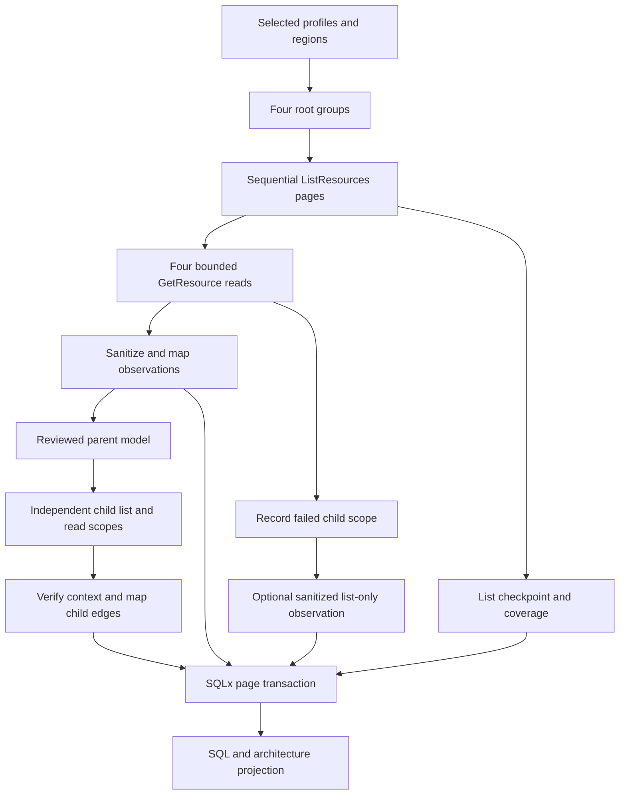

# Collection and architecture plan for 418 resource types

The scanner combines **418 reviewed Cloud Control resource-type descriptors** with the native collectors for deeper EC2/VPC, DynamoDB, Lambda, ECS, EKS, ELBv2, S3, IAM, Route 53 and CloudFront architecture. The combined selection contains **397 root types and 21 parent-dependent types**. One Rust adapter performs Cloud Control discovery and reads, with an explicit prerequisite plan for each admitted child. Adding a descriptor does not require another handwritten client, paginator, retry loop, or database writer.

The 418 types are configured coverage, not a claim that an AWS account has been scanned or that all providers succeed in every region. No live account requests were used to construct this catalog. Native and Cloud Control coverage overlap; their counts must not be added as though every type were distinct. [VERIFICATION.md](VERIFICATION.md) distinguishes implementation from executed local checks.

## Evidence and selection

[cloudcontrol-resources.json](../catalog/cloudcontrol-resources.json) preserves the 397-type root catalog: the original 200 descriptors and 197 reviewed regional additions. Selection emphasizes compute, networking, storage, databases, messaging, integration, operational metadata, identity references and regional machine-learning services. The additions include SageMaker, Bedrock, DAX, CloudFormation stacks, EMR, SES, Cognito, CodeDeploy and Image Builder. The separate [cloudcontrol-parent-resources.json](../catalog/cloudcontrol-parent-resources.json) adds 21 children of six reviewed root families. Runtime combines the two; schema eligibility alone does not enable a type.

| Current catalog measure | Count | Evidence |
| --- | ---: | --- |
| Executable regional resource types | 418 | 397 frozen roots plus 21 reviewed parent-dependent descriptors |
| CloudFormation service families | 76 | Distinct service namespaces in selected type names |
| Source-specific SQL views | 418 | One `aws_cc_*` view per descriptor; schema version 6 |
| Top-level provider columns | 4,273 | Descriptor `columns`; at most 85 per type |
| Property relationship rules | 965 | Explicit rules across 255 selected types |
| Parent relationship workflows | 21 | Runtime `CHILD_OF` binding per child type; 265 types have either form |
| Pinned schema universe | 1,881 | [Capability matrix](../catalog/cloudcontrol-capabilities.json), including exclusions |

[CLOUDCONTROL_COVERAGE.md](CLOUDCONTROL_COVERAGE.md) describes eligibility, remaining exclusions and relationship constraints. [PARENT_COLLECTIONS.md](PARENT_COLLECTIONS.md) defines every admitted prerequisite binding. [CLOUDCONTROL_EVIDENCE.md](CLOUDCONTROL_EVIDENCE.md) retains source-bound root-catalog evidence; the 21 parent workflows have a separate emulator case. The frozen 200-type event fixture remains a historical v0.3/v0.4 subset and has not been relabeled as a complete current fixture.

The pinned input is AWS's official [us-east-1 CloudFormation resource schema archive](https://schema.cloudformation.us-east-1.amazonaws.com/CloudformationSchema.zip), retrieved on 2026-11-12. The retained file is `catalog/upstream/cloudformation-us-east-1-2026-11-12.zip`: 3,335,713 bytes, SHA-256 `8226b9cd82f432997fe3918b134ef155245636f35ac37f8006de5abe88dd54a8`. It contains 1,881 resource schemas; 1,701 declare both `read` and `list` handlers. Each selected descriptor retains its schema filename, individual SHA-256, primary identifiers, declared permissions, property definitions and redaction paths.

Root eligibility requires both handlers, an empty object accepted by the complete list `handlerSchema` when supplied, and exclusion of AWS's documented types requiring a `ResourceModel`. The build helper validates `oneOf`/`anyOf`/`allOf` through JSON Schema. For example, Logs LogGroup allows an empty list model, while ELBv2 Listener and ListenerRule require parent context. The separate parent catalog admits Listener with a reviewed load-balancer binding; ListenerRule still needs a second discovery level. RDS DBProxyTargetGroup remains excluded because the [Cloud Control discovery guide](https://docs.aws.amazon.com/cloudcontrolapi/latest/userguide/resource-operations-list.html) requires `DBProxyName` and this catalog has no reviewed discovery plan for it, even though its pinned schema omits a list `handlerSchema`.

AWS distinguishes provisionable registry types from legacy, non-provisionable types that do not support Cloud Control. The schema handlers are the catalog's capability evidence; see [Cloud Control resource-type support](https://docs.aws.amazon.com/cloudcontrolapi/latest/userguide/resource-types.html). The supported-resources HTML table is not claimed as a second retained verification source: direct acquisition returned a 195-byte `SiteUnavailable` page. That response was discarded and the failed acquisition is recorded in `catalog/upstream/cloudcontrol-upstream.json`.

The archive describes us-east-1 at retrieval time. Other region/partition availability, the account's default provider version, permissions and provider behavior are validated only by actual collection. The adapter does not activate providers, change versions, create roles, provision AWS Config, or create Resource Explorer indexes. An unsupported provider, denied request or invalid model creates an incomplete scope; it never becomes a successful empty inventory.

## Inspect the plan before collection

The `plan` and `catalog` commands work without the `aws` feature and never load credentials. They show selected native groups and Cloud Control types, API stages, source priority, SQL views, schema evidence, declared permissions, concurrency and pagination bounds.

```bash
aws-inventory plan --cloud-control --profile prod --region us-east-1,eu-west-1
aws-inventory catalog
```

To plan only a few Cloud Control types:

```bash
aws-inventory plan --service cloud-control --cloud-control \
  --resource-type AWS::EC2::Instance,AWS::RDS::DBInstance,AWS::Logs::LogGroup \
  --profile prod --region us-east-1
```

The same selectors are accepted by an AWS-enabled build:

```bash
aws-inventory scan --db inventory.sqlite --cloud-control \
  --profile prod --region us-east-1,eu-west-1
```

An explicit region list selects exactly those regional endpoints. With no region list, the existing scan coordinator discovers opted-in regions. Profiles use the existing AWS credential chain; STS resolves their actual account identities. Multiple profiles may refer to the same account. With `--organization-role`, the coordinator enumerates ACTIVE Organizations accounts and assumes that existing role in each selected target; `DISCOVERY.md` describes bounds and eligibility. Plain profiles remain available without Organizations access.

At least one `ListResources` request is needed for each selected root/account/region that collection reaches. Each admitted child requires a separate list chain for every discovered parent; a successfully empty prerequisite list makes no child calls. Child-only selection automatically adds the relevant root, and selected siblings share that root enumeration. Every listed identifier is passed to `GetResource` once logically; retries add attempts. Two regions and all 397 roots imply 794 initial root lists per profile if those scopes are reached, before any parent-dependent lists, reads, continuation pages, native collectors or retries. Multiplying 418 by the region count would misstate the workload. A precise total is unknowable before enumeration.

## Execution and coverage



Four root groups run concurrently per region. Each root follows one continuation-token chain sequentially and admits up to four resource reads concurrently. A successful sanitized parent read drives at most two selected child types concurrently, with four child reads per page. The next root page waits for the bounded work admitted by its current page; no account-sized parent cache is retained. Every SDK `ListResources` and `GetResource` attempt passes through the existing `ApiExecutor` with quota group `cloudcontrol:read`. The service SDK has one attempt so the shared executor remains the single retry owner. Cloud Control's provider performs downstream service calls, whose separate quotas can still throttle it.

`MaxResults` is marked **Reserved** in the [ListResources API](https://docs.aws.amazon.com/cloudcontrolapi/latest/APIReference/API_ListResources.html). The adapter deliberately omits it. `--page-size` is not a promise about Cloud Control's service response size; returned cursors and explicit local limits determine traversal. List properties are optional and can be partial. The adapter reuses the exact returned identifier for [GetResource](https://docs.aws.amazon.com/cloudcontrolapi/latest/APIReference/API_GetResource.html), including composite identifiers separated by `|`; it does not reconstruct the request from guessed property order.

Coverage separates enumeration, enrichment and prerequisite discovery:

- `cloud_control_list`, with the CloudFormation type as parent ID, records the enumeration cursor. A successful empty response emits a real empty terminal page. An empty page with a token continues. Duplicate identifiers, repeated tokens, invalid output and traversal limits record failures.
- `cloud_control_get`, with a type plus identifier digest as parent ID, records each enrichment independently. A valid read streams one resource page immediately. If reading fails, the failure is recorded first. A valid sanitized list description can subsequently stream a `details_available=false`, `observation_detail=list_only` page in that same failed scope. Storage retains the failed flag. Malformed fallback properties add a scoped failure without cancelling valid siblings. List-only fallbacks do not emit enriched relationships.
- Parent-dependent list/read scopes additionally include the canonical request-model digest, so different parents retain independent token chains. A detailed child must match the requested model before `CHILD_OF` is emitted.
- `cloud_control_parent_discovery` records whether each selected child type's prerequisites were exhaustively obtained. A successful empty root list completes empty discovery; a denied list, capped traversal, failed required read or missing context leaves explicit incomplete evidence. Child list/read errors remain independently failed even when prerequisite enumeration completes.

Parent list pages contain checkpoints, not a buffer of all child resources. Resources are retained even if a later page or another type fails. A complete list with failed reads is still a partial scan. Missing results never imply deletion. Cancellation stops admission of new types and children, bypasses fallback work for cancelled reads, retains already queued events, and leaves explicit incomplete coverage.

### Bounded work

| Boundary | Limit and behavior |
| --- | --- |
| Type catalog and selected set | 418 descriptors; unknown type names rejected and child prerequisites expanded before credentials load |
| Active work | 4 root groups per region, 4 parent reads, 2 child types per parent and 4 child reads per page; existing global/per-bucket admission also applies |
| Traversal | At most 10,000 pages and 100,000 listed identifiers per type scope; lower configured page limits apply |
| Service response processing | Local maximum 1,000 descriptions per list response and 8 MiB aggregate list property text; limits are local containment, not claimed AWS page-size guarantees |
| Identifier history | SHA-256 digests in a bounded 100,000-entry ledger per active type; duplicate identifiers fail before replaying child pages |
| Parent-group admission | At most 10,000 child-model scopes and 100,000 distinct child identifiers across all selected child types; duplicate models from distinct parents rejected before listing |
| Parent request model | At most 4 bindings, 1,024 bytes per string value and 8,192 encoded bytes; current plans use 1 binding |
| Provider model | 262,144 bytes per JSON property string; object root required |
| JSON traversal | 16,384 retained-tree nodes, depth 32, 1 MiB cumulative traversal path text |
| Pointer expansion/redaction | 4,096 matches per expansion; 4,096 redacted paths and 256 KiB total recorded redaction paths |
| Relationships | 4,096 distinct outgoing edges per resource; core page/edge byte validation also applies |
| Persistence | Existing bounded event channel; transactional SQLx observation, edge and checkpoint writes |

These checks occur after the SDK has decoded the service response. They bound accepted processing, history and queued observations, not the SDK transport's entire response allocation before decoding. Exceeding a limit fails its scope explicitly; the adapter never silently truncates a provider's inventory and labels it complete.

## Identity, SQL and architectural references

Identity selection prefers a reviewed self-ARN property, then an ARN primary identifier, then a reviewed canonical ARN template. Returned ARNs retain their account and region. Canonical templates without returned ownership are marked `canonical_template_assumed_scanning_account`; they do not establish ownership of a shared resource. Composite EIP identifiers use observed `AllocationId` when constructing an allocation ARN, never `public-ip|allocation-id` as an ARN suffix.

When a reliable ARN cannot be obtained, the ID is a namespaced value containing partition, request region, scanning account, CloudFormation type and SHA-256 of the exact provider identifier. The original identifier remains in `resource_identifier`. The type namespace prevents unrelated providers with identical identifiers from colliding. A later authoritative ARN can differ from an earlier list-only fallback identity; the scanner does not claim to resolve that absence of evidence automatically.

Overlapping native types use the same canonical `kind` names and prefer the direct source when canonical IDs match: `direct` priority 4, `cloud_control` 3, `aws_config` 2, `resource_explorer` 1. All observations retain provenance. A few reviewed scalar aliases make familiar native views useful, but provider JSON is not represented as a complete equivalent of native service output.

Every Cloud Control descriptor has a dedicated `aws_cc_*` SQL view, filtered by source and `cloudformation_type`. The combined catalog defines **4,273 top-level provider columns**, at most 85 per type. Primitive values use SQLite JSON extraction; objects and arrays remain JSON. Column names are safe identifiers, with reserved names renamed. These source-specific views preserve Cloud Control observations even when a native resource wins the preferred-resource view. The generic `aws_cloudcontrol_resource` view and sanitized `provider_properties` remain available for common queries. Schema version 5 installed 197 additional root views; version 6 adds 21 parent views and 169 columns. The original 200 projections, later root projections and stored observations remain intact.

```bash
aws-inventory query --db inventory.sqlite \
  'SELECT instance_id, instance_type, vpc_id, subnet_id FROM aws_cc_ec2_instance ORDER BY instance_id LIMIT 100'

aws-inventory query --db inventory.sqlite \
  'SELECT db_instance_identifier, engine, db_instance_class FROM aws_cc_rds_db_instance LIMIT 100'

aws-inventory query --db inventory.sqlite \
  'SELECT log_group_name, retention_in_days FROM aws_cc_logs_log_group LIMIT 100'
```

The combined catalog includes **965 explicit property relationship rules across 255 types**, derived from declared string properties and reviewed ARN or short-identifier semantics. Examples include EC2-to-VPC/subnet/security-group membership, Lambda/EKS role and subnet references, ECS task-definition roles and ELB/VPC Lattice target groups, load-balancer subnets, RDS proxy secrets, event targets, DMS endpoints and Pipe source/target links. The additional **21 runtime `CHILD_OF` workflows** bring the number of types with either kind of relationship evidence to **265**. Parent edges point to the successfully observed parent identity and retain the exact requested model as evidence. Repeated `(from, to, relation)` observations merge their property-path evidence before persistence. Relation names match native collectors when their semantics match. These rules require returned evidence and do not constitute full dependency coverage for every resource.

Explicit referenced ARNs retain their account and region, with service/resource-prefix checks for typed rules. Reviewed short EC2 IDs create references marked `assumed_scanning_account`; these can remain unresolved or be corrected by stronger ownership evidence. EC2 image and snapshot templates retain the official empty account segment. Compound identifiers and fields defined as names are not expanded into guessed resource ARNs. Generic event destinations remain generic references instead of fabricated typed observations. IAM roles and secrets referenced by another resource do not count as proof that those targets were independently discovered. Configuration references describe declared architecture, not effective IAM authorization, successful network reachability or observed traffic.

## Redaction and permissions

Properties are sanitized **before** identity aliases, names, tags, SQL columns and graph edges are extracted. The policy combines schema `writeOnlyProperties`, explicit per-type sensitive paths and shared normalized field-name exclusions. Wildcards work over nested arrays and maps. Removed fields are represented by paths in `redacted_paths`; their values are never copied into inventory events.

The policy goes beyond write-only annotations: EC2 user data; Lambda environments and inline code; ECS and Batch environment/argument payloads and logging options; Batch EKS `Env`/`Args`; SSM parameter values and document content; workflow definitions; connection authentication; CodeBuild/CodePipeline configuration payloads; database parameter values; Firehose Splunk HEC tokens/HTTP endpoint access keys; SNS subscription endpoints that can embed URL credentials; and Pipe HTTP header/query payloads are examples. Credential-reference ARNs can remain useful evidence after credential values are excluded. The schema's write-only list alone is not treated as a guarantee that a read response contains no sensitive values.

This is a field-based metadata policy. It cannot recognize arbitrary secrets placed in ordinary names, tag values, free-form descriptions, or an unexpected provider extension. It also does not prevent a provider from obtaining sensitive values internally to satisfy its read handler. Raw SDK property strings are transient input, never deliberately logged, and sanitized copies are the only models persisted by this adapter.

`read_permissions` and `list_permissions` are **schema-declared provider requirements**, not an automatically grantable read-only IAM policy. Some published declarations include actions such as `kms:CreateGrant`, `iam:CreateServiceLinkedRole`, or underlying network mutations; other handlers declare `kms:Decrypt`, `iam:PassRole`, or secret-read permissions. The scanner itself issues only `ListResources` and `GetResource` in this adapter and never creates or attaches IAM policies. Existing credentials must already have the access needed for the chosen providers. Denied providers remain visible in the coverage report. Review the declared lists before choosing an execution policy; they are not transformed into wildcard grants.

## Remaining gaps and next increments

The regional catalog intentionally excludes global/account-home-region enumeration such as IAM roles, CloudFront distributions, Route 53 hosted zones and S3 buckets. Version 0.4 introduced those selected global kinds through native adapters with explicit endpoint and once-per-account policies; see `GLOBAL_INVENTORY.md`. They remain excluded from the combined regional Cloud Control selection. Parent discovery now includes EKS addons/Fargate profiles/nodegroups, ELBv2 listeners, and reviewed API Gateway, Logs and AppConfig children. ELBv2 listener rules, RDS proxy target groups, ECS task sets and other unreviewed contexts remain excluded. Native ELBv2 already covers listeners/rules and target health. A supported schema does not imply that all provider properties or every service's runtime entities are exposed by Cloud Control.

The next increments should follow evidence: validate the admitted parent workflows against actual regional providers; extend reviewed global coverage and additional dependency levels; improve authoritative ARN/owner resolution; and extend relationships only where source fields have clear semantics. Preserve explicit missing/failed scopes, redaction and bounded work while expanding breadth. The 418-descriptor selection is an implemented catalog, not a claim to inventory all AWS resource types.

## Reproduction and tests

The Python helpers are build-time acquisition/validation tooling. Production collection and mapping are Rust in `crates/aws/src/cloud_control.rs` and its `parents` module. Check the additive catalog from retained bytes:

```bash
python3 catalog/upstream/build_parent_catalog.py --check
python3 -m unittest discover -s catalog/upstream -p test_parent_catalog.py -v
cargo run --locked -p inventory-engine --example resource_views -- --check
```

The helpers require `jsonschema` (validated with 4.26.0), verify the archive checksum, revalidate handler eligibility and property columns, and produce deterministic JSON. The parent helper also validates literal request models and the frozen root checksum. It does not call an AWS account. The root generator remains `catalog/upstream/build_cloudcontrol_catalog.py`; running it intentionally rewrites root outputs and resets their executed evidence. The manifests retain source provenance and schema checksums. Runtime does not pin or change AWS's default provider version.

Adapter tests use official SDK model builders and injected request functions. They cover catalog/selector constraints, canonical and composite IDs, schema and readable-field redaction, relationship deduplication, byte/tree limits, duplicate pages, optional list properties, terminal/continuation pages, unsupported reads, mixed denied/malformed/successful siblings, a closed consumer, and pre-/mid-page cancellation. The consolidated verification report records which compile, test and integration gates actually ran. Synthetic fixtures and local tests do not establish live regional provider coverage.

The parent suite adds literal mapping and fixed-seed selection/model properties, distinct parent cursors, duplicate-model rejection, exact aggregate-cap boundaries and cancellation after child admission. Its production-SDK wire fixture injects a throttle and checks serialized models, cursors and executor counters. The official-emulator harness keeps the 397-root scan separate from the 21-child scan; the latter requires 161 child observations, 161 parent edges and 24 independently authored architecture edges. EKS Addon's 101 fixture records force pagination, including a filtered empty page with a continuation token. These contracts are described in [EMULATOR_TESTING.md](EMULATOR_TESTING.md); they are not substituted for current execution receipts.
