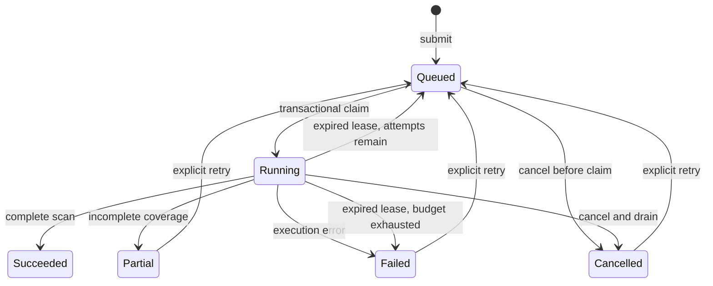

# Durable scan jobs with SQLx

> Status: Kept and extended. Fenced whole-scan jobs stay as they are; the plan
> adds a durable work queue inside the store that resumes at page level
> (ROADMAP M3.3) and bounded slices (M7.4), which this document does not
> describe. See [VISION](VISION.md) and [ROADMAP](ROADMAP.md).

Version 0.4 adds a local durable work queue using SQLx and SQLite. This is an
invocation-level recovery mechanism: it stores validated scan intent, leases,
attempts and terminal outcomes. It does not replay arbitrary Rust call stacks
or resume every AWS pagination cursor. A recovered job starts a fresh immutable
inventory scan, while observations from an interrupted scan remain available.

## Usage

```sh
# Submission is offline: no credential provider or AWS request is invoked.
aws-inventory job submit --queue jobs.sqlite --job-id organization-daily \
  --db inventory.sqlite --profile management --organization-role InventoryReader \
  --region us-east-1,us-west-2 --service all --cloud-control --discover-sources

# One bounded worker invocation, with heartbeat renewal of each claimed lease.
aws-inventory job run --queue jobs.sqlite --limit 1 --lease-seconds 60

aws-inventory job list --queue jobs.sqlite
aws-inventory job show --queue jobs.sqlite --job-id organization-daily
aws-inventory job cancel --queue jobs.sqlite --job-id organization-daily

# Explicitly authorize another attempt after investigating a partial/failed run.
aws-inventory job retry --queue jobs.sqlite --job-id organization-daily \
  --additional-attempts 1
```

Queue and inventory files must be different files. The queue has its own SQLite
application identifier; the inventory store refuses that identifier, and the
queue refuses another application's existing schema. Path comparisons reject
the same canonical path during submission. Existing symlinks are resolved.
SQLite's application check remains the defense against other filesystem aliases.

The queue is intended for processes on one host using a local filesystem with
SQLite locking semantics. Each worker's request limiter is process-local. Adding
worker processes does not create a distributed account-quota limiter; their
combined request rate can exceed any one process's policy. Use one worker with
bounded account/region fan-out until a shared admission service is implemented.

## State and effect boundaries



Submission, claim, heartbeat, completion, cancellation, recovery and explicit
retry use SQLx statements; claim/recovery and terminal transitions use SQLite
transactions. The database enables WAL, `synchronous=FULL`, foreign keys, a
five-second busy timeout and a ten-second connection-acquisition timeout.
These settings depend on the filesystem honoring SQLite's durability contract.

A claim holds `BEGIN IMMEDIATE`, recovers expired attempts, chooses the earliest
available queued job and writes the new attempt plus its lease in the same
transaction. Concurrent claimers cannot claim the same available job twice.
Each lease has a private job ID, attempt number, owner and unpredictable token.
Heartbeats and completion must match all four and an unexpired running lease.
Mutable presentation metadata cannot change this fencing identity. An expired
worker cannot acknowledge a replacement worker's attempt, even if the caller
reuses an owner or token. Expiration itself is a hard boundary: a heartbeat at
the exact expiry instant does not revive the lease.

An expired lease can leave old AWS reads or inventory persistence in flight
briefly. Fencing protects the queue acknowledgement; it does not implement
exactly-once AWS reads or prevent two inventory scans from overlapping. Scans
have separate immutable IDs, and selected pages commit transactionally within
each scan. The queue database and inventory database do not share a transaction.
An inventory scan can finish just before a worker loses its lease; retrying that
job can produce another valid snapshot. Treat attempts and scan IDs as evidence
of this at-least-once behavior.

`--max-job-attempts` controls automatic recovery from expired worker leases. A
normal failed, cancelled or partial job is terminal until `job retry` explicitly
adds an attempt. This avoids multiplying API retries by repeatedly scanning an
account whose permissions are still insufficient. A succeeded job cannot be
requeued under the same job ID. Submit a new ID for the next scheduled snapshot.

Submission is idempotent for the same job ID, kind, JSON payload and original
attempt budget. The original availability time is retained. Reusing an ID for
different work is a conflict. Job payloads use absolute inventory/rate-policy
paths, so running a worker from another directory does not change their meaning.
Payloads name profiles, role ARNs and the environment variable containing an
optional external ID. They do not contain AWS credentials or the external-ID
value; credential resolution happens when an attempt executes.

## Cancellation and supervision

Each worker owns its scan future, cancellation token and heartbeat future.
There are no detached scan tasks. A heartbeat renews the lease and observes a
durable cancellation request. Worker shutdown or a cancelled result stops intake
of additional queued work. During ordinary cancellation, the worker continues
heartbeats while the scanner drains persisted pages. Drain time is bounded to
30 seconds. Lease loss also requests cancellation and bounds drainage; a stale
terminal acknowledgement remains forbidden.

A drain timeout can leave an inventory scan marked `running` and with only its
committed pages. The worker reports incomplete finalization instead of claiming
that the scan completed. The bounded invocation has a 24-hour execution budget
per job. Limits are explicit operational ceilings, not a throughput claim.

## Bounds

| Item | Bound |
| --- | ---: |
| Retained jobs in one queue | 10,000 |
| Attempts per job, including explicit additions | 32 |
| Job payload | 64 KiB |
| Stored terminal result | 1 MiB |
| Stored error message | 8 KiB, truncated on UTF-8 boundaries |
| Lease duration | 10–3,600 seconds |
| Claims per worker invocation | 1–1,024 |
| Worker aggregate compact JSON budget | 4 MiB |
| Per-job compact JSON summary budget | 4 KiB |
| `job list` rows | 1–1,000; payloads/results omitted |
| Maximum initial submission delay | One year |

Large terminal results are reduced to scan IDs, statuses and summaries before
queue persistence; full inventory details remain in the inventory database.
Worker output always contains bounded per-job summaries. Byte budgets measure compact serialized JSON; the CLI pretty-printer can add whitespace. `job show` retrieves
the retained payload, terminal result and attempt history for a specific ID.
The queue has no automatic retention cleanup yet; archive a completed queue or
choose a new queue file before its retained-job cap is reached.

## Why this primitive is enough here

The collector already has Tokio stream scheduling, one request executor and a
transactional page store. SQLx supplies durable intent/lease transitions without
adding a separate workflow server to the local application. Temporal or another
durable workflow service can become an outer orchestrator if deployment needs
long-lived schedules, distributed task routing, centralized operational control
or cross-host recovery. Such an integration should submit bounded scan attempts
and preserve the single owner of request retries. It should not wrap every SDK
retry with another unbounded retry loop.

Focused queue tests cover racing claimers, exact expiry, recovery across reopen,
history retention, idempotent submission, stale lease fencing, cancellation,
retry budgets, payload/result bounds and database identity collisions. Worker
tests inject pending futures and virtual time for supervision paths. See
`VERIFICATION.md` for the observed results of this release.
