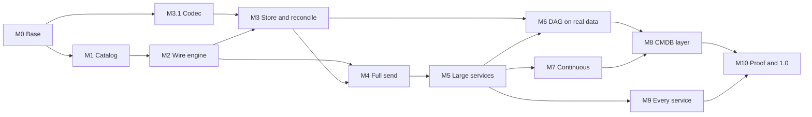

# Roadmap

Status: build plan for [VISION.md](VISION.md), 2026-11-13. Decision IDs (V01 to
V21, O1 to O9) refer to that document.

Agents work from this file. Take the first unfinished work package whose
dependencies are done, carry it through the gates in VISION section 10, and
mark it done here in the same commit, with the command that proved it. A
package is done only when its exit evidence has been produced; "implemented"
is not a status.

## Rules for every package

- No Cloud Control, no new typed SDK service crates, no JSON on the data path,
  no Python.
- No service-specific Rust. If a service needs special handling, it goes in the
  overlay. An exception needs a written reason in the change.
- Each package states the lines of Rust it added and deleted. Wave packages
  (M5, M9) are expected to delete more than they add.
- Evidence comes from the pinned emulator with real signed requests, run in the
  same owned process lifetime as the test. Emulator and real-account evidence
  are reported separately.
- One heavy Cargo build at a time on this machine.

## Baseline

At commit `78d3ac2`: the workspace compiles (`cargo check --workspace`). 39
resource kinds are collected by hand-written typed adapters and 421 types
through Cloud Control, into SQLite schema 13, with 968 reviewed relationship
rules, a FalkorDB projection, a rate limiter that is the single retry owner,
fenced whole-scan jobs, an owned emulator harness, a workload generator, a
loopback read API and a Makepad UI that renders a synthetic fixture. There is
no wire engine, no binary record, no continuous mode and no benchmark of
collection.

## Sequence

Packages that can run at the same time, because they touch different crates:
M1 with M3.1; M2.1 to M2.4 with each other once M1.2 exists; the M5 services
with each other; M6.2 and M6.3 with M5; M9 with M7 and M8.

## M0 — Base

| ID | Work | Exit evidence |
| --- | --- | --- |
| M0.1 | Commit the working tree as the baseline. **Done**, `78d3ac2`. | `git log` |
| M0.2 | Fix the 9 compile errors in two Cloud Control parent test files (`appconfig_experiment_definition_…`, `eks_pod_identity_association_…` under `crates/aws/src/cloud_control/parents/tests/`). | `cargo check --workspace --all-targets` is clean |
| M0.3 | One gate command: format, clippy, tests, file and function size. It must not invoke Python; `scripts/verify.sh` does today. | The gate passes with `python` and `python3` removed from `PATH` |
| M0.4 | `src/catalog.rs` reports SQLite schema 12; the store is at 13. Derive the number from the store. | `aws-inventory catalog` reports 13; the pinned test no longer hard-codes it |
| M0.5 | Regenerate `MANIFEST.sha256` without the 81,554 entries from `.local/runtime`. | The file lists tracked files only |
| M0.6 | Push `main`. | `git status -sb` shows no divergence |

## M1 — API catalog

Crate: `catalog-tool`. Depends on M0.

| ID | Work | Exit evidence |
| --- | --- | --- |
| M1.1 | Pin the AWS API models: a lock file holding the upstream commit (`46135f8`) and a digest per model file; `catalog-tool models fetch` and `verify`. | `verify` passes on a fresh clone; a changed byte fails it |
| M1.2 | Compile models to the binary catalog: services, protocols, endpoints for the commercial partition, operations, shapes, paginators, page-size limits, error classes. Append-only field-ID registry. | Catalog reports 436 services, 19,641 operations, 3,787 paginators; recompiling is byte-identical; a registry test proves IDs never change |
| M1.3 | Classify every operation: enumerate, expand, denied (content, secret, paid, mutating) or unclassified. Rules first, then review of what the rules cannot decide. | Report by class; every mutating operation is denied; a test proves an unclassified operation cannot be scheduled |
| M1.4 | Derive collection plans: parent-to-child bindings, identity, largest page size, lists that make the describe unnecessary, batch reads, fields excluded from hashing. Define the overlay format (O2). | Report: enumerations found (2,209 expected with no required input), expansions bound automatically, expansions needing overlay |
| M1.5 | Map each of the 1,881 CloudFormation types to a catalog resource kind, or record why not. This is the checklist. | Checklist file with counts of mapped, unmapped and not-a-resource |

## M2 — Wire engine

New crate: `aws-wire`. Depends on M1.2.

| ID | Work | Exit evidence |
| --- | --- | --- |
| M2.1 | Request serializers: JSON RPC, REST JSON, query, REST XML, binary RPC. | Golden request tests from Smithy's published AWS protocol test suites |
| M2.2 | Credentials from profiles and SigV4 signing with a cached signing key. | Signed requests accepted by the emulator; signature test vectors pass |
| M2.3 | One pooled HTTP client: keep-alive, HTTP/2 where offered, deadlines, response size limit. | Connection reuse counted in a test; an oversized or stalled response fails within its bound |
| M2.4 | Streaming JSON, XML and CBOR decoders into the record builder; error decoding into the executor's classes. | Decoder tests from the same protocol test suites; malformed and truncated input never panics (fuzzed) |
| M2.5 | Pagination driver for every modeled paginator style. | Multi-page enumerations against the emulator return every seeded item exactly once |
| M2.6 | Differential proof on the 87 non-Cloud-Control operations wired today. | For each, the wire result equals the typed SDK result on the emulator, field by field |
| M2.7 | Emulator probe: call every enumerate-class operation once against the emulator. | A stored matrix of answered, unsupported and failed, per service and protocol |
| M2.8 | Micro-benchmarks: signed requests per second, decode throughput, allocations per page, each against the typed SDK. | Numbers recorded with the machine and build profile |

## M3 — Records, store, reconciliation

Crates: `inventory-core`, `inventory-engine`. M3.1 depends on M0; the rest on M2.4.

| ID | Work | Exit evidence |
| --- | --- | --- |
| M3.1 | Binary record: schema-coded value, in-place reads, content hash in the decode pass. Settle O1 by benchmark. | Round-trip property tests; old-catalog records read under a newer catalog; benchmark table for the candidates |
| M3.2 | Generated schema: one table per kind with typed columns and the record blob; tags; edges; change log; scope outcomes. | Schema is generated from the catalog and reproducible; SQL can filter on any scalar field |
| M3.3 | Durable work queue and single-writer batched commits; a page commit is one transaction with its queue update. | Killing the process at any point and restarting yields the same final database as an uninterrupted run |
| M3.4 | Reconciler: page hash, record hash, missing detection, two-enumeration deletion, scope outcomes. | Re-sweeping an unchanged emulator account writes zero record rows; one seeded change writes exactly one version and one change-log row; a partial enumeration deletes nothing |
| M3.5 | Remove JSON from the collection, store and projection paths. JSON remains only in `export`. | No JSON serializer is reachable from the sweep path |

## M4 — Full send

Crate: `inventory-engine`. Depends on M2 and M3.

| ID | Work | Exit evidence |
| --- | --- | --- |
| M4.1 | Buckets per account, region and service; adaptive concurrency inside `ApiExecutor`; learned rates stored and reused; configurable cap. | Against an emulator proxy with a fixed rate limit, steady throughput stays within a stated margin of the limit, and the second sweep starts there |
| M4.2 | Retry classes from the catalog; retry budget; remembered inaccessible and unsupported scopes; token restart; credential refresh. | Each row of the VISION section 7 table has a passing fault-injection test |
| M4.3 | Fault-injecting proxy in the harness: throttle, 5xx, stall, reset, truncation, token expiry. | Used by M4.1 and M4.2; deterministic by seed |
| M4.4 | Sweep benchmark in `cmdb-bench`: cold sweep, warm re-sweep, calls, resources per second, CPU seconds, peak memory, bytes written. Settle O4. | One command produces the table from a seeded emulator |

## M5 — Large services, complete

Overlay data and proof per service; no Rust per service. Depends on M4. The
services can be done in parallel. Together they exercise every protocol.

| ID | Service | Protocol | Replaces |
| --- | --- | --- | --- |
| M5.1 | EC2, including VPC networking | ec2Query | `ec2`, `network` adapters and EC2 Cloud Control types |
| M5.2 | IAM, STS, Organizations | awsQuery, awsJson1.1 | `global_inventory`, discovery calls |
| M5.3 | S3, Route 53, CloudFront | restXml | `global_inventory`, `supplemental` |
| M5.4 | Lambda, EKS | restJson1 | `lambda`, `eks` adapters |
| M5.5 | ECS, KMS, DynamoDB, SQS, Step Functions, SNS, ELBv2, RDS | awsJson1.0, awsJson1.1, awsQuery | `ecs`, `task_definitions`, `kms`, `dynamo`, `sqs`, `step_functions`, `sns`, `load_balancing` adapters |

For each service:

1. Every enumerate and expand operation is classified and bound.
2. Identity, tags and hash exclusions are reviewed.
3. Relationships: model-declared edges enabled, reviewed rules remapped to API
   field paths, inferred edges on.
4. Emulator proof with the shipped binary, and the differential check against
   the old adapter.
5. The old adapter, its tests, its SDK dependency and the service's Cloud
   Control types are deleted in the same change.

| ID | Work | Exit evidence |
| --- | --- | --- |
| M5.6 | First head-to-head on these services against CloudQuery, Steampipe and Cartography on the emulator (O7). | Published table: versions, dataset, machine, kinds compared, all measures from M4.4 |
| M5.7 | Wave exit. | No hand-written adapter and no typed SDK service crate remains for these services; lines deleted exceed lines added across M5 |

## M6 — DAG on real data

Crates: `inventory-engine`, `cmdb-api`, `cmdb-view`, `cmdb-ui`. M6.2 and M6.3
can start once M3 is done.

| ID | Work | Exit evidence |
| --- | --- | --- |
| M6.1 | Graph deltas to FalkorDB from the change log, with the acknowledgment log; full replay from SQL. | After a re-sweep with one change, only that change is sent; a replayed graph equals the incremental one |
| M6.2 | `cmdb-api` reads the store and returns binary record and edge pages with cursors and limits. | No JSON export file is involved; a query over a scanned emulator account returns the stored records |
| M6.3 | `cmdb-ui` data client, table and detail on real records, DAG with level of detail. | A scan of the emulator opens in the UI; frame times recorded for the largest generated graph the laptop holds |
| M6.4 | One documented path from an empty directory to the DAG. | The walkthrough runs as written |

## M7 — Continuous on a laptop

Depends on M5.

| ID | Work | Exit evidence |
| --- | --- | --- |
| M7.1 | `serve`: sweeps about 10 profiles in a loop, ordered by staleness; clean stop and resume. | A long emulator run with seeded changes converges after each change; killing and restarting loses nothing |
| M7.2 | Change log, deletions and retention (O9). | History of a resource is queryable; retention removes only what is older than the limit |
| M7.3 | Freshness and coverage reporting: age and outcome of every scope. | SQL view and UI panel agree with the scope outcomes |
| M7.4 | Slice mode: run for a bounded time, stop, resume later. This is the Lambda-shaped entry point (V08). | A sweep completed in several bounded slices equals an uninterrupted one |

## M8 — CMDB layer

Depends on M6 and M7.

| ID | Work | Exit evidence |
| --- | --- | --- |
| M8.1 | Owners, teams, applications, custom fields, notes and user-drawn relationships, in their own tables, attached by identity or rule. | A sweep never alters them; deleting a resource keeps its annotations with its history |
| M8.2 | Defaults derived from tags and accounts by rule. | Rule changes re-apply without a sweep |
| M8.3 | Shown and editable in the UI; present in SQL and the graph, marked as asserted. | An application view shows its resources and their relationships |

## M9 — Every service

Overlay data only. Depends on M5; runs alongside M7 and M8.

| ID | Work | Exit evidence |
| --- | --- | --- |
| M9.1 | Enable every enumerate-class operation in every remaining service. | Catalog report: zero unclassified read operations |
| M9.2 | Bind and enable expand-class operations. | Report of bound, denied and deferred with reasons |
| M9.3 | Emulator proof for every operation the emulator answers (from M2.7); the rest are marked implemented, not verified. | Matrix updated |
| M9.4 | Close the checklist from M1.5. | Every CloudFormation type is collected by an endpoint kind or has a recorded reason |
| M9.5 | Delete Cloud Control: collectors, universal lister, parent workflows, `aws-sdk-cloudcontrol`, their catalogs and documents. Keep only the type checklist. | No Cloud Control call site remains; `crates/aws` contains only the planner and credentials |

## M10 — Proof and 1.0

| ID | Work | Exit evidence |
| --- | --- | --- |
| M10.1 | Read-only run against the authorized real account (O8). | Coverage, outcomes and any model disagreements recorded |
| M10.2 | Head-to-head on the emulator and on the real account, all services each tool supports. | Published tables as in M5.6 |
| M10.3 | Replace `ARCHITECTURE.md` and `CMDB_ARCHITECTURE.md` with one document describing what exists; operator guide; changelog. | Documents match the tree |
| M10.4 | Version 1.0. | Tag |

## After 1.0

Not scheduled: change-event hints; Organizations discovery and cross-account
roles; hundreds to thousands of accounts; a PostgreSQL store; Lambda packaging;
SSO, workspaces and a network-exposed API; a Makepad web build.

## What blocks what

| Blocker | Blocks | Who |
| --- | --- | --- |
| Authorized real AWS account (O8) | M10.1, real half of M10.2 | Owner |
| Competitor tools runnable against the emulator (O7) | M5.6, M10.2 | Found out at M5.6 |
| Emulator does not implement a service | Emulator proof for that service in M9.3 | Recorded, not blocking |
