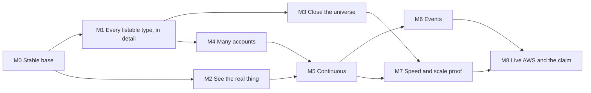

# Roadmap

The sequenced plan for [VISION.md](VISION.md). The vision defines what the
product is and what "done" means per pillar; this file orders the work.

Rules for this file:

- A milestone is delivered only when its exit evidence exists and is
  reproducible from the repository. Code that compiles is not delivery.
- Work packages are sized to become one bead each: an ID, the crates touched,
  the deliverable, and the evidence that closes it.
- Every package goes through the gates in VISION.md section 5.
- A package that needs live AWS authorization stays blocked. Its gate is never
  lowered to mark it complete.

## Delivered baseline

What exists in the tree on 2026-11-13. Counts come from `aws-inventory catalog`
and `aws-inventory coverage`; see VISION.md section 3 for the full table.

- Observation model, bounded validation and per-source provenance.
- Shared executor: per-attempt admission by account/region/quota family,
  adaptive pacing, server retry hints, bounded backoff/deadlines, cancellation.
  SDK clients run one attempt.
- Cloud Control: 421 reviewed types across 76 families (397 root, 24
  parent-scoped) with enrichment, schema-based redaction and generated views;
  universal list-only collection of all 1,291 list-capable types.
- 24 parent workflows (API Gateway REST/V2, AppConfig, EKS, ELBv2 Listener,
  CloudWatch Logs) with ownership checks and `CHILD_OF` edges.
- 39 native SDK kinds: EC2 and VPC networking, ELBv2, ECS, EKS, DynamoDB,
  Lambda, S3, IAM, Route 53, CloudFront, SQS, SNS, KMS, Step Functions.
- Config aggregator and Resource Explorer ingestion; Organizations discovery
  and existing-role fan-out.
- SQLite schema 13 through SQLx: page-atomic commits, immutable observations,
  scope checkpoints, freshness views, account/coverage registry, 421 provider
  views plus native views.
- 968 property relationship rules; opt-in runtime reference resolution at
  export (`--universal-references`).
- Fenced durable whole-scan job queue; streaming JSON/JSONL export; bounded,
  replayable FalkorDB projection; offline `deliver`.
- Snapshot diff, bounded neighborhoods/paths, findings, architecture report.
- CMDB slice: `cmdb-bench` workload generator and oracle (verified at 1 M and
  10 M), `cmdb-view` read model, read-only loopback `cmdb-api`, Makepad
  `cmdb-ui` table and DAG over a synthetic fixture.
- Rust tooling: `inventory-harness` (emulator install/own/seed/assert, live
  gate), `catalog-tool` (parent candidates, packaging), `sdk-operations`
  (20,537-operation map across 440 SDK crates).
- Live emulator gate: native services, reviewed types, universal partition,
  combined scan, multi-page listing, seeded S3.

## Sequence

M1 and M2 touch disjoint crates and run in parallel. So do M3 and M4.

## M0 — Stable base

Everything else builds on a tree that is committed, gated and consistent.

| ID | Work | Exit evidence |
| --- | --- | --- |
| M0.1 | Commit and push the working tree. 179 paths are uncommitted, including six crates, migrations 008–013 and the universal collector | Clean `git status`; `origin/main` contains the tree |
| M0.2 | One Rust gate lane: format, 300-line and 25-line gates, clippy, workspace tests, `catalog-tool parent-candidates --check`, `inventory-harness catalog universal --check`, `inventory-harness coverage operations --check`, generated-view check | A single command exits 0 on a fresh clone with no interpreter other than the Rust toolchain |
| M0.3 | CI runs the gate lane on every push; the live emulator gate runs as a separate job | Passing pipeline on `main` |
| M0.4 | `aws-inventory catalog` reports `sqlite_schema_version` 12; the store is at 13 | Catalog output derives the version from the store; test pins agreement |
| M0.5 | `catalog-tool parent-candidates` recognizes 20 of the 24 implemented workflows and reports 390 remaining; the coverage matrix gives 386. Unrecognized: `ApiGateway::GatewayResponse`, `EKS::Nodegroup`, `EKS::PodIdentityAssociation`, `ElasticLoadBalancingV2::Listener` | Candidate summary and `aws-inventory coverage` agree |
| M0.6 | `MANIFEST.sha256` carries 81,554 of its 82,487 entries from `.local/runtime` (the emulator checkout); packaging is documented to exclude it | Manifest lists only packaged payload; package test pins the exclusion |
| M0.7 | The count of types with property relationship rules is stated as 255 and 258 in documents; the two catalogs sum to 257 | One derived number, printed by `coverage`, quoted everywhere |
| M0.8 | Receipts cited by the verification documents live under a git-ignored `artifacts/` directory that is absent from this checkout | Each milestone's exit evidence is either committed or regenerated by one documented command |

## M1 — Every listable type, in detail

Pillars: Complete, Related, Queryable, Fastest (first number).

Today the universal path lists 1,291 types but stores identity only; detail,
SQL columns and static edges exist for the 421 reviewed types.

| ID | Work | Crates | Exit evidence |
| --- | --- | --- | --- |
| M1.1 | Universal detail: bounded `GetResource` enrichment for every list-capable type, with redaction driven generically by each schema's write-only properties and the global sensitive-name set | `inventory-aws` | Property test over all 1,291 schemas proves no write-only or sensitive property is stored; emulator scan shows `details_available` for every seeded type |
| M1.2 | Generated SQL view for every list-capable type, from schema top-level properties (421 → 1,291) | `inventory-engine` | Additive migration; generated-view check; every view answers a query on an upgraded database |
| M1.3 | Reference resolution on by default at collection time, not only at export | `inventory-engine`, CLI | Seeded emulator fixture with a known reference set: every expected edge present, zero unexpected edges, ambiguity counted |
| M1.4 | Seed breadth: the live gate creates at least one resource for every type the emulator can create, so detail is observed rather than empty lists | `inventory-harness` | Count of types with non-empty observed detail, pinned as a literal in the gate |
| M1.5 | Coverage ledger: one state per type on the VISION 2.1 ladder; the sums equal the universe | CLI | `aws-inventory coverage --ledger`; test pins the partition |
| M1.6 | Sweep benchmark: cold full universal sweep against the emulator under a frozen manifest; report wall time, attempts per resource, resources/s, throttles, peak RSS | `cmdb-bench`, `inventory-harness` | Retained result with manifest; every later milestone reports against it |

## M2 — See the real thing

Pillars: Visible, Queryable. Parallel with M1.

Today `cmdb-ui` renders a synthetic fixture and `cmdb-api` serves one exported
JSON snapshot.

| ID | Work | Crates | Exit evidence |
| --- | --- | --- | --- |
| M2.1 | API reads the store through the bounded read model instead of a parsed export | `cmdb-api`, `cmdb-view` | Endpoint tests over a scanned SQLite database; no read path opens a writer |
| M2.2 | UI data client: `cmdb-ui` loads from the API; the synthetic fixture remains for tests | `cmdb-ui` | Emulator scan → API → UI shows the scanned resources; capture retained |
| M2.3 | DAG from real data: account → region → service → type → resource, with relationship and reference overlays, neighborhood expansion, and a table equivalent for every view | `cmdb-ui`, `cmdb-view` | Every graph view has a table with the same rows; truncation and aggregation are shown explicitly |
| M2.4 | Coverage and freshness on screen: each displayed scope shows its ledger state and age | `cmdb-ui`, `cmdb-api` | A denied and an unsupported scope are visibly distinct from an empty one |
| M2.5 | Frame trace on a 5,000-node / 20,000-edge view with level of detail | `cmdb-ui` | Scripted pan/zoom trace on a declared client; p95 frame time recorded |

## M3 — Close the universe

Pillar: Complete. Needs M1. Parallel with M4.

| ID | Work | Exit evidence |
| --- | --- | --- |
| M3.1 | Generate parent workflows from `catalog/cloudcontrol-parent-candidates.json`: 325 high-confidence proposals accepted through a machine-checked ownership contract, each family with a fixture | Per-family emulator fixtures: required roots added once, independent child cursors, empty pages with continuation followed, ownership confirmed before `CHILD_OF` |
| M3.2 | Review the 13 medium-confidence and 52 low or unmapped parent types, including multi-level parents and account/global contexts | Each type has a workflow or a recorded provider boundary |
| M3.3 | Native adapters for the 180 types with no list/read handler, mapped to SDK operations through `catalog/aws-sdk-operations.json`; a generic list adapter where the SDK shape is regular, typed adapters where it is not | Each type is Detailed, Listed, or a recorded provider boundary |
| M3.4 | Non-registry catalog: SDK list/describe operations that no covered type accounts for, reviewed into native kinds or policy exclusions | Reviewed catalog committed; operation-coverage check accounts for every list operation |
| M3.5 | Global, home-region and partition placement stated per type; global services collected once per account | Tests for a global type, a home-region type and a second partition |
| M3.6 | Universe refresh: re-pin the registry archive, diff the ledger, and attempt newly list-capable types without a code change | A refresh run on a newer archive produces a reviewed diff and a passing gate |

Exit: `aws-inventory coverage --ledger` shows no type in a pending state.

### Native depth backlog

Runs alongside M3. Cloud Control gives configuration breadth; these are the
places where typed SDK reads add operational detail or relationships.

| Group | Remaining detail | Relationships to prove |
| --- | --- | --- |
| Networking | EIPs, egress-only/VPN/transit gateways and attachments, transit/VPN routing, prefix-list contents, endpoint services | Resolve existing references; keep route provenance separate from reachability |
| Traffic entry | ELBv2 tags, attributes, full certificate lists, mutual TLS; Classic ELB; more CloudFront and API Gateway | Entry point to target, without treating omitted fields as absent |
| Naming | Cloud Map, Route 53 health checks and resolver detail | DNS name to endpoint or service |
| Data | S3 account controls, RDS/Aurora, ElastiCache, Redshift, EFS, OpenSearch, DynamoDB related configuration | Workload dependency, encryption key, subnet placement |
| Identity | IAM users/groups, inline policy and policy-version metadata | Assumed role, trust relationships |
| Containers | Container instances, capacity-provider and host mappings, ECR and Auto Scaling detail | Service to target group, task definition, image and host |
| Events | Runtime detail and producer/consumer links across SQS, SNS, EventBridge, Lambda event sources, Step Functions | Invocation chains |

Tag enrichment is missing for DynamoDB, Lambda and ELBv2. Kubernetes objects
inside EKS need a separate authenticated collector and coverage model.

## M4 — Many accounts

Pillars: Fleet, Resilient, Fastest. Needs M1.

Today discovery is a per-invocation report, jobs are whole scans, quota
coordination is process-local, and an invocation is capped at 128 profiles and
1,024 accounts.

| ID | Work | Exit evidence |
| --- | --- | --- |
| M4.1 | Registry wired to Organizations discovery: account, OU path, partition, role, onboarding state, last verification | Discovery populates and re-verifies the registry; a suspended account changes state |
| M4.2 | Declared population: frozen account × region × collector manifest with a digest per cycle | A unit the collector never emits is reported as a gap |
| M4.3 | Task scheduler: one durable work item per population unit, with fairness, priority, per-scope leases and epoch-fenced evidence writes | A stale worker's write is rejected; one slow account does not starve the rest |
| M4.4 | Quota coordinator shared across workers; credential refresh; client reuse | Two worker processes against one bucket stay within its configured ceiling |
| M4.5 | Fleet gate on emulators: 100, then 1,000 simulated accounts with skewed sizes, empty regions, denials and throttling | Every unit has an explicit result; sweep benchmark reported at each size |

## M5 — Continuous

Pillars: Continuous, Related, Visible. Needs M2 and M4.

| ID | Work | Exit evidence |
| --- | --- | --- |
| M5.1 | `serve`: a long-running service in which a staleness planner feeds the scheduler and complete reconciliation sweeps recur | Runs unattended against the emulator; every scope's age stays inside its declared bound |
| M5.2 | Current-state read model and monotonic change log | A change in the emulator appears as one ordered delta; replay from a cursor converges |
| M5.3 | Tombstones and retention: absence only from a complete enumeration of the scope | No tombstone under denial, partial or unsupported; retention cost measured |
| M5.4 | Failure matrix on the emulator: kill mid-sweep, duplicate delivery, expired lease, stalled projection | Every row of the CMDB_ARCHITECTURE failure matrix passes deterministically |
| M5.5 | Incremental, versioned graph projection with a stale-writer fence | A single change updates the graph without a full rebuild; a rebuild yields the same graph |
| M5.6 | Delta feed in the API and live updates in the UI | A created, changed and deleted resource each appear in the open UI without a reload |

## M6 — Events

Pillars: Continuous, Fastest. Needs M5.

| ID | Work | Exit evidence |
| --- | --- | --- |
| M6.1 | EventBridge and CloudTrail consumer: dedupe, map to scope, coalesce, schedule targeted refresh | Duplicate and out-of-order events converge; a storm stays bounded |
| M6.2 | Config and Resource Explorer as change feeds with capture-time clocks and prerequisite checks | Provider, receipt and ingest lag reported separately |
| M6.3 | Reconciliation proves events were sufficient | A dropped event is repaired by the next sweep with no false deletion |

Blocked for live use until an event bus and Config aggregator are authorized.
The consumer and its tests are built against the emulator first.

## M7 — Speed and scale proof

Pillar: Fastest. Needs M3 and M5.

| ID | Work | Exit evidence |
| --- | --- | --- |
| M7.1 | Profile the sweep and the steady-state loop in release mode; optimize only what the profile names (batching, encoding, client reuse, admission) | Before/after on the M1.6 manifest; no loss of coverage, edges or durability |
| M7.2 | Shared store decision: PostgreSQL measured against the existing store contract and workload | Written decision record with write, read, recovery and operating cost; migration and rollback exercised |
| M7.3 | Query suite at 1 M and 10 M assets | p50/p95/p99 with rows examined and returned, on declared hardware |
| M7.4 | Steady-state campaign: declared change rate with skew and bursts | Change-visibility latency distribution; backlog age bounded |

## M8 — Live AWS and the claim

Needs M6, M7 and explicit authorization for accounts, roles and quotas.

| ID | Work | Exit evidence |
| --- | --- | --- |
| M8.1 | Two accounts, two regions, deliberately different roles; tested IAM policy examples for the exact operations used | Identities and counts match authoritative APIs; denial, unsupported and empty are distinguished |
| M8.2 | Quota calibration from Service Quotas and observed throttling | Request rates inside declared quotas; cooldown and recovery verified |
| M8.3 | Rollout 100 → 1,000 accounts with a multi-day soak | No false deletion, no unbounded backlog, coverage report per unit |
| M8.4 | Head-to-head against CloudQuery and Steampipe: cold sweep, steady state and query, at equal coverage, permissions and quota, interleaved, never run concurrently against shared quotas | Published manifest, raw results, confidence intervals; the claim is limited to the tested workload |
| M8.5 | Release gates: reproducible builds and checksums, advisory and license review, migration and backup/restore exercise, API authentication and authorization, metrics and runbook, whole-project mutation score of at least 95% of viable mutations | Each gate has a retained receipt |

## Global blockers

- **No live AWS authorization.** Emulator results do not establish role
  assumption, quotas, cross-account aggregation or regional availability.
- **No quota calibration.** Documented defaults are not an account's limits.
- **No collection benchmark.** The only baseline is local storage and mock
  scheduling ([CMDB_BASELINE_2026-11-13.md](CMDB_BASELINE_2026-11-13.md)).
- **No scale evidence.** Nothing is measured at 10 M assets.
- **No UI frame-time evidence.** The Makepad table and DAG exist; no trace has
  been recorded and the viewer is not wired to real data.
- **No event ingestion.**
- **Mutation gate unachieved.** The whole-project 95% target has not passed;
  package-level results do not substitute for it.

## Standing constraints

- A public IP is not proven reachability and an attached role is not effective
  permission. Those verdicts need evaluation semantics that are out of scope.
- Deleted, unobserved, inaccessible and unsupported stay four different states.
- An SDK crate or a convenience view does not raise a coverage count.
- Distributed collection needs exclusive scope ownership or a shared limiter;
  independent local token buckets are not sufficient.
