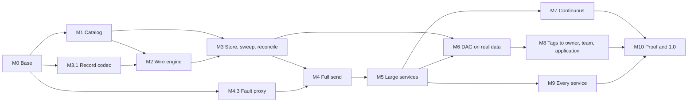

# Roadmap

Status: build plan for [VISION.md](VISION.md), 2026-11-13. Decision IDs (V01 to
V34, O2 to O8) refer to that document.

Agents work from this file (V20). Local GPU workers and ChatGPT Sol build
independent packages in parallel in separate worktrees. The coordinator owns
integration and verification. Every package goes through the same loop:

1. A local GPU or Sol worker implements it with `holzman-rust`,
   `functional-rust` and `scott-ddd-refactor` loaded.
2. The coordinator compiles and runs the narrow checks.
3. `black-hat-reviewer` and `test-reviewer` review independently.
4. Findings go back to the same worker as one repair packet.
5. Repeat until both reviewers report no findings. Then land, through the
   gates in VISION section 10.

Take the first unfinished package whose "Needs" are done. A package is done
only when its exit evidence has been produced; "implemented" is not a status.
The coordinator marks it done here, in the landing commit, with the command
that proved it.

## Rules for every package

- No Cloud Control, no new typed SDK service crates, no JSON on the data path,
  no Python.
- No service-specific Rust. If a service needs special handling, it goes in the
  overlay. An exception needs a written reason in the change.
- `unsafe_code = "forbid"` stays. No package relaxes a workspace lint.
- A package lands as one change. Where a row says "one change per …", each of
  those changes carries the row's evidence for its part.
- Exit evidence is a result another agent can reproduce with the named
  command. Running something is not evidence; its output is.
- Each package states the lines of Rust it added and deleted. Wave packages
  (M5, M9) are expected to delete more than they add.
- Evidence comes from the pinned emulator with real signed requests, run in the
  same owned process lifetime as the test. Emulator and real-account evidence
  are reported separately. An operation is emulator-verified only when it
  returned at least one seeded resource.
- One heavy Cargo build at a time on this machine.

Paths fixed here so that packages agree: models `.local/aws-models/` (a git
submodule; `scripts/check-models.sh` checks it); field-ID registry
`catalog/field-ids.txt`; compiled catalog `catalog/aws-api.catalog`; embedded
typed overlays `crates/catalog-tool/src/overlay/builtin/`; kind mappings
`crates/catalog-tool/src/kind_map/builtin.rs` (`SOURCE`); wire engine crate
`crates/wire` (`aws-wire`). Denials and spelling exceptions are also embedded
Rust data, not external text/TSV inputs. Historical milestones below retain
their original evidence; they are not current verification results.

Current policy contracts are documented in [API_CATALOG.md](API_CATALOG.md):
selected-item paths explicitly support scalar `$`, while request paths remain
strict modeled paths. `LastListItem` pagination carries the final list scalar
into the next typed request token. Typed relationships distinguish selected
output, request and compiled parent sources, and selected-value, bound-context
and canonical-ID target modes. These describe the recovery source contract,
not passing verification gates or complete AWS coverage.

## Baseline

At commit `78d3ac2`: the workspace compiles (`cargo check --workspace`). 39
resource kinds are collected by hand-written typed adapters and 421 types
through Cloud Control, into SQLite schema 13, with 968 reviewed relationship
rules, a FalkorDB projection, a rate limiter that is the single retry owner,
fenced whole-scan jobs, an owned emulator harness, a workload generator that
writes files, a loopback read API and a Makepad UI that renders a synthetic
fixture. Emulator fixtures are seeded by Python scripts and by Cloud
Control calls in `crates/harness/src/seed.rs`. There is no wire engine, no
binary record, no continuous mode and no benchmark of collection.

## Sequence

The diagram is the coarse order; the "Needs" column of each package is exact.

Starting now (V29): M0.3, M0.4, M0.5 and M0.7 finish M0, while M1.1 and M3.1
start in parallel. M4.3 needs only M0 and can start any time.

Historical status from the coordinator, 2026-11-13 (including the milestone
evidence below; not a current recovery verification result).

- **M0.7 was superseded by the owner's no-comments policy.** Rust source
  comments, including Rustdoc, are being removed together with `missing_docs`
  gates. API contracts, bounds and verification belong in external Markdown.
  Prior documentation-gate results are historical, not a current requirement.

- **The binary-only core feature is done**, a prerequisite rather than completion
  of M3.5. `inventory-core` with default features disabled contains `catalog`
  and `record`, with no serde/serde_json in its normal dependency graph.
  The default `legacy` feature preserves old scan API imports and behavior.
  Both independent reviews approve. Verified: 200 binary-only core tests,
  227 legacy core tests, 164 catalog-tool unit tests, both feature-specific
  source Clippy runs and source guards. Rust lines: 397 added, 389 deleted,
  mostly moving the old model below its feature boundary.

- **M2.3 is done.** The pooled HTTP client supports HTTP/1.1 keep-alive and HTTP/2,
  bounded response bodies and a global socket cap. Request and connector
  deadlines are independent; connector time includes admission, bounded DNS,
  TCP and TLS, including abandoned connection attempts. Public timed-out sends
  are counted once. Review findings on lifecycle, error classification, bounds
  and trust tests are closed; after integration rebase all 98 wire tests,
  source Clippy and both source guards pass. Accepted limits: idle sockets keep
  permits until eviction, and checkout-age expiry may retire an HTTP/2 sender
  while active streams keep their permits. Rust lines: 3,313 added, none
  deleted; production 766. Serializers and decoders remain open.
  A later cancellation review found that stalled OS DNS workers could retain
  all lookup permits after request cancellation. Client-owned asynchronous
  Hickory DNS replaces those workers; the cancellation/recovery regression,
  transport suites (118 tests total) and warnings-denied source Clippy pass.
  System DNS/hosts/search configuration is retained, but custom NSS plugins
  are outside this resolver's compatibility boundary.

- **M1.4a is done.** `catalog-tool plans` derives collection evidence, never
  authorization to send requests: 2,197 enumeration candidates, 2,940 expansions,
  337 modeled expansions (313 with a list source), and 2,603 requiring overlays.
  Of 1,846 List/Describe operations without modeled pagination, 1,406 have no
  detected pagination evidence and 440 require overlay review. The report also
  records 32 token pairs, 3,015 known page-size maxima and 124 batch reads.
  Independently executed jq extraction matches the report's totals and splits.
  Both reviews approve; 392 catalog-tool tests pass after integration rebase,
  including the 512-example fixed-seed property, with source Clippy, source
  guards and exact report comparison clean. The gate checks generated bytes.
  Rust lines: 2,374 added, 21 deleted. Semantic overlay validation and callable
  handles remain M1.4c, not part of this report.

- **M1.4b is done: the overlay syntax parser, not callable authorization.**
  It bounds files, traversal, operations and arrays; rejects unknown keys and
  wrong types; and validates dates, templates and explicit binding cycles.
  Parsed service values expose only read-only getters. An external consumer
  compile probe produces three `E0616` errors for attempted format, review
  and operation-map mutation. Code and test review findings are closed;
  after integration rebase all 427 catalog-tool tests, source Clippy and
  both source guards pass. The external format reference is in
  `docs/API_CATALOG.md`; source comments are pending the global removal.
  Rust lines: 2,855 added, none deleted; production 1,454, above the original
  estimate without dropping validation. M1.4c remains open.

- **M4.3 is done.** The seeded HTTP fault proxy supports every requested
  fault, latency and per-scope rate limit, with bounded state and owned task
  shutdown. Independent code and test reviews closed their findings after
  protocol, timing and architecture repairs. All 52 proxy tests and 179
  harness tests pass. All seven ignored live emulator tests were explicitly
  enabled and passed, including S3 through the proxy's TLS upstream and a
  scheduled throttle. Main integration also passes Clippy, the 52 proxy
  tests and both size guards. Rust lines: 4,909 added, none deleted;
  production 2,483, above the original estimate without omitting bounds.

- **M1.2c is done.** The committed binary catalog is 6,951,532 bytes;
  compile/write followed by compile/check yields identical bytes and SHA-256
  `4ccb385a0d57ff48d8b957114ddbe27db4537d726368e0cc3d10b13a231bce3b`.
  `aws-inventory catalog --models` reads the embedded bytes and reproduces
  the model counts without JSON. Catalog structural validation allocates no
  heap storage and rejects container depth above 32; generic record readers
  preserve deep-value compatibility. Clean source provenance includes
  ignored untracked models. Independent code and test reviews closed their
  findings; 571 core/catalog tests and the product CLI test pass after
  integration rebase, with Clippy and both size guards clean. The gate checks
  regenerated catalog bytes. Rust lines: 3,456 added, 69 deleted.

- **M1.1 is done**, as a git submodule and not as our own code. A local worker
  built lock, verify and fetch commands (1,181 lines); the coordinator found
  the stored digests were hashes of hashes, and the two reviewers found 14
  blocking defects, one of which would have run `git checkout` on this
  repository. It was discarded for the submodule, which needs no code (V23).
- **M1.2a is done**, `cde710a`: the real pinned source reproduces the model
  totals in `catalog/aws-models.report`. `catalog-tool models report --check`
  passes; all 43 catalog-tool tests and all-target Clippy pass.
- **M1.2b is done.** `catalog/field-ids.txt` has 49,069 lines and equals an
  independent `jq` extraction of every structure and union member name;
  `catalog-tool models fields --write` run twice prints `field-ids 49069 (+0)`
  the second time with identical bytes, and `--check` is in the gate with the
  M1.2a report check and the submodule check. The registry is append-only:
  new names are appended in sorted order after all existing lines, a removed
  member keeps its line, and `Registry::verify_prefix` rejects a file that is
  not an extension of the previous one. A swapped but well-formed committed
  file cannot be detected by the command alone, since it has no history; the
  prefix check is for the reviewer of a change. Publication is an exclusive
  temporary file used as a lock, a comparison with the bytes read at the
  start, and an atomic rename; reads are bounded at 16 MiB. Independent code
  review: five findings (lost update between two writers, temporary path
  reuse through a symlink, unbounded read, temporary file left behind,
  output larger than its own read bound), all closed. Independent test
  review: six gaps, closed. Mutation testing (cargo-mutants, 62 mutants):
  51 caught, 9 not buildable, 2 missed, both closed by tests. 100
  catalog-tool tests pass. Rust lines: 1,525 added, 17 deleted; production
  560 added, 17 deleted, above the 300-line target because of the
  publication safeguards the review required.
- **M1.3a is done: every operation has a class, and the class is a candidate,
  not a permission.** `catalog-tool classes [--check | --write]` classifies
  the 19,641 operations and writes `catalog/aws-classes.report`: enumerate
  2,197, expand 2,940, denied 11,370 (mutating 11,277, content 65, secret 22,
  paid 4, reference data 2), unclassified 3,134. All 11,275 operations whose
  name starts with no read verb are denied; only `List` and `Describe` names
  can be classed by rule; `readonly` is counted and never consulted. The
  must-deny list `catalog/overlay/must-deny.txt` has 85 entries: the 15 names
  of the row below and 70 service-scoped `List`/`Describe` operations that an
  independent Black Hat review found by reading the model documentation
  (they return secrets, customer content or presigned URLs, are billed, or
  can create a key: `storage-gateway/DescribeChapCredentials`,
  `cognito-identity-provider/DescribeUserPoolClient`, `kms/DescribeKey`,
  `iot-data-plane/ListRetainedMessages` and others), each with its sentence
  beside it; five of them are denied as unverified until a service review
  decides. The same review counted 3,693 of the 5,207 `List`/`Describe`
  operations without the `readonly` trait, which is why the trait cannot be
  the gate and why class alone must never make an operation callable. An
  entry that matches no operation fails the build; an input that does not
  resolve, or uses mixins, is an error and not "no required input". The
  report equals an independent `jq` derivation; `classes --check` is in the
  gate. `cargo test -p catalog-tool --locked` passes 225 tests. Black Hat
  review: four findings, two closed and confirmed, two (bounds inside the
  shared model discovery and reader) closed afterwards in one change for
  every command that reads the models; test review: eight gaps, closed. Rust
  lines: 1,869 added, 11 deleted; production 713. Still open in M1.3: the
  callable handle and its proof (needs the overlay, M1.4).
- **M1.5a is done: the SQL naming rule, as a library.** `catalog_tool::names`
  derives a kind's SQL table name from a type name by one written rule
  (digits and a final `V2` stay attached, acronym runs split before the last
  capital) and a committed, sorted exceptions file,
  `catalog/name-exceptions.tsv` (11 reviewed spellings: `ACMPCA`, `B2BI`,
  `FSx`, `IPv4`, `IoT`, `OAuth`, `OAuth2`, `OTel`, `SMSVOICE`, `VPCDHCP`,
  `WAFv2`). Applied to all 1,881 CloudFormation type names with no
  exceptions, the rule equals an independent `jq`/`sed` derivation with zero
  differences; with exceptions the 1,881 names are distinct and at most 69
  bytes. A name is made only through one constructor that enforces
  `[a-z][a-z0-9_]*`, two words or more, 128 bytes, no `sqlite_` prefix and
  no SQLite keyword; output growth is checked before each append and the
  inputs are bounded. `cargo test -p catalog-tool --locked names` passes 55
  tests. Black Hat review: two findings (unsafe SQL identifiers reachable
  through an exception, limit checked after allocation), closed and
  confirmed; test review: six gaps, closed. Rust lines: 1,368 added, none
  deleted. Still open in M1.5: the type-to-kind map and `catalog/kinds.tsv`
  (needs M1.4). Its gate must compare against the committed file, because
  adding an exception after a kind is published renames its table.
- **M1.6a is done: every service's endpoint is derived from its own rule
  set and proven on the models' own cases.** `catalog-tool models endpoints
  [--check | --write]` evaluates each model's endpoint rules with a small
  interpreter (seven of the standard functions; any other is a typed
  "unsupported" result, and no in-scope case of the pinned models reaches
  one) and writes
  `catalog/aws-endpoints.report`. Of the 14,115 published endpoint cases,
  4,109 are in this package's scope (a commercial region, FIPS and
  dual-stack off, no other parameter) and all 4,109 pass; the other 10,006
  are counted by exclusive reason (other partition 5,631, FIPS 1,809,
  dual-stack 908, custom endpoint 844, operation inputs 538, other
  parameters 276) and not executed. Per service the report gives a URL
  template, signing name and signing region: 28 global, 401 regional, 5
  needing an overlay (`acm`, `cloudfront-keyvaluestore` and `neptune-graph`
  need a request parameter; `simpledbv2` and `eventbridgev2` have a template
  no published case confirms), 2 unsupported (no SigV4: `codecatalyst`,
  `account-access-runtime`). Every passing case is compared with its
  service's template; the three that differ are explicit exception rows
  (`health` and `sts` at `aws-global`, `simpledbv2` at `us-east-1`). A Black
  Hat review found the first version published `sdb.{region}` although the
  model's own case says `sdb.amazonaws.com`; that check now exists because
  of it. `cargo test -p catalog-tool --locked` passes 302 tests; the gate
  runs `models endpoints --check`. Black Hat: five findings, three closed
  and confirmed against 99 expectations in 12 services, one closed by
  amending the scope (the skipped cases are outside what this package
  proves; the product has no rules interpreter at run time, so other
  partitions, FIPS and dual-stack stay unsupported until a later package
  compiles templates for them, a custom endpoint is the user's override of
  the whole URL, and services whose endpoint depends on a request value need
  overlay data), one closed afterwards with the shared reader bounds; test
  review: 13 gaps and 5 later survivors, closed. Rust lines:
  4,138 added, 2 deleted; production 1,783 against a 1,200 estimate. Still
  open in M1.6: overlay templates for the five services and storing the
  result in the binary catalog.
- **O1 is settled as V34**: records are CBOR through the `minicbor` library.
  The coordinator first wrote its own format (1,054 lines), then ran the codec
  benchmark at the owner's prompting; CBOR was faster to build and smaller, so
  the own format was deleted before it landed. It and the benchmark are kept
  on the branch `evidence/o1-record-codec`.
- **M3.1a is done**, `5910de1`: `cargo test -p inventory-core --tests --locked`
  passes 122 tests; all-target Clippy passes. Encoding is canonical, capped
  before copying beyond 16 MiB, and bounded to 32 containers. Borrowed lookup
  skips generic unselected values without allocation; malformed framing and
  selected unsupported forms retain distinct errors. Both reviews are closed.
  Rust footprint: 2,808 added, none deleted, including tests; production is
  941 physical lines, above the 500-line stop/report target. Typed domain
  errors, generic framing validation and allocation-free borrowed skipping
  account for the overage; byte parsing remains minicbor's responsibility.
- **M3.1b is done; M3.1 is complete.** `cargo test -p inventory-core --locked`
  passes 172 tests, 50 of them new (`content_hash`, `record_evolution`).
  `Record::content_hash(&Exclusions)` is BLAKE3 (the `blake3` library, 32
  bytes) over one format-version byte followed by the record written again
  with indefinite-length containers, so an excluded entry is dropped during
  one pass with no buffer and no allocation; a path of field IDs is anchored
  at the root, and lists and name-keyed entries do not add path steps. The
  proof includes one record whose hash input is written out by hand, the
  32/33 nesting bound for lists, maps and timestamps, and a record written
  under one registry and read under a longer one. `FORMAT_VERSION = 1` is
  the bare root map, so no byte is added to stored records; a later format
  must begin with a CBOR tag, which version 1 readers reject. Also added,
  for the catalog (M1.2c) and typed column reads (M3.2): the borrowed
  validated view `MapRef::from_bytes`, `ValueKind` and `MapRef::get_typed`.
  Independent code review: no findings; independent test review: four gaps,
  all closed. Rust lines: 1,350 added, 19 deleted; production 326 added, 18
  deleted.
- **M3.1c is done: a validated record now carries the invariant its lookups
  use.** An architecture audit found that `Record::from_bytes` and
  `MapRef::from_bytes` accepted any well-framed CBOR while lookup stops at
  the first greater key, so `{2: 0, 1: "x"}` reported field 1 absent.
  Validation now proves, in the same single pass and with no allocation
  beyond the frame stack, that every map a reader can reach (the root, and
  every definite-length map found as a map value or list item) has field-ID
  or name keys in strictly ascending order; `KeyOutOfOrder` and
  `DuplicateKey` carry the offending key's offset. Content inside a tag or an
  indefinite-length container stays opaque, so version 1 still skips value
  kinds it does not know. Non-shortest integer encodings remain accepted
  (order and equality are by decoded value; the hash normalizes widths).
  `cargo test -p inventory-core --locked` passes 193 tests, 21 of them new.
  Black Hat review: no findings; test review: three gaps, closed. Rust lines:
  644 added, 102 deleted; production 158 added, 51 deleted.
- **The M2 crate exists and its protocol oracle is in the tree.** `crates/aws-wire`
  is scaffolded (`ac75ec1`). Smithy's published protocol test suites are
  committed as complete JSON ASTs under
  `crates/aws-wire/tests/fixtures/protocol-tests/`, converted once, outside the
  build, by `scripts/protocol-tests/convert.sh` from Smithy 1.75.0 (commit
  `981f95a2cae567752b70749c1f04502c076a7a63`) with the released Smithy CLI
  and `jq`; two clean conversions gave identical SHA-256 digests, recorded in
  the fixtures' README. Seven protocols, 901 HTTP cases (478 request, 366
  response, 57 error), 3,229,771 bytes. No Rust lines. M2.1a to M2.1c and M2.4a
  to M2.4d prove themselves against these files.
- **M2.2a is done: the signing library half of M2.2.** `aws_wire::sign` is a
  wrapper over `aws-sigv4` 1.6.5 with typed scope values, redacted
  credentials, caller-supplied time, body bytes or a precomputed SHA-256,
  standard and S3 path modes, and size bounds checked before any work; it
  re-implements no canonicalization. `cargo test -p aws-wire --locked` passes
  35 tests: 37 of AWS's published SigV4 vectors, byte-identical copies of the
  files shipped in the `aws-sigv4` crate, are compared with their full
  published `Authorization` value. Three vectors are excluded with reasons
  (folded headers, a literal space in the URI, a session token left out of
  signing). Black Hat review: two findings (Host length checked after use,
  six parameters), closed; test review: three gaps, closed. Rust lines:
  1,270 added, none deleted; production 349. The seven-serializer live request
  smoke now passes: each signed read-only request returned HTTP 200 and its
  altered-signature control returned HTTP 403 against the authenticated local
  emulator. This closes that request/authentication smoke, not response decoding
  or the complete universal inventory pipeline; see [VERIFICATION](VERIFICATION.md).
- **The first end-to-end slice runs against the emulator (M3.2, M3.3, M3.4,
  M3.6, M3.7 and M6 for reviewed EC2/STS only).** `aws-inventory sweep`
  executes compiled runtime plans through `aws-wire` into SQLite schema 14 and
  FalkorDB; `cmdb-ui` reads both. The ignored `sweep_e2e` suite passes both
  live tests (see [VERIFICATION](VERIFICATION.md)). Scope is deliberately
  narrow: four callable operations (EC2 `DescribeVpcs`, `DescribeSubnets`,
  `DescribeRegions`, STS `GetCallerIdentity`), one reviewed relation
  (`Subnet.VpcId` → `VPC.VpcId`, `IN_VPC`). Universal coverage needs M5
  overlays per service. Open in these milestones: the M3.2 open-time and
  regeneration measurements, the M3.3 100-point kill matrix, and M3.5's gate
  check.

Packages that can run at the same time: M1 with M3.1 and M4.3; M2.1a to M2.1c,
M2.2 and M2.3 with each other; M2.4a with M2.4b; the M5 services
with each other (one overlay file each); M6.2 and M6.3 with M4 and M5; M7, M8
and M9 with each other.

## M0 — Base

| ID | Work | Needs | Exit evidence |
| --- | --- | --- | --- |
| M0.1 | Commit the working tree as the baseline. **Done**, `78d3ac2`. | | `git log` |
| M0.2 | All targets compile. **Done**, `b5332e8`; reverified after the dependency upgrade with the current workspace tests and final gate. | M0.1 | `cargo check --workspace --all-targets --locked -j1` passes |
| M0.3 | **Done:** `moon ci` replaces `scripts/verify.sh`. Moon 2.2.4 and 1.100.0 stable are pinned; all Cargo tasks share a mutex and quality tasks do not reuse cached passes. Pull requests and pushes to main run the gate; version tags also publish the built Linux debug collector and Makepad artifacts. | M0.2 | Local integration run on 2026-11-14: exit 0, 17 tasks completed in 8m 1s 236ms, including freshness checks, binary-only core tests, all-target/all-feature checks and workspace tests, warnings-denied source Clippy, both size guards and final build. Live component tasks remain opt-in; universal-pipeline proof is separate. |
| M0.4 | The catalog command reports the store's schema version. **Done**, `bbd0821`: `inventory_engine::store::SCHEMA_VERSION` is the single source; the engine migration tests bind it to the real `PRAGMA user_version`; `tests/cli_properties.rs` pins 13 through the binary. | M0.2 | `aws-inventory catalog` prints `"sqlite_schema_version": 13`; no literal schema number remains in `src/catalog.rs` |
| M0.5 | Regenerate `MANIFEST.sha256` from tracked files only. **Partly done**, `bbd0821`: both packagers now exclude `.local`. Still open: the file itself has not been regenerated (the working copy has 82,487 lines, 81,554 under `.local/`); do it when no worker has uncommitted files in the tree. | M0.2 | Every path in the file is in `git ls-files`; none starts with `.local/` |
| M0.6 | Push `main`. **Done**, `b5332e8`. | M0.2 | `git status -sb` shows no divergence |
| M0.7 | **Superseded by owner decision:** no Rust code comments, including Rustdoc. Remove existing comments and `missing_docs` gates; keep contracts in external Markdown. Removal is in progress. | M0.3 | Lexer-based verification finds no Rust comment tokens; format, source guards and affected compilation/tests pass without missing-docs enforcement. |

## M1 — API catalog

Crate: `catalog-tool`. Reading the model files with a JSON parser here is build
tooling, not the data path.

| ID | Work | Needs | Exit evidence |
| --- | --- | --- | --- |
| M1.1 | Pin the models (V23). Done: `.local/aws-models` is a shallow git submodule of `github.com/aws/api-models-aws` at commit `46135f8468cd5cb60d983b97290c9f6661e359c6`. `git submodule update --init --depth 1 .local/aws-models` fetches it; `scripts/check-models.sh` fails unless the checkout is at the pinned commit with no file changed or added. | M0.2 | On a fresh clone the update then the check exits 0 and prints 436 files; changing one byte or adding a file makes the check exit non-zero and name the file; a checkout at another commit, or none, fails the check |
| M1.2a | **Done**, `cde710a`: model reader and report. `catalog-tool models report` streams the 436 files and counts services, protocols, operations, shapes, members, paginators and classification traits. Detailed collection planning remains M1.4. | M1.1 | Actual `models report --check`, 43 tests and all-target Clippy pass. The committed report matches VISION section 3: 436 services; 19,641 operations; 8,366 read-named; 2,736 `readonly`; 5,207 List/Describe, 2,209 input-free in 359 services; 3,787 paginators; 44 rpcv2Cbor; 413 JSON; 20 XML-only; 238,070 members and 49,069 distinct names. No expected totals were tuned |
| M1.2b | Field-ID registry `catalog/field-ids.txt`, committed: one member name per line; the line number is the ID; lines are only ever appended. | M1.2a | The file has 49,069 lines; regenerating it changes nothing; a test fails when the committed file is not a prefix of the regenerated one; removing a member from a test model leaves its line in place |
| M1.2c | Binary catalog `catalog/aws-api.catalog`, committed (V23), embedded with `include_bytes!` and read in place through a validated safe accessor. It is encoded as CBOR with the M3.1a record module (V34). | M1.2b, M3.1 | Recompiling is byte-identical; the gate fails when the committed catalog differs from a recompile; `aws-inventory catalog` reports the M1.2a counts from the embedded bytes; a corrupted catalog gives an error, never a panic; no `unsafe` |
| M1.3 | Classify every operation as enumerate, expand, denied (content, secret, paid, mutating, reference data) or unclassified, as in VISION 5.1. Deny rules run first and win. Only List and Describe names can be classed by rule; every other read name stays unclassified until a typed policy reviews it. Mandatory denials are embedded in `crates/catalog-tool/src/classes/deny/builtin.rs`, including `GetId`, `ReceiveMessage`, `GetCostAndUsage`, `GetSecretValue`, `GetFunction`, `GetObject`, `Scan`, `Query`, `GetParameter`, `GetPasswordData`, `GetLogEvents`, `GetMetricData`, `GetAuthorizationToken`, `GetSessionToken` and `GetRecords`. | M1.2c | `catalog-tool classes` prints counts per class that sum to 19,641; all 11,275 operations whose name starts with no read verb are denied; every mandatory denial is denied; a test proves no callable handle can be obtained for a denied or unclassified operation, or for a service with no reviewed typed policy |
| M1.4 | Collection plans and the overlay format (O2), documented in the `catalog-tool` crate documentation. Derive parent-to-child bindings, identity, largest page size, lists that make the describe unnecessary, batch reads, fields excluded from hashing, scope (per region, once per account, home region) and the paginators the model lacks. | M1.3 | `catalog-tool plans` prints: enumeration candidates (2,197 after the List/Describe denials of M1.3a; 2,209 before), expansions bound from modeled identifiers, expansions that need an overlay entry, and the 1,846 List/Describe operations with no modeled paginator split into unpaginated and needs-overlay; an overlay entry that names an unknown operation or member fails compilation |
| M1.5 | Names (V26, V30). Map each of the 1,881 CloudFormation types to a catalog kind or record why not; derive every kind's SQL name; name kinds that have no CloudFormation type in the same style. The rule: split the type name at `::`. Split each part into words (a) before an upper-case letter that follows a lower-case letter or a digit, (b) inside a run of upper-case letters, before the last one when a lower-case letter follows it, and (c) before a version suffix, which is a `V` followed only by digits up to the end of the part. Digits otherwise stay with the letters before them. Lower-case every word and join all words with `_`. Acronyms therefore stay whole (`EC2`, `IAM`, `KMS`, `VPC`, `DB`). Exceptions are embedded in `crates/catalog-tool/src/names/exceptions.rs` and are only spellings the rule splits wrongly: `IoT` is `iot`; `IPv4` and `IPv6` are `ipv4` and `ipv6`; `WAFv2` is `wafv2`; adjacent acronyms are separated by hand (`VPCDHCPOptionsAssociation` is `vpc_dhcp_options_association`). Embedded typed mappings in `crates/catalog-tool/src/kind_map/builtin.rs` (`SOURCE` and its data modules) feed schema generation (M3.2) and the rules. | M1.4 | 1,881 type rows with counts of mapped, unmapped and not-a-resource; a test proves no two types and no two kinds map to the same SQL name; these come out exactly: `aws_ec2_instance`, `aws_iam_role`, `aws_kms_key`, `aws_rds_db_instance`, `aws_ec2_vpc_endpoint`, `aws_elastic_load_balancing_v2_target_group`, and by the plain rule `aws_dynamo_db_table`; every embedded spelling exception is used by at least one type; each of today's 431 kind names has a mapping giving its new name (for example `aws_vpc_subnet` becomes `aws_ec2_subnet`), so every target of the 968 rules resolves |
| M1.6 | Endpoints. Evaluate each model's endpoint rule set at compile time for the commercial partition with FIPS and dual-stack off; store a URL template, signing name and signing region per service; mark services that resolve to one endpoint for every region as global. Rule sets that need request parameters (bucket, account ID) get an overlay template. The emulator cannot prove any of this, because every request goes to its one endpoint. | M1.2c | The models' own endpoint test cases are run: every case whose only parameters are a commercial region with FIPS and dual-stack off resolves to the expected URL and signing properties; the report states cases run, passed and skipped out of 14,115; each service handled by an overlay template or marked unsupported is listed; IAM, Route 53 and CloudFront are reported as global |
| M1.7 | **Done**: removed the redundant typed-SDK catalog and operation inventories, their generated data, commands, audit/reconciliation consumers and dependencies. Retained typed service adapters for M2.6 and independent Cloud Control/delivery evidence. | M1.2c | Neither package appears in Cargo metadata. All-target/all-feature workspace check, 26 retained behavior tests including the real catalog CLI, production Clippy with warnings denied and both source guards pass. |
| M1.8 | Model update. `catalog-tool models bump <commit>` re-pins, recompiles and prints added, changed and removed operations and members. New operations are unclassified. New member names are appended to the registry. | M1.3 | Bumping to a later upstream commit prints the differences; no existing registry line changes; no operation becomes callable through the bump alone |

## M2 — Wire engine

New crate: `aws-wire`.

| ID | Work | Needs | Exit evidence |
| --- | --- | --- | --- |
| M2.1a | **Done:** request serializers for awsJson1.0, awsJson1.1 and rpcv2Cbor. | M1.2c | Published client request fixtures pass in `request_body_fixtures` (18 tests); server-only cases are explicitly accounted. Response decoding remains M2.4. |
| M2.1b | **Done:** request serializers for awsQuery and ec2Query. | M1.2c | Both published client fixture runners pass within the 38 request-library tests, including form encoding, limits and fractional timestamps. |
| M2.1c | **Done:** request serializers for restJson1 and restXml, including path/query/header bindings, host prefixes and explicit S3 addressing policy. | M1.2c | All 142 REST JSON and 109 REST XML client cases pass with unmodified expected URI/host/header/body values; seven adversarial XML-comparator tests distinguish ordered collections, modeled flattening and namespaces. A regression rejects mismatched service protocols before request construction. |
| M2.2 | SigV4 signing with `aws-sigv4`. Credentials are passed in by the profile loader in `inventory-aws`. No signing-key cache (see M2.8). | M2.1a | AWS's published SigV4 test vectors pass through our request builder; the emulator, started with `--auth on`, accepts one signed request per serializer and rejects the same request with one signature byte changed. If it accepts the changed one, that is recorded and signing stays unproven until M5.8 |
| M2.3 | One pooled HTTP client: keep-alive, HTTP/2 where offered, deadlines, response size limit, a cap on open connections. | M1.2c | Connection reuse is counted in a test; an oversized or stalled response fails within its bound; with more distinct endpoints than the cap, open connections never exceed it |
| M2.4a | **Implemented:** streaming JSON decoder into the record builder, with restJson1 header/status bindings; 167 published successful client cases and malformed/limit regressions pass. | M3.1, M1.2c | The response cases of the same suites pass; malformed and truncated input returns an error and never panics (fuzzed). Fixture conformance does not establish fuzz coverage. |
| M2.4b | **Implemented:** streaming XML decoder for awsQuery, ec2Query and restXml, including wrappers, namespaces, flattened collections and headers; 144 published successful client cases pass. | M3.1, M1.2c | As M2.4a |
| M2.4c | **Implemented:** streaming CBOR decoder; all 40 published successful client cases and malformed/limit regressions pass. | M2.4a | As M2.4a; the same value decoded from JSON and from CBOR gives identical record bytes and the same hash. Protocol fixture comparison alone does not prove this cross-format invariant. |
| M2.4d | **Implemented:** error decoding for all seven protocols into the classes of VISION 5.2; 57 published client error cases assert exact codes/classes through the public decoder. | M2.4a, M2.4b, M2.4c | The error cases of the suites pass; every class has at least one case |
| M2.9 | Emulator seeder in `inventory-harness`. Typed Rust scenario fixtures in `crates/harness/tests/seed_inventory/`, registered by `crates/harness/tests/seed_inventory.rs`, construct create operations and inputs; there is no external scenario TOML parser. Requests are sent through `aws-wire` with a write capability that exists only in the harness crate. This replaces the Cloud Control seeding in `crates/harness/src/seed.rs` and the role of `scripts/emulator/seed_*.py`. | M2.1a to M2.1c, M2.2, M2.3, M2.4d | With no Python on `PATH`, seeding the first-wave services succeeds; listing through the wire engine returns exactly the seeded identities; the same seed gives the same listing twice; a test proves the product binary has no write capability |
| M2.10 | Delete Python from the tree (V21): every tracked `.py` file (48 today) and both `requirements.txt` files. Before deleting, each script still in use is replaced in Rust or dropped with a recorded reason; the FalkorDB installer is now Rust (`inventory-harness install-graph`); request recording and the mutation gate as still Python. | M0.3, M2.9 | `git ls-files '*.py' '*requirements.txt'` prints nothing; the gate passes; the emulator and FalkorDB can be installed and seeded by following the documents with no Python on `PATH` |
| M2.5 | Pagination driver: every modeled token-name pair (more than 30), including dotted output paths, and the overlay paginators (several tokens, truncation flags). Pages per scope are bounded. | M2.9, M1.4 | Multi-page enumerations against the emulator return every seeded item exactly once, for at least one operation of each style the emulator serves; a test server that repeats its token forever is stopped at the page bound and the scope ends partial |
| M2.6 | Differential proof on the 87 non-Cloud-Control operations wired today. | M2.5 | For each operation the emulator answers and the typed SDK decodes, the wire result equals the typed SDK result field by field. Every other operation is listed by name with its reason (today: 2 Organizations operations not implemented by the emulator, 3 Resource Explorer answers the SDK cannot decode, 10 KMS and Step Functions operations never run). None is skipped silently |
| M2.7 | Emulator probe: call every operation classed enumerate once against the emulator. This is a harness run; it makes nothing callable in the product. | M2.5, M1.3 | A stored matrix per service and protocol: answered with items, answered empty, unsupported, failed |
| M2.8 | Micro-benchmarks: signed requests per second, decode throughput, allocations per page, each against the typed SDK; signing time as a share of one loopback request. | M2.6 | Numbers recorded with the machine and build profile. A signing-key cache is added only if signing is above 1% of a request (proposed threshold) |

## M3 — Records, store, sweep, reconciliation

Crates: `inventory-core`, `inventory-engine`, `inventory-aws`.

| ID | Work | Needs | Exit evidence |
| --- | --- | --- | --- |
| M3.1 | Binary record, in `inventory-core`, module `record`: CBOR through the `minicbor` library (V34). A value made of maps, lists and scalars (string, boolean, integer, float, timestamp, blob), with map keys that are field IDs or names, written in one fixed form so equal values give equal bytes. M3.1a is the value tree, the encoder and the readers that look up one key without decoding the rest. M3.1b adds the content hash, over the record bytes minus excluded fields, and the format version. The codec benchmark is done. | M0.2 | Round-trip property tests pass; one small record has exactly the bytes written out in its test; a record written under one registry reads under a later one in which a field was added, removed or changed type, and the mismatch is reported, not a panic; corrupted or truncated bytes return an error and never panic; the reader works on a byte slice with no alignment guarantee, as SQLite and `include_bytes!` deliver; no `unsafe` and no lint relaxed |
| M3.2 | Generated schema (V24). One table per kind, named from embedded typed kind mappings, with typed columns and the record blob; one narrow table across all kinds; tags; edges; unresolved references; scope outcomes; work queue; pending projection; learned rates. | M1.5, M3.1 | The schema text is generated from the catalog and is byte-identical when regenerated; the full schema for every kind is created in an empty database, and table count, column count, file size, time to open and time to prepare one insert per table are recorded; if opening takes more than 100 ms (proposed limit), the fallback in VISION 5.4 is taken before M3.3; a test filters on a scalar column of every kind; under a catalog with one added member the column is added in place and existing rows are untouched |
| M3.3 | Durable work queue and single-writer batched commits; a page commit is one transaction with its queue update. Proven here with a deterministic in-process page source; M3.6 repeats it against the emulator. | M3.2 | Killing the process at 100 seeded random points and restarting gives the same final database as an uninterrupted run, compared by a digest that leaves out timestamps; with writes failing as on a full disk the run stops with the error, `PRAGMA integrity_check` passes, and a restart completes |
| M3.6 | Planner and `aws-inventory sweep`. For each profile: discover the enabled regions (V27; `--region` narrows them), seed the queue with every callable enumeration (regional ones per region, global ones once), and create child work from committed pages. Planner in `inventory-aws`; command in `src/`. | M3.3, M2.5, M1.4 | `aws-inventory sweep` against the seeded emulator stores exactly the seeded resources: per-kind counts equal the seed; `--region` limits the regions swept; a sweep killed and restarted gives the same database as an uninterrupted one |
| M3.4 | Reconciler: record hash, missing detection, deletion after two complete enumerations, deletion of children with their parent, scope outcomes, pending-projection keys. Pages are not hashed (V33). No history is kept (V22). | M3.6 | Re-sweeping an unchanged emulator account writes zero resource rows; three unchanged sweeps in a row delete nothing; one seeded change replaces exactly one row and queues exactly one key; a seeded deletion is applied after the second complete enumeration and not after the first; a partial enumeration deletes nothing; deleting a parent removes its children |
| M3.7 | Edge extraction in `inventory-engine`: model-declared, reviewed rule, and inferred by exact match, each labelled; unresolved references; ambiguous matches counted, not drawn (V15). | M3.4 | With fixtures: each source yields an edge with its label; a value that matches two resources yields no edge and raises the ambiguous count; an edge appears when its target is collected in a later sweep although the source did not change; it disappears when the target is deleted |
| M3.5 | No JSON on the new sweep path. The old `scan` path keeps its JSON until its adapters are deleted (M5, M9.5). | M3.7 | `aws-wire` does not depend on `serde_json` (`cargo tree -p aws-wire -e normal -i serde_json` prints nothing); the record, queue, reconciler and edge modules do not import it, checked by the gate |

## M4 — Full send

Crates: `inventory-engine`, `inventory-harness`, `cmdb-bench`.

| ID | Work | Needs | Exit evidence |
| --- | --- | --- | --- |
| M4.3 | Fault-injecting proxy in `inventory-harness`: throttle, 5xx, stall, reset, truncation, malformed body, access denied, expired pagination token, expired credentials, expired signature, refused connection, a fixed added latency, and a fixed rate limit per account, region and service. Deterministic by seed. | M0.2 | Each fault is observed in a test with a plain HTTP client; the same seed gives the same fault sequence |
| M4.1 | Buckets per account, region and quota group; adaptive concurrency inside `ApiExecutor`; learned rates stored and reused; configurable cap; the bucket registry (bounded at 65,536 today) handles the 74,000 buckets of VISION 5.3. | M4.3, M3.6 | Through the proxy with a fixed rate limit, steady throughput is within 10% of the limit (proposed margin) and under 1% of responses are throttles after convergence; the second sweep is within that margin in its first minute; with the cap set, throughput never exceeds it; 74,000 distinct buckets are admitted without error |
| M4.2 | Retry classes from the catalog; retry budget; remembered inaccessible and unsupported scopes; token restart; credential refresh; signing again after an expired signature. | M4.3, M3.6 | Each VISION section 7 row marked M4.2 has a passing fault-injection test named after the row |
| M4.5 | Sleep and network loss. | M4.2 | With the process stopped by `SIGSTOP` mid-sweep while the proxy drops every connection and expires tokens and signatures, `SIGCONT` leads to the same final database as an uninterrupted run; with the proxy refusing every connection, no scope outcome changes and the sweep completes once connections return |
| M4.4 | Sweep benchmark in `cmdb-bench`: cold sweep, warm re-sweep, calls, connections opened, resources per second, CPU seconds, peak memory, bytes written, writer rows per second, and decoding as a share of CPU time. Run directly against the emulator and through the proxy with a stated latency and rate limit. One run makes at least 1,000,000 API calls, or the most the emulator allows, with that limit stated. Settle O4. | M4.1, M3.4 | One command produces the table from a seeded emulator; peak memory in the large run is stated; the decoding share is stated, since only that can bring page hashing back (V33) |

## M5 — Large services, complete

Overlay data and proof per service; no Rust per service. Needs M4.2 and M3.7. This is
the first wave (V25). One change per service; EC2 lands in several changes by
resource family. Together the services cover all seven protocols; CloudWatch
is the one that offers rpcv2Cbor.

| ID | Service | Protocol | Replaces |
| --- | --- | --- | --- |
| M5.1 | EC2, including VPC networking | ec2Query | `ec2`, `network` adapters and EC2 Cloud Control types |
| M5.2 | IAM, STS, Organizations | awsQuery, awsJson1.1 | `global_inventory`, discovery calls |
| M5.3 | S3, Route 53, CloudFront | restXml | `global_inventory`, `supplemental` |
| M5.4 | Lambda, EKS | restJson1 | `lambda`, `eks` adapters |
| M5.5 | ECS, KMS, DynamoDB, SQS, Step Functions, SNS, ELBv2, RDS | awsJson1.0, awsJson1.1, awsQuery | `ecs`, `task_definitions`, `kms`, `dynamo`, `sqs`, `step_functions`, `sns`, `load_balancing` adapters; RDS has no adapter today |
| M5.9 | CloudWatch (alarms, dashboards and other configuration; metric data is never read) | rpcv2Cbor | Nothing; no adapter today |

For each service:

1. Every enumerate and expand operation is classified, bound and reviewed in
   the service's overlay file, which is what makes it callable.
2. Identity, tags and hash exclusions are reviewed.
3. Relationships: model-declared edges enabled, reviewed rules remapped to API
   field paths, inferred edges on.
4. Seed file for the emulator (M2.9), proof with the shipped binary, and the
   differential check against the old adapter where one exists.
5. The old adapter, its tests, its SDK dependency and the service's Cloud
   Control types are deleted in the same change.

Exit evidence for each service: `aws-inventory sweep` against the seeded
emulator returns every seeded resource of every kind the emulator serves, with
its edges; kinds the emulator does not serve are listed as implemented, not
verified.

| ID | Work | Needs | Exit evidence |
| --- | --- | --- | --- |
| M5.6 | First head-to-head on these services against CloudQuery, Steampipe and Cartography on the emulator (O7). Competitors run from their published images; nothing of theirs is added to this repository. | M5.1 to M5.5, M5.9, M4.4 | Published table: tool versions, dataset (seed and resource counts), machine, the kinds every tool collected, the resources each tool returned for those kinds (which must equal the seed), and the M4.4 measures. Each tool is run three times in rotated order and the median is reported, directly against the emulator and through the M4.4 proxy settings. A tool that cannot be pointed at the emulator, or has no freely runnable release, is listed as not run, with the reason |
| M5.7 | Wave exit. | M5.1 to M5.5, M5.9 | No hand-written adapter remains for these services; `cargo tree` shows none of their `aws-sdk-*` crates except those `aws-config` itself depends on; CloudWatch was swept over rpcv2Cbor, or the emulator's lack of it is recorded; lines deleted exceed lines added across M5 |
| M5.8 | First real-account run, read-only, on these services, once the owner names the account (O8). It does not block M6 to M9. | M5.7, O8 | Coverage and outcomes recorded; every endpoint, signature, pagination or decode difference from the emulator listed; the rates the limiter learned recorded |

## M6 — DAG on real data

Crates: `inventory-engine`, `cmdb-view`, `cmdb-ui`. There is no HTTP read API
(V32).

| ID | Work | Needs | Exit evidence |
| --- | --- | --- | --- |
| M6.1 | Graph projection from the pending-projection queue: changed and deleted keys are sent to FalkorDB and removed when acknowledged; full rebuild from SQL; the queue is bounded and an overflow triggers a rebuild. The queue is not history (V22). | M3.7 | After a re-sweep with one change, only that key is sent; a rebuilt graph equals the incrementally updated one; with FalkorDB stopped a sweep completes, and the queue drains after FalkorDB returns; overflowing the queue ends in a graph equal to a rebuild |
| M6.2 | `cmdb-view` becomes the in-process query layer (V32). It opens the SQLite file read-only and returns binary record and edge pages with cursors and limits. Its traversal calls (neighbors, path, blast radius) run bounded Cypher on FalkorDB and return keys (V14). | M3.2 for tables, M6.1 for traversal | No JSON export file is involved and `cmdb-view` no longer depends on `serde_json`; a query over a swept emulator account returns the stored records while a sweep is writing; traversal over a seeded graph returns exactly the seeded neighbors and paths; with FalkorDB stopped the table calls still answer and the traversal calls return a distinct "graph unavailable" result |
| M6.3 | `cmdb-ui` calls `cmdb-view` in process, off the UI thread; table and detail on real records; the DAG opens on the hierarchy account, region, service, resources, and expanding a node shows what it connects to (V28); level of detail. The UI shows and does not edit. | M6.2 | A sweep of the emulator opens in the UI; the counts shown at each hierarchy level equal SQL counts; expanding a seeded resource shows exactly its seeded neighbors; frame times are recorded for the largest generated graph the laptop holds; the UI process opens no listening socket |
| M6.4 | One documented path from an empty directory to the DAG. | M6.3, M5.7 | The walkthrough runs as written, by an agent that has read nothing else |
| M6.5 | Delete the HTTP read API (V32). **Done**, `7122e07`, `a228731`: removed `crates/cmdb-api`, its workspace member, unused HTTP dependencies and operational references; retained the exact-tag-map regression through the public `cmdb-view::Snapshot` reader. | M0.2 | Directory absent; no `axum`, `tower` or `tower-http` workspace dependency; no `cmdb-api` package in `cargo metadata`; no `axum` in `Cargo.lock`. `cargo check --workspace --all-targets --locked -j1` and the Python-free full gate pass |

## M7 — Continuous on a laptop

| ID | Work | Needs | Exit evidence |
| --- | --- | --- | --- |
| M7.1 | `serve`: sweeps about 10 profiles on an interval the user sets and idles in between (V10). Within a sweep the stalest scopes go first. A sweep that overruns the interval is followed at once by the next; sweeps never overlap. Clean stop and resume. | M5.7 | Over several intervals against the emulator, each seeded change is stored by the sweep after it; the proxy log shows no request in the idle time; killing and restarting loses nothing. Whether one emulator can present several accounts is found out here; if not, several emulator processes are used and the limit is recorded |
| M7.2 | Deletion handling in continuous mode. A deleted resource leaves SQL, its edges and the graph. A scope that is no longer swept (profile removed, region narrowed, scope inaccessible) deletes nothing and is reported as unobserved, with its age. | M7.1, M6.1 | A seeded deletion is gone from SQL and FalkorDB after the second complete sweep; narrowing the regions deletes nothing and the skipped scopes are reported as unobserved |
| M7.3 | Freshness and coverage reporting: age and outcome of every scope. | M7.1, M6.3 | A SQL view and a UI panel agree with the stored scope outcomes |
| M7.4 | Slice mode: run for a bounded time, stop, resume later. This is the only Lambda requirement now (V08, O6). | M3.6 | A sweep completed in several bounded slices gives the same database as an uninterrupted one; no slice exceeds its time bound |

## M8 — Owner, team and application from tags

| ID | Work | Needs | Exit evidence |
| --- | --- | --- | --- |
| M8.1 | Tags and the tag-key mapping (V16, V31). An overlay file for the Resource Groups Tagging API enables its bulk read, classified and reviewed like any other operation; it runs once per region and its tags are joined to resources by ARN. The overlay names each kind's tag source: its own list, the bulk API, or the service's own tag call. A mapping file says which tag keys mean owner, team and application. Derived values are stored apart from the observed record, for every resource. | M3.6 | In a seeded account every tagged resource has its tags and the expected owner, team and application in SQL; a kind the bulk API covers makes no per-resource tag call; a sweep never alters the mapping; the kinds with no tag source are reported |
| M8.2 | A mapping change is applied without a sweep. | M8.1 | After the mapping file changes, the derived values change with no API call made |
| M8.3 | Shown in the graph and in the UI, marked as derived from tags. Not editable. | M8.1, M6.3 | An application view shows its resources and their relationships; resources with no application are listed as unassigned |

## M9 — Every service

Overlay data only. Needs M5.7. One change per service or small group of
services.

| ID | Work | Exit evidence |
| --- | --- | --- |
| M9.1 | Review and enable every enumeration in every remaining service. | Catalog report: zero unclassified read operations; every service has a reviewed overlay file or a recorded reason for having none |
| M9.2 | Bind and enable expand-class operations. | Report of bound, denied and deferred with reasons |
| M9.3 | Emulator proof for every operation the emulator answers with items (from M2.7); the rest are marked implemented, not verified. | Matrix updated; it separates answered with items from answered empty |
| M9.4 | Close the checklist from M1.5. | Every CloudFormation type is collected by an endpoint kind or has a recorded reason |
| M9.5 | Delete Cloud Control and the old `scan` path: collectors, universal lister, parent workflows, `aws-sdk-cloudcontrol` (also in `crates/harness`), the Cloud Control assertions in the harness, their catalogs and documents, and SQL files 001 to 013. Keep only the type list. | No Cloud Control call site remains; `crates/aws` contains only the planner and the profile loader; `cargo tree -e normal -i serde_json` shows it only under `export`, `aws-config` and the tools (`catalog-tool`, `inventory-harness`, `cmdb-bench`) |

## M10 — Proof and 1.0

Needs M7, M8 and M9.

| ID | Work | Exit evidence |
| --- | --- | --- |
| M10.1 | Read-only run of every enabled service against the authorized real account (O8). | Coverage, outcomes and any model disagreements recorded |
| M10.2 | Head-to-head on the emulator and on the real account, all services each tool supports. On the real account the tools run one after another, never together, because they share the account's quota. | Published tables as in M5.6 |
| M10.3 | Replace `ARCHITECTURE.md` and `CMDB_ARCHITECTURE.md` with one document describing what exists; operator guide, including the IAM permissions the enabled operations need; changelog. | Documents match the tree; the walkthrough of M6.4 still runs |
| M10.4 | Version 1.0. | Tag |

## After 1.0

Not scheduled: history of changes and retention; notes, custom fields,
user-drawn relationships and editing the CMDB layer in the UI; an HTTP read
API; page-level hashing, unless the benchmark shows decoding is the
bottleneck; change-event hints; Organizations discovery and cross-account
roles; hundreds to thousands of accounts; a PostgreSQL store; Lambda packaging
and its store (O6); SSO and workspaces; a Makepad web build.

## What blocks what

| Blocker | Blocks | Who |
| --- | --- | --- |
| Authorized real AWS account (O8) | M5.8, M10.1, real half of M10.2 | Owner, after M5.7 |
| Competitor tools runnable against the emulator (O7) | M5.6, M10.2 | Found out at M5.6 |
| Emulator does not implement a service or serves it empty | Emulator proof for that service in M5 and M9.3 | Recorded at M2.7, not blocking |
| Emulator presents one account in one region | Multi-account and multi-region evidence in M4.1 and M7.1 | Found out at M7.1; otherwise proven at M5.8 |
