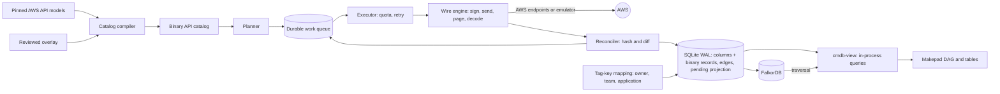

# Vision spec

Status: owner-confirmed direction, 2026-11-13. This document defines the product
and its architecture. [ROADMAP.md](ROADMAP.md) orders the build. Where any other
document in this repository disagrees with this one, this one wins.

## 1. The product

A CMDB of every AWS resource in every account we are pointed at, kept current by
repeated sweeps, stored in SQL, projected into a relationship graph, and shown
as a DAG in a native Makepad application. It reads AWS through the services' own
endpoint APIs. It holds current state, not history (V22).

It covers the ground of CloudQuery, Cartography and Steampipe. It is our own
implementation and promises compatibility with none of them.

Speed of collection and reconciliation is the selling point. Every design choice
below is judged first on whether it makes a sweep faster or a reconcile cheaper,
and second on whether it removes code. "Fastest" is a goal until it is measured
(V19).

## 2. Decisions

Confirmed by the owner on 2026-11-13. A later decision replaces an earlier one
with the same ID; nothing here is changed silently. V04, V10, V11, V12, V14,
V16, V20, V21 and V25 were amended and V22 to V33 added later the same day;
V13 was confirmed as written. V22, V23, V24, V30 and V31 settle what were open
decisions O9, O3, O5, O10 and O11.

| ID | Decision |
| --- | --- |
| V01 | Collection calls the service endpoint APIs directly. Cloud Control is not used. |
| V02 | We build our own wire engine. The official AWS API models are pinned as data, and one client signs, sends and pages any operation of any service. AWS crates are used only for credentials and request signing. |
| V03 | Each AWS response is parsed exactly once, streaming, into a binary record. No JSON after the socket: not in the store, not between components, not to the UI. Where a service offers AWS's binary protocol, we request it. JSON is produced only by an explicit export. |
| V04 | The existing Cloud Control collectors are deleted as endpoint collection replaces them. The CloudFormation type list is kept as an offline checklist that no resource type was missed and as the naming authority (V26); it is never used as an API. The reviewed relationship rules are carried over. No new work is done on Cloud Control code. |
| V05 | SQL holds typed columns generated from the API model plus the full record as one binary blob. SQLite in WAL mode is the store. PostgreSQL or DuckDB is added only when a measurement shows SQLite is the limit. |
| V06 | Scope is every configurable resource plus the runtime components that matter for architecture (running tasks, target health, DNS records). Content, secrets and paid calls are never read. The deny list fails closed: an unclassified operation is not called. |
| V07 | Commercial AWS partition only. |
| V08 | It runs on one laptop. AWS Lambda is the second runtime target, so collection must work in resumable slices and must not need a second long-lived process. |
| V09 | Accounts come from local AWS profiles. The first version is proven on about 10 accounts. |
| V10 | Freshness comes from fast full sweeps, repeated on an interval the user sets; the process idles between sweeps. Within a sweep the stalest scopes go first. Change events are added later and only tell us what to re-read. |
| V11 | Reconciliation is hash-based, at record level (V33): unchanged records cause no writes. Only changes reach the store and the graph. |
| V12 | AWS Config, Resource Explorer and CloudTrail may supply change hints and cross-checks. Every stored fact comes from the service's own API, with one exception: tags (V31). |
| V13 | Full send is the default: use all the request rate AWS will grant. A configurable cap exists for accounts that share quota with production automation. |
| V14 | FalkorDB is the graph database. SQL is the source of truth and the graph can always be rebuilt from it. The UI's tables and resource details come from SQL; graph traversal (neighbors, paths, blast radius) comes from FalkorDB through Cypher; the UI reads both in process (V32). FalkorDB is therefore required for the DAG's traversal features and is not required for collection or SQL queries. |
| V15 | Edges come from three labelled sources: the API model, reviewed rules, and inference where a field value exactly matches a collected resource's ARN or unique ID. Ambiguous matches are counted, not drawn. |
| V16 | The CMDB layer in the first version is owner, team and application, derived from AWS tags through a mapping of which tag keys mean which. There is no manual editing. |
| V17 | The UI is a native Makepad 2.0 desktop application. A web build is not planned for the first version. |
| V18 | Build order is depth first: the large services complete with relationships and the DAG, then every remaining service. |
| V19 | "Fastest" is claimed only from head-to-head runs against CloudQuery, Steampipe and Cartography, on the same emulator dataset and machine and on a real account the owner authorizes. |
| V20 | Work is executed by agents straight from the roadmap, through the loop and gates in section 10. Local GPU workers and ChatGPT Sol work in parallel in separate worktrees. The coordinator owns integration and verification. No separate tracker. Amended 2026-11-13 at the owner's request to add Sol alongside both local GPUs. |
| V21 | Code is a liability. A service is described by data, never by Rust. All product code is Rust, MIT licensed. The Python helper scripts are not part of any plan and are deleted from the tree as soon as nothing uses them (M2.10). |
| V22 | No history in the first version. The store holds current state only; there is no change log and no retention. Deletion is still detected (two complete enumerations) and applied. |
| V23 | The models are pinned as a git submodule at `.local/aws-models`. The pinned commit is recorded in this repository's tree, so git is the lock and none of the lock code is ours. The compiled catalog is committed. Changed 2026-11-13: the first form was a lock file with a digest per file kept by our own commands; it was built, reviewed and discarded, because it was 1,181 lines that repeated what git does. |
| V24 | Existing local databases are thrown away and re-collected. No migration code from schema 13. |
| V25 | The first wave of services is EC2 with VPC networking, IAM, STS, Organizations, S3, Route 53, CloudFront, Lambda, EKS, ECS, KMS, DynamoDB, SQS, SNS, Step Functions, load balancers, RDS and CloudWatch. CloudWatch is in it so the binary protocol (rpcv2Cbor) is proven end to end early. |
| V26 | A resource kind is named by its CloudFormation type name (`AWS::EC2::Instance`) and exposed in SQL as `aws_ec2_instance` (rule: V30). A kind with no CloudFormation type gets a name in the same style, derived from service and resource. |
| V27 | Every region enabled in the account is swept, discovered automatically. A flag narrows it. |
| V28 | The DAG opens on the hierarchy: account, then region, then service, then resources. Expanding a node shows what it connects to. |
| V29 | Building starts now: M0 is finished while M1 and M3.1 start in parallel. |
| V30 | A SQL name is the CloudFormation type name split into words, lower-cased and joined with `_`: `AWS::ElasticLoadBalancingV2::TargetGroup` is `aws_elastic_load_balancing_v2_target_group`. Acronyms stay whole: `aws_ec2_instance`, `aws_iam_role`, `aws_kms_key`, `aws_rds_db_instance`. The exact rule and its exceptions are in M1.5. |
| V31 | Tags come from the Resource Groups Tagging API in bulk first, for speed, and from the service's own tag call only for kinds the bulk API does not cover. This is the one exception to V12. The bulk call is a classified, overlay-reviewed operation like any other. |
| V32 | The UI reads its data in process: the Makepad app opens SQLite and talks to FalkorDB itself, through `cmdb-view`. There is no HTTP read API in the first version; `cmdb-api` is deleted. |
| V33 | Page-level hashing is dropped; only records are hashed. It may return only if the sweep benchmark shows decoding is the bottleneck. |
| V34 | Records are CBOR (RFC 8949), written and read with the `minicbor` library. Our code only fixes which CBOR forms are written, so that equal values give equal bytes. Chosen by benchmark over our own format, `rkyv`, `postcard` and JSON: fastest to build and hash, and smallest ([evidence](performance-evidence/record-codec-2026-11-13.md)). A library is preferred to our own code wherever it is at least as fast. |

The earlier requirements draft in [cmdb-spec/](cmdb-spec/README.md) remains the
detailed reference for behavior this document does not restate (deletion needs
two complete enumerations; stale and incomplete coverage is always explicit).
These decisions replace it where they differ: its 5-second visibility and
hourly reconciliation targets wait for V10's event work, its enterprise
deployment waits behind V08, its browser renderer is replaced by V17, and its
history, retention and hand-edited annotations wait behind V22 and V16.

## 3. Measured ground

Numbers from the tree at commit `78d3ac2` and from the official AWS API models
(`github.com/aws/api-models-aws`, commit `46135f8`, 2026-11-13, Apache-2.0).
Model rows are `jq` counts over the 436 model files. Rows marked "heuristic"
match member names and are approximate.

| Fact | Value |
| --- | --- |
| Service models | 436 |
| Operations in the models | 19,641 |
| Read operations by name (List, Describe, Get, BatchGet, Search, Scan, Query, Lookup, Select) | 8,366 |
| Operations carrying the model's `readonly` trait | 2,736, in 208 services |
| List/Describe operations | 5,207 |
| List/Describe operations with no required input | 2,209, in 359 services |
| Operations with a modeled paginator | 3,787, using more than 30 different token-name pairs |
| List/Describe operations with no modeled paginator | 1,846; about 405 of them, in 92 services, have token-like input and output members (heuristic) |
| Services with modeled resources / resource shapes | 127 / 763 |
| ARN templates / ARN-reference traits / reference traits in the models | 385 / 200 / 534 |
| Services offering AWS's binary protocol (rpcv2Cbor) | 44, covering 1,774 operations; 3 of them offer nothing else |
| Services with a JSON body protocol (restJson1, awsJson1.0, awsJson1.1) | 413; 372 of them (15,461 operations) offer no binary protocol |
| Services with an XML body protocol only | 20, covering 2,406 operations: 16 awsQuery or ec2Query (1,956) and 4 restXml (450) |
| Endpoint rule sets / endpoint test cases in the models | 436 / 14,115 |
| Rule sets that set a signing region explicitly / operations with a host prefix | 40 / 713, in 21 services |
| Structure members / distinct member names | 238,070 / 49,069 |
| Untyped `document` members | 197, in 40 services |
| Operations the collector calls today | 89, in 19 services; 2 of them are Cloud Control |
| Resource kinds collected today by hand-written adapters | 39 |
| Cloud Control types (to be replaced) | 421 reviewed and collected; 1,291 list-capable in the universal catalog |
| Reviewed relationship rules to carry over | 968 |
| CloudFormation types (checklist and naming authority) | 1,881 |
| Rust in `crates/aws` today | 28,866 lines, 5,540 of them Cloud Control |

The 2,209 input-free enumerations set the scale of a complete sweep: each
regional one is called once per enabled region per account, whether or not the
account uses the service. With 17 regions (the usual commercial default; an
estimate, not taken from the sources above) that is up to about 37,500 calls per
account, and about 375,000 for 10 accounts, before the first child resource is
read. Remembered unsupported and denied scopes shrink it on later sweeps. That
is the workload the design is sized for.

## 4. Design rules

1. **Services are data.** The pinned models plus a small reviewed overlay say
   what to call, how to page it, what identifies a resource and what it refers
   to. Adding a service adds no Rust. Service-specific Rust needs a written
   reason in the change that adds it.
2. **One of each.** One HTTP client, one signer, one retry owner, one record
   format, one work queue, one writer per database.
3. **State that matters is on disk.** The work queue, pagination position,
   learned request rates and scope outcomes live in SQL. A killed process
   resumes; it does not restart.
4. **Every write is idempotent.** Records are keyed by identity and content
   hash. Replaying a page changes nothing.
5. **Everything is bounded.** Queues, batches, retries, response sizes and
   traversals have limits. No detached tasks.
6. **Writes are proportional to change.** An unchanged account costs API calls
   and comparisons, not disk writes.
7. **Delete as we go.** Each replaced adapter, SDK dependency and JSON path is
   removed in the change that replaces it.
8. **Nothing is claimed without evidence.** Implemented, emulator-verified and
   live-verified are separate facts. Deleted, unobserved, inaccessible and
   unsupported are separate states.
9. **No `unsafe`.** The workspace forbids it (`unsafe_code = "forbid"`) and no
   work package relaxes that. Anything read in place goes through a validated,
   safe accessor.

## 5. Architecture

| Component | Crate | State |
| --- | --- | --- |
| Domain model, binary record | `inventory-core` | Model exists; record format is new |
| Catalog compiler | `catalog-tool` | Exists for Cloud Control; model compiler is new |
| Wire engine | `aws-wire` | New |
| Executor, work queue, store, reconciler, edges, graph projection | `inventory-engine` | Limiter with adaptive pacing, store, fenced jobs and snapshot projection exist; learned rates, work queue, reconciler, edge extraction and delta projection are new |
| Planner, profile credentials | `inventory-aws` | Profile loading exists; the planner is new; the crate shrinks to these two once adapters are deleted |
| In-process query layer | `cmdb-view` | Exists; parses one JSON export today; becomes the layer that reads SQLite and FalkorDB for the UI (V32) |
| HTTP read API | Removed (`cmdb-api`) | Removed under V32 (M6.5), including its workspace member and direct `axum`, `tower` and `tower-http` declarations; unrelated transitive dependencies remain |
| UI | `cmdb-ui` | Exists; renders a synthetic fixture |
| Emulator harness, benchmark | `inventory-harness`, `cmdb-bench` | Exist; the harness seeds through Cloud Control and Python today |
| Typed-SDK inventories | `inventory-sdk-catalog`, `sdk-operations` | Redundant once the model catalog exists; deleted in M1.7 |

### 5.1 API catalog

The models are a git submodule pinned to one commit, and the compiled catalog
is committed (V23). `catalog-tool` compiles the models, with the overlay,
into one binary catalog. It is embedded in the binary (`include_bytes!`) and
read in place through a validated, safe accessor (rule 9). The runtime never
reads a model file.

A **resource kind** is what one enumeration returns, merged with its describe.
It is named by its CloudFormation type (V26), so the 968 reviewed rules keep
their type names and only their property paths are remapped.

For each operation the catalog holds its protocol, endpoint, input and output
shapes, paginator, page-size limit, retryable errors, scope (per region, once
per account, or one home region) and a class:

- **enumerate**: a read with no required input; a root of collection.
- **expand**: a read whose required inputs come from a parent's output.
- **denied**: content, secret, paid, mutating, or AWS-owned reference data
  (instance types, engine versions, public images). Never called.
- **unclassified**: not yet reviewed. Never called.

Fail closed means three things:

- A rule may deny on a name alone and may never allow on one. `GetId` creates
  an identity, `ReceiveMessage` hides messages, `GetCostAndUsage` is billed per
  call and `GetSecretValue` returns a secret. None of the four carries the
  `readonly` trait, while `GetFunction`, which returns a link to the code,
  does. The trait is a hint, not a permission.
- An operation is called only when it is classed enumerate or expand and its
  service's overlay file has been reviewed (M5, M9).
- The catalog hands the wire engine a callable handle only for those
  operations. The product binary has no other way to send a request.

**Endpoints.** Every model carries an endpoint rule set. The compiler evaluates
it for the commercial partition with FIPS and dual-stack off and stores, per
service, a URL template, signing name and signing region. The runtime has no
rules interpreter. A service that resolves to the same endpoint for every
region is global and is planned once per account. The overlay supplies what
the rule sets need at request time or do not say: S3 bucket addressing and
bucket region, account-ID host prefixes, and lists that return account-wide
results from every region.
The models do not say which regions a service is deployed in; that is learned
as an unsupported outcome and remembered. SigV4 is the only signing scheme
used. Operations that require endpoint discovery (32, in Timestream) and
services that accept only bearer tokens (CodeCatalyst) are recorded as
unsupported.

The compiler derives what it can and the overlay supplies the rest:

- Bindings from a parent's output to a child's input, from modeled resource
  identifiers where they exist.
- The largest page size the model allows, so each enumeration uses the fewest
  calls.
- Pagination the model does not describe: several tokens at once (Route 53
  record sets) and truncation flags.
- Fixed request parameters, such as an owner filter, so an enumeration returns
  the account's resources and not AWS's.
- Lists that already return everything the matching describe returns, so the
  describe is skipped.
- Batch reads in place of one call per resource.
- Identity: the modeled ARN template, else an ARN field, else a synthesized key.
- Fields that change on every read (timestamps of the read itself, counters),
  which are excluded from the content hash.

The overlay is one file per service, so services can be reviewed in parallel.

Every member name gets a stable numeric ID from an append-only registry file
that is committed, so a record written under one model version reads under the
next. A model update is one command: it re-pins, recompiles and reports what
changed, and new operations arrive unclassified.

### 5.2 Wire engine

One crate, driven entirely by the catalog.

- **Request**: five serializers cover the seven protocols in the 436 models:
  JSON RPC (awsJson1.0 and 1.1), REST JSON, form-encoded query (awsQuery and
  ec2Query, which differ in list and name encoding), REST XML, and binary RPC
  (rpcv2Cbor), which is chosen wherever a service offers it.
- **Signing**: `aws-sigv4`. Credentials come from `aws-config` profiles, loaded
  by `inventory-aws` and passed in. The derived signing key is cached only if
  the M2.8 benchmark shows signing is a measurable share of a request.
- **Transport**: one pooled client; connections are kept alive per endpoint and
  use HTTP/2 where the endpoint offers it. Every request has a deadline and a
  response size limit. Open connections are capped below the process's file
  descriptor limit: a sweep touches one endpoint per service and region, about
  7,400 hosts for 436 services and 17 regions.
- **Decode**: three streaming decoders (JSON, XML, CBOR) driven by the output
  shape, plus the header and status-code bindings of the two REST protocols.
  Tokenizing uses existing non-AWS crates; ours is the shape-driven layer on
  top. A response becomes binary records in one pass with no intermediate
  tree. Timestamps are normalized, so the same resource decoded from JSON, XML
  or CBOR gives the same record and the same hash. Untyped `document` members
  are kept as nested values inside the record.
- **Errors**: decoded into throttle, retryable, access denied, not supported,
  expired token, expired signature and fatal, using the model's error shapes.

The 87 service operations wired today are the first proof: the wire engine
must return the same fields as the typed SDK against the emulator. Today the
emulator does not implement 2 of them (Organizations), the typed SDK cannot
decode the emulator's answer for 3 (Resource Explorer), and 10 (KMS, Step
Functions) have never been run against it; M2.6 reports each by name.

### 5.3 Executor, quota and retries

The existing `ApiExecutor` stays the only retry owner; SDK-style internal
retries do not exist in the wire engine.

- Quota is tracked per account, region and quota group. A quota group is a
  service unless the overlay splits it. Buckets are independent, so the sweep's
  total rate is the sum of all of them until a local limit binds: the in-flight
  cap (4,096 today), CPU, or the single writer. Keeping every bucket busy at
  once is where most of the speed comes from.
- 10 accounts, 17 regions and 436 services make about 74,000 buckets, more
  than the limiter's present bound of 65,536. M4.1 removes idle buckets or
  raises the bound.
- Each bucket raises its concurrency until AWS throttles, backs off, and holds
  just under the limit. The learned rate is stored, so the next sweep starts
  there instead of probing again.
- A retry re-enters admission like any other request, with jittered backoff and
  a server-supplied delay honored. Each bucket has a retry budget; when it is
  exhausted the scope is recorded as failed and the sweep goes on.
- Access denied and not-supported outcomes are remembered per scope with an
  expiry, so they are not re-asked on every sweep.
- An expired pagination token restarts that one enumeration. Expired
  credentials are refreshed once and the request is retried. A request
  rejected for an expired signature is signed again and retried.

### 5.4 Records and store

- A record is a schema-coded binary value: numeric field IDs, no field names, a
  format version, readable in place through a validated accessor without
  deserializing. The same bytes go into the store and from the store into the
  UI.
- Each resource kind has one table, named as in V26: identity, account, region,
  content hash, first seen, last changed, typed columns for scalar fields, and
  the record blob. The column set is generated from the output shape and the
  writer fills it; these are not SQLite generated columns, which cannot read
  the record. A catalog update adds columns in place.
- One narrow table across all kinds holds identity, kind, account, region and
  hash. Reconciliation, cross-kind search and edges use it. Tags, edges and
  unresolved references have their own tables.
- The models imply thousands of kinds (1,881 CloudFormation types; 5,207
  List/Describe operations). M3.2 creates the full schema and measures it. If
  opening the database or preparing statements is too slow, kinds share one
  table and only fields the overlay marks as queryable get columns.
- One writer task owns the database. It groups page commits into batched
  transactions. Readers use WAL snapshots and never block it.
- A page commit is one transaction containing the changed records, the changed
  edges, the pending-projection keys and the work-queue update (next token, or
  done plus the child work it produced). There is no window in which data is
  stored but the position is not.
- The store sits behind one interface with one implementation. A second
  implementation is written when the sweep benchmark shows the writer is the
  limit, not before.

### 5.5 Reconciliation

- **Record level** (the only level, V33): at the start of a scope the known
  identities and hashes are loaded; each arriving record is compared and
  matched off. Equal hash: nothing
  is written. Different hash: the row is replaced, its edges are diffed and its
  key is queued for projection. Unknown identity: insert.
- **Missing**: identities left unmatched when an enumeration completes cleanly
  are missing candidates. A resource is deleted after it is missing from two
  complete enumerations of its scope: its row and edges are removed, the
  resources enumerated under it go with it, and the keys are queued for
  projection. A partial, denied or failed enumeration never deletes anything.
- **Outcome**: every scope ends each sweep as complete, partial, inaccessible,
  unsupported or failed, and that is stored and shown.

### 5.6 Relationships and graph

Each edge carries its source: declared by the model, reviewed rule, or inferred
by exact match. Edges are recomputed for changed records. A reference whose
target is not collected yet is stored unresolved and becomes an edge when the
target appears, without the source changing. The 968 reviewed rules keep their
CloudFormation type names (V26); their property paths are remapped to API
field paths as each service lands.

Edges live in SQL. Changed and deleted node and edge keys go into a bounded
pending-projection queue in SQL. The graph projection drains it into FalkorDB
and removes what FalkorDB acknowledged. The queue holds keys, not history; if
it would overflow it is cleared and the graph is rebuilt from SQL, which is
always possible. FalkorDB holds identity, kind, account, region, name, the
tag-derived owner, team and application, and edges. Full records stay in SQL.

FalkorDB is a local process on the laptop. It is required for traversal in the
DAG (neighbors, paths, blast radius) and not for collection or SQL queries
(V14). Its protocol is Redis frames carrying Cypher text. That is not JSON, but
it is text, and it is the one hop where values are not binary; only keys and a
few scalars cross it.

### 5.7 CMDB layer

In the first version the CMDB layer is owner, team and application, derived
from AWS tags (V16). A mapping file says which tag keys mean owner, team and
application. The derived values are stored apart from the observed record, are
derived again when the mapping changes without a sweep, and appear in SQL, in
the graph and in the UI marked as derived from tags. Nothing is edited by hand.
Tags come from the Resource Groups Tagging API in bulk, joined to resources by
ARN; a kind the bulk API does not cover uses its service's own tag call (V31).
The overlay names each kind's tag source, and M8.1 reports the kinds that have
none.

### 5.8 Query layer and UI

There is no HTTP read API (V32). The Makepad app calls `cmdb-view` in process.
`cmdb-view` opens the SQLite file read-only for tables and resource details,
which it returns as binary record pages, and runs bounded Cypher on FalkorDB
for traversal. A traversal returns keys, and their details come from SQL.
Queries are bounded and run off the UI thread.

The DAG opens on the hierarchy: account, then region, then service, then
resources. Expanding a node shows what it connects to (V28). `cmdb-ui` also
shows a filterable table and a detail view, and draws the DAG with level of
detail. It shows the CMDB layer and does not edit it. With FalkorDB down, the
tables, details and hierarchy still work and traversal is reported as
unavailable. The UI never triggers collection by browsing.

## 6. Where the time goes, and the answer to each

| Cost | Answer |
| --- | --- |
| Waiting on AWS | All quota buckets driven concurrently; learned rates persisted; full send by default |
| Number of calls | Largest page size; describe skipped when the list is complete; batch reads; remembered denied and unsupported scopes |
| Connection setup | Pooled keep-alive connections; HTTP/2 where offered. The first call to each endpoint still pays a TLS handshake, and an enumeration is one call per endpoint, so a cold sweep opens thousands of connections |
| Decoding | One streaming pass into the binary record; binary protocol where offered (44 of 436 services) |
| Disk writes | One writer, batched transactions; unchanged records not written |
| Graph load | Changed keys only; no full records |
| Re-sweep | Cost is API calls plus hash comparisons; writes are proportional to change |

Four limits apply to any claim. When one service's quota is the bottleneck,
every tool converges on that quota; our advantage is in the calls we do not
make, in running all buckets at once, and in reconcile cost. The emulator is
one local endpoint with no quotas and no network latency, so emulator runs
measure the engine (CPU, decoding, writing), not connection setup or quota
handling; the benchmark therefore also runs through the fault proxy with a
stated latency and rate limit (M4.4), and real runs measure the whole system.
Tools collect different sets of resources, so a result counts only the kinds
every compared tool collected and states how many resources each returned. A
result is published with tool versions, dataset, machine and that set of
kinds.

Measured for every run: cold sweep time, warm re-sweep time, API calls made,
connections opened, resources per second, CPU seconds, peak memory, bytes
written.

## 7. Failure handling

| Failure | Behavior | Proven in |
| --- | --- | --- |
| Throttle | Bucket backs off; request re-enters admission; learned rate lowered | M4.2 |
| 5xx, timeout, reset, truncated body | Retried within the bucket's budget; then the scope is failed for this sweep | M4.2 |
| Access denied, service not in region | Scope stored as inaccessible or unsupported; skipped until expiry | M4.2 |
| Expired pagination token | That enumeration restarts | M4.2 |
| Expired credentials | Refreshed once; then the account is failed for this sweep and reported as needing a new login | M4.2 |
| Expired signature (clock skew, wake from sleep) | Signed again and retried | M4.2 |
| Model disagrees with the service | Decode error is stored with the operation and shape; the scope is partial; the overlay is corrected | M4.2 |
| Process killed | Work queue resumes from the last committed page | M3.3 |
| Disk full or database error | The sweep stops with the error; nothing is half-written | M3.3 |
| Laptop sleeps | Requests in flight fail and are retried on new connections; the sweep continues from the work queue | M4.5 |
| No network | The sweep pauses and resumes. A failure common to every endpoint marks no scope unsupported, inaccessible or failed | M4.5 |
| FalkorDB down | Collection and SQL continue; projection resumes from the pending-projection queue; the UI reports traversal as unavailable | M6.1, M6.2 |

Each row has a test in the named package. Wire faults are injected between the
wire engine and the emulator.

## 8. Runtime targets

**Laptop, now.** One binary, one SQLite file, a local FalkorDB (needed for the
DAG's traversal, not for collection), the Makepad app. About 10 profiles, every
enabled region of each (V27). Continuous mode sweeps on an interval the user
sets and idles in between (V10). The product opens no listening socket;
FalkorDB listens on loopback.

**Lambda, next.** The only requirement now is that collection runs as bounded
slices that stop before a time limit and resume from the work queue (M7.4).
Which store Lambda uses stays deferred (O6). Nothing in the collector may
assume a long-lived process or local-only state beyond the store interface.

## 9. Proof

- **Emulator** (pinned AWS Emulator 1.0.336, commit `f5155815`): every wired
  operation is called with real signed requests. It proves serialization,
  decoding, pagination, retry, storage and delivery. It does not prove real
  provider semantics, IAM, quotas or eventual consistency. The harness runs it
  as one account in one region behind one endpoint, so it does not prove
  endpoint resolution either; the endpoint test cases in the models do (M1.6).
  An operation counts as emulator-verified only when it returned at least one
  seeded resource; an empty answer proves nothing about decoding.
- **Differential**: while a typed adapter still exists, the wire engine's
  output is compared to it field by field. The adapter is deleted when they
  match.
- **Checklist**: every CloudFormation type maps to an endpoint-collected kind
  or is listed with the reason it does not.
- **Real account**: read-only, in an account the owner has authorized, reported
  separately from emulator evidence. Until then real endpoints, real signature
  checks, real quotas and the binary protocol on real services are unproven.
- **Head-to-head**: section 6.

## 10. How work lands

Local GPU workers and ChatGPT Sol implement independent packages in parallel,
with exclusive file ownership and separate worktrees (V20).

Every work package goes through this loop:

1. A worker implements the package in its own git worktree as `aws-build-5090`,
   `aws-build-3090` or `aws-build-sol`. Each loads `holzman-rust`,
   `functional-rust` and `scott-ddd-refactor` before implementation.
   Workers do not build, test, lint or format mid-flight.
2. The coordinator integrates the completed patch and runs the narrow checks,
   serializing heavy Cargo builds.
3. `aws-black-hat` and `aws-test-review`, which load `black-hat-reviewer` and
   `test-reviewer` the same way, review independently and read-only.
4. Their findings go back to the same worker as one repair packet.
5. Steps 1 to 4 repeat until both reviewers report no findings. Then the
   coordinator lands the commit on `main`.

Worker reports are not verification evidence. The coordinator supplies actual
compiler, lint and behavior failures in the repair packet; a completed patch
is checked again after repairs before landing.

Every package uses `scott-ddd-refactor` (domain types), `holzman-rust`
(implementation), `black-hat-reviewer` (adversarial code review) and
`test-reviewer` (test review). The other gates stay, in this order:

1. Contract: `rust-contract`, `scott-ddd-refactor`
2. Test plan: `test-planner`, `test-reviewer`
3. Implementation: `holzman-rust`, `functional-rust`
4. Async review: `async-rust-reviewer`
5. Tests: `test-writer`, `red-queen`
6. Proof with the shipped binary against the emulator: `hands-on-qa`, `qa-enforcer`
7. Adversarial review: `black-hat-reviewer`, `truth-serum`
8. Landing: `evidence-packaging`, `landing-skill`

Makepad work follows the `makepad-2.0-*` skills.

Documentation is part of the gate. A change that alters behavior updates this
document's status, the roadmap and the affected design document in the same
commit. Every crate states its contract in its crate-level documentation.
Undocumented public items do not fail the build today; M0.7 makes them fail.
When this architecture is implemented, `ARCHITECTURE.md` and
`CMDB_ARCHITECTURE.md` are replaced by one document that describes what
exists.

## 11. Not in the first version

- Cloud Control, in any form.
- History of changes and retention (V22).
- An HTTP read API, on loopback or on the network (V32).
- Page-level hashing (V33).
- Notes, custom fields, user-drawn relationships and any editing of the CMDB
  layer in the UI (V16).
- Change-event ingestion; Organizations discovery and cross-account roles;
  more than about 10 accounts.
- PostgreSQL, DuckDB, Kubernetes, SSO, workspaces.
- A browser UI.
- GovCloud and China partitions.
- Content, secrets, paid read calls, and any write to AWS.
- Objects inside resources (Kubernetes objects, S3 object listings, database
  schemas).

## 12. Open decisions

Defaults are stated so work is not blocked; each is settled by the named
evidence or by the owner. O1, O3, O5, O9, O10 and O11 are settled (V34, V23,
V24, V22, V30, V31).

| ID | Question | Default | Settled by |
| --- | --- | --- | --- |
| O2 | Overlay file format | TOML (`toml` is already a workspace dependency), one file per service, compiled into the catalog | Owner, at M1.4 |
| O4 | SQLite `synchronous` setting | `FULL` as today | Sweep benchmark in M4.4 |
| O6 | Store used from Lambda | Deferred | Owner, before Lambda work starts |
| O7 | Competitor versions and licenses for head-to-head runs | Latest freely runnable release of each, run from its published image; none is added to this repository | Checked at M5.6 |
| O8 | Real AWS account for proof | Emulator only until the large services are done; the owner names an account then | Owner, at M5.8 |

## 13. Milestones

| ID | Outcome |
| --- | --- |
| M0 | Baseline committed, compiling and gated without Python |
| M1 | AWS API models pinned and compiled; endpoints resolved; kinds named; every operation classified |
| M2 | Wire engine calls any callable operation; matches the typed SDK on today's 87; emulator seeded without Python |
| M3 | Binary records, generated schema, durable work queue, hash reconciliation, edges, first end-to-end sweep |
| M4 | Full-send executor, fault-injection proof, sweep benchmark |
| M5 | Large services complete on the wire engine; their old adapters deleted; first head-to-head |
| M6 | Makepad DAG and tables on a real scan; graph deltas; traversal from FalkorDB |
| M7 | Interval sweeps of about 10 profiles on a laptop; deletions; bounded slices |
| M8 | Owner, team and application from tags |
| M9 | Every remaining service; checklist closed; Cloud Control deleted |
| M10 | Real-account proof, published head-to-head, version 1.0 |
