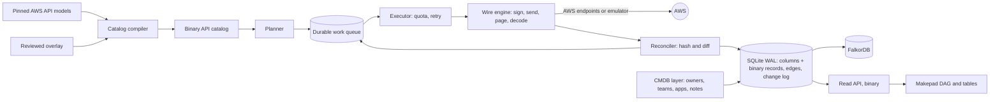

# Vision spec

Status: owner-confirmed direction, 2026-11-13. This document defines the product
and its architecture. [ROADMAP.md](ROADMAP.md) orders the build. Where any other
document in this repository disagrees with this one, this one wins.

## 1. The product

A CMDB of every AWS resource in every account we are pointed at, kept current by
repeated sweeps, stored in SQL, projected into a relationship graph, and shown
as a DAG in a native Makepad application. It reads AWS through the services' own
endpoint APIs and it is built to be the fastest tool there is at sweeping an
account and reconciling what changed.

It covers the ground of CloudQuery, Cartography and Steampipe. It is our own
implementation and promises compatibility with none of them.

Speed of collection and reconciliation is the selling point. Every design choice
below is judged first on whether it makes a sweep faster or a reconcile cheaper,
and second on whether it removes code.

## 2. Decisions

Confirmed by the owner on 2026-11-13. A later decision replaces an earlier one
with the same ID; nothing here is changed silently.

| ID | Decision |
| --- | --- |
| V01 | Collection calls the service endpoint APIs directly. Cloud Control is not used. |
| V02 | We build our own wire engine. The official AWS API models are pinned as data, and one client signs, sends and pages any operation of any service. AWS crates are used only for credentials and request signing. |
| V03 | Each AWS response is parsed exactly once, streaming, into a binary record. No JSON after the socket: not in the store, not between components, not to the UI. Where a service offers AWS's binary protocol, we request it. JSON is produced only by an explicit export. |
| V04 | The existing Cloud Control collectors are deleted as endpoint collection replaces them. The CloudFormation type list is kept only as an offline checklist that no resource type was missed, and the reviewed relationship rules are carried over. No new work is done on Cloud Control code. |
| V05 | SQL holds typed columns generated from the API model plus the full record as one binary blob. SQLite in WAL mode is the store. PostgreSQL or DuckDB is added only when a measurement shows SQLite is the limit. |
| V06 | Scope is every configurable resource plus the runtime components that matter for architecture (running tasks, target health, DNS records). Content, secrets and paid calls are never read. The deny list fails closed: an unclassified operation is not called. |
| V07 | Commercial AWS partition only. |
| V08 | It runs on one laptop. AWS Lambda is the second runtime target, so collection must work in resumable slices and must not need a second long-lived process. |
| V09 | Accounts come from local AWS profiles. The first version is proven on about 10 accounts. |
| V10 | Freshness comes from fast repeated full sweeps first. Change events are added later and only tell us what to re-read. |
| V11 | Reconciliation is hash-based: unchanged pages and records cause no writes. Only changes reach the store and the graph. |
| V12 | AWS Config, Resource Explorer and CloudTrail may supply change hints and cross-checks. Every stored fact comes from the service's own API. |
| V13 | Full send is the default: use all the request rate AWS will grant. A configurable cap exists for accounts that share quota with production automation. |
| V14 | FalkorDB is the graph database. SQL is the source of truth and the graph can always be rebuilt from it. |
| V15 | Edges come from three labelled sources: the API model, reviewed rules, and inference where a field value exactly matches a collected resource's ARN or unique ID. Ambiguous matches are counted, not drawn. |
| V16 | The CMDB layer (owners, teams, applications, custom fields, notes) is part of the first version. |
| V17 | The UI is a native Makepad 2.0 desktop application. A web build is not planned for the first version. |
| V18 | Build order is depth first: the large services complete with relationships and the DAG, then every remaining service. |
| V19 | "Fastest" is claimed only from head-to-head runs against CloudQuery, Steampipe and Cartography, on the same emulator dataset and machine and on a real account the owner authorizes. |
| V20 | Work is executed by agents straight from the roadmap, through the gates in section 10. No separate tracker. |
| V21 | Code is a liability. A service is described by data, never by Rust. All product code is Rust, MIT licensed. The Python helper scripts are frozen and are not part of any plan. |

The earlier requirements draft in [cmdb-spec/](cmdb-spec/README.md) remains the
detailed reference for behavior this document does not restate (deletion needs
two complete enumerations, the four coverage states, isolation of CMDB
annotations from observed facts). These decisions replace it where they differ:
its 5-second visibility and hourly reconciliation targets wait for V10's event
work, its enterprise deployment waits behind V08, and its browser renderer is
replaced by V17.

## 3. Measured ground

Numbers from the tree at commit `78d3ac2` and from the official AWS API models
(`github.com/aws/api-models-aws`, commit `46135f8`, 2026-11-13, Apache-2.0).

| Fact | Value |
| --- | --- |
| Service models | 436 |
| Operations in the models | 19,641 |
| Read operations by name (List, Describe, Get, BatchGet, Search, Scan, Query, Lookup, Select) | 8,366 |
| List/Describe operations | 5,207 |
| List/Describe operations with no required input | 2,209, in 359 services |
| Operations with a modeled paginator | 3,787 |
| Services with modeled resources / resource shapes | 127 / 763 |
| ARN templates / ARN-reference traits / reference traits in the models | 385 / 200 / 534 |
| Services offering AWS's binary protocol (rpcv2Cbor) | 44, covering 1,774 operations |
| Services with a JSON body protocol (restJson1, awsJson1.0, awsJson1.1) | 413 |
| Services with an XML body protocol only (awsQuery, ec2Query, restXml) | 20, covering 2,406 operations |
| Operations the collector calls today | 89, in 19 services; 2 of them are Cloud Control |
| Resource kinds collected today by hand-written adapters | 39 |
| Cloud Control types collected today (to be replaced) | 421 reviewed in detail; 1,291 listed |
| Reviewed relationship rules to carry over | 968 |
| CloudFormation type checklist | 1,881 |
| Rust in `crates/aws` today | 28,868 lines, 5,376 of them Cloud Control |

The 2,209 input-free enumerations set the floor for a complete sweep: each
regional one is called once per enabled region per account, whether or not the
account uses the service. A sweep is tens of thousands of calls per account
before the first child resource is read. That is the workload the design is
sized for.

## 4. Design rules

1. **Services are data.** The pinned models plus a small reviewed overlay say
   what to call, how to page it, what identifies a resource and what it refers
   to. Adding a service adds no Rust. Service-specific Rust needs a written
   reason in the change that adds it.
2. **One of each.** One HTTP client, one signer, one retry owner, one record
   format, one work queue, one writer per database.
3. **State that matters is on disk.** The work queue, pagination position,
   learned request rates and scope outcomes live in SQL. A killed process
   resumes; it does not restart.
4. **Every write is idempotent.** Records are keyed by identity and content
   hash. Replaying a page changes nothing.
5. **Everything is bounded.** Queues, batches, retries, response sizes and
   traversals have limits. No detached tasks.
6. **Writes are proportional to change.** An unchanged account costs API calls
   and comparisons, not disk writes.
7. **Delete as we go.** Each replaced adapter, SDK dependency and JSON path is
   removed in the change that replaces it.
8. **Nothing is claimed without evidence.** Implemented, emulator-verified and
   live-verified are separate facts. Deleted, unobserved, inaccessible and
   unsupported are separate states.

## 5. Architecture

| Component | Crate | State |
| --- | --- | --- |
| Domain model, binary record | `inventory-core` | Model exists; record format is new |
| Catalog compiler | `catalog-tool` | Exists for Cloud Control; model compiler is new |
| Wire engine | `aws-wire` | New |
| Executor, work queue, store, reconciler, graph projection | `inventory-engine` | Limiter, store, fenced jobs and projection exist; adaptive rate, work queue and reconciler are new |
| Planner, credentials | `inventory-aws` | Shrinks to these two once adapters are deleted |
| Read API | `cmdb-api` | Exists, loopback, serves one JSON export; moves to the store and binary responses |
| View model, UI | `cmdb-view`, `cmdb-ui` | Exist; UI renders a synthetic fixture |
| Emulator harness, benchmark | `inventory-harness`, `cmdb-bench` | Exist |

### 5.1 API catalog

The model files are pinned by commit and per-file digest and are not shipped.
`catalog-tool` compiles them, with the overlay, into one binary catalog that the
runtime memory-maps. The runtime never reads a model file. For each operation
the catalog holds its protocol, endpoint data, input and output shapes,
paginator, page-size limit, retryable errors and a class:

- **enumerate**: a read with no required input; a root of collection.
- **expand**: a read whose required inputs come from a parent's output.
- **denied**: content, secret, paid or mutating. Never called.
- **unclassified**: not yet reviewed. Never called.

The compiler derives what it can and the overlay supplies the rest:

- Bindings from a parent's output to a child's input, from modeled resource
  identifiers where they exist.
- The largest page size the model allows, so each enumeration uses the fewest
  calls.
- Lists that already return everything the matching describe returns, so the
  describe is skipped.
- Batch reads in place of one call per resource.
- Identity: the modeled ARN template, else an ARN field, else a synthesized key.
- Fields that change on every read (timestamps of the read itself, counters),
  which are excluded from the content hash.

Every field name gets a stable numeric ID from an append-only registry, so a
record written under one model version reads under the next.

### 5.2 Wire engine

One crate, driven entirely by the catalog.

- **Request**: five serializers cover all 436 services: JSON RPC (awsJson1.0 and
  1.1), REST JSON, form-encoded query (awsQuery and ec2Query), REST XML, and
  binary RPC (rpcv2Cbor), which is chosen wherever a service offers it.
- **Signing**: `aws-sigv4`, with the derived signing key cached per credential,
  day, region and service. Credentials come from `aws-config` profiles.
- **Transport**: one pooled client; connections are kept alive per endpoint and
  use HTTP/2 where the endpoint offers it. Every request has a deadline and a
  response size limit.
- **Decode**: three streaming decoders (JSON, XML, CBOR) driven by the output
  shape. A response becomes binary records in one pass with no intermediate
  tree, and the content hash is computed in the same pass.
- **Errors**: decoded into throttle, retryable, access denied, not supported,
  expired token and fatal, using the model's error shapes.

The 87 service operations wired today are the first proof: for each, the wire engine
must return the same fields as the typed SDK against the emulator.

### 5.3 Executor, quota and retries

The existing `ApiExecutor` stays the only retry owner; SDK-style internal
retries do not exist in the wire engine.

- Quota is tracked per account, region and service, because that is how AWS
  enforces it. Buckets are independent, so the sweep's total rate is the sum of
  all of them. Keeping every bucket busy at once is where most of the speed
  comes from.
- Each bucket raises its concurrency until AWS throttles, backs off, and holds
  just under the limit. The learned rate is stored, so the next sweep starts
  there instead of probing again.
- A retry re-enters admission like any other request, with jittered backoff and
  a server-supplied delay honored. Each bucket has a retry budget; when it is
  exhausted the scope is recorded as failed and the sweep goes on.
- Access denied and not-supported outcomes are remembered per scope with an
  expiry, so they are not re-asked on every sweep.
- An expired pagination token restarts that one enumeration. Expired
  credentials are refreshed once and the request is retried.

### 5.4 Records and store

- A record is a schema-coded binary value: numeric field IDs, no field names,
  readable in place without deserializing. The same bytes go into the store,
  through the read API and into the UI.
- Each resource kind has one table: identity, account, region, content hash,
  first and last change, typed columns generated from the output shape for
  scalar fields, and the record blob. Tags and edges have their own tables.
- One writer task owns the database. It groups page commits into batched
  transactions. Readers use WAL snapshots and never block it.
- A page commit is one transaction containing the changed records, the changed
  edges, the change-log rows and the work-queue update (next token, or done plus
  the child work it produced). There is no window in which data is stored but
  the position is not.
- The store sits behind one interface with one implementation. A second
  implementation is written when the sweep benchmark shows the writer is the
  limit, not before.

### 5.5 Reconciliation

- **Page level**: where the protocol keeps request metadata out of the body, the
  raw page is hashed before decoding. A page identical to last sweep's is not
  decoded.
- **Record level**: at the start of a scope the known identities and hashes are
  loaded; each arriving record is compared and matched off. Equal hash: nothing
  is written. Different hash: new version, change-log row, edge diff. Unknown
  identity: insert.
- **Missing**: identities left unmatched when an enumeration completes cleanly
  are missing candidates. A resource is marked deleted after it is missing from
  two complete enumerations of its scope. A partial, denied or failed
  enumeration never deletes anything.
- **Outcome**: every scope ends each sweep as complete, partial, inaccessible,
  unsupported or failed, and that is stored and shown.

### 5.6 Relationships and graph

Edges are computed from changed records only, and each carries its source:
declared by the model, reviewed rule, or inferred by exact match. The 968
reviewed rules are remapped from CloudFormation property paths to API field
paths as each service lands. Edges live in SQL; changed nodes and edges are
sent to FalkorDB as deltas with an acknowledgment log, and the whole graph can
be replayed from SQL. FalkorDB is a local process on the laptop and is not
required for collection or SQL queries.

### 5.7 CMDB layer

Owners, teams, applications, custom fields, notes and user-drawn relationships
are stored in their own tables and are never overwritten by collection. They
attach to a resource by identity or by rule (a tag selector, an account, a
kind). They appear in SQL, in the graph and in the UI, always marked as
asserted rather than observed.

### 5.8 Read API and UI

`cmdb-api` reads the store and returns binary records and edge pages. `cmdb-ui`
shows a filterable table, a detail view, and the DAG with level of detail, and
edits the CMDB layer. The UI never triggers collection by browsing.

## 6. Where the time goes, and the answer to each

| Cost | Answer |
| --- | --- |
| Waiting on AWS | All quota buckets driven concurrently; learned rates persisted; full send by default |
| Number of calls | Largest page size; describe skipped when the list is complete; batch reads; remembered denied and unsupported scopes |
| Connection setup | Pooled keep-alive connections; HTTP/2 where offered; cached signing keys |
| Decoding | One streaming pass into the binary record; binary protocol where offered; unchanged pages not decoded |
| Disk writes | One writer, batched transactions; unchanged records not written |
| Graph load | Deltas only |
| Re-sweep | Cost is API calls plus hash comparisons; writes are proportional to change |

Three limits apply to any claim. When one service's quota is the bottleneck,
every tool converges on that quota; our advantage is in the calls we do not
make, in running all buckets at once, and in reconcile cost. The emulator has
no real quotas, so emulator runs measure the engine and real runs measure the
whole system. A result is published with tool versions, dataset, machine and
the set of resource kinds compared.

Measured for every run: cold sweep time, warm re-sweep time, API calls made,
resources per second, CPU seconds, peak memory, bytes written.

## 7. Failure handling

| Failure | Behavior |
| --- | --- |
| Throttle | Bucket backs off; request re-enters admission; learned rate lowered |
| 5xx, timeout, reset, truncated body | Retried within the bucket's budget; then the scope is failed for this sweep |
| Access denied, service not in region | Scope stored as inaccessible or unsupported; skipped until expiry |
| Expired pagination token | That enumeration restarts |
| Expired credentials | Refreshed once; then the account is failed for this sweep |
| Process killed, laptop sleeps | Work queue resumes from the last committed page |
| Model disagrees with the service | Decode error is stored with the operation and shape; the scope is partial; the overlay is corrected |
| FalkorDB down | Collection and SQL continue; projection resumes from its acknowledgment log |
| Disk full or database error | The sweep stops with the error; nothing is half-written |

Each row is proven by injecting the fault between the wire engine and the
emulator.

## 8. Runtime targets

**Laptop, now.** One binary, one SQLite file, an optional local FalkorDB, the
Makepad app. About 10 profiles. No network service is exposed beyond loopback.

**Lambda, next.** The same collector runs as bounded slices that stop before
the time limit and resume from the work queue. That needs a store reachable
from Lambda, which is an open decision (section 12). Nothing in the collector
may assume a long-lived process or local-only state beyond the store interface.

## 9. Proof

- **Emulator** (pinned AWS Emulator 1.0.336, commit `f5155815`): every wired
  operation is called with real signed requests. It proves serialization,
  decoding, pagination, retry, storage and delivery. It does not prove real
  provider semantics, IAM, quotas or eventual consistency.
- **Differential**: while a typed adapter still exists, the wire engine's
  output is compared to it field by field. The adapter is deleted when they
  match.
- **Checklist**: every CloudFormation type maps to an endpoint-collected kind
  or is listed with the reason it does not.
- **Real account**: read-only, in an account the owner has authorized, reported
  separately from emulator evidence.
- **Head-to-head**: section 6.

## 10. How work lands

Each roadmap work package passes these gates in order, each with its skill:

1. Contract: `rust-contract`, `scott-ddd-refactor`
2. Test plan: `test-planner`, `test-reviewer`
3. Implementation: `holzman-rust`, `functional-rust`
4. Async review: `async-rust-reviewer`
5. Tests: `test-writer`, `red-queen`
6. Proof with the shipped binary against the emulator: `hands-on-qa`, `qa-enforcer`
7. Adversarial review: `black-hat-reviewer`, `truth-serum`
8. Landing: `evidence-packaging`, `landing-skill`

Makepad work follows the `makepad-2.0-*` skills.

Documentation is part of the gate. A change that alters behavior updates this
document's status, the roadmap and the affected design document in the same
commit. Every crate states its contract in its crate-level documentation, and
public items without documentation fail the build. When this architecture is
implemented, `ARCHITECTURE.md` and `CMDB_ARCHITECTURE.md` are replaced by one
document that describes what exists.

## 11. Not in the first version

- Cloud Control, in any form.
- Change-event ingestion; Organizations discovery and cross-account roles;
  more than about 10 accounts.
- PostgreSQL, DuckDB, Kubernetes, SSO, workspaces, a network-exposed API.
- A browser UI.
- GovCloud and China partitions.
- Content, secrets, paid read calls, and any write to AWS.
- Objects inside resources (Kubernetes objects, S3 object listings, database
  schemas).

## 12. Open decisions

Defaults are stated so work is not blocked; each is settled by the named
evidence or by the owner.

| ID | Question | Default | Settled by |
| --- | --- | --- | --- |
| O1 | Binary record codec | `rkyv` over a schema-coded value | Codec benchmark in M3.1 |
| O2 | Overlay file format | TOML, compiled into the catalog | Owner, at M1.4 |
| O3 | How model files are pinned | Lock file of commit and digests; files fetched into an ignored cache | Owner, at M1.1 |
| O4 | SQLite `synchronous` setting | `FULL` as today | Sweep benchmark in M4.4 |
| O5 | Existing local databases | Re-collected under the new schema, not migrated | Owner, at M3.2 |
| O6 | Store used from Lambda | Undecided | Owner, before Lambda work starts |
| O7 | Competitor versions and licenses for head-to-head runs | Latest freely runnable release of each | Checked at M5.6 |
| O8 | Real AWS account for proof | None authorized yet | Owner, before M10 |
| O9 | Change-log retention | 90 days of changes | Owner, at M7.2 |

## 13. Milestones

| ID | Outcome |
| --- | --- |
| M0 | Baseline committed, compiling and gated without Python |
| M1 | AWS API models pinned and compiled; every operation classified |
| M2 | Wire engine calls any classified operation; matches the typed SDK on today's 87 |
| M3 | Binary records, generated schema, durable work queue, hash reconciliation |
| M4 | Full-send executor, fault-injection proof, sweep benchmark |
| M5 | Large services complete on the wire engine; their old adapters deleted; first head-to-head |
| M6 | Makepad DAG and tables on a real scan; graph deltas |
| M7 | Continuous sweeps of about 10 profiles on a laptop; change log and deletions |
| M8 | CMDB layer |
| M9 | Every remaining service; checklist closed; Cloud Control deleted |
| M10 | Real-account proof, published head-to-head, version 1.0 |
