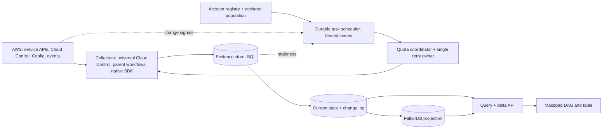

# Vision spec

Status: accepted direction, 2026-11-13. This is the top-level product
definition. Every other document is subordinate to it: when a design, roadmap
entry or handoff note disagrees with this file, this file wins and the other
document is the defect. The sequenced work is in [ROADMAP.md](ROADMAP.md).

## 1. The product

A continuously updated AWS CMDB, written in Rust, that:

1. **collects every AWS resource** in **every account and region** of a fleet,
2. **keeps it current** without being asked,
3. stores it as **queryable SQL** and as a **relationship graph**,
4. shows the whole estate and how it relates as a **GPU-rendered DAG in
   Makepad**, and
5. is **the fastest collector available** for that job, with retries built in.

It occupies the ground that CloudQuery (broad sync into a database), Cartography
(relationship graph) and Steampipe (familiar SQL tables) each cover in part. It
is our own implementation with its own model, schema and storage. It is not a
port of any of them and promises compatibility with none of them. MIT licensed.

## 2. Pillars and what "done" means for each

Each pillar has one acceptance statement. A pillar is met only by retained
evidence, never by code that compiles.

### 2.1 Complete: every AWS resource

**Done means:** every resource type in the declared universe is in exactly one
ledger state, and no type is in a pending state.

The universe is not "the adapters someone wrote". It is:

- every type in the pinned CloudFormation registry snapshot (1,881 types on
  2026-11-12), re-pinned on a schedule so new AWS types enter the ledger when
  AWS publishes them; plus
- resources and components that have an SDK list/describe operation but no
  registry type (target-health memberships, DNS records, running tasks and
  similar), tracked in a reviewed native catalog.

Ledger states, from best to worst:

| State | Meaning |
| --- | --- |
| Detailed + related | Identity, redacted configuration, SQL columns and relationship edges collected |
| Detailed | Identity and redacted configuration collected |
| Listed | Identity only |
| Pending: parent workflow | Listing needs a parent model that no workflow supplies yet |
| Pending: native adapter | No Cloud Control list/read handler; needs an SDK adapter |
| Provider boundary | AWS itself offers no enumeration for it; reason recorded |
| Excluded by policy | Content, secrets or key material; never collected |

Coverage is always reported on this ladder. Dependency available, enumeration
implemented, fields implemented, relationships implemented, emulator-verified
and live-verified are separate facts and are never merged into one tick.

### 2.2 Fleet: many accounts

**Done means:** one deployment collects thousands of accounts across all enabled
regions and partitions from a persisted account registry, with a declared
population (account × region × collector) and an explicit result for every unit
in it.

Accounts come from Organizations discovery and existing read-only roles. A unit
that was denied, unsupported, throttled out or never attempted is visible as
such. A unit the collector never emitted is a gap, not a silent success.

### 2.3 Continuous: always current

**Done means:** the service runs indefinitely and every resource carries a
known age. Three loops keep it current:

1. **Bootstrap sweep** — full enumeration of the declared population.
2. **Targeted refresh** — change signals (EventBridge, CloudTrail, Config)
   schedule a refresh of the affected scope. Signals never write evidence
   themselves and never prove completeness.
3. **Reconciliation sweep** — periodic complete enumeration, the only thing
   that can establish that a resource is gone.

Deleted, unobserved, inaccessible and unsupported are four different states. A
resource is tombstoned only by a complete enumeration of its scope. Provider
time, receipt time and ingest time stay distinct.

### 2.4 Fastest

**Done means:** a published, reproducible head-to-head on a named workload shows
a shorter cold full sweep and lower steady-state change latency than CloudQuery
and Steampipe at equal coverage, equal permissions and equal quota.

AWS API quotas bound every collector. Speed therefore comes from four places,
and the design commits to all four:

1. **Fewest calls per resource.** List first, enrich only what is missing or
   stale, reuse Config/Resource Explorer where they already hold the answer,
   refresh changed scopes instead of re-sweeping everything.
2. **Saturate the allowed quota, never exceed it.** Admission is per
   account/region/quota family, adaptive to throttling feedback, and parallel
   across every independent bucket in the fleet.
3. **No wasted work.** Durable checkpoints mean a crash, a retry or a restart
   never repeats a committed page.
4. **Nothing slow off the wire.** Streaming, bounded memory, batched durable
   commits, profile-driven optimization of the hot path.

Speed is never bought by dropping coverage, relationships, history or
durability. A claim names its workload; "fastest" is asserted only for what was
measured.

Target budgets, unmet until measured on a declared workload and hardware:

| Dimension | Target |
| --- | --- |
| Fleet size | 1,000 → 10,000 accounts; 1 M → 10 M assets |
| Change visibility | p95 receipt-to-query-visible under 5 s at steady state |
| Query | p95 under 250 ms on the frozen indexed suite at 10 M assets |
| UI | p95 frame under 16.7 ms on a 5,000-node / 20,000-edge view; first useful view under 2 s |

### 2.5 Resilient: retries built in

**Done means:** every failure class has a proven outcome and none of them
produces a false "complete" or a false "empty".

- One retry owner. The shared executor retries; SDK clients are configured for
  a single attempt, so attempts are never multiplied.
- Every attempt re-enters admission. Server retry hints extend the bucket
  cooldown. Backoff, deadlines and attempt budgets are bounded.
- Collection, export and graph delivery retry independently. Re-delivering
  never repeats AWS reads.
- Work is leased and fenced. A stale worker cannot write.
- Partial is a first-class result that is stored and reported, never hidden.

### 2.6 Related: the DAG

**Done means:** every collected resource is a node, every reference between
resources that the data supports is an edge with its evidence, and a reference
to something not collected is an explicit unresolved placeholder.

Two edge sources: reviewed relationship rules per type, and runtime reference
resolution that connects any listed resource by exact ARN or unique identifier
within its own account and region. Ambiguity is counted, not guessed. No edge
is invented, and a configured rule is never reported as an observed edge.
SQLite holds the evidence; FalkorDB is a rebuildable projection of it.

### 2.7 Queryable

**Done means:** every collected type is reachable through SQL with stable,
familiar table names, and through a bounded, authenticated query API that the
UI and other consumers share. No read path can ever trigger collection.

### 2.8 Visible: Makepad

**Done means:** a native Makepad application renders the live estate as a
navigable DAG (account → region → service → type → resource, with relationship
overlays), with a table equivalent for every graph view, coverage and freshness
shown on what is displayed, and live updates as the CMDB changes. Makepad is the
UI. There is no browser client.

### 2.9 Proven: emulators first

**Done means:** every capability is exercised by the shipped binary making real
SDK calls against a pinned AWS emulator before it is called working, and
against real AWS before it is called production-ready.

The pinned official AWS Emulator is the standing proving ground for request
serialization, decoding, pagination, retry behavior, storage and delivery. It
does not certify real provider semantics, IAM, quotas or eventual consistency;
those need authorized live accounts. Emulator evidence and live evidence are
reported separately.

## 3. Where the tree stands

Measured from this checkout on 2026-11-13. The command in the last column
prints the number; documents quote it, they do not own it.

| Fact | Value | Source of truth |
| --- | --- | --- |
| Type universe | 1,881 | `catalog/cloudcontrol-universal.json` |
| List-capable, attempted by `--resource-type all` | 1,291 | same |
| Parent workflow required | 410 (24 implemented, 386 pending) | `aws-inventory coverage` |
| No list/read handler | 180 | same |
| Detailed (reviewed descriptors, SQL views) | 421 across 76 families | `aws-inventory catalog` |
| Listed only | 894 | `aws-inventory coverage` |
| Relationship rules | 968 property rules, 24 parent workflows, 268 types with at least one | `aws-inventory coverage` |
| Native SDK kinds | 39 | `aws-inventory catalog` |
| SDK surface available | 440 crates, 20,537 operations | `catalog/aws-sdk-operations.json` |
| SQLite schema | 13 | `crates/engine/src/store/schema.rs` |
| Emulator universal run | 1,291 attempted = 999 listed + 292 provider-unsupported + 0 failed | `cargo test -p inventory-harness --test emulator_live -- --ignored` |

Against the pillars:

| Pillar | State today |
| --- | --- |
| Complete | 421 detailed; 894 listed only; 386 + 180 pending; non-registry catalog not started |
| Fleet | Organizations discovery and role assumption exist per invocation (128 profiles, 1,024 accounts max); registry storage exists but is not wired to discovery; whole-scan jobs only |
| Continuous | Not started: no daemon, no change log, no tombstones, no event ingestion. Freshness views and the coverage registry are in place |
| Fastest | No collection benchmark. Only a local storage/mock-scheduler baseline exists |
| Resilient | Single-owner executor, adaptive pacing, fenced whole-scan jobs and replayable delivery are implemented and tested |
| Related | Rules for 268 types; runtime reference resolution is opt-in at export; projection is whole-snapshot |
| Queryable | SQL views and a bounded `query` command; read-only loopback API over one exported snapshot, no auth |
| Visible | Makepad table and hierarchical DAG render over a synthetic fixture; not connected to real data |
| Proven | Live emulator gate for native, reviewed, universal, combined, pagination and seeded S3; no CI; no live AWS |

## 4. Architecture in one picture

Invariants:

1. Evidence is committed before anything derived from it is visible.
2. Completion is per scope. One finished scan says nothing about another scope.
3. Readers never create collection intent.
4. Leases fence writes, not only acknowledgements.
5. The graph is rebuildable; losing it changes no inventory answer.
6. Collection is read-only. Nothing is created, enabled or modified in AWS.

Component contracts are in [CMDB_ARCHITECTURE.md](CMDB_ARCHITECTURE.md);
measurement rules are in [PERFORMANCE_CONTRACT.md](PERFORMANCE_CONTRACT.md).

## 5. How work lands

All product code is Rust. Each work package in the roadmap goes through the same
gates, in order, and each gate has an owning skill:

| Gate | What it produces | Skill |
| --- | --- | --- |
| Contract | Domain types, typestates and error model where illegal states cannot be built | `rust-contract`, `scott-ddd-refactor` |
| Test plan | Behaviors, properties and failure cases, reviewed before code | `test-planner`, `test-reviewer` |
| Implement | Bounded, panic-free Rust inside the workspace lints | `holzman-rust`, `functional-rust` |
| Async review | Cancellation, backpressure, task ownership, no detached work | `async-rust-reviewer` |
| Tests | Unit, property and integration tests that catch consumer-visible bugs | `test-writer`, `red-queen` |
| Emulator proof | The shipped binary run against the pinned emulator, outputs inspected | `hands-on-qa`, `qa-enforcer` |
| Adversarial review | Contract parity, hidden failure paths, claims checked against evidence | `black-hat-reviewer`, `truth-serum` |
| Land | Evidence retained, documents updated, gates green, pushed | `evidence-packaging`, `landing-skill` |

Makepad work additionally follows the `makepad-2.0-*` skills. Performance work
follows release-mode baselines and profiles before any optimization.

Standing rules:

- No `unsafe`, `unwrap`, `expect`, `panic`, unchecked indexing or lossy casts.
  Files stay at or under 300 lines and functions at or under 25.
- Every queue, batch, retry and traversal is bounded.
- No universal-coverage, throughput or mutation-score statement without the
  evidence that produced it.
- New work is Rust. The legacy Python helper scripts are frozen: nothing in the
  roadmap depends on extending them.

## 6. Non-goals

- Writing to AWS, deploying roles, or enabling Config, Resource Explorer or any
  paid service on the user's behalf.
- Reading resource content, secrets or key material.
- Clouds other than AWS.
- Schema, query or plugin compatibility with CloudQuery, Cartography or
  Steampipe.
- A browser UI.
- Network reachability or effective-permission verdicts. Configuration evidence
  is reported as configuration.

## 7. Decisions

Locked:

| Decision | Choice |
| --- | --- |
| Language | Rust for all product and new tooling code |
| License | MIT |
| UI | Makepad 2.0, native |
| System of record | SQL evidence store; SQLite for local and single-host mode |
| Graph | FalkorDB as a rebuildable projection |
| Retry ownership | One shared executor; SDK attempts fixed at one |
| Proving ground | Pinned official AWS Emulator; live AWS only when authorized |
| Type universe | Pinned CloudFormation registry snapshot plus a reviewed native catalog |

Open, with the default that applies until the owner decides otherwise:

| Question | Default |
| --- | --- |
| Shared store for the fleet service | Evaluate PostgreSQL against the existing store contract before adding any other database (roadmap M7) |
| Internal encoding on hot paths | Keep JSON at the SQL and export boundary; adopt a binary encoding internally only where a profile shows serialization dominates |
| Multi-account emulation | Establish whether the pinned emulator can hold many accounts in one process; otherwise run one owned emulator per simulated account |
| Whole-project mutation gate | Stays a release gate at 95% of viable mutations; per-package adversarial testing applies from M0 |
| Work tracking | Roadmap work packages are written to be decomposed into beads; no tracker is initialized in this repository yet |

## 8. Milestones

Each milestone is a vertical slice that can be demonstrated end to end. Detail,
dependencies and exit evidence are in [ROADMAP.md](ROADMAP.md).

| Milestone | Outcome |
| --- | --- |
| M0 Stable base | Tree committed, Rust-only gate lane, CI, known drift defects fixed |
| M1 Every listable type, in detail | All 1,291 list-capable types collected with redacted configuration, SQL and reference edges; first sweep benchmark |
| M2 See the real thing | Makepad DAG and table driven by a real scan through the API |
| M3 Close the universe | Parent workflows, native adapters and the non-registry catalog; no pending ledger state |
| M4 Many accounts | Registry, declared population, task scheduler and shared quota; 1,000 emulated accounts |
| M5 Continuous | Daemon, change log, tombstones, retention, incremental graph, live UI updates |
| M6 Events | EventBridge, CloudTrail and Config signals drive targeted refresh |
| M7 Speed and scale proof | Profiled hot path, store decision, 10 M-asset query and UI evidence |
| M8 Live AWS and the claim | Authorized calibration, fleet rollout, published head-to-head, release gates |
