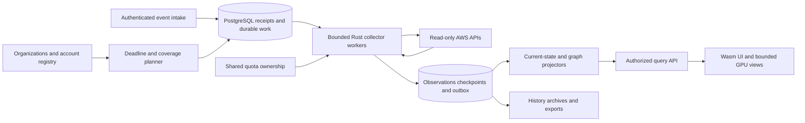

# Distributed collection and continuous scheduling

## Chosen initial service architecture

Use Rust services, PostgreSQL for shared control/observations/outbox, object
storage for archives/exports/backups, and a rebuildable FalkorDB graph projection.
Retain SQLite as the standalone/local emulator mode. Start with PostgreSQL-backed
durable work, conditional claims, and outbox processing; add a separate broker or
analytics engine only if a representative profile proves this design inadequate.
Neither SQLite nor the current process-local scheduler is the fleet control plane.

## Discovery and onboarding

Enumerate Organizations accounts completely, optionally follow OUs, and verify
per-account existing role access. Standalone account registrations use the same
identity checks. Account/OU movement changes membership and authorization but
does not prove provider resource deletion. Suspended/closed/removed accounts
retain last inventory with explicit loss-of-visibility state.

Provide declarative least-privilege role/event infrastructure plans, dry-run
validation, per-account bootstrap status, and drift checks. StackSets may deploy
to new OU accounts where an administrator enables that behavior; management
account and other exceptions are explicit. Installation cannot silently enable
Config, CloudTrail, paid APIs, or broad administrative inventory roles.

## Work granularity and deadlines

Durable units are bounded account/endpoint-scope/collector/parent enumeration
segments and targeted refresh intents. A whole account is not one indivisible
24-hour job. Each page checkpoint survives worker replacement. Avoid persisting
one job per every possible future API call when a sequential token chain suffices.

The planner records expected scope populations and next completion deadlines.
Every supported enabled scope must complete reconciliation at least hourly.
Schedule with measured headroom before the deadline, not a cron kickoff at its
end. Known-empty scopes still reconcile. Provider-proven unavailability is a
versioned capability result, not an excuse to skip unimplemented collectors.
Freshness breaches and incomplete scope counts remain in the fleet denominator.

Use separate bounded queues/budgets for change refresh, deadline reconciliation,
onboarding/bootstrap, and backfill. Weighted fair scheduling prevents one hot
account, expensive child population, or event burst from starving hourly work.
Publish per-class oldest age, admitted rate, completion rate, saturation, and
estimated catch-up time. Catch-up estimates are labeled estimates.

## Global quota coordination

Keys follow actual provider quota dimensions: deployment, commercial partition,
AWS account, regional/global endpoint domain, service, quota group, and principal
dimension only where documented. The same AWS account registered in two
workspaces must not gain two independent account-level quotas.

Assign each quota domain to a fenced owner that controls rate and concurrency
for its workers, or use an equivalent reviewed shared-admission protocol. Bound
permit lifetime, owner lease, in-flight operation lifetime, and transfer guard.
Coordinator uncertainty stops new dispatch. Worker reassignment cannot simply
reset token capacity. Retain throttle/cooldown feedback across handoff.

AWS does not accept our lease fencing token: requests already sent may finish,
and process stalls can create bounded handoff overlap. The design must quantify
that overlap, reserve safety headroom, and test it. Do not claim perfectly paced
wire timestamps or exactly-once external reads. Commit fencing remains strict.

One owner handles provider retries. Respect reviewed shared operation buckets,
server retry hints, jitter, per-attempt budgets, circuit states, and total work
deadlines. Service Quotas is advisory; it does not reveal every API limit.
Credential/STS refresh has separate rate/concurrency telemetry and jittered reuse.

## Event transports

Support authenticated AWS event adapters for useful EventBridge/SQS signals,
CloudTrail streaming paths, and existing S3 log-notification paths as reviewed
per-source capabilities. Native service events, Config evidence, and CloudTrail
events have different delays, coverage, and ordering guarantees. Record which
adapter is enabled and its lag; never describe them as equivalent instant feeds.

Commit receipts and refresh intents before acknowledgement. Bound decompression,
envelope nesting, batch counts, deduplication state, and poison-message retries.
Validate source account/region/transport identity. Replays and dead-letter replay
preserve original receipt identity and policy version. Full hourly reconciliation
remains mandatory when events are absent, dropped upstream, unsupported, or stale.

## Initial configurable hard bounds

These are starting safety limits, not measured capacity claims: page body 8 MiB;
individual normalized record 1 MiB; event envelope 1 MiB after decompression;
nesting depth 64; provider request deadline 30 seconds; at most 8 classified
provider attempts within a 120-second operation budget; work lease 60 seconds
with renewal every 15 seconds; graceful drain 30 seconds. Reviewed collector
overrides require explicit limits and evidence. Larger legal AWS payloads receive
a visible bounds outcome until a safe streaming/override policy is qualified.

Set deployment-level CPU/RSS, connection, pending-work byte/count, and storage
ceilings during installation. Validate them against the accepted load profile;
do not substitute arbitrary static defaults for capacity planning. Saturation
closes admission explicitly and triggers the overload contract.
