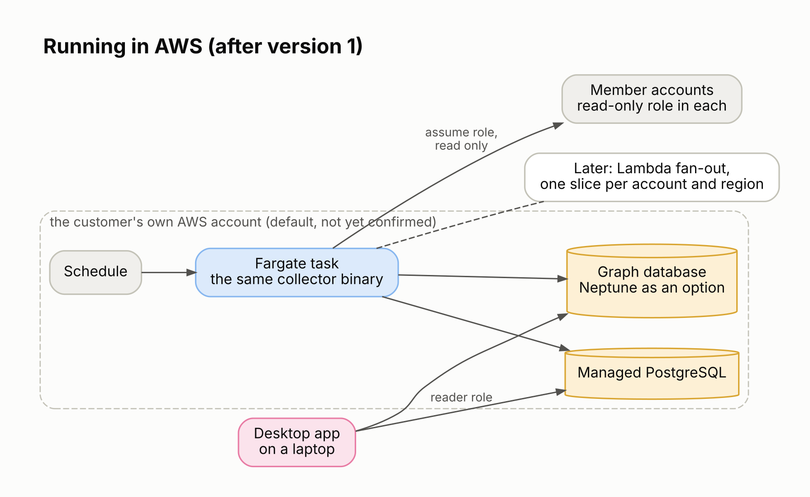
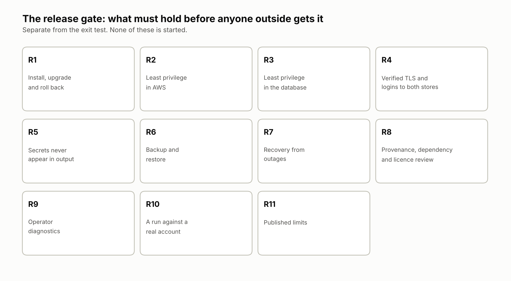

# After the exit test

> Status: Plan, 2026-11-15. Ordered work that starts once the
> [end-to-end milestone](README.md) passes its exit test. IDs in brackets are
> the matching packages in [ROADMAP](../ROADMAP.md).

## 1. Continuous

Polling only (V44).

| ID | Work | Exit evidence |
| --- | --- | --- |
| F1 | `serve`: sweep several profiles on an interval the user sets, idle in between, stalest scopes first, never two sweeps at once (M7.1). One database holds every account; today one invocation takes one profile and the store refuses a second active sweep. | Over several intervals against the emulator each seeded change is stored by the sweep after it; the proxy log shows no request in the idle time; kill and restart loses nothing |
| F2 | Deletion in continuous mode; a scope that is no longer swept deletes nothing and is reported as unobserved (M7.2). | A seeded deletion is gone from SQL and the graph after the second complete sweep; narrowing regions deletes nothing |
| F3 | Freshness and coverage: age and outcome of every scope, as a SQL view and a UI panel (M7.3). | The view and the panel agree with the stored outcomes |
| F4 | Slice mode: run for a bounded time, stop, resume (M7.4). This is what Lambda needs later. | A sweep finished in several slices equals an uninterrupted one |
| F5 | The remaining failure rows of VISION section 7 (M4.2). Remembered inaccessible and unsupported scopes moved into the milestone as B6. | Fault-injection tests named after the rows of VISION section 7 |

## 2. Tags

| ID | Work | Exit evidence |
| --- | --- | --- |
| G1 | Tags in bulk through the Resource Groups Tagging API, joined by ARN; a kind the bulk call does not cover uses its service's own tag call (V31, M8.1). | Every tagged seeded resource has its tags in SQL; a kind the bulk API covers makes no per-resource tag call |
| G2 | Owner, team and application from a tag-key mapping file, stored apart from the observed record and derived again without a sweep when the mapping changes (M8.1, M8.2). | After the mapping file changes, the derived values change with no API call |
| G3 | Shown in the graph and the UI, marked as derived (M8.3). | An application view lists its resources and the unassigned ones |

## 3. On AWS

**Mostly not part of version 1.** Version 1 runs on one person's laptop
(V54), so running the collector inside AWS waits until after it. H2 is the
exception and is part of version 1: the laptop sweeps whole organizations
(V64), so it needs the accounts from AWS Organizations, role assumption,
and the read-only role as a template.

V51 moved the PostgreSQL store into the milestone (package C6 in
[C_SQL.md](C_SQL.md)), so H1 is done there. O15 and O16 are the defaults for
where and how; they were set aside, not confirmed, by V54.

| ID | Work | Exit evidence |
| --- | --- | --- |
| H1 | Moved: now C6, inside the milestone (V51). What remains here is running against a managed PostgreSQL in AWS. | The end-to-end suite passes against the managed instance; the sweep benchmark is recorded for it |
| H2 | Accounts from Organizations discovery and cross-account role assumption, beside local profiles. Ship the read-only role as a template the customer deploys. | A sweep of two emulator accounts through assumed roles, or the recorded limit if one emulator cannot present two accounts |
| H3 | Container image and a scheduled Fargate task that runs `serve` against PostgreSQL. | The task definition and one recorded run |
| H4 | The desktop app connects to the remote PostgreSQL and the remote graph database. | Tables, console and DAG work against the remote stores |
| H5 | Neptune as an optional graph backend behind the interface from E3 (V46). | The traversal tests pass against both backends |
| H6 | Lambda fan-out, one invocation per account and region, built on slice mode. Only when account counts make it worth the orchestration. | Recorded comparison with the Fargate run |

Why Fargate first: it runs the laptop binary and loop unchanged, with no time
limit, and keeps connections and learned rates warm for the whole sweep. Lambda
has a 15-minute limit, so it needs slice mode, a connection pooler in front of
PostgreSQL and an orchestrator, and it reconnects on every invocation. Account
plus region is also the quota boundary, so a later fan-out along that line
needs no shared limiter state.

## 4. SSO and the repository split

Both are dropped. There is no SSO to start (V61), and everything is MIT
with no closed part (V63), so there is nothing to split. What remains of
this package is one undated act: making the private repository public.

| ID | Work | State |
| --- | --- | --- |
| I1 | SSO | Not planned (V61) |
| I2 | Split into an open and a commercial workspace | Dropped (V63) |

## 5. Proof

| ID | Work | Exit evidence |
| --- | --- | --- |
| J1 | Head-to-head against CloudQuery, Steampipe and Cartography on the emulator, same dataset and machine, three runs each in rotated order, median reported (M5.6, V19). | The published table, with versions, dataset, machine and the kinds every tool collected |
| J2 | First real-account run, read-only, once the owner names the account (O8, M5.8). | Coverage and outcomes; every endpoint, signature, pagination or decode difference from the emulator; the learned rates |
| J3 | Head-to-head on the real account, tools run one after another (M10.2). | Published table |

## 6. Removal

| ID | Work | Exit evidence |
| --- | --- | --- |
| K1 | Delete each typed service adapter and its `aws-sdk-*` crate once the wire engine matches it field by field (M2.6, M5.7). | `cargo tree` shows none of those crates except what `aws-config` needs |
| K2 | Move Cloud Control behind the verification command and off the product path; delete the old `scan` path, the schema 13 store and SQL files 001 to 013 (amended M9.5, V39). With them goes the last of the old store's database library and its build settings (V53); step K2.1 lists them. | No Cloud Control call site in the product binary; the cross-check still runs; `cargo tree` shows PostgreSQL as the only database driver |
| K3 | Delete Python from the tree: 46 `.py` files and both `requirements.txt` (M2.10). | `git ls-files '*.py' '*requirements.txt'` prints nothing; the gate passes |
| K4 | Regenerate `MANIFEST.sha256` from tracked files only (M0.5), and bring `START_HERE.md`, `CONTRACT.md` and `NEXT_AGENT_PROMPT.txt` in line with the tree. | Every path in the manifest is tracked; no document describes the UI as a synthetic fixture |

## 7. The public-release gate

The exit test proves an emulator milestone. Package L is what must hold
before anyone outside is handed the product. Its lines are in
[RELEASE_GATE.md](RELEASE_GATE.md); its steps, one per line of the gate, are
in [build/STEPS_AFTER.md](build/STEPS_AFTER.md).

| ID | Work | Exit evidence |
| --- | --- | --- |
| L1 | Installation, upgrade and rollback | R1 |
| L2 | Least privilege in AWS and in the database | R2, R3 |
| L3 | TLS and authentication to both stores; secrets redaction | R4, R5 |
| L4 | Backup, restore and outage recovery | R6, R7 |
| L5 | Provenance, dependency and licence review; operator diagnostics | R8, R9 |
| L6 | The authorized real-account run, with stated limits | R10, R11 |

## Later, not scheduled

Change history and retention (V42). EventBridge and CloudTrail change hints
(V44). Editing the CMDB layer in the UI. A browser build. Restoring the
mutation gate (V50).
