# Architecture

> Status: Target design, 2026-11-22. It describes the system the plan
> builds. Each section says what exists in the tree today and what does not.
> Nothing marked "planned" has been built or measured. The older
> `docs/ARCHITECTURE.md` describes the tree before this plan and is brought
> in line by step K4.1; where the two differ, this file is the target.

Read [OVERVIEW.md](OVERVIEW.md) first if you have not. Tables and columns
are in [DATA_MODEL.md](DATA_MODEL.md). The desktop app has its own document,
[MAKEPAD_UI.md](MAKEPAD_UI.md).

## The core, in one page

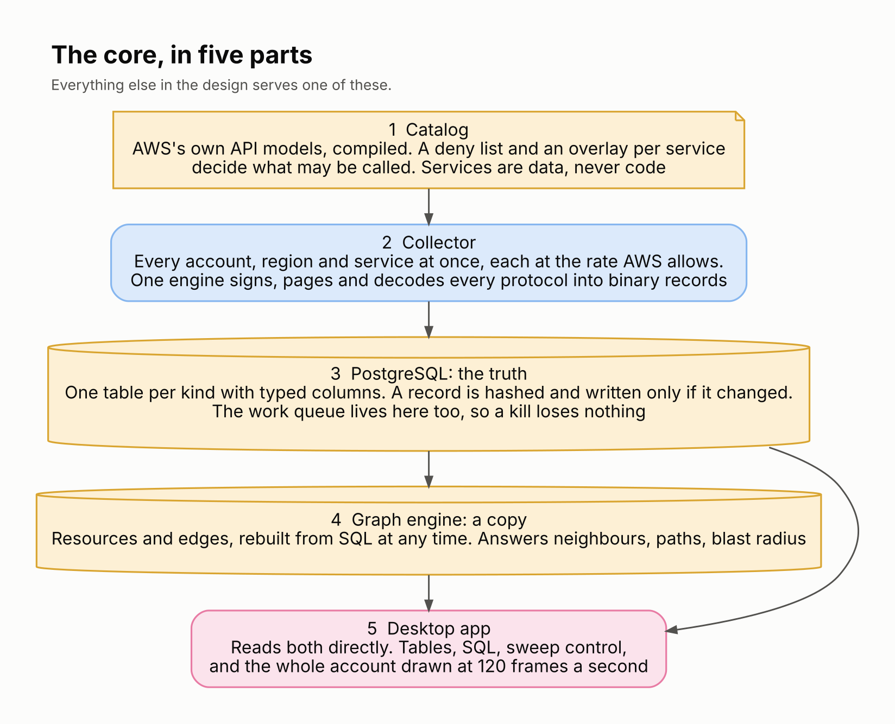

| Part | What it is | The one idea |
| --- | --- | --- |
| 1. Catalog | AWS's own API models for every service, compiled into one file, with a deny list and an overlay per service | A service is data. Supporting a new one means no new Rust |
| 2. Collector | One engine that signs, sends, pages and decodes any operation, driven by a work queue and per-account, per-region rate budgets | Everything runs at once, each at the rate AWS allows |
| 3. PostgreSQL | One table per kind of resource, plus edges, evidence and the work queue | It is the truth. A record is hashed and written only if it changed, and a kill loses nothing |
| 4. Graph engine | A copy of resources and edges, shipped inside the product | Rebuildable from SQL at any time. It answers "what is connected" |
| 5. Desktop app | A native app that reads both stores directly and can start a sweep | The whole organization on screen, at 120 frames a second |

Version 1, as decided:

| | |
| --- | --- |
| Runs on | One person's laptop, macOS or Linux (V54, V58) |
| Reaches | Every account in an AWS organization that its owner gives access to, by a read-only role in each: up to 10,000 accounts, reached in stages (V64, V69) |
| Collects | Every resource of every service, children included. Never content, secrets or paid calls (V36, V06) |
| How often | One full sweep a day (V65) |
| Priority | Sweep time, and how little of the laptop it uses (V68) |
| Store | PostgreSQL 18, pinned 18.7 (V66) |
| Licence | All of it MIT (V63) |
| Not in it | Running in AWS, SSO, Windows, change history, change events |

The rest of this document is the detail behind those five parts.

## 1. The system in one picture

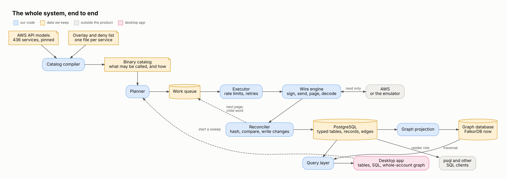

| Part | What it does | Crate | State today |
| --- | --- | --- | --- |
| Catalog compiler | Turns AWS's API models, the overlay files and the deny list into one binary catalog | `catalog-tool` | Built. Compiles 436 models; 4 operations callable |
| Planner | Seeds one unit of work per listing to run | `src/sweep_runtime/` | Built, inside the CLI binary. Becomes a library (D1) |
| Work queue | Holds every unit of work, with leases, in the store | `inventory-engine` | Built |
| Executor | Admission, rate limits, retries. The only place a retry is decided | `inventory-engine` | Built. Limits are low and coarse (section 4) |
| Wire engine | Signs, sends, pages and decodes any operation of any service | `aws-wire` | Built: five request serializers, three streaming decoders, SigV4 |
| Reconciler | Hashes each record, compares, writes only changes | `inventory-engine` | Built |
| Store | PostgreSQL 18: one table per kind plus shared tables | `inventory-engine` | Planned (C6). Today's store is a local single-file database that the plan replaces |
| Graph projection | Copies changed resources and edges to the graph database | `inventory-engine` | Built, for one edge |
| Query layer | Reads SQL and the graph for the app | `cmdb-view` | Built against today's store; moves to PostgreSQL (C6.11) |
| Desktop app | Tables, SQL console, sweep control, whole-account graph | `cmdb-ui` | Built in part: tables and one neighbourhood |
| Benchmarks | Every number the plan quotes | `cmdb-bench` | Built in part; the sweep benchmark is planned (B5) |
| Test harness | Starts and owns the emulator and databases, seeds resources | `inventory-harness` | Built |

Everything is Rust. A service is described by data (a model, an overlay
file, rows in a kind map), never by Rust code written for that service.

## 2. Rules the whole design obeys

| Rule | What it means in practice |
| --- | --- |
| Read-only | The product has no code path that writes to AWS. The only code that can create AWS resources is in the test harness, for seeding the emulator |
| Never content, secrets or paid calls | Object bodies, secret values, queue messages, log contents and any call that is billed per request are denied |
| Fail closed | An operation is called only if the deny list allows it **and** an overlay entry classifies it. A rule may deny by name; nothing may allow by name |
| Bounded | Every queue, channel, pool, retry budget, page size and lease has a limit. Nothing grows without bound |
| One retry owner | Only the executor retries. A retry goes back through admission and the rate limit |
| State is in the store | Progress, leases and outcomes live in the database, so killing the process loses nothing |
| SQL is the truth | The graph database can be deleted and rebuilt from SQL at any time |
| Measure, then claim | Every step on the sweep, write, read or render path records a number before and after (V52) |
| Three separate facts | Implemented, verified on the emulator and verified on a real account are tracked separately for every operation |

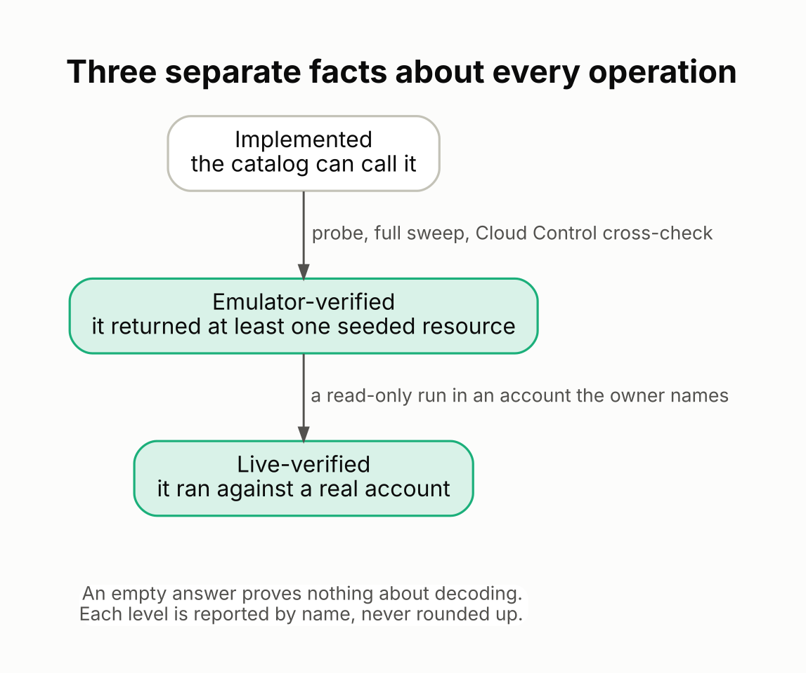

## 3. The catalog: how an operation becomes callable

AWS publishes a model of every API. The repository pins 436 of them at one
commit as a git submodule, so the input is fixed and reviewable.

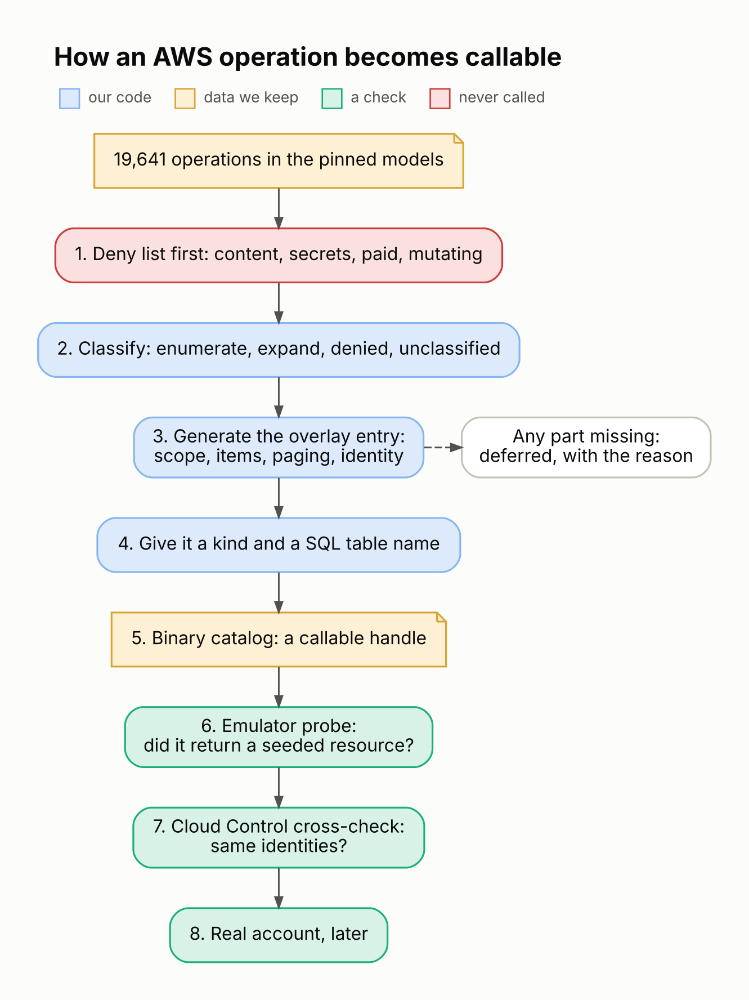

The compiler reads four inputs:

| Input | What it holds | Size today |
| --- | --- | --- |
| API models | Every operation, its input and output shapes, its protocol | 436 services, 19,641 operations |
| Deny list (`catalog/must-deny.txt`) | Operations that are never called | 184 lines |
| Overlay (`catalog/overlay/<service>.toml`) | For each allowed operation: whether it lists roots or children, where the items are in the response, how it pages, what identifies a resource | 2 services |
| Kind map (`catalog/kinds.tsv`) | Which operation produces which resource kind, and which fields point at other kinds | 113 API kinds, 42 relation rows |

It writes one binary file, `catalog/aws-api.catalog`, which is the only
thing the running product reads. An operation ends in exactly one class:
`enumerate` (lists resources with no required input), `expand` (lists
children of a parent), `denied`, or `unclassified`. Only the first two are
ever called.

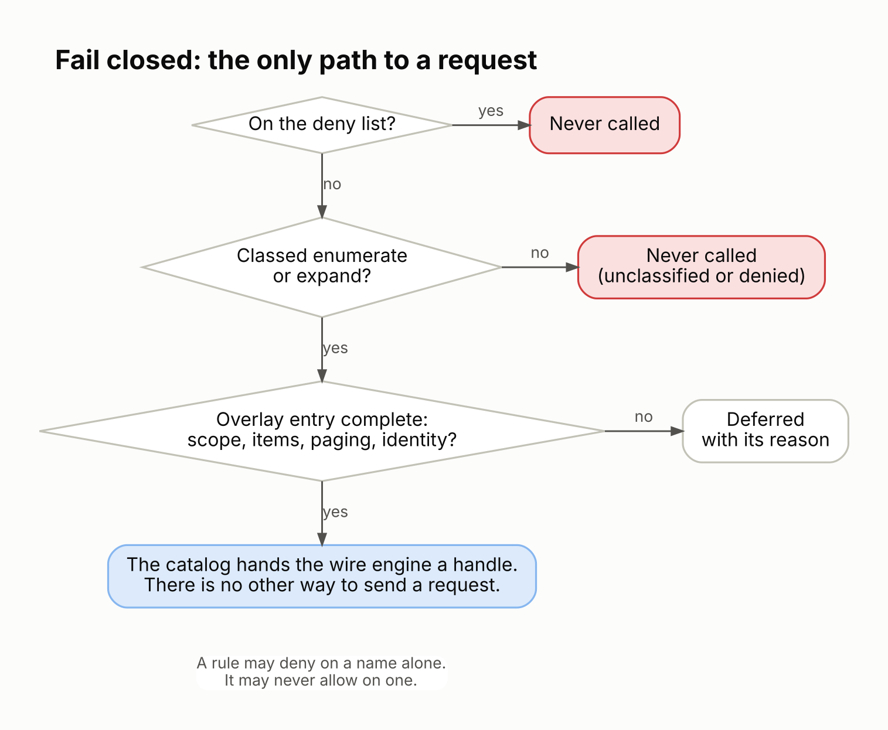

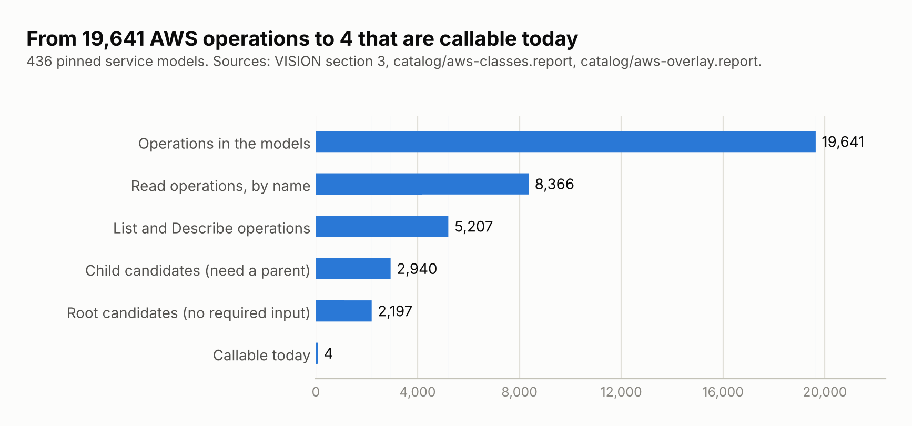

**What is planned.** Writing 436 overlay files by hand is not possible in
the time available, so track A builds a generator (A1). It proposes an
overlay entry from the model: the paginator, the list member, and an
identity taken from an ARN member or a modeled identifier. The safety
argument is that the generator can only produce entries; the deny list is
still checked first and still wins, and whatever the generator cannot
classify with confidence is deferred with a written reason, not guessed.
Each generated entry is then checked twice from outside: the emulator probe
(A5) and the Cloud Control cross-check (A6). The owner has accepted that an extracted entry does not need one-by-one
human review (V67).

**Protocols.** AWS uses several wire formats. One engine covers them all.

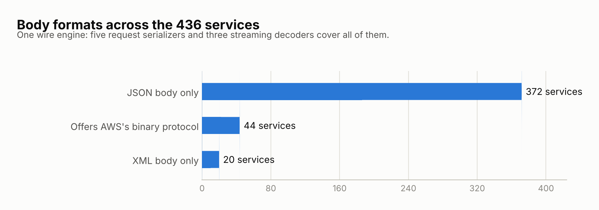

Each response is parsed once, as a stream, straight into a binary record.
No JSON document is built in memory, stored, or passed between components
(V03, V40). Where a service offers AWS's binary protocol, it is requested.

## 4. A sweep, from start to finish

A **sweep** is one complete pass. A **scope** is one listing inside it: one
operation, in one account and region, for one parent if it is a child
listing.

1. The planner seeds one unit of work per root scope into the work queue,
   for every enabled region of every account.
2. Workers claim units under a lease.
3. For each unit the executor waits for the rate budget, the wire engine
   signs and sends the request, and the response is decoded as it arrives.
4. The page is reconciled and committed in **one transaction**: the changed
   records, their edges, the keys to project to the graph, the next page
   token, and any child scopes the page produced.
5. Child scopes go back on the queue. Step 2 repeats until the queue is
   empty.
6. Each scope ends in exactly one outcome, and deletions are decided.
7. The projection copies what changed to the graph database.

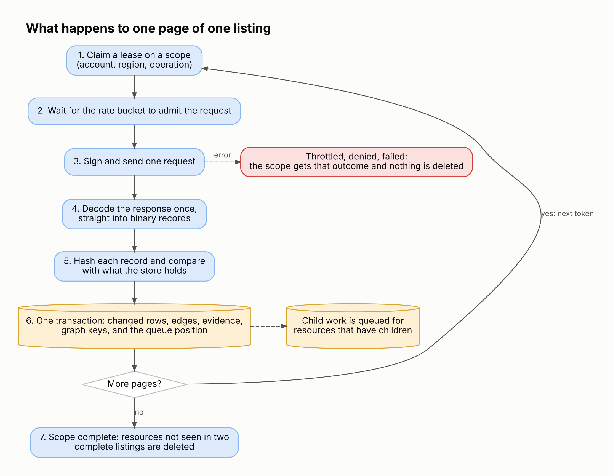

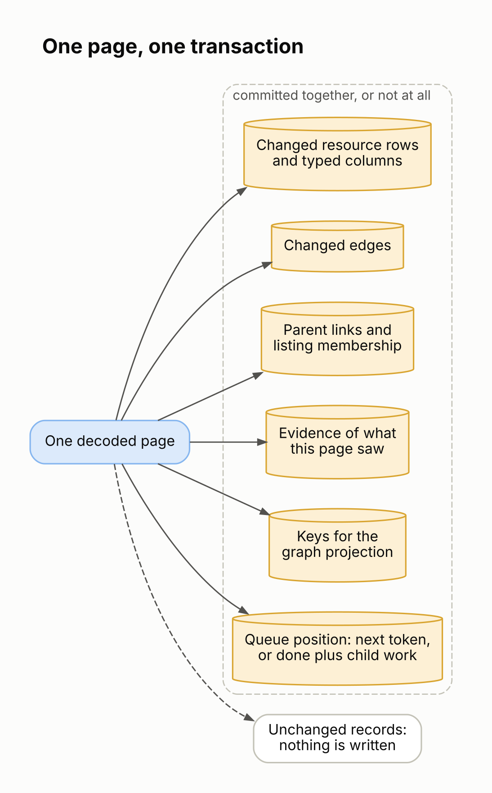

Because a page's data and its place in the queue commit together, a crash
at any moment leaves either the whole page stored and the queue advanced,
or neither. Resuming repeats at most the page that was in flight.

### Outcomes

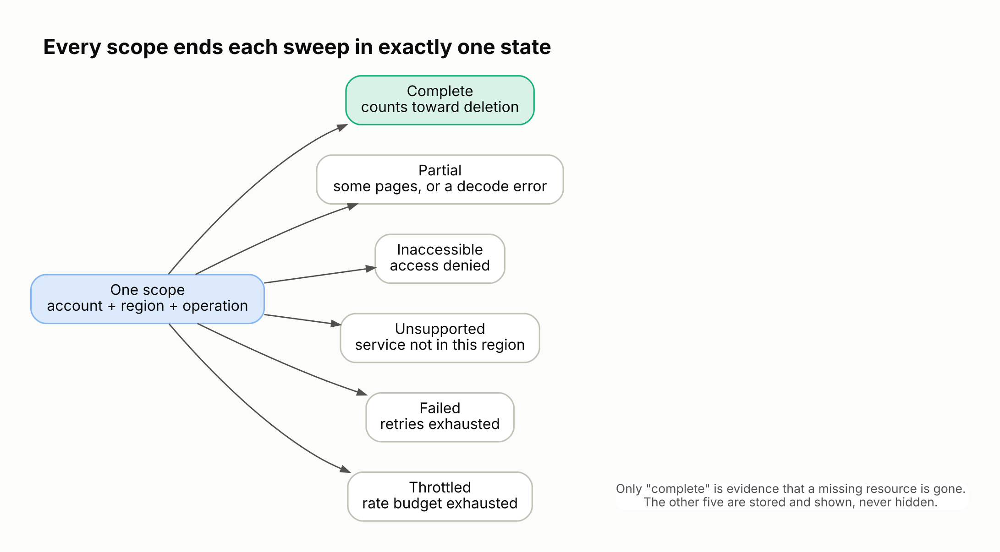

Only a scope that completed can prove that something is gone. A scope that
failed, was denied, or was skipped says nothing about deletion.

### Deletion

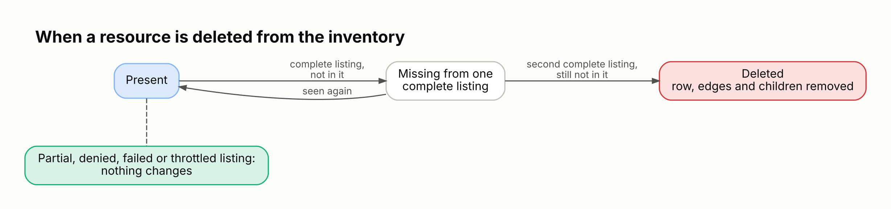

A resource is removed only after it was missing from **two complete**
listings of its scope. One missing sighting marks it; a second removes it.
This protects against a listing that was eventually consistent, or a page
that AWS dropped.

## 5. Speed

Speed is the first design constraint (V43, V52). Collection time is bounded
by four things, in this order: how many requests AWS will accept, how many
requests are needed, how fast pages can be committed, and CPU spent
decoding.

**Where the tree is slow today**, read from the code, not measured:

| Limit | Today | Planned |
| --- | --- | --- |
| Request rate | 5 a second per bucket, and the adaptive rate can never rise above where it starts | No low ceiling: climb until AWS throttles, settle just under, remember the rate (B2) |
| What shares a budget | One bucket per service, across every region and account | One bucket per account, region and quota group (B1) |
| Work in flight | Claims a batch and waits for all of it; default 16, cap 128 | Keeps a constant number in flight, lifted to the limiter's bound (B3) |
| Commits | One transaction per claim and per page, each flushed to disk | Pages grouped per transaction on PostgreSQL, each setting chosen by measurement (B4) |
| Calls made | Small pages; every list followed by a describe | Largest page size, skip a describe the list already covers, batch reads, remember scopes that are denied or unsupported (B6) |
| Connections | Idle timeout of 1 second, 2 idle per host | Set from measured reuse (B7) |
| CPU | Rows copied, requests re-encoded | Removed where a profile shows it (B8) |

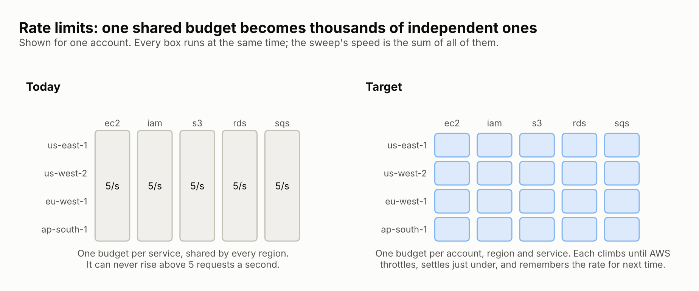

**The benchmark comes first** (B5). One command prints cold sweep time,
warm sweep time, API attempts, retries and throttles, connections,
resources per second, CPU, peak memory, bytes written, and decode share.
The baseline is recorded on PostgreSQL before any speed step, and each step
records before and after. A wave does not close on a slowdown without a
written reason. The seventeen measurements the plan uses are listed in
[BUILD_PLAN.md](BUILD_PLAN.md) section 3.

**The warm sweep.** On an unchanged account the reconciler finds every hash
equal and writes nothing about resources. The exit test requires exactly
that: zero rows written to resource state on a second sweep (X4).

**What the emulator cannot tell us.** It has no quotas and no network
latency. Rate behaviour is tested through a fault proxy that imposes a
stated limit and delay; real quotas are only learned on a real account.

## 6. The store

PostgreSQL is the only store, on a laptop, in tests, in CI and in AWS
(V53). One store means one write path to build, tune and crash-test. A
local user runs PostgreSQL from a container (podman or docker) or a native
install; every command takes one connection URL.

Three kinds of data live in it:

- **Resource state**: one table per kind with typed columns, plus shared
  tables for identity, edges and tags.
- **Evidence**: which scope saw which resource, and how each scope ended.
- **Control**: the work queue, leases, learned rates, the projection
  outbox.

The record itself is stored twice on purpose: once as typed columns and a
JSONB column for SQL, and once whole as a compact binary blob (CBOR) that
is what gets hashed and what the app decodes. Details, including the
tables this plan adds, are in [DATA_MODEL.md](DATA_MODEL.md).

**State today.** The tree stores into a local single-file database. No
PostgreSQL code exists yet. The plan puts a store interface in front of
the current code first (C5), builds the PostgreSQL store behind it (C6),
proves the same end-to-end scenario on it, and only then deletes the old
store (C6.12).

## 7. Relationships and the graph

An edge is a relationship between two resources. Edges come from three
places, and each edge is labelled with where it came from.

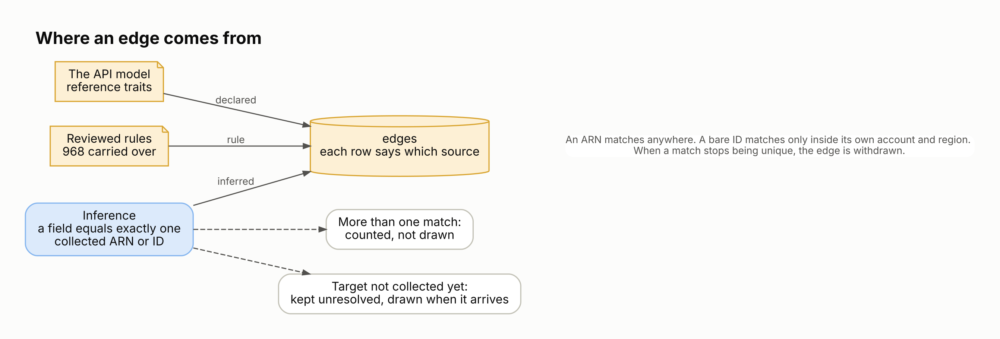

| Source | How | Count available |
| --- | --- | --- |
| The API model and kind map | A field is declared to hold the identifier of another kind | 42 rows mapped, 1 live |
| Reviewed rules | Rules carried over from the earlier collectors | 968 |
| Inference | A field's value exactly equals the ARN or unique ID of exactly one collected resource | Computed per sweep |

An inferred edge is drawn only when the match is unique. Ambiguous matches
are counted and reported, never drawn. If the matching resource later
disappears or becomes ambiguous, the edge is withdrawn (E1.2).

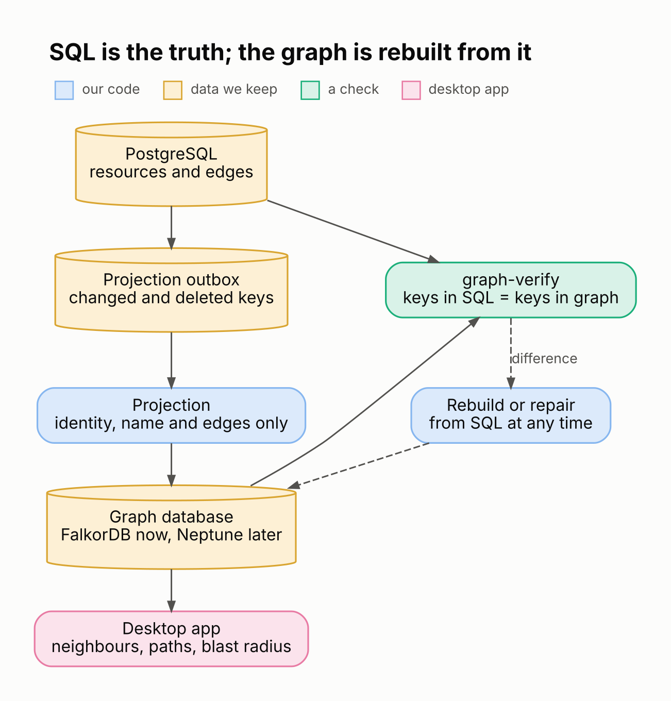

Every commit that changes a resource or an edge also writes its key to an
outbox table in the same transaction. The projection reads the outbox and
applies the change to the graph database, so the graph can lag but cannot
silently diverge. A full rebuild from SQL is always possible, and a repair
command compares the two and fixes differences (E4.3). The exit test
requires node and edge keys to match exactly (X5).

### Which graph engine

The engine ships inside the product (V60) and everything is MIT (V63). The
engine in the tree today is FalkorDB. Two things put it in question: its
licence, and the owner's request for something faster that works from Rust.
Because projection and traversal go through one interface (E3.1), a second
engine is one more implementation of that interface, and the choice can be
made by measurement. That is step E3.4.

| Candidate | Written in | How it runs | Licence | From Rust | What is known |
| --- | --- | --- | --- | --- | --- |
| FalkorDB | C | A separate server | SSPLv1, not counted as open source by the OSI | A client crate | In the tree; the end-to-end test passes on it |
| Grafeo | Rust | Inside our process, or as a server | Apache-2.0 | Native crate, `grafeo` | Pre-1.0. Its own published benchmark puts it ahead of the others. Nobody independent has confirmed that, and the benchmark is not our workload |
| LadybugDB | C++ | Inside our process | MIT | A binding crate | The continuation of Kuzu, whose own repository was archived in October 2025 |
| An index of our own | Rust | Inside our process | MIT | It is Rust | Not a database: no query language, only the three traversals the app needs. Included as the floor a database has to beat |
| PostgreSQL alone | | Already running | PostgreSQL licence | | Recursive SQL can traverse today. Standard graph queries (SQL/PGQ) were in the PostgreSQL 19 betas and are reported withdrawn before the release |

**None of these has been run for this project, and "faster" is not known.**
At the size in question (250,000 nodes, 1,000,000 edges) an engine inside
the process has no network hop and no second server to install, start and
secure, which matters on a laptop. Against that, two processes (the CLI and
the app) would open the same files, and each candidate's rule for that has
to be checked. Step E3.4 measures load, rebuild, the three traversals,
memory and disk for each, checks that the graph still equals SQL, and
records the choice.

Neptune stays an optional later backend behind the same interface (V46).

Sources for the table: [FalkorDB licence](https://docs.falkordb.com/license.html),
[Grafeo](https://github.com/GrafeoDB/grafeo),
[LadybugDB](https://dbdb.io/db/ladybugdb),
[Kuzu archived](https://www.theregister.com/2025/10/14/kuzudb_abandoned/),
[SQL/PGQ withdrawn from PostgreSQL 19](https://neon.com/postgresql/postgresql-19/sql-pgq-graph-queries).

## 8. The desktop app

A native Makepad application. It reads PostgreSQL and the graph database
directly, in process; there is no server between the app and the data.
Whatever the CLI can do, the app can do, including starting a sweep (V47).

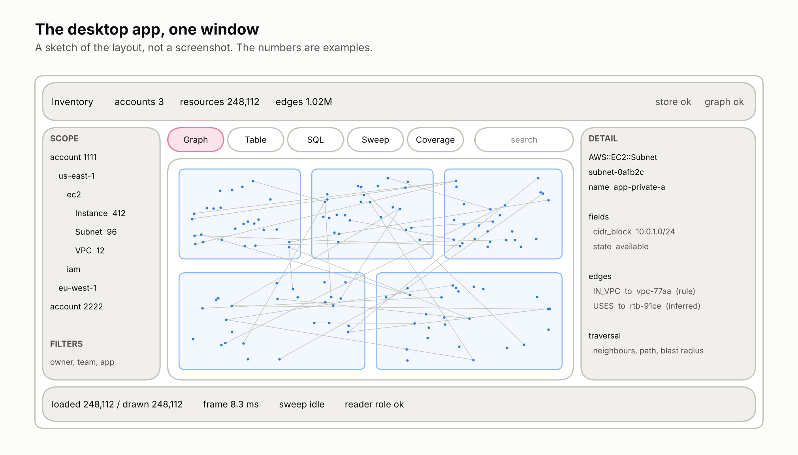

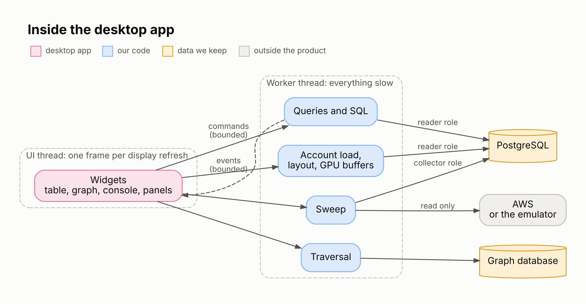

The hard part is drawing a whole account at 120 frames a second. The
target is measured on two classes of machine, an Apple M3 MacBook Pro and
a machine with an RTX 3070 class GPU (V56). The design: load everything once, lay it out off the UI thread, upload node and
edge data to the GPU once, and on each frame change only a few numbers
(pan, zoom, selection). Level of detail replaces far-away resources with
aggregates.

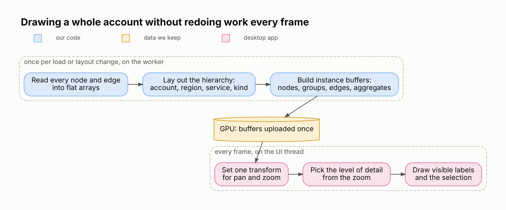

Everything else about the app (every screen, the measurements, the
frame-rate harness, what Makepad offers and what was read in its source) is
in [MAKEPAD_UI.md](MAKEPAD_UI.md).

## 9. Where it runs

### On one person's laptop: version 1

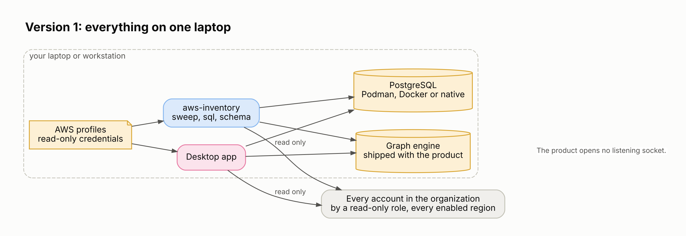

This is version 1 (V54), on macOS and Linux (V58). The graph engine ships
inside the product (V60); PostgreSQL 18 comes from a container or a native
install (V66).

### Whole organizations from one laptop

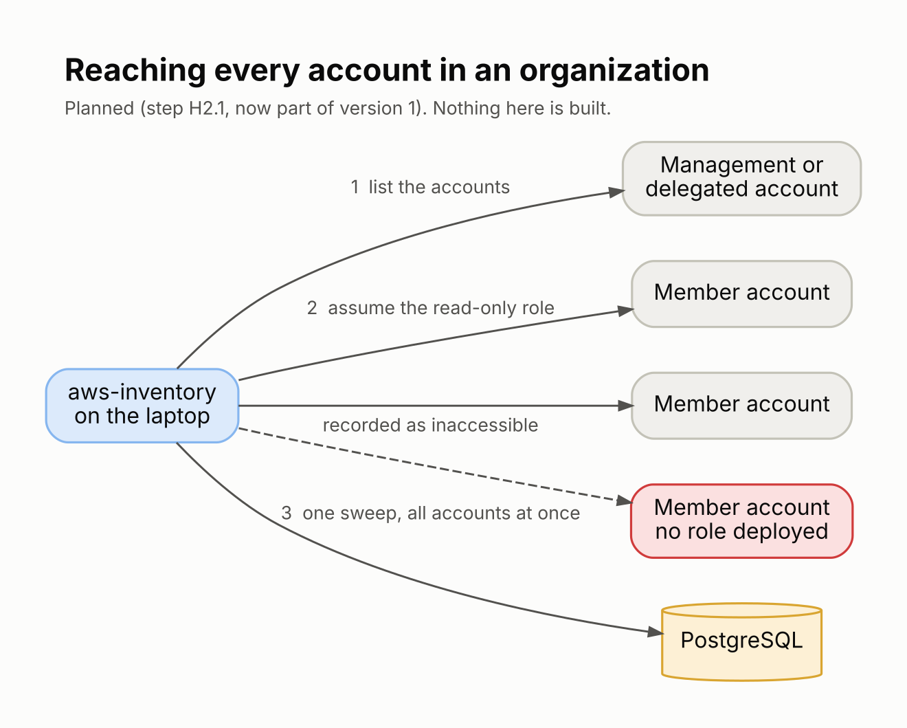

The product is designed to be given access to every account an organization
owns (V64). It lists the accounts through AWS Organizations, assumes one
read-only role in each, and sweeps them all in one run, with a separate
rate budget for every account, region and service. An account where the
role is missing is recorded as inaccessible and never treated as empty.
How the role gets into each account is not a concern for now (V75): access
is assumed to exist. Local AWS profiles keep working for a single account.

Today only local profiles work. Organization discovery and role assumption
are step H2.1, now part of version 1.

### Built for massive scale

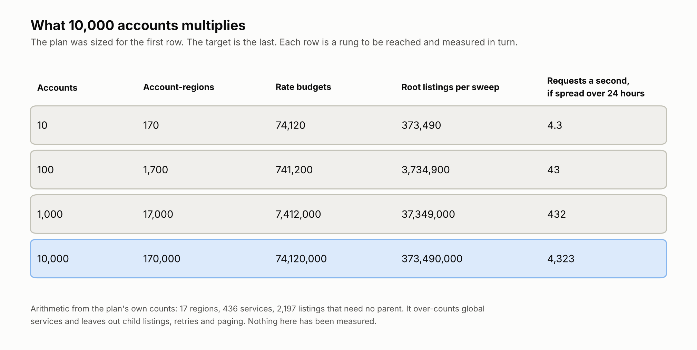

The instruction is to plan for massive scale (V76). One rule follows, and
every part is held to it:

> **No cost may grow with accounts times regions times operations.** Memory
> follows what is in flight. Rows written follow what was found and what
> went wrong. Connections follow endpoints. What the app holds follows what
> is on screen.

| Part | What the rule means there |
| --- | --- |
| Rate budgets | Created on first use, dropped when idle, registry sharded; learned rates kept in the store |
| Work queue | Seeded for a moving window of accounts, never for the whole organization up front |
| Outcomes | Exceptions are rows. "Completed and empty" is a count |
| Connections | Pooled per endpoint and shared by every account |
| Credentials | Held only for accounts in the window |
| Store | The account leads every key, so large tables can be partitioned by account |
| Collectors | Work is leased from the store, so more than one collector process, and later more than one machine, can share one database |
| Graph engine | Chosen with memory per million nodes measured, and behaviour past memory known |
| App | Counts for everything; individual resources for what is in view |

A sweep runs as fast as AWS allows; there is no window it has to fit (V73).
Whether 10,000 accounts fit on one laptop is not treated as a blocker
(V74). It is a result the scale ladder reports.

The target is up to 10,000 accounts in one organization (V69). The plan was
sized for about 10. A thousand times more accounts does not change the five
parts, but it changes four assumptions inside them. The numbers are
arithmetic from the catalog's counts; none is measured.

| Assumption at 10 accounts | Why it fails at 10,000 | What replaces it | Step |
| --- | --- | --- | --- |
| Every rate budget stays in memory | About 74 million budgets, against a bound of 65,536 | A bounded window of accounts in flight. A budget exists while its account and region are being swept; its learned rate is kept in the store | S1.2 |
| Every listing is a row in the work queue, and its outcome a row per sweep | About 373 million root listings a sweep would write more control data than resource data | Listings are planned as an account enters the window. A listing that completed and found nothing is counted, not stored | S1.3 |
| The app loads the whole account into memory | A whole organization may be tens of millions of resources | Counts for everything, always. Individual resources only for what is in view, up to a stated budget | S1.6 |
| The graph is small enough for any engine | An engine that keeps the whole graph in memory may not fit on a laptop | Memory per million nodes, and behaviour past memory, are measured when the engine is chosen | E3.4 |

Two things already in the design carry over unchanged, and matter more at
this size:

- **Connections are per endpoint, not per account.** A service in a region
  is one host for every account, and each request carries its own account's
  signature. 10,000 accounts reuse the same connections (S1.4).
- **AWS limits each account separately.** The sweep is not held back by one
  account's quota; it is held back by the laptop: its network, its open-file
  limit, its CPU and its disk.

**What is not known.** Listing everything in 10,000 accounts is about 373
million root listings a sweep, before children, paging and retries. How
long that takes from one machine has not been measured. The plan climbs a
ladder of 10, 100, 1,000 and 10,000 accounts and records each rung (S2.1).
Two levers are designed for when one machine is not enough: more than one
collector sharing the store, and a slower cadence for scopes that stay
empty, which is built and left switched off (S1.7, O22).

### Once a day

One full sweep a day is enough (V65), and each sweep runs as fast as AWS
allows (V73). A daily sweep is started by the
operating system's scheduler or from the app; the product does not need to
run all day. What matters is how long the sweep takes and what it costs the
laptop while it runs. An unchanged organization still writes nothing about
resources. Credentials come from local AWS
profiles. Running PostgreSQL locally is step C6.2 and the commands are in
[RUN_HERE.md](RUN_HERE.md).

### In AWS: after version 1

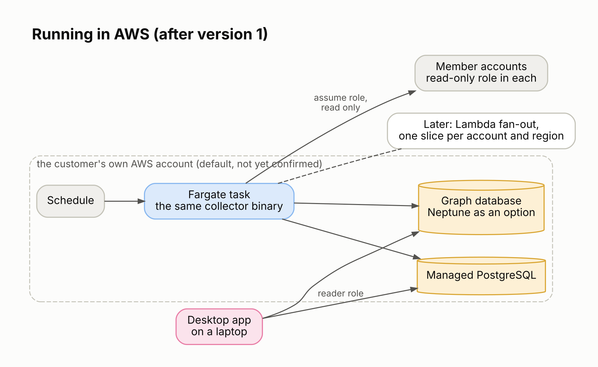

Not part of version 1 (package H). The default design is the collector as a
scheduled Fargate task in the customer's own account, a managed PostgreSQL,
accounts discovered through AWS Organizations and reached by assuming a
read-only role, and the desktop app connecting to the remote stores. Both
"the customer's account" and "Fargate first" are defaults that were
set aside, not confirmed, when version 1 became laptop-only (O15, O16). Lambda fan-out comes later, through a mode that collects in
resumable slices.

## 10. Security

| Area | Design | State |
| --- | --- | --- |
| AWS permissions | Read-only. One role in every account of the organization. Generating the exact policy and deploying the role are set aside for now (V75) | Planned (H2.1); the policy is release-gate work (R2) |
| What is never read | Content, secret values, paid calls; enforced by the deny list at compile time | Built |
| Database roles | A collector role that writes and a reader role that can only read. The app's SQL console connects as the reader and refuses to run if the role can write | Planned (C4, D13.1) |
| Connections | On the laptop both stores listen on the local machine only and require a password. Verified TLS is required whenever a store is not on the local machine | Planned (R4) |
| Secrets | Connection settings from the environment or an owner-only file; never on the command line. No secret in logs, errors or exports | Planned (D13.1, R5). Keychain storage is later (O20) |
| Sign-in | None. The app runs on its user's own laptop; there is no SSO to start (V61) | |

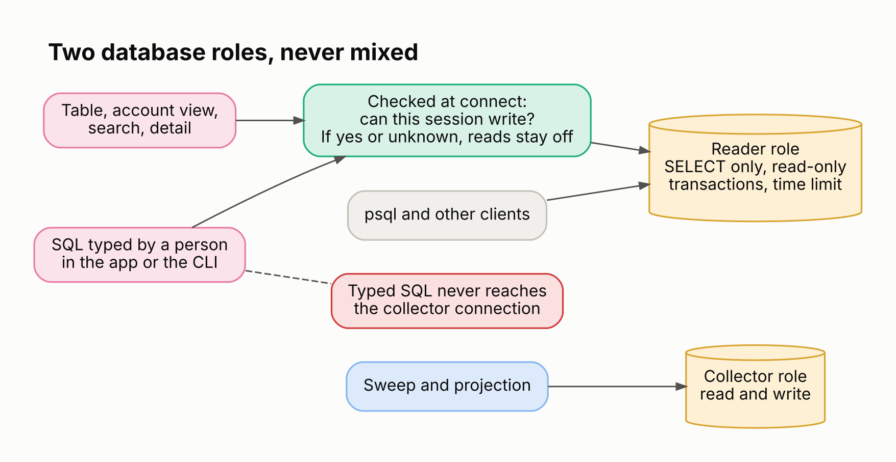

## 11. When things go wrong

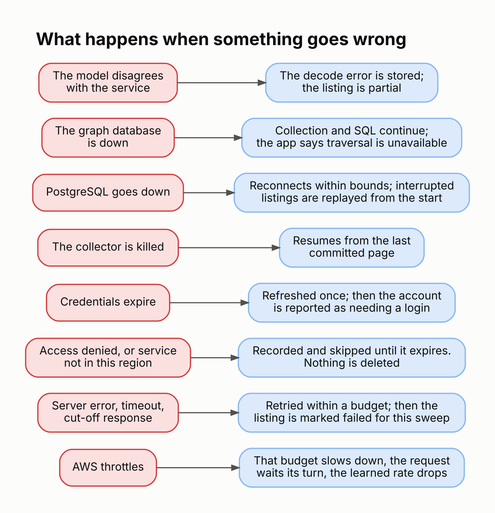

The collector is killed on purpose in tests, in three ways.

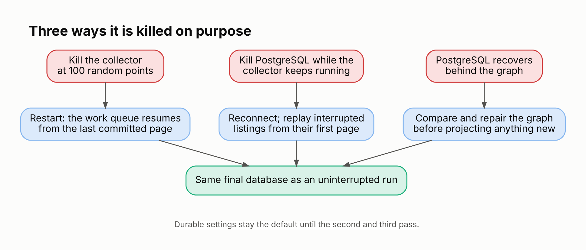

The third, killing the **database** while the collector is running, was
added after an outside review (B4.6). It matters because some speed
settings trade durability for throughput; any setting that loses data in
that test is removed from the options, and the defaults stay durable.

## 12. How it is proven

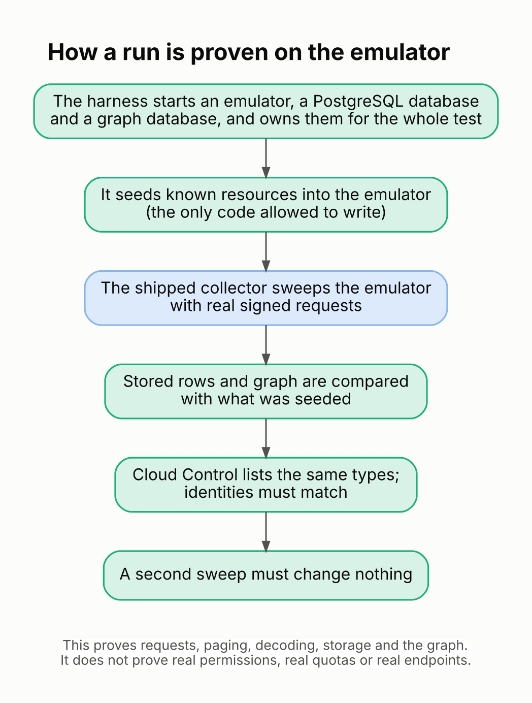

The harness owns the emulator and both databases for the length of a test,
seeds known resources, runs the shipped collector against them with real
signed requests, and compares what was stored with what was seeded. Cloud
Control then lists the same types independently and the identities must
match. Cloud Control is a checker only: nothing it returns is ever stored
(V39).

The baseline of this was run on 2026-11-15 and passed for the 4 operations
that are callable today; see [RUN_HERE.md](RUN_HERE.md).

## 13. Upgrades

When AWS changes a model, the catalog changes, and tables may gain columns.

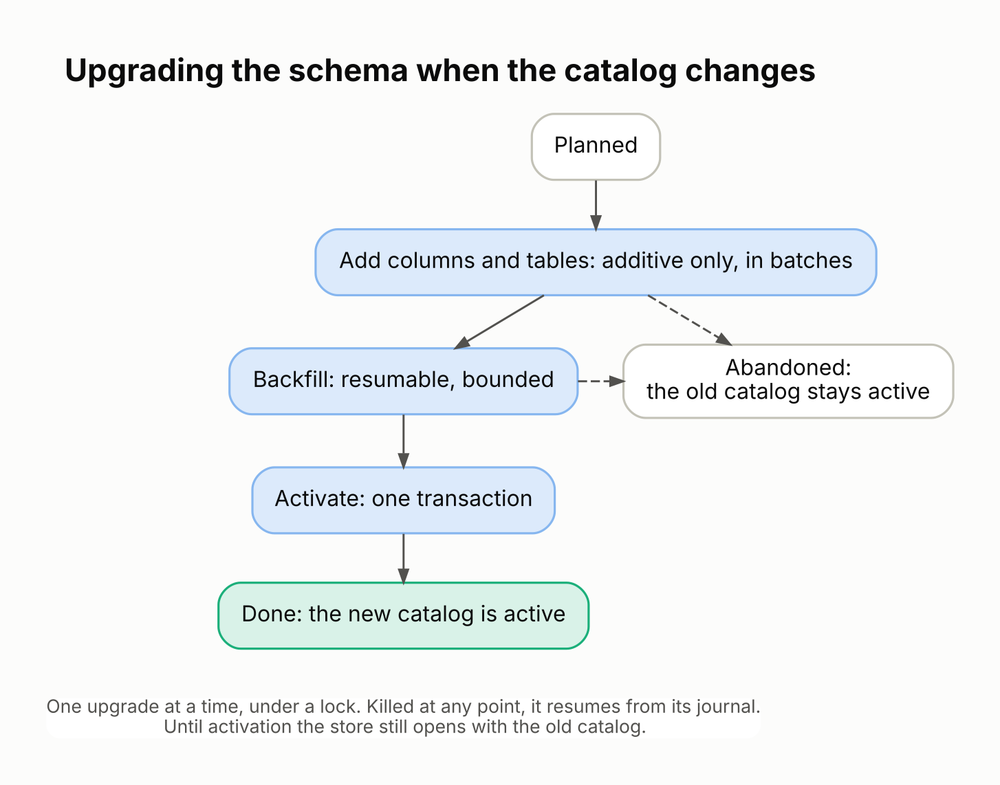

A journal table records each migration step so an upgrade that is
interrupted resumes instead of leaving a half-changed schema (C1.7).

## 14. What is deliberately not in the design

| Not included | Why | Where it would go |
| --- | --- | --- |
| Change history | Current state only for now (V22, V42) | Later, not scheduled |
| Event-driven updates | One sweep a day is enough (V65, V44) | EventBridge and CloudTrail hints, later |
| Writing to AWS | Never | |
| A server or HTTP API between the app and the data | The app reads the databases directly (V32) | |
| A browser version of the app | Native only (V17) | Later, not scheduled |
| Editing in the app | Read, sweep and query only (O21, unconfirmed) | A product decision |
| GovCloud and China | Commercial partition only (V07, V49) | |
| A second kind of store | PostgreSQL only (V53) | |
| SSO | Not to start (V61) | |
| Windows | macOS and Linux only (V58) | |
| Running in AWS | Version 1 is a laptop (V54) | After version 1 (package H) |
| A closed or paid edition | Everything is MIT (V63) | |

## 15. Today against the target

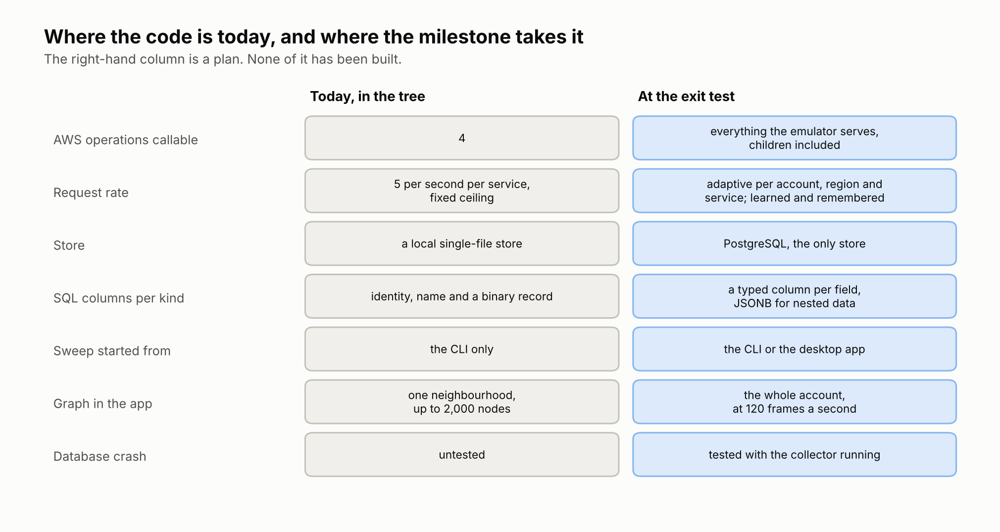

The order in which the gap is closed is [BUILD_PLAN.md](BUILD_PLAN.md).
