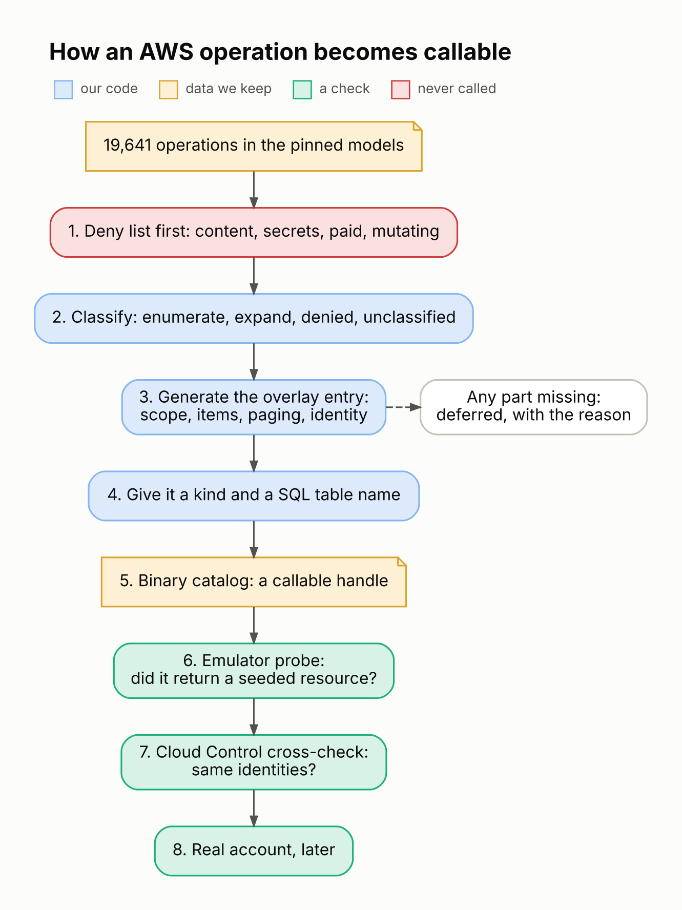
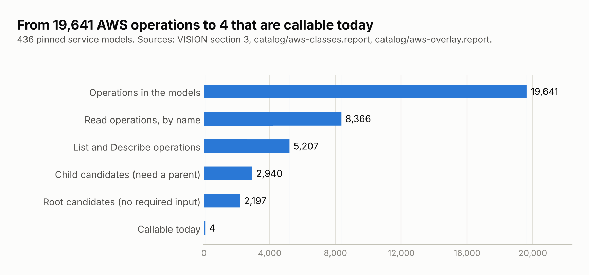
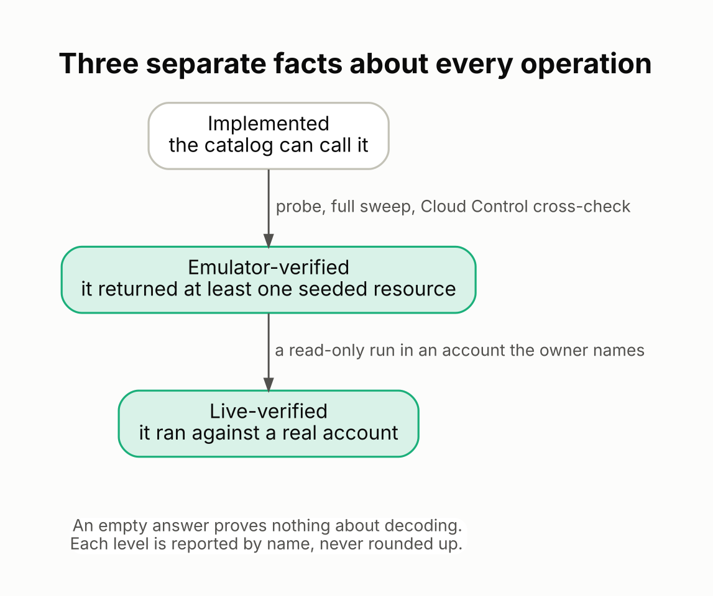

# Track A: coverage

> Status: Plan, 2026-11-15. Part of the [end-to-end milestone](README.md).
> Crates: `catalog-tool`, `inventory-harness`. Data: `catalog/overlay/`,
> `catalog/kinds.tsv`. Needs the pinned models at `.local/aws-models`.

This page is the one-page summary of track A. Its 32 steps are in
[build/STEPS_A.md](build/STEPS_A.md), and the step file wins where the two
differ. A3.4 now also records what a list returned (`scope_members`), so an identifier that disappears can be removed.

## Why

The new pipeline can call 4 operations. `catalog/aws-overlay.report` counts
2,026 unreviewed enumerations, 2,915 unreviewed expansions and 434 services
with no overlay file. Both existing overlay files are stamped "Automated model
review; no human approval", so the present gate is already machine review.
This track makes that explicit, makes it scale, and adds two independent
checks: the emulator probe and Cloud Control (V39, V67).

The deny rules do not change. A rule may deny on a name alone and may never
allow on one. `catalog/overlay/must-deny.txt` is applied before anything is
generated, and a generated entry can never override it.

## Packages

| ID | Work | Needs | Exit evidence |
| --- | --- | --- | --- |
| A0 | Make the catalog gate pass again. On the `main` archive of 2026-11-15, `catalog-tool models compile --check` fails with `runtime capability metadata is invalid or unsupported`, because `catalog/kinds.tsv` carries relation rows for kinds no callable operation produces ([RUN_HERE](RUN_HERE.md) has the narrowing). Either hold those rows back until their kinds are callable, or let the compiler carry a relation as pending until both ends are. Replace the bare `Capability` error with the existing `CapabilityContext` variant wherever a service, kind or path is known, so the next failure names its cause. | None | `models compile --check` exits 0 from a clean checkout with the pinned models; a deliberately broken relation row fails with an error that names the kind and the path |
| A1 | Overlay generator. `catalog-tool overlays generate [--check \| --write]` writes one `catalog/overlay/<service>.toml` per service from the pinned models. For each enumerate candidate it derives: scope (account for a service the endpoint report marks global, otherwise region), items path (the paginator's items member, else the single list member of the output), paginator (the modeled token pair), page size (the model's maximum; the two live enumerations are hand-set to 5 and are raised separately in B6), identity (an ARN member, else the modeled resource identifiers). An operation with any part missing is written as `defer` with the missing part as its reason. Generated files carry `reviewer = "generated"`. A hand-written entry wins over a generated one. | A0 | Counts of callable and deferred by reason sum to the 2,197 enumerate candidates; regenerating gives identical bytes; `overlay-check` passes; a test proves no must-deny operation can become callable through generation; the 4 operations callable today are unchanged |
| A2 | A kind for every callable operation. Nothing generates `catalog/kinds.tsv` today; it is a hand-maintained input with 313 operation rows for 17 services. Add a generator beside it: an item shape maps to its CloudFormation type where one matches (168 rows map today), otherwise to `AWS::ApiOnly::<Service><Resource>`. SQL names come from the existing rule in `catalog_tool::names`. | A1 | Every callable operation has a kind row; all SQL names are distinct; the binary catalog compiles and `binary-catalog` passes |
| A3 | Child operations. Generate bindings for expand candidates. The 337 with modeled identifiers bind directly. For the others, bind a required input when exactly one kind in the same service has an identity field of the same name and shape; anything else is `defer` with its reason. | A2 | Report of bound and deferred with reasons, summing to the 2,940 expand candidates; against the emulator, a parent page creates child work and the children are stored (the first real run of `src/sweep_runtime/execution/page/child.rs`) |
| A4 | Seed files. A4.1 moves the default VPC/subnet scenario into embedded `crates/harness/seeds/ec2.toml`, with strict bounded loading, repeat-index bindings and nested request values. The remaining A4 steps add directory execution and model-generated drafts, then keep what the emulator accepts. | None | Seeding runs with no Python on `PATH`; the same seed gives the same listing twice; a stored matrix says, per service and create operation, accepted or rejected with the emulator's error; a test proves the product binary has no write capability |
| A5 | Emulator probe (ROADMAP M2.7). Call every root enumeration once and sample bindable children against the seeded emulator. This is a harness run and makes nothing callable. | A3, A4 | `catalog/emulator-probe.report`: per service and operation, answered with items, answered empty, unsupported, failed with the decode or protocol error, or skipped with a binding reason |
| A6 | Cloud Control cross-check (V39). `inventory-harness verify cloud-control --database DB`: for every kind that maps to a CloudFormation type Cloud Control can list, compare the identities from `ListResources` with the identities stored by the sweep. It reads from Cloud Control and writes nothing to the inventory. | A7 | Report per type: matched, missing from the sweep, extra in the sweep; zero unexplained differences for seeded kinds; each explained difference has its reason recorded |
| A7 | Full sweep proof. `aws-inventory sweep` against the seeded emulator. | A5 | Exit test lines X2, X3 and X4 of [README](README.md) |

### Cloud Control checker inputs

`inventory-harness verify cloud-control` reads the command's region and stored
`global` rows. Global inventory keys serialize `Region::Global` as `global`;
the older SQLite store preserves the resource's region verbatim, including the
request region used by Cloud Control observations. If a kind exists in multiple
inventory accounts within the selected region or global scope, the checker names
the accounts and requires `--account`. An explicit account also filters global
rows. The database connection remains read-only.

The default catalog, universal capabilities, explanation rules and seed recipes
are the tracked files below the workspace root (`--root` selects another root).
There is no separate `--catalog` override.

| Optional input | User and purpose |
| --- | --- |
| `--universal <file>` | Harness fixture maintainers exercise listable and unsupported types with an isolated capability report. Defaults to `catalog/cloudcontrol-universal.json`. |
| `--differences <file>` | Explanation-rule authors check reviewed rule candidates without replacing the tracked rules. Defaults to `catalog/cloudcontrol-differences.tsv`; the checker never writes it. |
| `--seeds <dir>` | Custom seed-suite authors use the same recipe directory as `seed run` or `e2e run` when checking declared seeded kinds. Defaults to `crates/harness/seeds`. |
| `--oracle <file>` | Thin-slice operators select the kinds actually created by a retained `seed run`/`e2e run` oracle instead of all declared recipes. |

Mapped CloudFormation types absent from the universal capabilities are input
errors, not silently skipped types. ARN identifiers match the full resource part
first. The portion after its first `:` or `/` can match only a delimiter-free
listed identifier. Two stored candidates are an ambiguity error naming both;
nested role paths are not reduced to basenames.

Each response body is limited to 1,048,576 bytes before SDK JSON deserialization;
one listed identifier is limited to 4,096 UTF-8 bytes. The typed bound errors name
the CloudFormation type, one-based page and byte limit. A failed page, including
throttling, does not compare a partial list or replace an existing report.

Explanation rules express only direction-specific identifier-prefix classes and
reasons, not per-type identifier transformations. A path-bearing IAM role ARN
such as `role/service-role/worker` and a listed `worker` remain an unexplained
pair. This affects one default-seeded IAM kind (`AWS::IAM::Role`); the separate
bench suite adds `AWS::IAM::InstanceProfile`, for two IAM kinds across both
recipe directories. `AWS::IAM::ManagedPolicy` uses its full ARN as its
CloudFormation primary identifier, so its path does not need normalization.

An owned emulator run scoped to `ec2:DescribeVpcs` created six VPCs.
The PostgreSQL sweep and resweep passed, and the checker wrote its report.
For `AWS::EC2::VPC`, Cloud Control returned no identities: 0 matched,
0 missing from the sweep, and 7 extra in the sweep (the six seeded VPCs
and one baseline VPC). The checker exited 1. No explanation rule has been
approved for this discrepancy; this run does not satisfy the zero-difference
gate.

## Notes for the worker

- The generator's inputs already exist as reports: `catalog/aws-plans.report`
  (3,361 paginated List/Describe operations, 3,015 known page-size maxima, 440
  paginations that need an overlay, 337 modeled expansions) and
  `catalog/aws-classes.report`. Reuse the code behind them, not their text.
- Decode failures found by A5 are overlay or decoder defects. Record each with
  operation and shape, as VISION section 7 requires, and fix the data first.
- Fixed request parameters matter for correctness, not only speed: an
  enumeration must return the account's resources and not AWS's (owner
  filters). Where the model cannot say, the operation stays deferred.
- A4 is the long pole for verified coverage. An operation is
  emulator-verified only when it returned at least one seeded resource.
