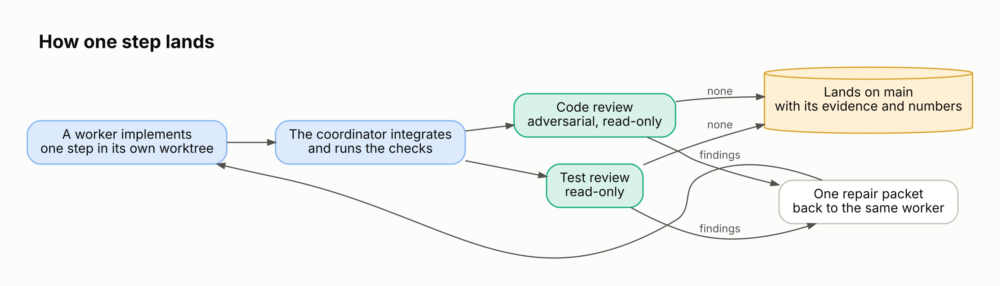
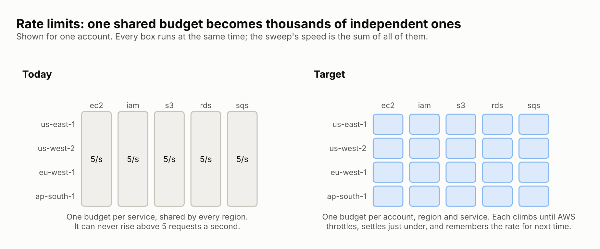
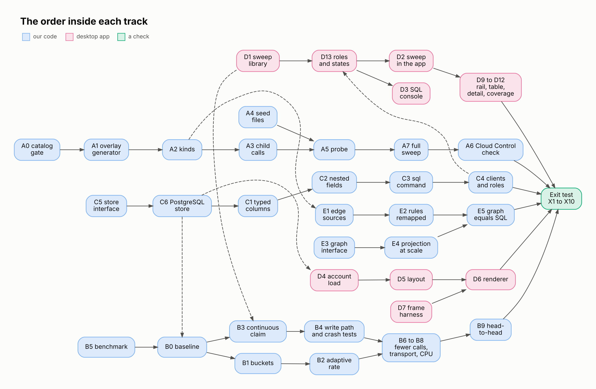
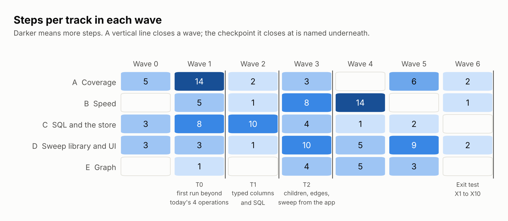
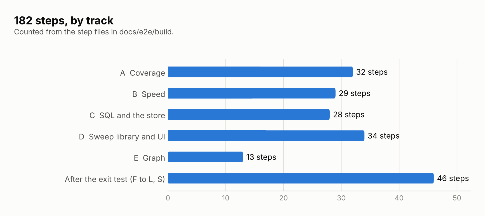
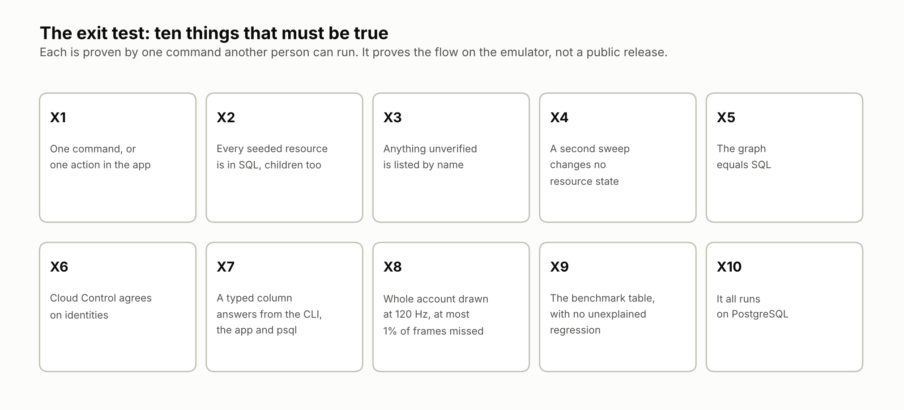

# Build plan for the end-to-end milestone

> Status: Plan, 2026-11-15, revised the same day for V53. A step-by-step
> walkthrough of the packages in [README](README.md) and the track files,
> written from a read of the tree and from the owner's decisions V35 to V53 in
> [DECISIONS](DECISIONS.md). It changes no code. Where it and a track file
> differ on order, this file wins, because it carries V51 (PostgreSQL from the
> start), V52 (performance first) and V53 (PostgreSQL is the only store).
> Nothing in it has been built or measured.

> Revised 2026-11-18: the desktop app is outlined in full in
> [MAKEPAD_UI.md](MAKEPAD_UI.md), with new packages D9 to D14 and steps D6.0
> and D7.3; the findings of an outside review are applied
> ([REVIEW_2026-11-18.md](REVIEW_2026-11-18.md)), adding B4.6, C1.7 and E4.3;
> and a public-release gate is separate from the exit test
> ([RELEASE_GATE.md](RELEASE_GATE.md)). Section 11 lists what changed.

## 1. How to read this

- A **package** is a row of a track file (A0 to A7, B0 to B5, C1 to C6, D1 to
  D8, E1 to E5, then F to K). Package IDs are kept.
- A **step** is one reviewed change, numbered inside its package (A1.3). Steps
  are in [build/STEPS_A.md](build/STEPS_A.md) to
  [build/STEPS_E.md](build/STEPS_E.md) and
  [build/STEPS_AFTER.md](build/STEPS_AFTER.md). Each has: goal, depends on,
  stores, files, change, tests, budget, prove it, done when, size, watch out.
- A **wave** is a set of steps that can run at the same time in separate
  worktrees, closed by a checkpoint. Section 6 lists the waves; section 7 lists
  every step.
- Numbers come from the tree: reports under `catalog/`, constants in the code,
  and `wc`, `grep` and `jq` over them. Anything not checked says "not
  verified".

This plan adds four packages that the track files do not have, all for V52:
B6 (fewer calls), B7 (transport), B8 (CPU on the hot path) and B9 (early
head-to-head). Step IDs are never renumbered; the steps V53 removed are listed
in section 2 so that no reference dangles.

### How one step lands

Unchanged from VISION section 10:

1. A worker implements the step in its own worktree. It does not build, test,
   lint or format.
2. The coordinator integrates the patch and runs the narrow checks named in the
   step's "Prove it", one heavy Cargo build at a time.
3. The code reviewer and the test reviewer review independently, read-only.
4. Their findings go back to the same worker as one repair packet.
5. Repeat until both report no findings. The coordinator lands the change with
   explicit paths and marks the step done in its track file with the command
   that proved it and the Rust lines added and deleted.

Three additions for this milestone:

- The mutation gate is suspended (V50). Tests and both reviews are still
  required.
- A step with a "Budget" line is not done until its before and after numbers
  are recorded (V52).
- `catalog/aws-api.catalog` and the reports under `catalog/` are generated
  files. Workers do not edit or merge them. The coordinator regenerates them at
  integration with the `--write` command the step names, and only one
  catalog-changing step is integrated at a time.

### How to run locally

PostgreSQL is the only store, so a local run needs a PostgreSQL server. Step
[C6.2](build/STEPS_C.md) is the one that provides it, in three ways the owner
confirmed: under Podman, under Docker (both from `deploy/local/compose.yaml`,
through `inventory-harness postgres up`), or as a native server. All three are
reached through `INVENTORY_POSTGRES_URL`. This machine has no working Docker
daemon; it uses the native PostgreSQL 16.15, run as an unprivileged user.

With a server up, the whole flow is one command, `inventory-harness e2e run
--work "$(mktemp -d)"` (A7.1), and the numbers come from `cmdb-bench sweep`
(B5.2).

## 2. Decisions this plan is built on

| ID | What it means here |
| --- | --- |
| V35 | A thin slice is proven end to end before coverage is widened (waves 1 to 3 before wave 5). |
| V36, V67 | Operations become callable through generated overlays (A1), after the deny list, verified by the probe (A5) and Cloud Control (A6). |
| V39 | Cloud Control stays as a checker in the harness (A6). |
| V40, O13 | Nested fields are a JSONB column, kept only if C2.1's measurement allows it. |
| V47 | The sweep becomes a library (D1) and the UI can start it (D2). |
| V50 | No mutation gate. |
| V51 | The store interface (C5) comes first and the PostgreSQL store (C6) is in the milestone. X10 is new. |
| V52 | Section 3. The benchmark comes before the speed steps; every step on a hot path has a budget; no wave closes on an unexplained regression. |
| V53 | PostgreSQL is the only store. This settles O17. Laptop users and tests get PostgreSQL from a container (the official image, under Podman or Docker) or point at any server by URL. |
| V54 | Version 1 is one person's laptop. Package H (AWS) is after version 1. Nothing in waves 0 to 6 changes: the milestone was already local. |
| V55 | The owner is the coordinator of section 1. |
| V56 | D7.2 runs on an Apple M3 MacBook Pro and on a machine with an RTX 3070 class GPU. D14.1's platform matrix puts macOS beside Linux. |
| V57 | The graph database is part of version 1, so installing and starting it belongs to the local setup (C6.2 for PostgreSQL; the graph database joins it in L1.1). |
| V58 | D14.1's platform matrix is macOS and Linux. |
| V59 | D7.2's Mac is a MacBook Pro with the M3 Pro chip. |
| V60, V63 | The graph engine ships in the product and everything is MIT. E3.4 chooses the engine by measurement, before L1.1 and L5.1. I2.1 is dropped. |
| V61 | I1.1 is dropped. |
| V64 | Whole organizations: H2.1 and H2.2 are part of version 1, after the milestone. The bucket count in B1 and the sizes in O14 are per organization, not per account. |
| V65 | Package F is a daily schedule, not a loop that must run all day. |
| V66 | C6.2 runs PostgreSQL 19. |
| V67 | O12 is settled: A1 generates overlays without a review of each entry. |
| V68 | Peak memory and CPU time get limits in section 3, not only rows. |
| V69 | The target is up to 10,000 accounts. Waves 0 to 6 do not change: the milestone is still proven at the size it was planned for. Package S, after the milestone, climbs the ladder. B1.2's 74,000 budgets is rung one of four. |
| V70 | The app shows the whole organization as aggregates and loads resources for what is in view (S1.6). |
| V71 | A graph database is required. In E3.4 our own index is a yardstick only. |
| V72 | Work continues from the existing repository. The step files stay as written and are adapted as the code changes. |
| V73 | No sweep window. S2.1 records how fast AWS allowed, and gates on nothing. |
| V74 | Fitting 10,000 accounts on a laptop is a result, not a requirement. |
| V75 | H2.2 is set aside. H2.1 assumes whatever role exists. |
| V76 | Massive scale is designed in from the first step that builds each part: B1.2 (budgets), B7.2 (connections), C6.3 (keys that allow partitioning), C6.5 (a queue that is seeded in windows and shared by several collectors). Package S proves it. |

### One ordering rule for the current store

The current store is `BinaryStore` in `crates/engine/src/inventory.rs`, with
its readers in `crates/cmdb-view/src/database.rs` and
`crates/cmdb-bench/src/main.rs`. It is what `tests/sweep_e2e` passes on today
(2 passed). That code is left untouched, and that suite keeps passing, until
the same scenario passes on PostgreSQL (C6.10). Then C6.12 deletes the old
store code. Every other step is simply about PostgreSQL; a step that would
have had to change the current store is ordered after C6.12 instead.

What the old `scan` pipeline still needs (`crates/engine/src/store` and what
depends on it) goes later, with that pipeline, in K2.1. C6.12 and K2.1 list
the exact files, crate features and configuration, and what `cargo tree` must
show after each.

Three consequences:

- **The store interface stays small.** The trait of C5.1 exists so that
  `PgStore` can be built and tested piece by piece and swapped in at one call
  site. It is kept after C6.12, because VISION 5.4 asks for one interface with
  one implementation and the sweep's tests use a fake store through it.
- **PostgreSQL comes from a URL.** The harness does not own a server (C6.2).
- **O4 no longer applies.** The write settings that matter are measured in
  B4.1 and B4.4.

### Removed by V53

Step IDs are never reused. A reference to one of these resolves here.

| ID | Was | Why it is gone | Where its remaining purpose went |
| --- | --- | --- | --- |
| B0.1 | A baseline recorded on the current store before any change | The first recorded number is on PostgreSQL | B0.2, recorded at T0; every speed step compares against it or a later row |
| B4.2 | A durability setting of the current store, with a `--durable` flag | That code is deleted, not tuned | B4.4 (`synchronous_commit`, with `--durable`) |
| C5.2 | Split `crates/engine/src/inventory/schema.rs` so two schema generators could share it | There is one generator | C6.3 (a new module), C6.12 (moves `encode_schema` and `decode_schema` out before deleting the file) |
| C5.4 | `cmdb-view` reads through a backend-neutral `Database` | There is one backend | C6.11 (the PostgreSQL reader), C6.12 (deletes the reader it replaces) |

C6.12 is the one step V53 added.

## 3. Performance

Performance is the critical part of the product (V52). This section is the
frame every step is measured against. It claims no speedup: it says where the
time goes, what the design does about it, and which measurement shows whether
it worked.

### Where sweep time goes

| Cost | What the tree does today | Design answer | Steps | Measurement that proves it |
| --- | --- | --- | --- | --- |
| Waiting on AWS | 5 requests per second per bucket, and the rate cannot rise (`limiter/policy.rs`, `pacing.rs`); one bucket per service for all regions (`call.rs`); a batch of leases is claimed and awaited as a whole (`draining.rs`); concurrency capped at 128 | Bucket per account, region and quota group; a rate that rises until throttled and is remembered; the configured number of leases always in flight | B1.1, B1.2, B2.1 to B2.3, B3.1 to B3.3 | `proxy` profile: steady throughput against the limit, throttle share, time to 90% on first and second sweep (P3, P1) |
| Number of calls | Both real enumerations ask for 5 items per page (`ec2.toml`); no child call is ever skipped or batched; unsupported scopes are asked again every sweep | Largest page size; skip a describe the list already covers; batch reads; remembered unsupported and denied scopes | B6.1 to B6.4 | API attempts per seeded resource, with per-kind counts unchanged (P3) |
| Connection setup | Pool idle timeout 1 s, 2 idle connections per host by default, at most 512 connections (`transport/config.rs`); HTTP/2 is enabled but not measured | Measure reuse and HTTP/2 share; keep connections alive across a paced bucket; size the pool to the concurrency | B7.1, B7.2, B3.3 | Connections opened per request and handshake time through the proxy (P4). The emulator is one endpoint, so this is an estimate until J2 |
| Decoding | One pass into the record; rpcv2Cbor is chosen at compile time when offered (`plans.rs::protocol`); never measured | Measure the decode share; compare JSON and CBOR on CloudWatch; remove per-row copies | B5.1, B8.1, B8.2 | `decode_ns` over user CPU time (P10), CPU seconds (P6) |
| Store writes | `crates/engine/src/inventory/commit.rs` issues several statements per row, one transaction per claim and per page, and rewrites `resource_scopes` for every observation even when nothing changed | `PgStore`: compare hashes first and write only changed rows, in sets (`UNNEST`), COPY for cold loads, pages grouped per transaction, `synchronous_commit`, pool size, one writer or several and staging tables each chosen by measurement; an unchanged resource writes nothing | C6.6, C6.7, B4.1, B4.4, B4.5 | Writer rows per second, commits per page, WAL bytes, rows written on a warm sweep (P8, P9), each with the server settings recorded; the kill matrix (B4.3) proves the atomicity was kept |
| Per-page CPU outside decoding | Every row is tried against every plan in the catalog (`child.rs`); plan lookup is a linear scan (`RuntimeCatalog::lookup`) | Indexes built once when the catalog is loaded | A3.3 | CPU seconds on `thin` and `full` (P6) |
| Graph load | One query per changed key | Changed keys only (already so); batches if the measurement asks | E4.1, E4.2 | Projection keys per second, rebuild time (P15) |
| Re-sweep | Calls plus per-row hash lookups plus the `resource_scopes` rewrite | Calls plus one hash query per page; zero writes when nothing changed | C6.6, B4.5, A7.3 | Warm sweep time and rows written (P2, P8) |
| Read and render | One page of 500 rows; 2,000-node cap; vector paths rebuilt per frame | Whole-account load from PostgreSQL into flat arrays; layout off the UI thread; instanced drawing with aggregation | D4 to D7 | Load time and memory (P12), layout time (P13), frame time p99 (P14) |

### Measurements

Every "Budget" line names one of these. The commands exist after the step in
the last column.

| ID | Measurement | Command | From |
| --- | --- | --- | --- |
| P1 | Cold sweep wall time | `cmdb-bench sweep` | B5.2 |
| P2 | Warm re-sweep wall time | `cmdb-bench sweep` | B5.2 |
| P3 | API attempts, retries, throttles | `cmdb-bench sweep` | B5.2 |
| P4 | Connections opened, requests reused, HTTP/2 requests | `cmdb-bench sweep` | B5.2, B7.1 |
| P5 | Resources per second | `cmdb-bench sweep` | B5.2 |
| P6 | CPU seconds of the collector, user and system | `cmdb-bench sweep` | B5.2 |
| P7 | Peak memory of the collector | `cmdb-bench sweep` | B5.2 |
| P8 | Database size and WAL bytes written; rows written on a warm sweep, logged and unlogged | `cmdb-bench sweep` | B5.2 |
| P9 | Writer rows per second; commits and claims per page | `cmdb-bench sweep` | B5.2 |
| P10 | Decoding as a share of CPU time | `cmdb-bench sweep` | B5.2 |
| P11 | Catalog load time; schema create and store open time; table and column counts | `cmdb-bench open` | B5.2 |
| P12 | SQL read: page and count latency, whole-account load time and memory | `cmdb-bench measure`, `cmdb-bench load` | exists, D4.2 |
| P13 | Layout time | `cmdb-bench layout` | D5.1 |
| P14 | Frames: presented and missed frames against the display's refresh; GPU busy time and UI-thread time p50, p95, p99; with display, resolution, GPU, driver and backend | `cmdb-ui --frame-harness` | D7.1 |
| P15 | Projection keys per second; full rebuild time | `cmdb-bench projection` | E4.1 |
| P16 | Catalog compile time and catalog bytes | `time catalog-tool models compile --check`; `wc -c catalog/aws-api.catalog` | exists |
| P17 | Graph traversal latency: neighbours, path, blast radius | `cmdb-bench traverse` | D11.2 |

Benchmark profiles:

| Profile | Dataset | Purpose |
| --- | --- | --- |
| `thin` | Bulk seed of the thin-slice services (`crates/harness/seeds/bench`, A4.5) | Every step, every wave |
| `full` | Every seed file, raised to the emulator's limit | Waves 5 and 6 |
| `proxy` | `thin` through the fault proxy with 50 ms latency and 20 requests per second per service and region | Pacing, rates, connections |

Rules:

- **Release builds only** for recorded numbers. The numbers in the tree so far
  (RUN_HERE's 258.69 s) are debug builds of a test suite. D1.1 is what makes a
  release build of the sweep fit in this machine's memory, which is one reason
  it is in wave 0.
- **The first recorded number is B0.2**, on PostgreSQL, at T0. Every speed
  step compares against it or against a later row. Steps that land before it
  (D1.2, D1.3, C5.3, C6.3 to C6.10) are proven by tests, not by numbers.
- **Before and after.** A speed step records the row before its change and the
  row after, same machine, same profile, same server and settings.
- **The server is part of the measurement.** Every table is headed by the
  settings the server reports (`shared_buffers`, `max_wal_size`,
  `synchronous_commit`, `fsync`, `max_connections` and the rest, B5.2) and by
  how it was run (container, native or managed; named volume or native disk).
  Container defaults are small (`shared_buffers` defaults to 128MB), so
  `deploy/local/compose.yaml` sets them explicitly (C6.2) and a native server
  is given the same values. A run with `fsync` off is not publishable.
- **Published numbers come from Linux.** Docker on macOS runs in a virtual
  machine and is slower on disk, more so with a bind mount; the compose file
  uses a named volume, and a macOS row is marked and never compared with a
  Linux row.
- **Wave rule.** A wave's checkpoint includes `cmdb-bench compare <first raw
  file of the wave> <last raw file of the wave>` (B5.3). If any measurement got
  worse by more than the band, the wave does not close until the row has a
  written reason accepted by the coordinator.
- **No claim without a comparison.** "Fastest" needs head-to-head runs (V19).
  B9 runs the first one right after the thin slice, on the emulator, on the
  kinds every tool collected. It measures engines, not quota handling.
- **What the emulator cannot show:** quotas, latency, connection setup to
  thousands of hosts, real protocol behavior. The `proxy` profile approximates
  the first three; J2 (a real account) is the only proof.

## 4. The thin slice

The owner wants the core flow proven end to end before it is widened (V35).
The thin slice is a small set of services that together use all seven
protocols and that the emulator is likely to serve:

| Service | Protocol | Why it is in the slice |
| --- | --- | --- |
| `ec2` | ec2Query | Already callable; VPC and subnet with a live relation |
| `sts` | awsQuery | Already callable; account bootstrap |
| `iam` | awsQuery | Global service; parents with children (role, attached policies) |
| `sns` | awsQuery | Topic and subscription; cross-service reference to SQS |
| `sqs` | awsJson1.0 | Scalar item list (`ListQueues` returns URLs); no kind rows exist for it yet |
| `dynamodb` | awsJson1.0 | List of names plus a describe |
| `kms` | awsJson1.1 | Has a must-deny entry (`kms/DescribeKey`) inside a service that is otherwise swept |
| `lambda` | restJson1 | 7 modeled expansions; reference to an IAM role |
| `s3` | restXml | Bucket addressing limits what is callable; `ListBuckets` only |
| `cloudwatch` | rpcv2Cbor | The binary protocol, end to end |

Which of these the emulator serves is **not known** until the seed matrix
(A4.3) and the probe (A5.2) run. VISION records that the emulator does not
implement 2 Organizations operations and that KMS and Step Functions
operations had never been run against it. Substitutes, from VISION's V25 list,
in this order: `route-53` (restXml), `ecs` (awsJson1.1), `sfn` (awsJson1.0),
`elastic-load-balancing-v2` (awsQuery), `rds` (awsQuery), `eks` (restJson1),
`cloudfront` (restXml). `kinds.tsv` already has operation rows for all of them
except `sqs`. If no rpcv2Cbor service is served, the slice says so and the
binary protocol stays implemented, not verified.

Three checkpoints, as early as the dependencies allow. All three run on
PostgreSQL:

| Checkpoint | Closes | What it proves |
| --- | --- | --- |
| T0 | Wave 1 | The first end-to-end run over more than the 4 current operations: thin-slice operations generated callable, seeded from data files, swept by the shipped binary into PostgreSQL, per-kind counts equal the seed, second sweep writes no resource rows. Columns are still today's. |
| T1 | Wave 2 | The old store code is deleted (C6.12). The same run with typed columns, queried from the CLI and `psql`, and shown in the UI's table. |
| T2 | Wave 3 | Children, edges from all sources, the graph equal to SQL, a sweep started from the UI, and the first head-to-head. |

Only after T2 does A1.7 generate for all 436 services.

## 5. Shared files and the chains

Parallel work is safe only when steps own different files. These resources
are shared by many steps and are therefore sequenced.

**The sweep crate.** `src/sweep_runtime/` is owned by D1 until D1.2 moves it
to `crates/sweep/src/`. No other step touches it before that. Afterwards one
step at a time per file:

| File | Steps, in order |
| --- | --- |
| `lib.rs`, `control.rs` | D1.2, D1.3, B5.1, B2.3, B6.1, C2.1 |
| `call.rs` | D1.2, B5.1, B1.1, B8.1 |
| `execution.rs` | D1.3, C5.3, D1.4, B2.1, B3.3, B7.2 |
| `execution/draining.rs`, `execution/scheduler.rs` | C5.3, D1.4, B3.2, B6.4, E1.2 |
| `execution/page.rs` | C5.3, B5.1, A5.1, B6.1, B3.3, A3.4 |
| `execution/page/child.rs`, `rows.rs` | A3.3, B8.1, B6.3, E1.1, E2.2 |

**The store.** Until C6.12, `crates/engine/src/inventory/*.rs` (`BinaryStore`
and its queries) is touched only by C5.1 (the trait and its delegating `impl`) and by
three visibility edits (C6.3, C6.5, C6.6). Everything PostgreSQL goes in the
new directory `crates/engine/src/inventory/postgres/`. C6.12 then owns the
whole of `crates/engine/src/inventory/` for one change; nothing else lands
there at the same time.

**The schema chain.** `crates/engine/src/inventory/postgres/schema/`. One link
at a time, in this order: C6.3 (the generator), A5.1
(`scope_outcomes.detail`), C1.1 to C1.4 (typed columns), B2.2
(`learned_rates`), B6.4 (`scope_memory`), E1.2 (`identities`), B4.5
(`scope_seen`), C1.6 (upgrade). Every link after the first comes after C6.12,
so no schema change is ever made twice. Test databases are created fresh;
only C1.6 upgrades in place.

**The catalog format chain.** Every map in the runtime catalog extension is
closed, so the compiler in `catalog-tool` and the reader in
`crates/core/src/catalog/runtime/decode/` change together, one step at a time:
C1.1 (column name), A3.4 (plan field 14 `emit`, extension version 2), B1.1
(plan field 15 `quota_group`), E1.1 (relation field 7 `source`), B6.2 (16
`skip`), B6.3 (17 `batch`), E1.2 (column field 4 `inferable`).

Two smaller ones: the root `Cargo.toml` (D1.1, then C6.1, D1.2, C6.12, and
last K2.1), and `crates/cmdb-ui/src/app.rs`, which is at the size limit (A0.4,
then D7.1, D2.2, D3.2).

## 6. Waves

Each wave lists its lanes (steps in one lane are in order; lanes run in
parallel), the files each lane owns, the checkpoint, the performance
checkpoint, and the exit-test lines it moves.

### Wave 0: open the gate, cut the seams, get PostgreSQL running

| Lane | Steps | Owns |
| --- | --- | --- |
| Catalog | **A0.1**, A0.2, A0.3 | `crates/catalog-tool/src/runtime_catalog/` |
| Size guards | A0.4 | file limit is 1000 lines and every file passes; comment lines remain |
| Features | D1.1, then C6.1 | `Cargo.toml`, `crates/aws/Cargo.toml`, `crates/aws/src/lib.rs` |
| Store interface | C5.1 | `crates/engine/src/inventory.rs`, `inventory/store_api.rs`, `tests/inventory_store*` |
| PostgreSQL, locally | C6.2 | `deploy/local/`, `crates/harness/src/postgres*`, `.github/workflows/ci.yml` |
| Seeds | A4.1 | `crates/harness/src/inventory_seed/` |
| Frames | D7.1 (after A0.4); D6.0 on a machine with a GPU | `crates/cmdb-ui/src/frame_harness*`, `crates/cmdb-ui/examples/retained_spike.rs` |

A0.1 is the first step of the plan. Nothing that changes the catalog can land
before A0.2.

- **Checkpoint:** `catalog-tool models compile --check` exits 0. `cargo test
  --locked --features sweep --test sweep_e2e -j1 -- --ignored --test-threads
  1` gives 2 passed, built within 6 GiB. With `INVENTORY_POSTGRES_URL` set (a
  native server on this machine, the compose container elsewhere), `cargo test
  -p inventory-harness --locked postgres -- --ignored` passes. `cargo check
  --workspace --all-targets --all-features --locked -j1` passes with the
  `postgres` feature of `sqlx` (C6.1). Both size guards pass.
- **Performance checkpoint:** no sweep number exists yet; the first is B0.2 at
  T0. What is recorded here: D1.1's build memory and time, C6.1's build cost,
  and D7.1's frame baseline on a machine with a GPU (or reported as not run).
- **Exit test:** none yet. This wave unblocks every other.

### Wave 1: the library, PostgreSQL, the generator, the benchmark (closes at T0)

| Lane | Steps | Owns |
| --- | --- | --- |
| Sweep library | D1.2, D1.3, C5.3, D1.4, B5.1 | `crates/sweep/` |
| PostgreSQL store | C6.3, C6.4, C6.5, C6.6, C6.8, C6.9, C6.10 | `crates/engine/src/inventory/postgres/`, `tests/sweep_e2e/` |
| Overlay generator | A1.1, A1.2, A1.3, A1.4, A1.5, A1.6 | `crates/catalog-tool/src/overlay/`, `catalog/overlay/generated/` |
| Kinds | A2.1, A2.3, A2.2 (after A1.6) | `crates/catalog-tool/src/kind_map*`, `names*` |
| Seeds | A4.2, A4.3, A4.5 | `crates/harness/src/inventory_seed/`, `crates/harness/seeds/` |
| Run command | A7.1 (after C6.10) | `crates/harness/src/e2e*` |
| Probe | A5.2 (after D1.3, A4.3, A2.2) | `crates/harness/src/probe*` |
| Benchmark | B5.2, B5.3, B0.2, B5.4 (after C6.10) | `crates/cmdb-bench/` |
| Graph crate | E3.1 | `crates/graph-store/` |

- **Checkpoint T0:** `INVENTORY_E2E_STORE=postgres cargo test --locked
  --features sweep --test sweep_e2e -j1 -- --ignored --test-threads 1` gives 2
  passed, and the same suite with `INVENTORY_E2E_STORE=file` (the current
  store, C6.10) still gives 2 passed. The store conformance suite passes on
  `PgStore`. Then, for the thin slice: `inventory-harness e2e run --work
  "$(mktemp -d)" --service ec2 --service sts --service iam --service sns
  --service sqs --service dynamodb --service kms --service lambda --service
  s3 --service cloudwatch` exits 0 through the stages `start`, `seed`,
  `sweep`, `verify-counts`, `resweep`, into a fresh PostgreSQL database. The
  probe report lists every thin-slice enumeration with its outcome.
- **Performance checkpoint:** `cmdb-bench sweep --profile thin` prints the
  table from a release build with the server settings block. That row is B0.2,
  the first recorded number of the plan and the baseline of every speed step.
  The `proxy` baseline exists (B5.4).
- **Exit test:** X10 for real. X1 (CLI half), X2 and X4 on the slice. X9
  started.

### Wave 2: typed columns, SQL, the UI on PostgreSQL (closes at T1)

| Lane | Steps | Owns |
| --- | --- | --- |
| Old store code out (first) | C6.11, D4.1, then C6.12 | `crates/cmdb-view/src/database*`, `crates/cmdb-bench/src/generate*`, then all of `crates/engine/src/inventory/` |
| Outcome detail | A5.1 (after C6.12) | schema link 2, `execution/page.rs` |
| Typed columns | C1.1, C1.3, C1.2, C1.4 (after C6.12) | `runtime_catalog/schemas*`, `crates/core/src/inventory/`, `inventory/postgres/commit/arrays.rs` |
| SQL command | C3.1, C3.2, C3.3, C4.1 | `crates/engine/src/sql*`, `src/sql_command*`, `src/schema_command.rs` |
| Catalog indexes | A3.3 | `crates/core/src/catalog/runtime/index.rs`, `child.rs`, `rows.rs` |
| Head-to-head harness | B9.1 | `crates/harness/src/head_to_head*` |

C6.12 lands alone: while it is being integrated, nothing else that touches
`crates/engine/src/inventory/` is integrated. C3.1 and B9.1 do not touch it
and may run beside it.

- **Checkpoint T1:** the checks in C6.12's "Prove it" hold (its file searches
  print nothing and its `cargo tree` queries report what the step says). The
  T0 command still exits 0 on a fresh database. `aws-inventory sql --database
  "$URL" "select cidr_block from aws_ec2_vpc order by 1"` prints the seeded
  blocks, `psql "$URL" -At -c "select cidr_block from inventory.aws_ec2_vpc
  order by 1"` prints the same rows, and `cargo test -p cmdb-view -p cmdb-ui
  --locked -- --ignored postgres` passes (the UI worker returns the swept
  rows). The typed-column filter test passes for every kind in the catalog.
- **Performance checkpoint:** `thin` rows before and after typed columns
  (C1.4): this is the measured cost of filling every scalar column, and it is
  expected to be a cost. P11 for the slice catalog. `cmdb-bench compare`
  across the wave, with C1.4's cost written down as the reason if it exceeds
  the band.
- **Exit test:** X7 from the CLI and `psql` on the slice.

### Wave 3: children, edges, graph, UI control, first speed steps (closes at T2)

| Lane | Steps | Owns |
| --- | --- | --- |
| Children | A3.1, A3.2, A3.4 | `overlay/generate/expand*`, plan field 14 |
| Edges | E1.1 | `runtime_catalog/relations*` |
| Graph | E3.2, E3.3, E5.1 | `inventory/projection/runner.rs`, `crates/cmdb-view/src/graph*`, `src/graph_verify.rs` |
| Roles first | D13.1 (after C4.1, C3.2) | the engine's `sql` module, `crates/cmdb-ui/src/worker/connections.rs` |
| UI control | D2.1, D2.2, then D3.1, D3.2 (all after D13.1) | `crates/cmdb-ui/src/worker/`, `sweep_panel.rs`, `console.rs` |
| UI browse | D9.1; D10.1, D10.2; D11.1; D12.1 | `scope_rail*`, `table*`, `detail*`, `coverage.rs`, `crates/cmdb-view/src/database/` |
| External clients | C4.2 | `docs/SQL.md`, `tests/sweep_e2e/external_clients.rs` |
| Nested fields | C2.1, C2.2 | `crates/core/src/record/json_text.rs` |
| Speed, sweep crate (one at a time) | B6.1, B1.1, B3.1, B3.2, B3.3, B8.1 | `crates/sweep/src/`, `limiter/`, `inventory/postgres/work.rs` |
| Speed, elsewhere | B7.1; C6.7 | `crates/aws-wire/src/transport/`; `inventory/postgres/copy*` |
| Comparison | B9.2 | `docs/performance-evidence/head-to-head/` |

- **Checkpoint T2:** the thin-slice `e2e run` exits 0 with
  `catalog/aws-overlay.report` showing `callable_expand` above 0, child rows
  stored, and the `verify-graph` stage passing after the sweep and after a
  re-sweep with one seeded change. `cargo test -p cmdb-ui --locked --
  --ignored worker_sweep worker_sql` passes. `tests/sweep_e2e`'s
  `external_clients` test passes with `psql` through the reader role. The
  head-to-head report for the slice is committed with tool versions, whatever
  it shows.
- **Performance checkpoint:** before and after rows for B6.1, B1.1, B3.2, B3.3,
  B8.1, C6.7 and A3.3. `cmdb-bench compare` across the wave on `thin` and on
  `proxy`.
- **Exit test:** X1 (UI half) and X5 on the slice; X7 complete on the slice.

### Wave 4: rate, write path, read path at scale

| Lane | Steps | Owns |
| --- | --- | --- |
| Kill matrix (first) | B4.3, then B4.6 (the database is killed, not the collector) | `crates/engine/tests/inventory_kill_matrix*`, `inventory_db_crash*` |
| Write path | B4.1, B4.4, then B4.5; no relaxed setting before B4.6 passes with it | `inventory/postgres/writer.rs`, `config.rs`, `seen.rs` |
| Rate | B1.2, B2.1, B2.2, B2.3 | `crates/engine/src/limiter/`, `inventory/postgres/rates.rs` |
| Fewer calls | B6.4, B6.2, B6.3 | `inventory/postgres/memory.rs`, plan fields 16 and 17 |
| Transport and CPU | B7.2, B8.2 | `transport/config.rs` |
| Inference | E1.2, E1.3 | `inventory/postgres/infer.rs` |
| Rules | E2.1 | `crates/catalog-tool/src/relations*` |
| Indexes | C1.5 | `inventory/postgres/schema/kinds.rs` |
| Whole-account read | D4.2, D4.3, D5.1, D5.2, then D13.2 | `crates/cmdb-view/src/account*`, `crates/cmdb-ui/src/dag/hierarchy*`, `app/state.rs`, `status_line.rs` |
| Projection | E4.1 | `crates/cmdb-bench/src/projection.rs` |
| Graph engine | E3.4 (after E4.1) | `crates/graph-store/src/`, `crates/cmdb-bench/src/traverse.rs` |

The schema chain orders B2.2, B6.4, E1.2 and B4.5 within this wave. The kill
matrix lands first and is rerun after each write-path step.

- **Checkpoint:** the kill matrix gives 100 of 100 on PostgreSQL (`cargo test
  -p inventory-engine --locked --features kill-hooks --test
  inventory_kill_matrix -- --ignored`), with the write settings that became
  defaults. The quota test of B2.3 reports its three numbers. The thin-slice
  `e2e run` still exits 0.
- **Performance checkpoint:** the benchmark table has a before row and an
  after row for every step of B1, B2, B3, B4, B6, B7 and B8, each with its
  server settings block. The warm sweep writes 0 rows in logged tables for
  single-page scopes (B4.5). The write defaults (`group_pages`,
  `synchronous_commit`, COPY threshold, pool size, writers, staging) are set
  from B4.1's and B4.4's rows. `cmdb-bench compare` across the wave. Load,
  layout and projection rows at 250,000 nodes and 1,000,000 edges exist (D4.2,
  D5.1, E4.1).
- **Exit test:** X9 has most of its rows; X4 holds on the slice with zero
  logged writes.

### Wave 5: everything the emulator serves, and the renderer

| Lane | Steps | Owns |
| --- | --- | --- |
| Coverage | A1.7, A5.3, A4.4, A4.6 (batches), A7.2 | `catalog/overlay/generated/`, `crates/harness/seeds/` |
| Cross-check | A6.1 | `crates/harness/src/verify*` |
| Rules | E2.2 | `crates/sweep/src/record/multi.rs` |
| Projection | E4.2, then E4.3 (after B4.6) | `crates/graph-store/`, `crates/cmdb-view/src/graph/reconcile.rs` |
| Upgrade | C1.6, then C1.7 | `inventory/postgres/upgrade.rs`, `migrate*` |
| Renderer | D6.1, D6.2, D6.3, D6.4 (after D6.0's report), then D7.3 | `crates/cmdb-ui/src/dag/widget/` |
| On the account view | D9.2, D9.3, D11.2 (after D6.3, D6.4) | `search.rs`, `traversal.rs`, `dag/widget/highlight.rs` |
| Parity | D8.1 | `docs/e2e/PARITY.md` |
| Comparison | B9.2 again | head-to-head with the speed work in |

- **Checkpoint:** all catalog gate tasks pass with every service generated and
  `catalog/aws-api.catalog` under 16,777,216 bytes. `inventory-harness e2e run
  --work "$(mktemp -d)"` (no `--service`) exits 0 and writes
  `catalog/coverage-status.report` with a row for every callable kind. The
  probe report has no `failed decode` row without a recorded cause.
- **Performance checkpoint:** P16 and P11 for the full catalog and the full
  schema (about 2,200 tables in PostgreSQL), with the 100 ms rule of C1.5
  applied in writing. `full` profile rows. `cmdb-bench compare` on `thin`
  across the wave: adding about 2,000 plans must not slow a sweep of the slice
  beyond the band (A3.3 is what protects this). Frame rows after each of D6.1
  to D6.4.
- **Exit test:** X2 and X3 on the full set; X5 on the full set.

### Wave 6: the exit test

| Lane | Steps |
| --- | --- |
| Zero writes | A7.3 |
| Cross-check | A6.2 |
| Frames | D7.2, D14.1 |
| Benchmark | B5.5 |

- **Checkpoint:** section 8, one command per line.
- **Performance checkpoint:** B5.5's table is complete, from a release build
  on Linux, each table with its server settings; every regression has a
  written reason.
- **Exit test:** X1 to X10.

Waves in one line each:

0. Open the catalog gate (A0), split the `aws` feature, define the store
   trait, get PostgreSQL running locally (Podman, Docker or native; C6.2).
1. Sweep library, PostgreSQL store, overlay generator, seed files, benchmark;
   first run over more than 4 operations, on PostgreSQL (T0).
2. Delete the old store code (C6.12); typed columns, the `sql` command,
   `psql`, the UI table (T1).
3. Children, edges, graph equals SQL, sweep from the UI, first speed steps,
   first head-to-head (T2).
4. Kill matrix, the PostgreSQL write path, adaptive rates, fewer calls,
   whole-account load and layout.
5. All 436 services generated, full probe and seeds, Cloud Control check,
   instanced renderer.
6. The exit test X1 to X10.

## 7. Every step

"W" is the wave. Dependencies are step IDs; "T1" and "T2" mean the checkpoint.

### Track A: coverage ([build/STEPS_A.md](build/STEPS_A.md))

| ID | W | Goal | Depends on |
| --- | --- | --- | --- |
| A0.1 | 0 | Make the relation failure name its kind, path and reason | none |
| A0.2 | 0 | Compile only relations whose two kinds are callable; report the rest as pending | A0.1 |
| A0.3 | 0 | Context at the remaining bare `Capability` error sites | A0.2 |
| A0.4 | 0 | Remove the comment lines (the file limit is 1000 lines and every file passes) | A0.1 |
| A1.1 | 1 | Generated overlays as a second source; hand-written entries win | A0.2 |
| A1.2 | 1 | Derive one enumeration entry, or a deferral with its reason, from the model | A1.1 |
| A1.3 | 1 | Write generated files deterministically, with an entry for every candidate | A1.2 |
| A1.4 | 1 | `catalog-tool overlays generate`, its report and its gate task | A1.3 |
| A1.5 | 1 | Prove over all models that generation cannot open a denied operation | A1.4 |
| A1.6 | 1 | Generate overlays for the thin-slice services | A1.5 |
| A1.7 | 5 | Generate for all 436 services; totals sum to 2,197 and 2,940 | A1.6, A2.3, A3.2, A3.3, C1.2, T2 |
| A2.1 | 1 | `catalog-tool kinds generate`: a kind row for every callable operation | A1.4 |
| A2.2 | 1 | Kinds for the thin slice; first catalog with more than 4 callable operations | A1.6, A2.1 |
| A2.3 | 1 | Table names distinct and within PostgreSQL's 63 bytes | A2.1 |
| A3.1 | 3 | Child bindings from modeled identifiers | A1.4, A2.1 |
| A3.2 | 3 | Child bindings by name and shape; account for all expansions | A3.1 |
| A3.3 | 2 | Index children, plans, name paths and relations in the runtime catalog | D1.2 |
| A3.4 | 3 | Children against the emulator; `emit = "work"` for list-then-describe | A3.1, A3.3, A4.3, C6.10 |
| A4.1 | 0 | Seed scenarios as TOML files; list and structure inputs | none |
| A4.2 | 1 | `inventory-harness seed run`, the oracle file and the acceptance matrix | A4.1 |
| A4.3 | 1 | Hand-written seed files for the thin slice | A4.2 |
| A4.4 | 5 | Draft seed files from the model's create operations | A4.2 |
| A4.5 | 1 | Bulk seeding for the benchmark; proof that the product cannot write | A4.2 |
| A4.6 | 5 | Seed files for every service the emulator serves | A4.4, A5.3 |
| A5.1 | 2 | Store the reason when a scope fails (`scope_outcomes.detail`) | D1.2, C6.12 |
| A5.2 | 1 | `inventory-harness probe` and the thin-slice probe report | D1.3, A4.3, A2.2 |
| A5.3 | 5 | Probe every callable enumeration; triage failures | A1.7, A5.2 |
| A6.1 | 5 | `inventory-harness verify cloud-control` | C6.10, A7.1 |
| A6.2 | 6 | Zero unexplained identity differences for seeded kinds (X6) | A6.1, A7.2 |
| A7.1 | 1 | `inventory-harness e2e run`: one command from an empty directory into PostgreSQL | A4.2, C6.2, C6.10 |
| A7.2 | 5 | Per-kind counts equal the seed; not-verified kinds listed (X2, X3) | A7.1, A5.3, A4.6 |
| A7.3 | 6 | Second sweep writes zero resource rows at full scale (X4) | A7.2, B4.5 |

### Track B: speed ([build/STEPS_B.md](build/STEPS_B.md))

| ID | W | Goal | Depends on |
| --- | --- | --- | --- |
| B0.2 | 1 | Release baseline on PostgreSQL through the benchmark | D1.1, B5.2, B5.3, A4.5, C6.10 |
| B5.1 | 1 | The sweep prints its counters (calls, connections, decode, commits, CPU, memory) | D1.3 |
| B5.2 | 1 | `cmdb-bench sweep` and `cmdb-bench open`, with the server settings recorded | B5.1, A4.5, A7.1, C6.10 |
| B5.3 | 1 | The recorded table and `cmdb-bench compare` (the regression rule) | B5.2 |
| B5.4 | 1 | The `proxy` profile: latency and a rate limit | B5.2 |
| B5.5 | 6 | Scale run and the final table (X9) | A7.2, B1 to B4, B6 to B8 |
| B1.1 | 3 | Bucket key of account, region and quota group | D1.2, A3.4 |
| B1.2 | 4 | 74,000 buckets: evict idle buckets, keep their learned rate | B1.1 |
| B2.1 | 4 | A rate that rises until throttled and holds just under | B1.1 |
| B2.2 | 4 | Learned rates stored and reused | B2.1, C6.12 |
| B2.3 | 4 | `--max-rps`, and the quota proof through the proxy | B2.2, B5.4 |
| B3.1 | 3 | Claim several leases in one statement (`SKIP LOCKED`) | C5.1, C6.12 |
| B3.2 | 3 | Keep the configured number of leases in flight | B3.1, D1.3, C5.3 |
| B3.3 | 3 | Lift the 128 and 512 bounds; stay on a scope across pages | B3.2 |
| B4.1 | 4 | Group pages into one transaction, measured | B3.3, C5.3, C6.12 |
| B4.3 | 4 | The kill matrix, 100 points, on PostgreSQL | B3.3, C6.12 |
| B4.4 | 4 | Write settings chosen from measurements (`synchronous_commit`, COPY, pool, writers, staging) | C6.7, B4.1, B4.3, B5.2 |
| B4.5 | 4 | An unchanged resource writes nothing; parent links reconciled; deletion evidence logged | B4.1, C6.8, B4.3 |
| B4.6 | 4 | Kill the database, not the collector: reconnect, replay, same result | B4.3, C6.2 |
| B6.1 | 3 | Largest page size; `--max-page-size` for tests | D1.2, A4.5 |
| B6.2 | 4 | Skip a describe the list already covers | A3.2, A3.4 |
| B6.3 | 4 | Batch reads | B6.2 |
| B6.4 | 4 | Remember inaccessible and unsupported scopes with an expiry | A5.1, B2.2 |
| B7.1 | 3 | Count connection reuse, handshakes and HTTP/2 requests | B5.1 |
| B7.2 | 4 | Tune idle timeout and pool size from measurements | B7.1, B3.3 |
| B8.1 | 3 | Stop copying rows and re-encoding requests | A3.3, B5.1 |
| B8.2 | 4 | Decode share; JSON against rpcv2Cbor on CloudWatch | B8.1, A5.2 |
| B9.1 | 2 | A harness that runs CloudQuery and Steampipe on the same emulator | A7.1, B5.2 |
| B9.2 | 3 | The first comparison on the thin slice; repeated in wave 5 | B9.1, T1 |

### Track C: SQL and the store ([build/STEPS_C.md](build/STEPS_C.md))

| ID | W | Goal | Depends on |
| --- | --- | --- | --- |
| C5.1 | 0 | `InventoryStore` trait and a conformance suite | A0.2 |
| C5.3 | 1 | The sweep and the projection use the trait | C5.1, D1.2 |
| C6.1 | 0 | The `postgres` feature of `sqlx`, and its build cost | D1.1 |
| C6.2 | 0 | Run PostgreSQL locally (Podman, Docker or a native server); a database per test; CI service | none |
| C6.3 | 1 | The PostgreSQL schema generator, as a new module | C6.1, C6.2, C5.1 |
| C6.4 | 1 | `PgStore`: connect, create, open | C6.3 |
| C6.5 | 1 | The work queue with leases | C6.4 |
| C6.6 | 1 | Page commit, set-based, only changed hashes | C6.5 |
| C6.7 | 3 | COPY for the cold path, measured against `UNNEST` | C6.6, C6.8, B5.2 |
| C6.8 | 1 | References, edges, completion and deletion | C6.6 |
| C6.9 | 1 | The projection outbox and projection reads | C6.8 |
| C6.10 | 1 | The sweep runs on PostgreSQL; the baseline scenario passes there | C6.9, C5.3, C6.2 |
| C6.11 | 2 | `cmdb-view` and the UI read PostgreSQL | C6.10 |
| C6.12 | 2 | Delete the old store code | C6.10, C6.11, D4.1 |
| C1.1 | 2 | Named columns for every scalar member, in the catalog | C6.12, A0.3 |
| C1.2 | 2 | The column budget fits PostgreSQL (1,592 typed columns), with a cut report | C1.1 |
| C1.3 | 2 | Name collisions after flattening | C1.1 |
| C1.4 | 2 | The writer fills the columns; a filter test for every kind | C1.2, C1.3, C6.6 |
| C1.5 | 4 | Indexes on reference targets; open-time numbers and the 100 ms rule | C1.4 |
| C1.6 | 5 | A catalog update adds columns in place | C1.4, B4.5 |
| C1.7 | 5 | A migration journal, a lock, resumable backfill and atomic activation | C1.6 |
| C2.1 | 3 | Measure the cost of a JSONB column for nested fields | C1.4, B5.2 |
| C2.2 | 3 | Decide and finish nested fields (O13) | C2.1 |
| C3.1 | 2 | The statement policy | C5.1 |
| C3.2 | 2 | `aws-inventory sql`, read-only and bounded | C3.1, C6.4, C1.4 |
| C3.3 | 2 | CSV and JSON as explicit exports | C3.2 |
| C4.1 | 2 | `aws-inventory schema`; a reader role | C3.2 |
| C4.2 | 3 | `psql` and a desktop client through the reader role, documented and proven (X7) | C4.1 |

### Track D: sweep library and UI ([build/STEPS_D.md](build/STEPS_D.md))

| ID | W | Goal | Depends on |
| --- | --- | --- | --- |
| D1.1 | 0 | Split the `aws` feature so the sweep builds without 19 SDK crates | A0.2 |
| D1.2 | 1 | Move the sweep runtime into `crates/sweep` | D1.1, C5.1 |
| D1.3 | 1 | Cancellation and bounded progress events | D1.2 |
| D1.4 | 1 | Put the new crate under the function-size gate; state the numbers | D1.3 |
| D2.1 | 3 | Worker commands for start, cancel and resume, on the collector connection | D1.3, C6.11, C6.12, D13.1 |
| D2.2 | 3 | The progress panel; the UI half of X1 | D2.1 |
| D3.1 | 3 | `cmdb-view` runs one bounded read-only statement, on the reader connection only | C3.2, C6.11, C4.1, D13.1 |
| D3.2 | 3 | The console widget | D3.1 |
| D4.1 | 2 | `cmdb-bench generate` through the real store, with edges | C6.8 |
| D4.2 | 4 | Stream the whole account into compact arrays | C6.11 |
| D4.3 | 4 | The worker loads the account | D4.2 |
| D5.1 | 4 | A hierarchical layout into flat arrays | D4.2 |
| D5.2 | 4 | Incremental layout on the worker | D5.1, D4.3 |
| D6.0 | 0 | Spike: retained instances, uniforms and headless start at the pinned Makepad revision | none |
| D6.1 | 5 | Nodes as retained instances; pan and zoom as a uniform | D6.0, D5.2, D7.1 |
| D6.2 | 5 | Edges as instances, aggregated at far zoom | D6.1 |
| D6.3 | 5 | Labels and level of detail; a memory bound in place of the caps | D6.2 |
| D6.4 | 5 | Picking through a spatial grid | D6.3 |
| D7.1 | 0 | The frame harness: presented frames, GPU time, UI-thread time, display and hardware | A0.4 |
| D7.2 | 6 | Frames at 250,000 nodes and 1,000,000 edges on a 120 Hz display (X8) | D6.4, D4.1 |
| D7.3 | 5 | An unpaced throughput check for CI, with no display | D6.0, D6.1 |
| D8.1 | 5 | The CLI-to-UI parity table | D2.2, D3.2 |
| D9.1 | 3 | The scope rail is built from the data, not written by hand | C6.11 |
| D9.2 | 5 | Search by ID, name or ARN, and fly-to | D9.1, D6.4 |
| D9.3 | 5 | One filter for the table and the graph | D9.1, D6.3 |
| D10.1 | 3 | Table paging by key in both directions; the 500-row limit goes | C6.11 |
| D10.2 | 3 | Typed columns for the selected kind, and sorting | D10.1, C1.4, C4.1 |
| D11.1 | 3 | The detail panel shows the whole record and its edges | C6.11 |
| D11.2 | 5 | Neighbours, path and blast radius drawn on the account view | D11.1, D6.4, E3.2 |
| D12.1 | 3 | The coverage tab | C6.11, A5.1 |
| D13.1 | 3 | Two database URLs and roles, checked, failing closed | C4.1, C3.2 |
| D13.2 | 4 | Header, status line, and a screen for every state | D13.1, D4.3 |
| D14.1 | 6 | The platform matrix: macOS and Linux | D6.4, D7.1 |
| D14.2 | After | Packaging | the exit test, I1 |

### Track E: relationships and graph ([build/STEPS_E.md](build/STEPS_E.md))

| ID | W | Goal | Depends on |
| --- | --- | --- | --- |
| E1.1 | 3 | Edges from the model's reference traits, labelled | A2.2, A0.2 |
| E1.2 | 4 | Inferred edges by exact match; ambiguous counted | C1.4, C6.8 |
| E1.3 | 4 | Edge counts by source; fixture tests for every source | E1.1, E1.2 |
| E2.1 | 4 | Remap the 968 rules to API field paths; report | A2.1 |
| E2.2 | 5 | References inside lists; a seeded remapped edge | E2.1, A4.3 |
| E3.1 | 1 | A graph crate: one trait, one Cypher module, FalkorDB | C5.1 |
| E3.2 | 3 | Projection through the trait | E3.1, C5.3 |
| E3.3 | 3 | Traversal through the trait; no Cypher elsewhere | E3.1 |
| E3.4 | 4 | Choose the graph engine by measurement | E3.2, E3.3, E4.1 |
| E4.1 | 4 | Measure the drain and a full rebuild at scale | E3.2, D4.1 |
| E4.2 | 5 | Batch the projection if measured; rebuild equals incremental | E4.1, E5.1 |
| E4.3 | 5 | Repair the graph when the store recovers behind it | E4.2, E5.1, B4.6 |
| E5.1 | 3 | `aws-inventory graph-verify` (X5) | E3.2, C6.9 |

### After the exit test ([build/STEPS_AFTER.md](build/STEPS_AFTER.md))

| ID | Goal | Depends on |
| --- | --- | --- |
| F1.1 | Several profiles in one database | exit test, C6.5 |
| F1.2 | `serve`: interval sweeps, stalest first, never two at once | F1.1, D1.3 |
| F2.1 | Deletion in continuous mode; unobserved scopes | F1.2, B4.5 |
| F3.1 | Freshness and coverage as a view and a panel | F2.1, C4.1 |
| F4.1 | Slice mode | D1.3, B3.2 |
| F5.1 | The remaining failure rows of VISION section 7 | B2.3, B6.4 |
| G1.1 | Tags in bulk through the tagging API | exit test, E1.2 |
| G1.2 | The service's own tag call where the bulk API has none | G1.1, A3.2 |
| G2.1 | Owner, team and application from a mapping file | G1.1 |
| G3.1 | Derived values in the graph and the UI | G2.1, E3.2, D6.3 |
| H1.1 | The suite and the benchmark against a managed PostgreSQL in AWS | B5.5 |
| H2.1 | Accounts from Organizations and assumed roles | F1.1, D1.2 |
| H2.2 | The read-only role as a generated template | A1.7 |
| H3.1 | Container image and a scheduled Fargate task | F1.2, H2.1 |
| H4.1 | The desktop app against remote stores (TLS) | C6.11, D6.4 |
| H5.1 | Neptune behind the graph trait | E3.3 |
| H6.1 | Lambda fan-out on slice mode | F4.1, H3.1 |
| I1.1 | SSO. Not planned (V61) | |
| I2.1 | The open and commercial split. Dropped (V63): everything is MIT | |
| J1.1 | Full head-to-head on the emulator, with Cartography | B9.2, A7.2 |
| J2.1 | The first real-account run | exit test, owner |
| J3.1 | Head-to-head on the real account | J2.1, J1.1 |
| K1.1 | Delete each typed adapter and its SDK crate | A7.2, D1.1 |
| K2.1 | Cloud Control behind the verifier; delete the old scan path and everything only it needs | A6.2, K1.1, C6.12 |
| K3.1 | Delete Python | A4.2, K2.1 |
| K4.1 | Manifest and documents in line with the tree | K3.1 |
| L1.1 | Install, upgrade, roll back, remove (R1) | D14.2, C1.7, C6.2, E3.4 |
| L2.1 | The read-only AWS policy, generated and proven minimal (R2) | A1.7, A7.2 |
| L2.2 | Three database roles with tested limits (R3) | C4.1, D13.1 |
| L3.1 | Authentication to both stores, and verified TLS off the local machine (R4) | C6.2, D13.1 |
| L3.2 | No secret in any output (R5) | D13.1 |
| L4.1 | Backup and restore (R6) | E5.1, E4.2 |
| L4.2 | Outages, during a sweep and at rest (R7) | B4.6, E4.3, F5.1 |
| L5.1 | Provenance, dependencies and licences (R8) | E3.4, K1.1 |
| L5.2 | One diagnostics command (R9) | C4.1, D12.1, L3.2 |
| L6.1 | The authorized real-account run, as release evidence (R10) | J2.1, L2.1 |
| L6.2 | Published limits (R11) | A7.2, L6.1 |
| S1.1 | An organization to test against | B5.4, D4.1, H2.1 |
| S1.2 | Rate budgets that exist only while they are used | B1.2, B2.2 |
| S1.3 | Plan a window at a time; store exceptions, not everything | S1.2, B4.5 |
| S1.4 | Connections shared across accounts; limits checked at start | B7.2 |
| S1.5 | Credentials for 10,000 accounts | H2.1 |
| S1.6 | The organization in the app: aggregates for all, resources for what is in view | D4.3, D6.3 |
| S1.7 | A slower cadence for scopes that stay empty, off by default | S1.3, B6.4 |
| S1.8 | Partition the large tables by account, if it measures better | C6.3, S1.1 |
| S2.1 | The ladder: 10, 100, 1,000, 10,000 | S1.1 to S1.6, S1.8, E3.4 |

Step counts: A 32, B 29, C 28, D 34, E 13 (136 in the milestone, counting
D14.2, which runs after it), and 46 after it (26 in packages F to K, 11 in
the release gate, package L, and 9 for scale, package S), 182 in all. Of
the 46, I1.1 and I2.1 are no longer planned (V61, V63), H2.1 is part of
version 1 (V64), and H2.2 is set aside for now (V75). V53 removed B0.1, B4.2, C5.2
and C5.4 and added C6.12. The revision of 2026-11-18 added B4.6, C1.7, E4.3,
D6.0, D7.3 and D9.1 to D14.2.

## 8. The exit test, line by line

Every command runs against PostgreSQL; there is no other store.

| # | Evidence | Command at the end | First moved | Complete |
| --- | --- | --- | --- | --- |
| X1 | One CLI command seeds, sweeps, projects, exits 0; one UI action sweeps and projects an account that already exists | `inventory-harness e2e run --work "$(mktemp -d)"`; `cargo test -p cmdb-ui --locked -- --ignored worker_sweep` and the recorded UI session | Wave 1 (CLI, slice) | Wave 6 |
| X2 | Per-kind counts equal the seed, children included | stage `verify-counts` of the same command | Wave 1 (slice) | Wave 5 |
| X3 | Unserved kinds listed as implemented, not verified | `catalog/coverage-status.report` written by the same command | Wave 5 | Wave 5 |
| X4 | Second sweep changes no resource state; control writes counted separately | stage `resweep` | Wave 1 (slice) | Wave 6 (A7.3) |
| X5 | Graph equals SQL | stage `verify-graph`; `aws-inventory graph-verify` | Wave 3 (slice) | Wave 5 |
| X6 | Cloud Control cross-check: no unexplained difference | stage `cross-check`; `inventory-harness verify cloud-control` | Wave 5 | Wave 6 (A6.2) |
| X7 | A typed-column query returns the seeded value from the CLI, the UI console and `psql` | `aws-inventory sql`; `cargo test -p cmdb-ui --locked -- --ignored worker_sql`; `psql` as a member of `inventory_reader`; the `external_clients` e2e test | Wave 2 | Wave 3 |
| X8 | Whole account rendered; on a 120 Hz display at most 1% of frames missed, GPU and UI-thread p99 under 8.3 ms | `cmdb-ui --frame-harness 20` on the stated machine | Wave 0 (baseline) | Wave 6 (D7.2) |
| X9 | Release-build benchmark table, before and after each speed package, no unexplained regression | `cmdb-bench sweep`, `cmdb-bench compare`; `docs/performance-evidence/sweep-benchmark.md`, each table with its server settings | Wave 1 | Wave 6 (B5.5) |
| X10 | The run stores into PostgreSQL | every command above; after C6.12 no other store exists | Wave 1 | Wave 2 (C6.12) |

The first point at which a full end-to-end run over more than the 4 current
operations is possible is **T0, the end of wave 1**, and it requires
PostgreSQL. It needs, in dependency order: A0.1, A0.2 (gate), D1.1 to D1.3
(library), C5.1, C5.3 (trait), C6.1 to C6.6 and C6.8 to C6.10 (PostgreSQL),
A1.1 to A1.6 (generator and slice overlays), A2.1, A2.2 (kinds), A4.1 to A4.3
(seed files) and A7.1 (the run command): 28 steps. C6.12 is not one of them;
it follows T0.

## 9. Risk register

The steps most likely to fail or grow, why, and the fallback.

| Step | Risk | Why | Fallback |
| --- | --- | --- | --- |
| A0.2 | The regenerated catalog differs from the committed one in unexpected places | The committed catalog was compiled from an earlier state of `kinds.tsv` that the archive cannot show; only 1 of the 41 other relation rows was tested | Diff the two catalogs' extension fields before committing; if plans differ, stop and report. The baseline suite is the safety net |
| A1.2, A1.6 | Few operations come out callable | Identity is never modeled as such; the rules (ARN member, modeled identifiers, scalar item) may defer most of a service | The deferral report ranks reasons. Add one identity rule at a time, each with its own safety test, or hand-write the few entries the slice needs |
| A1.7 | The catalog passes 16 MiB | It is 11,976,647 bytes today; about 8,000 decision rows with reason text, about 2,000 plans and full column lists are added (A1.7, C1.1, E1.1) | Store each distinct deferral reason once and reference it by index; or raise the one bound in `record.rs`, `inventory.rs` and the sweep command in a single change with P11 recorded |
| A2.2, A5.2 | The emulator serves fewer thin-slice services than hoped | Not known until A4.3 and A5.2 run | The substitute list in section 4; a protocol with no served service stays implemented, not verified |
| A4.6 | Seeding everything takes far longer than planned | One file per service, trimmed by hand to what the emulator accepts | It runs in batches and is not on the path to T0, T1 or T2. X2 is "everything the emulator serves and a seed exists for"; the rest is listed under X3 |
| A3.4 | List-then-describe storage needs more than one new key | The parent of a work-only scope is not a stored resource, and deletion follows scopes | Keep storing the list items as their own API-only kind for the slice and make `emit` a later step |
| C6.1 | The pinned `sqlx` revision's `postgres` feature does not build | The pin is a git revision of a fork, not a release; not verified | Report to the coordinator. Options: move the pin, or use `tokio-postgres` behind the same trait (COPY and pipelining are first-class there). There is no other store, so this is checked in wave 0 |
| C6.2 | No container runtime, or the container path is unproven | This machine has the `docker` client and no daemon; `initdb` refuses root; the image digest is not known to this plan | The URL contract: any server satisfies `INVENTORY_POSTGRES_URL`. Here a native PostgreSQL 16.15 run as an unprivileged user; in CI a service container; the compose path is proven on a machine that has Docker or Podman and reported as not run otherwise |
| C6.2 | Tests leak databases or collide | A database per test, on a shared server; killed runs skip `Drop` | Names carry time, pid and random bits; `postgres prune` removes old ones; `DROP DATABASE ... WITH (FORCE)` |
| C6.3 | Schema creation fails or is slow with thousands of tables | Lock table size on a default server; catalog bloat | DDL batches (planned) and `max_locks_per_transaction=256` in the compose file; if P11 is bad, the VISION 5.4 fallback (shared tables) |
| C6.6, C6.7 | The set-based commit is slower than hoped for small pages, or COPY is not available at the pin | Fixed cost per statement; `copy_in_raw` not verified | Keep `UNNEST` (already set-based). COPY is a measured choice, not a requirement of the milestone |
| C6.12 | The old store code is deleted before `PgStore` is proven | After it there is no second store | It lands alone, after T0 has passed on PostgreSQL with `tests/sweep_e2e` still passing on the current store beside it; it is one revertable change. If T0 slips, C6.12 and everything ordered after it wait |
| C1.1, C1.4 | Typed columns cost too much write time | Up to 1,592 columns per row | The cost is measured in C1.4. Fallback: columns only for members the overlay marks `queryable` plus identity, name and reference targets |
| C1.2 | A wide kind fits the column count but not a PostgreSQL row | Fixed-width values cannot be moved out of line; more than about 1,000 non-null 8-byte columns exceed an 8 kB page (computed, not run) | The create test inserts a full row; if it fails, a lower budget for fixed-width columns, reported per kind |
| B2.1, B2.3 | The 10% and 1% targets are not met | AIMD against a fixed proxy limit oscillates | Report the measured numbers; tune the hold (90%, 60 s); the targets are proposals from ROADMAP |
| B3.3 | Holding a lease across pages breaks resume | Lease renewal inside the commit is new behavior | The kill matrix includes a kill between pages; if it fails, return to one page per claim and keep only B3.1 and B3.2 |
| B4.1, B4.4 | Grouping or several writers deadlock, reorder, or gain nothing | Shared `resources` indexes and the outbox; one failed page in a group | Defaults stay at one page per transaction and one writer unless the rows and the kill matrix both support the change |
| B4.5 | Deletion is decided wrongly | It changes how "seen" is recorded; `scope_seen` is unlogged | Land only after the kill matrix and the deletion conformance cases pass; otherwise keep the per-resource marker and record the warm-sweep write cost as the known price |
| B5.2 | Benchmark numbers are not comparable between machines | Container against native, macOS against Linux, different server settings | Settings and server kind are printed with every table; published numbers come from Linux; `compare` refuses files whose settings blocks differ |
| B9.1 | The other tools cannot be pointed at the emulator, or cannot be run freely | Custom endpoint and CA support, licensing; not verified | Record what was found; the comparison waits for J3 on a real account |
| D1.2 | The move collides with speed work | B3, B5.1 and others edit the same files | D1 goes first and nothing else touches the sweep until D1.3 lands (section 5) |
| D6.0 | Retained instances cannot be drawn from this app at the pinned revision | The API was read (`RetainedInstances`, `add_retained_instances`, `set_draw_item_uniform`) but no example in the pinned tree uses it, and how a shader declares its instance slots was not established | The spike runs in wave 0. Fallback: per-frame `begin_many_instances` over visible groups only, with D6.1's budget restated |
| D6.1 to D6.3 | 120 fps is not reached at 250,000 nodes and 1,000,000 edges | The M3's built-in GPU is the weaker of the two test machines (V56); text; a million visible edges | Aggregation thresholds from D7; report the largest size that holds. O14 is an unconfirmed default |
| D7.2 | 120 fps cannot be shown at all | Makepad draws once per vsync, so it needs a 120 Hz display. The MacBook has one built in; the RTX 3070 machine needs a monitor of 120 Hz or more | State the display; on 60 Hz report headroom only and say X8 is not shown |
| B4.6 | A relaxed write setting loses data in a database crash | `synchronous_commit = off` and unlogged tables trade durability for speed | Durable defaults; a setting that fails B4.6 is removed from the options |
| D13.1 | Typed-in SQL runs with write rights | One URL for everything | Two roles; the reader is checked at connect time and reads fail closed |
| D7.1 | Frame numbers cannot be taken where the plan is written | The machine the plan was written on has no display. The owner's test machines (V56) do | Worker-level tests keep D2 and D3 moving; frame numbers are taken on the owner's machines and reported as not run until then |
| E3.4 | The graph engine that ships does not fit an all-MIT product, or a replacement is not ready | FalkorDB is SSPLv1; the Rust-native candidate is pre-1.0 and unproven | Measure every candidate behind the one interface; keep FalkorDB working until another passes E5.1; take the licence question to a lawyer before L5.1 |
| S2.1 | A full sweep at massive scale takes longer than is useful | About 373 million root listings a sweep at 10,000 accounts; control data, memory and the graph all scale with it | The scale rule in ARCHITECTURE section 9, built in from B1.2, B7.2, C6.3 and C6.5; the ladder a rung at a time; more than one collector on one store; the empty-scope cadence as a designed fallback (S1.7) |

## 10. Where the tree differs from the track files

Found while reading; each is handled by the step named.

| Track file says | The tree says | Handled in |
| --- | --- | --- |
| C5: `cmdb-view` calls `BinaryStore` | `cmdb-view` has no dependency on `inventory-engine`; it opens the database with its own queries (`crates/cmdb-view/Cargo.toml`, `src/database.rs`) | C6.11, C6.12 |
| C1: column names go through the existing SQL-name constructor | That constructor requires at least two words (`crates/catalog-tool/src/names/identifier.rs`), so `arn` or `state` would be refused; and today's columns are named `f_<field id>` (`crates/core/src/inventory/schema.rs`) | C1.1 |
| C1: with one member added, the column is added in place | A database refuses a catalog with another digest (`StoreError::CatalogMismatch`), so no in-place path exists | C1.6 |
| C1: the column limit | Core's budget allows 2,000 physical columns, counting a real or a timestamp as 2 (`crates/core/src/inventory/schema.rs` line 114). PostgreSQL allows 1,600 per table, so the budget must come down to 1,592 typed columns | C1.2 |
| A2: extend the generation of `kinds.tsv` | Nothing generates it; it is read only. It already has 313 operation rows for 17 services and none for `sqs` | A2.1 |
| A1: page size is the model's maximum; the 4 callable operations are unchanged | `ec2.toml` sets `page_size = 5` on `DescribeVpcs` and `DescribeSubnets` | B6.1 |
| B: concurrency is capped at 128 while the limiter allows 4,096 | The transport also caps connections at 512 and its idle timeout defaults to 1 second (`crates/aws-wire/src/transport/config.rs`) | B3.3, B7.2 |
| X4: a second sweep writes zero resource rows | True for `resources`, but every observation updates `resource_scopes` and rewrites `resource_parents` (`crates/engine/src/inventory/commit.rs`) | B4.5 |
| Size gates: files at or under 1000 lines, functions under 60 lines | No file exceeds 1000 lines (`scripts/check-source-size.sh`); the function gate does not cover `crates/engine`, `crates/core`, `crates/aws-wire` or `src/sweep_runtime` (`scripts/check-function-size.sh`); 17 Rust comment lines exist in 5 files (2 in `catalog-tool`, 5 in `cmdb-view/src/graph/query.rs`, 10 in `cmdb-ui/src/worker/`) | A0.3, A0.4, D1.4 |
| E1: declared edges from the model's reference traits | The compiler does not retain those traits (`smithy/model/traits/retained.rs`) | E1.1 |
| E3: no Cypher string outside one module | Cypher is in two crates and in the schema 13 path | E3.1 to E3.3, K2.1 |
| A5: decode failures are recorded with operation and shape | `finish_error` in `src/sweep_runtime/execution/page.rs` keeps only the outcome | A5.1 |
| V53: PostgreSQL is the only store | The code to delete belongs to two separate pipelines: the sweep's (`crates/engine/src/inventory`, `cmdb-view`, `cmdb-bench`) and the old `scan` path's (`crates/engine/src/store`, `jobs`, `graph`, `export`, the harness's `snapshot/` and `audit/`). They cannot be removed in one step | C6.12, then K2.1 |

## 11. Changes of 2026-11-18

| Change | Steps | Why |
| --- | --- | --- |
| The desktop app outlined in full | [MAKEPAD_UI.md](MAKEPAD_UI.md) | The owner asked for it. Every screen, the thread model, the draw path, measurement, tests and platforms are now written down |
| Makepad facts verified from the pinned source | D6.0, D6.1 to D6.3, D7.1 | Retained instance blocks, uniform updates on a retained item, a GPU frame timer, a presentation trace and a per-frame monitor all exist at `506ec05`. What reading could not settle is D6.0's job |
| New UI packages | D9.1 to D9.3, D10.1, D10.2, D11.1, D11.2, D12.1, D13.1, D13.2, D14.1, D14.2 | Scope rail from data, search, filters, a table past 500 rows with typed columns, a full detail panel, traversal on the account view, coverage, roles, states, platforms |
| Frame measurement restated | D7.1, D7.2, new D7.3, X8 | Draw-event intervals are not cost; frames are paced by the display |
| Review finding 1, database crash | B4.3, B4.4, B4.5, new B4.6, new E4.3 | The kill matrix killed only the collector |
| Review finding 2, roles | C3.2, C4.1, D2.1, D3.1, new D13.1 | One URL served the writer and the console |
| Review findings 3 and 4, parents and membership | B4.5, A3.4 | Stale parents; no durable evidence for listed-then-described resources |
| Review finding 5, hash exclusions | A7.3 | Hiding fields to reach zero writes can hide state |
| Review finding 6, batches and skipped describes | B6.2, B6.3 | Partial responses are not absence |
| Review finding 7, inferred edges | E1.2 | Namespace and retraction |
| Review finding 8, schema migration | C1.2, C1.6, new C1.7 | A journal, a lock, resumable cursors, atomic activation, byte budgets |
| Exit test wording | README X1, X4, X8 | One contract for the UI action; what "zero writes" means; what "120 fps" means |
| A release gate separate from the exit test | [RELEASE_GATE.md](RELEASE_GATE.md), package L | The exit test proves an emulator milestone |
| The revision is pinned first | A0.1 | The plan was written from an archive with no git history |

