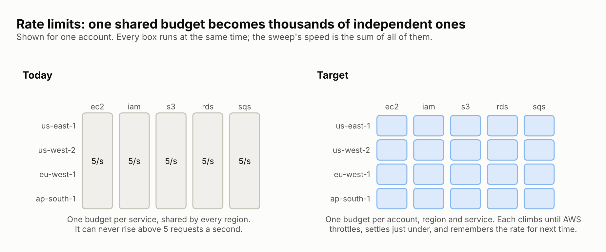
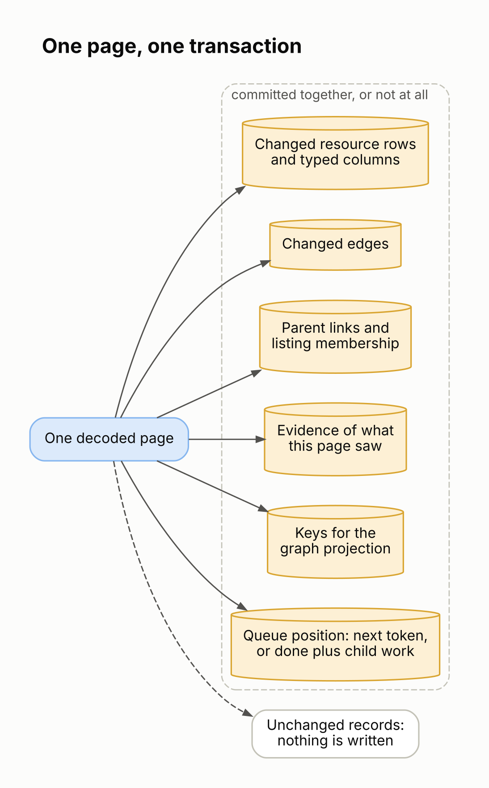
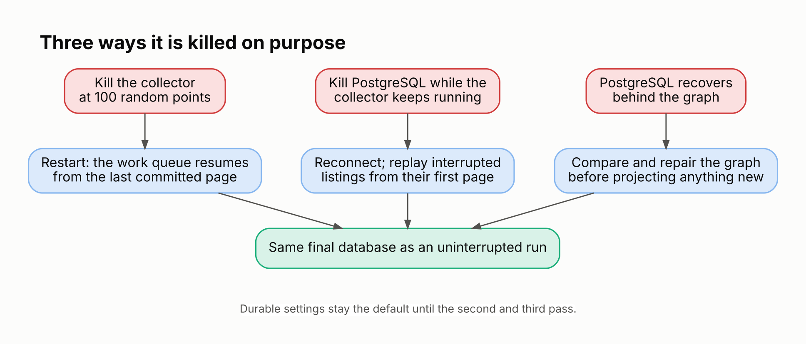

# Track B: speed

> Status: Plan, 2026-11-15. Part of the [end-to-end milestone](README.md).
> Crates: `inventory-engine` (limiter, inventory store), the sweep runtime,
> `cmdb-bench`. Maps to ROADMAP M4.1, M4.4, M3.3 and open decision O4.
> Amended for V51, V52 and V53. Steps are in
> [build/STEPS_B.md](build/STEPS_B.md).

This page is the one-page summary of track B. Its 29 steps are in
[build/STEPS_B.md](build/STEPS_B.md), and the step file wins where the two
differ. B4.6 (the database is killed while the collector runs) was added after this page was first written.

## Why

V43 makes speed a design constraint. Today five things in the tree hold a
sweep far below what AWS grants:

1. `ExecutorConfig::default()` sets 5 requests per second, and
   `AdaptiveRate::PerSecond { current, maximum }` starts with both equal, so
   recovery can never pass 5 (`crates/engine/src/limiter/policy.rs`,
   `pacing.rs`).
2. The bucket key is the service name (`src/sweep_runtime/call.rs`), so every
   region of a service shares that one budget.
3. Concurrency defaults to 16 and is capped at 128
   (`src/sweep_runtime/config.rs`), while the limiter allows 4,096.
4. `drain_work` claims a batch of leases and waits for all of them before it
   claims again (`src/sweep_runtime/execution/draining.rs`), so one slow page
   holds back the batch.
5. Each claim and each page commit is its own transaction on one connection,
   flushed to disk every time (`crates/engine/src/inventory/connection.rs`),
   so the disk flush rate caps pages per second.

The `learned_rates` table exists in schema 14 and nothing reads or writes it.
No benchmark of collection exists, so none of this has a number yet.

V52 changes the order: the benchmark (B5) is built first, in a release build,
and B0 records the baseline with it, on PostgreSQL. Every later step in every track that sits
on the sweep, write, read or render path records its number before and after.
The numbers recorded so far in this repository are from debug builds.

V51 and V53 change the write path: PostgreSQL is the only store. Item 5 above
describes the current store, which is being replaced and is not tuned or
measured. The first recorded number is on PostgreSQL. B4 is the PostgreSQL
write path, and each of its
settings is a measured choice, not an assumption: commit grouping,
`synchronous_commit`, `UNNEST` against `COPY`, the batch size, the pool size,
one writer or one per account and region, and unlogged staging tables.

Published numbers come from Linux. Docker on macOS runs inside a virtual
machine and writes to disk more slowly, more so with a bind mount, so the
compose file uses a named volume. Container defaults are small
(`shared_buffers` defaults to 128 MB), so every benchmark table records the
server's settings.

## Packages

| ID | Work | Needs | Exit evidence |
| --- | --- | --- | --- |
| B0 | Baseline. The first benchmark table, recorded on PostgreSQL at the first end-to-end run and before any speed step. | B5, C6 | A recorded table with machine, build profile and the server's settings |
| B1 | Bucket per account, region and quota group. A quota group is the service unless the overlay splits it. Remove idle buckets or raise the registry bound of 65,536 (`MAX_BUCKETS`). | None | Two regions of one service are paced independently in a deterministic-time test; 74,000 distinct buckets are admitted without error |
| B2 | Adaptive rate with no low ceiling, persisted. Start from the learned rate if one is stored, otherwise from a configured start. Raise until AWS throttles, cut on a throttle, hold just under. A flag caps the rate for accounts that share quota with production. Store the rate per account, region and quota group; the present table key (service, operation) changes with it. | B1 | Through the fault proxy with a fixed rate limit: steady throughput within 10% of the limit and under 1% throttles after convergence; the second sweep is inside that margin in its first minute; with the cap set, throughput never exceeds it |
| B3 | Continuous claim. Keep the configured number of leases in flight at all times, claim leases several at a time in one transaction, and lift the sweep's concurrency bound to the limiter's. Size the transport pool to match. | None | With one page stalled by the proxy, the other scopes complete without waiting for it; in-flight count stays at the configured value until the queue empties |
| B4 | The PostgreSQL write path. Pages go through a bounded channel to the writer, which commits a group per transaction. The page's records, edges, projection keys and queue update stay atomic inside the group. Only rows whose content hash changed are written. Grouping, `synchronous_commit`, `UNNEST` against `COPY`, pool size and writer count are each chosen from a recorded measurement. | B3, C6 | Killing the process at 100 seeded random points and restarting gives the same final database as an uninterrupted run (the M3.3 kill matrix), on PostgreSQL; commits per page and bytes written are recorded for each setting tried |
| B5 | Sweep benchmark in `cmdb-bench` (ROADMAP M4.4): cold sweep, warm re-sweep, API calls, connections opened, resources per second, CPU seconds, peak memory, bytes written, writer rows per second and decoding as a share of CPU time. Run directly against the emulator and through the fault proxy with a stated latency and rate limit. | B2, B4, A7 for scale | One command prints the table from a seeded emulator; the table is recorded before and after each of B1 to B4 |

## Packages added by the build plan (V52)

Their steps are in [build/STEPS_B.md](build/STEPS_B.md).

| ID | Work | Exit evidence |
| --- | --- | --- |
| B6 | Fewer calls: the largest page size (the two live enumerations ask for 5 items a page today, `catalog/overlay/ec2.toml`), skipping a describe the list already covers, batch reads, and remembered inaccessible and unsupported scopes with an expiry | API attempts per seeded resource, before and after, with per-kind counts unchanged |
| B7 | Transport: count connection reuse, handshakes and HTTP/2 requests, then set the idle timeout (1 second today) and pool size (2 idle per host, at most 512 connections) from those numbers (`crates/aws-wire/src/transport/config.rs`) | Connections opened per request through the proxy, before and after |
| B8 | CPU on the hot path: stop copying rows and re-encoding requests; measure the decode share and JSON against rpcv2Cbor on CloudWatch | CPU seconds and decode share, before and after |
| B9 | Head-to-head early: a harness that runs CloudQuery and Steampipe on the same emulator, first on the thin slice and again once the speed work is in | The report with tool versions, dataset and the kinds every tool collected, whatever it shows |

## Why relaxed durability is safe here

PostgreSQL with `synchronous_commit = off` does not wait for the disk on every
commit. A crash cannot corrupt the database; it can lose the most recent
commits. In this design a page's data and its queue position commit together,
so a lost commit means that page is fetched again on resume. Nothing is left
half-written. That is why the setting may be relaxed if the measurement favors
it, and why the kill matrix in B4 is the proof and not an argument.

## What does not change

- `ApiExecutor` stays the only retry owner. A retry re-enters admission.
- Every queue and channel stays bounded.
- The emulator measures the engine only: it has no quotas and no network
  latency. Quota behavior is proven through the fault proxy, and real quotas
  only on a real account.
- "Fastest" is claimed only from head-to-head runs (V19). Those are in
  [AFTER](AFTER.md).
