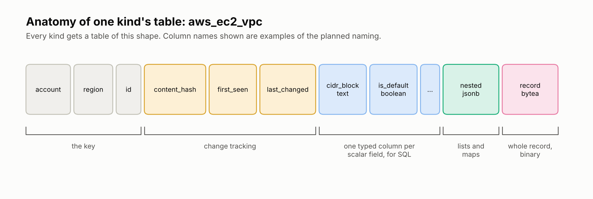
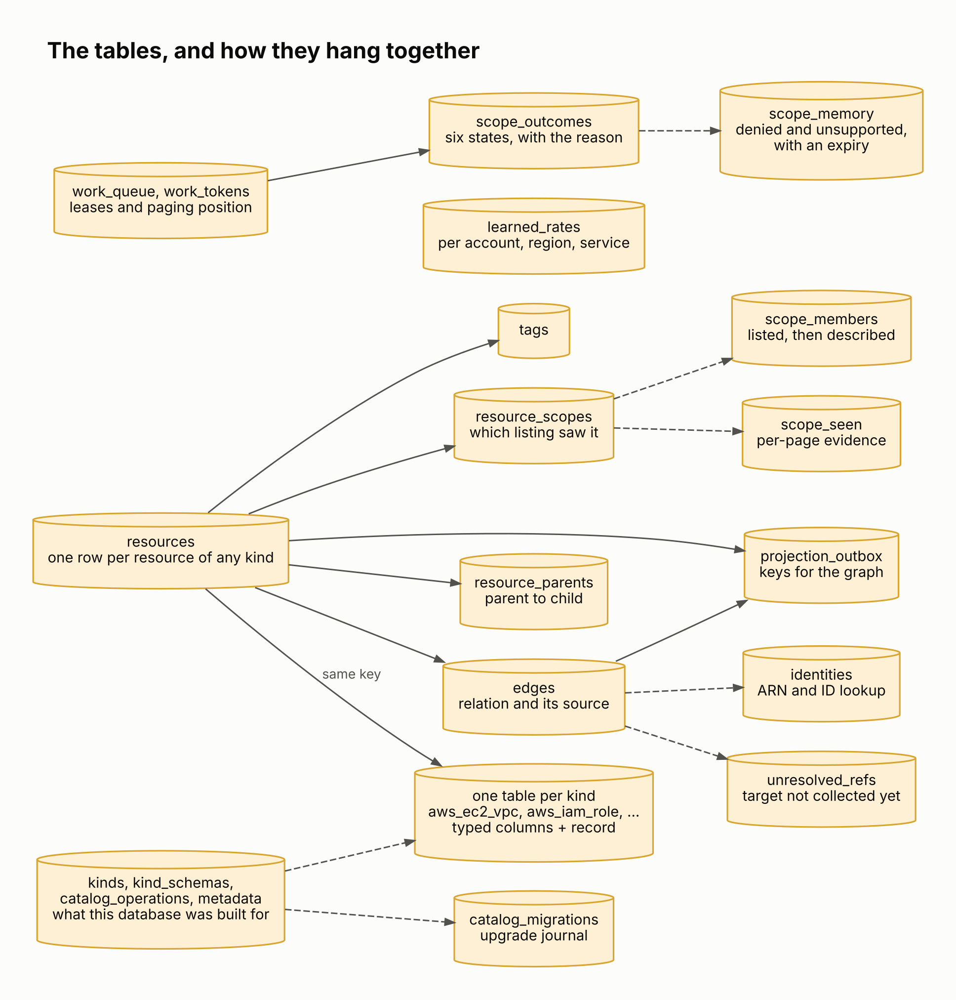
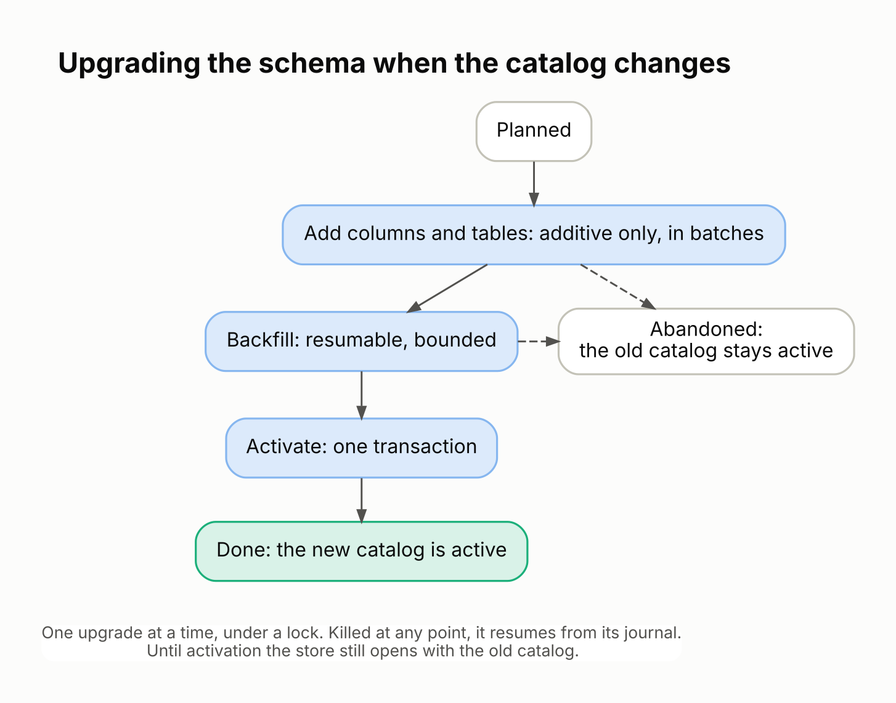
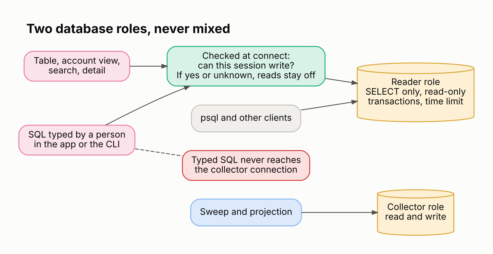

# Track C: SQL

> Status: Plan, 2026-11-15. Part of the [end-to-end milestone](README.md).
> Crates: `catalog-tool` (runtime catalog schemas), `inventory-engine`
> (inventory schema, typed columns, commit), the CLI. Maps to ROADMAP M3.2.
> Amended for V51 and V53: PostgreSQL is the only store, so C5 moves to the
> front, C6 is new, and the current store's code is deleted once C6 passes. Steps are in
> [build/STEPS_C.md](build/STEPS_C.md).

This page is the one-page summary of track C. Its 28 steps are in
[build/STEPS_C.md](build/STEPS_C.md), and the step file wins where the two
differ. C1.7 (a migration journal) was added after this page was first written.

## Why

V41 says SQL must work from the CLI, the UI and external clients. Today a
kind's table holds `account`, `region`, `id`, `content_hash`, `first_seen`,
`last_changed`, the CBOR `record`, and only the columns the catalog compiler
emits: the display-name path and the paths that relations point at
(`crates/catalog-tool/src/runtime_catalog/schemas.rs`). A query such as
`SELECT cidr_block FROM aws_ec2_vpc` cannot be written. The `query` command
opens only the schema 13 store.

VISION 5.4 already asks for typed columns generated from the output shape.
This track builds them.

V51 and V53 make PostgreSQL the only store. No PostgreSQL code exists today,
and the current store is the only one that passes an end-to-end run. So its
code stays, untouched, until the same scenario passes on PostgreSQL, and is
then deleted. The order inside this
track is therefore C5 (the store interface), C6 (the PostgreSQL store), then
C1 to C4 on top of it.

## Packages

| ID | Work | Needs | Exit evidence |
| --- | --- | --- | --- |
| C1 | Typed columns. For each kind, emit one column per scalar member of its item shape, with nested structures flattened by joining member names with `_`. Types follow `ScalarType`: bigint, double precision, text, bytea, and one `timestamptz` column for a timestamp (the record keeps the full value). Lists, maps and documents get no scalar column. Columns are named `f_<field id>` today (`crates/core/src/inventory/schema.rs`), so readable names are new. The existing SQL-name constructor cannot be reused as it is: it requires at least two words, which would refuse `arn` or `state`. PostgreSQL allows 1,600 columns per table and 63-byte identifiers, while the catalog's own budget allows 2,000 (`validate_column_budget`), so that budget comes down to 1,592 typed columns (1,600 less the 8 fixed ones); a kind over the limit keeps its shallowest members first and the rest stay in the record, reported per kind. Names that collide after flattening are resolved by one written rule and reported. | C6; A2 widens it | The schema text is generated from the catalog and identical when regenerated; a test filters on a scalar column of every kind; with one member added to the catalog, the column is added in place and existing rows are untouched (today a database refuses any catalog with a different digest, `StoreError::CatalogMismatch`, so this upgrade path is new); table count, column count, file size, time to open and time to prepare one insert per table are recorded; if opening exceeds 100 ms, the fallback of VISION 5.4 is taken (shared tables, columns only for queryable fields) |
| C2 | Nested fields (O13, V40). Lists and maps go into one JSONB column per kind, written at commit. Measure its cost on the write path against the record-only alternative before keeping it. | C1, B0 | A recorded table of write time and bytes for both; the chosen option answers a query on a list field (for example a security group's rules) |
| C3 | `aws-inventory sql --database DB "<statement>"` on the new schema, against PostgreSQL first. Read-only connection, one statement, row and byte bounds. The old store already has this policy in `crates/engine/src/store/query.rs` and `sql_policy.rs`; reuse it. Output is a table by default, with CSV and JSON as explicit exports. | C1 | A query over a swept emulator account returns typed values while a sweep is writing; a write statement is refused; an oversized result ends at its bound with a distinct error |
| C4 | External clients. Document connecting with `psql` and a desktop client through a read-only role, and add `aws-inventory schema` to list tables and columns. Cross-kind tables (`resources`, `edges`, `tags`, `scope_outcomes`) are part of the documented surface. | C3 | The documented `psql` command returns the same rows as C3 while a sweep runs |
| C5 | Store interface, first in this track. Put the calls the sweep runtime and the projection make on `BinaryStore` behind one trait. `BinaryStore` implements it unchanged, which is the seam the sweep crosses to reach PostgreSQL. `cmdb-view` does not use `BinaryStore`: it has no dependency on `inventory-engine` and runs its own queries (`crates/cmdb-view/src/database.rs`), so it gets a PostgreSQL reader in C6. The trait is kept afterwards: the sweep's tests use a fake store through it. | None | The sweep runtime compiles against the trait; the baseline end-to-end suite still gives 2 passed |
| C6 | PostgreSQL store (V51, V53; this was H1). The PostgreSQL implementation of the C5 trait: schema generation, the work queue with leases (`FOR UPDATE SKIP LOCKED`), an atomic page commit, bulk writes by `COPY` into a staging table followed by one set-based upsert that touches only rows whose content hash changed, the projection outbox, and the read paths `cmdb-view` needs. Tests take a connection URL, create a uniquely named database each and drop it afterwards. Locally the server comes from a compose file with the official image pinned by digest; CI uses a service container; a machine without a container runtime uses a native server through the same URL ([RUN_HERE](RUN_HERE.md)). The last step of this package deletes the current store's code. | C5 | The baseline end-to-end scenario passes against PostgreSQL; a re-sweep of an unchanged account writes zero rows; the kill matrix of B4 holds; the sweep benchmark is recorded with the server's settings; after the deletion PostgreSQL is the only store on the sweep, read and UI paths; exit test line X10 |

## Names

Table names follow V26 and V30 and are already produced by
`catalog_tool::names` with `catalog/name-exceptions.tsv`. Column names use the
same word-splitting rule so that `VpcId` is `vpc_id` and `CidrBlock` is
`cidr_block`. Compatibility with Steampipe or CloudQuery column names is not
promised (VISION section 1); if the owner wants it, it is a view layer on top
and a separate package.

## What does not change

- The record blob stays CBOR and stays the source for the UI's detail view.
- The writer fills the columns; they are not generated columns.
- Nothing is migrated from the current store. Inventories are collected again
  into PostgreSQL (V24).

## C6.1 implementation evidence (2026-11-22)

The workspace enables SQLx's `postgres` feature, retaining `sqlite` until the
planned store cutover. The existing prerequisite commit `c6ded414` supplied
the manifest and lockfile; the SQLx pin was not moved. Contrary to the original
step description, this tree uses registry SQLx 0.9.1 and Rust 1.100.0, not a
git fork and nightly. The new metadata regression therefore checks equal
version and upstream source for every resolved SQLx crate, with exactly one
`sqlx-postgres`, rather than inventing a git revision.

| Measurement | Before `postgres` | After `postgres` |
| --- | --- | --- |
| `cargo tree --locked -e normal -p inventory-engine` lines | 305 | 349 |
| Clean debug engine build wall time | 27.04 s | 29.27 s |
| Peak RSS | 683,988 KiB | 697,236 KiB |
| Swaps | 0 | 0 |

Build command: `RUSTC_WRAPPER= /usr/bin/time -v cargo build --locked -p
inventory-engine -j2`, with a fresh
`CARGO_TARGET_DIR=$HOME/.cache/cargo-target-d11` each time. The earlier target
directories were moved aside, not reused for either clean build. These use
two jobs under the task's machine policy instead of the step's proposed one.
The registry cache was warm.

The coordinator must run the workspace all-target/all-feature gate after
integration. This dependency change does not implement or claim a PostgreSQL
store or PostgreSQL end-to-end sweep.

New lockfile package names: `etcetera`, `hkdf`, `libredox`,
`objc2-core-foundation`, `objc2-system-configuration`, `sqlx-postgres`,
`stringprep`, `unicode-normalization`, and `whoami`. This list compares
lockfiles, not unlike-feature metadata graphs.

Passed: `cargo test --locked -p inventory-engine --test postgres_dependency
-j2` (1 test), `cargo fmt -p aws-inventory -p inventory-aws -p inventory-engine
-- --check`, `cargo clippy --locked -p aws-inventory --features aws -j2 --
-D warnings`, and `cargo clippy --locked -p inventory-engine --test
postgres_dependency -j2 -- -D warnings`. The initial offline all-feature
metadata command could not fetch `libredox`; locked online resolution fetched
the missing platform packages, after which the offline regression passed.
