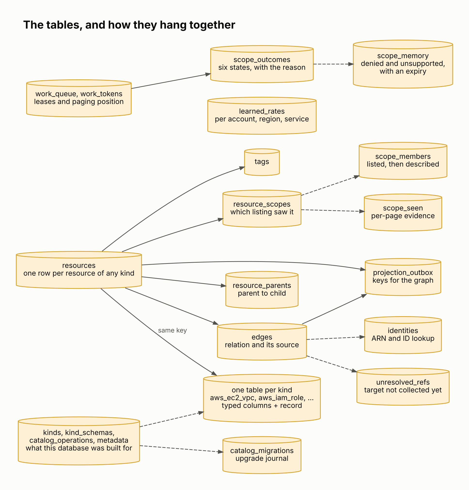
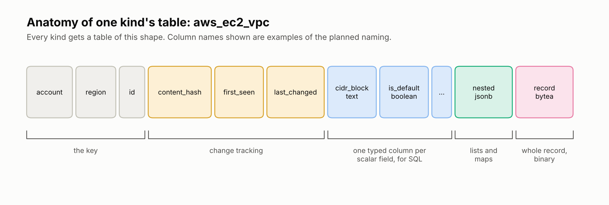
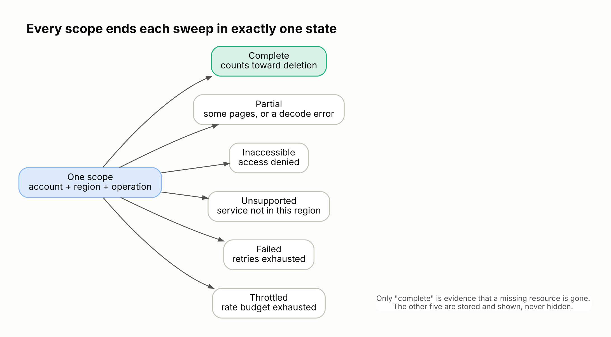
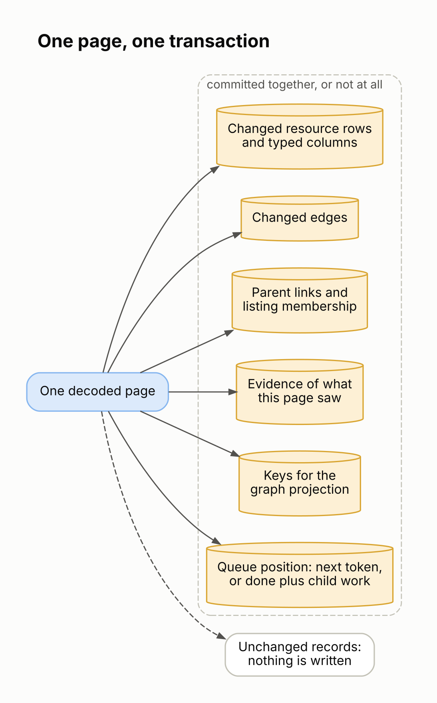
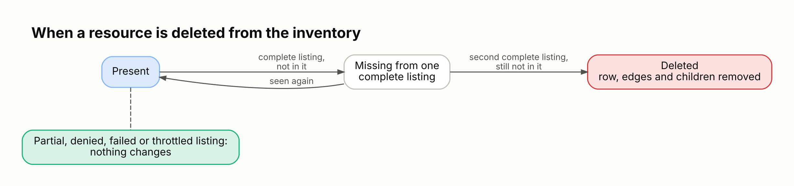
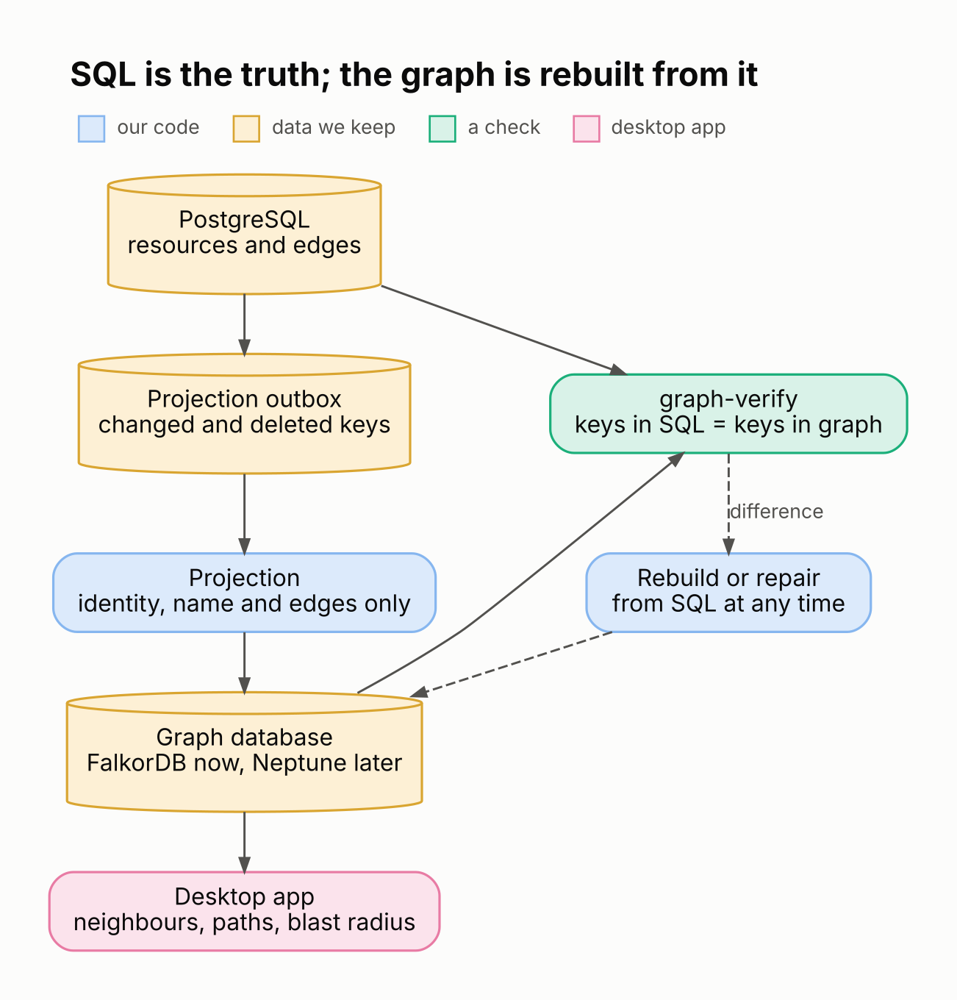
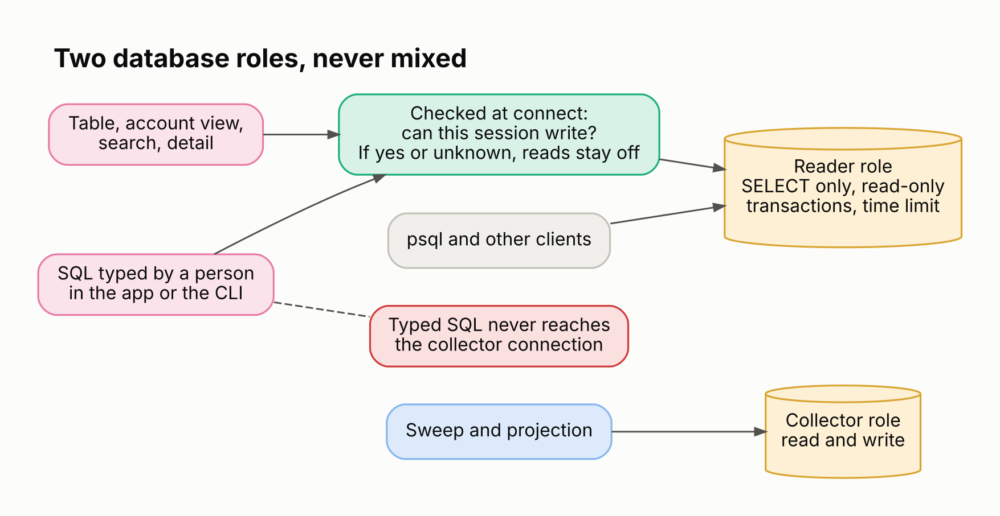
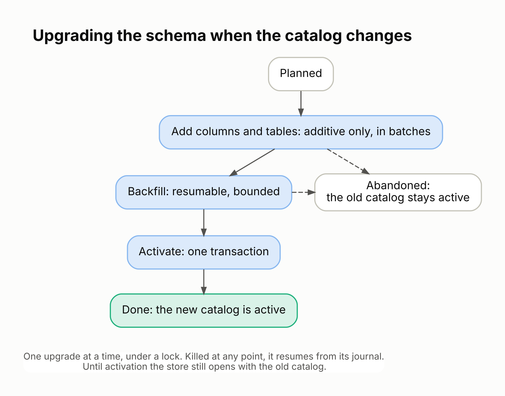

# Data model

> Status: Target design, 2026-11-22. The shared tables in section 3 exist in
> the tree today (store schema 14, in a local single-file database that the
> plan replaces). The PostgreSQL forms, the typed columns and the tables in
> section 4 are planned and not built. Column names for planned tables are
> the ones the step files use; the step that creates each table is named so
> the exact definition can be checked.

How the system uses this data is in [ARCHITECTURE.md](ARCHITECTURE.md).

## 1. The four things that are stored

| What | Example | Where |
| --- | --- | --- |
| A resource | One EC2 subnet, with everything AWS says about it | A row in its kind's table, and a row in `resources` |
| A relationship | That subnet is in that VPC | A row in `edges` |
| Evidence | Which listing saw the subnet, and how each listing ended | `resource_scopes`, `scope_outcomes` and the tables in section 4 |
| Control state | Work still to do, rates learned, changes waiting to reach the graph | `work_queue`, `learned_rates`, `projection_outbox` |

Nothing else is stored. There is no history: the store holds the current
state only (V22). There is no content from inside resources, and no secret
values.

## 2. Identity

A resource is identified by four values:

| Part | Example | Notes |
| --- | --- | --- |
| `account` | `111122223333` | The owning AWS account |
| `region` | `us-east-1` | A fixed value for global services |
| `kind` | `AWS::EC2::Subnet` | The CloudFormation type name. A kind that has none gets a name in the same style (V26) |
| `id` | `subnet-0a1b2c` | What the overlay says identifies one resource of that kind |

The SQL table for a kind is its name split into words, lower-cased and
joined with underscores: `AWS::EC2::Subnet` is `aws_ec2_subnet`,
`AWS::ElasticLoadBalancingV2::TargetGroup` is
`aws_elastic_load_balancing_v2_target_group` (V30).

## 3. Tables

All tables live in one PostgreSQL schema named `inventory` (C6.3).

### One table per kind

| Columns | Type | Purpose |
| --- | --- | --- |
| `account`, `region`, `id` | text | The key |
| `content_hash` | bytes | Hash of the record. Equal hash means nothing is written |
| `first_seen`, `last_changed` | timestamp | When it first appeared and when its content last changed |
| One column per scalar field | text, number, boolean, timestamp | Generated from the API model, so SQL can filter and join (C1) |
| `nested` | JSONB | Lists and maps, for SQL (C2, an unconfirmed default, O13) |
| `record` | bytes | The whole record in CBOR. This is what is hashed and what the app decodes |

**Today** a kind table has the key, the hash, the two times, the record,
and columns only for identity, name and fields that point at other kinds.
The typed column per field is track C.

**Limits.** PostgreSQL allows 1,600 columns in a table. After the fixed
columns, at most 1,592 typed columns fit; a wider kind keeps the shallowest
fields as columns and the rest stay readable in `record` and `nested`,
listed in a report (C1.2). A second limit, the size of one row, is computed
in the plan and not yet tested.

**Why two copies.** Typed columns and JSONB are for people writing SQL. The
binary record is for the machine: it is the smallest form, the fastest to
hash, and the app decodes it without parsing text. The cost of writing the
SQL-friendly copy is measured before it is accepted (C1.4, C2.1).

### Shared tables that exist today

| Table | One row per | Key columns | Notes |
| --- | --- | --- | --- |
| `resources` | Resource | account, region, kind, id | Name, hash and times for every resource of every kind. The table to query across kinds |
| `edges` | Relationship | from (4 parts), to (4 parts), relation, source | `source` says where the edge came from: model, rule or inferred |
| `unresolved_refs` | Reference whose target has not been collected | from, target kind and value | Becomes an edge when the target appears |
| `resource_parents` | Parent and child pair | parent (4 parts), child (4 parts), scope | Deleting a parent deletes its children |
| `tags` | Tag on a resource | resource, tag key | Filled after the milestone (package G) |
| `resource_scopes` | Resource seen by a listing | resource, scope | Holds the "missing once" marker used for deletion |
| `scope_outcomes` | Listing in a sweep | sweep, scope | One of six outcomes |
| `work_queue` | Unit of work | sweep, scope | Page token, state, lease, generation |
| `work_tokens` | Page token already used | sweep, scope, digest | Stops a paging loop |
| `kinds`, `kind_schemas` | Kind | kind | The table name and column definition in force |
| `catalog_operations` | Callable operation | service, operation | What the store was created for |
| `projection_outbox` | Resource changed since the graph last caught up | resource key | Written in the same transaction as the change |
| `learned_rates` | Rate | today: service, operation | Created but unused today; re-keyed by the plan |
| `metadata` | Setting | key | Schema version, catalog digest |

### The six outcomes of a listing

| Outcome | Meaning | Can it prove a deletion |
| --- | --- | --- |
| `Complete` | Every page was read | Yes |
| `Partial` | Some pages were read, then it stopped | No |
| `Inaccessible` | Access was denied | No |
| `Unsupported` | The service or operation does not exist in that region | No |
| `Failed` | Errors exhausted the retry budget | No |
| `Unobserved` | It was not attempted in this sweep | No |

## 4. Tables the plan adds

| Table | Purpose | Step |
| --- | --- | --- |
| `scope_seen` | For a listing with more than one page, the IDs seen so far in this sweep. Used once at completion to work out what is missing, then cleared. A one-page listing writes nothing here | B4.5 |
| `scope_members` | For a list whose items are only identifiers that are then described one by one: what the list returned. Without it, an identifier that vanishes from the list could never be removed | A3.4 |
| `identities` | Every resource's ID and ARN, as a lookup, so a field value can be matched to exactly one resource | E1.2 |
| `scope_memory` | Listings that were denied or unsupported, with an expiry (1 hour and 24 hours by default), so they are not retried every sweep | B6.4 |
| `learned_rates`, re-keyed | The request rate that worked, per account, region and quota group | B2.2 |
| `catalog_migrations` | A journal of schema upgrade steps, so an interrupted upgrade resumes | C1.7 |
| Column registry | A fixed mapping from a field in the API model to its column name, so a column never changes meaning between versions | C1.1, C1.7 |

`scope_seen` and `scope_members` are deletion evidence, so they are
ordinary durable tables by default. A faster non-durable form is allowed
only if it passes the database-crash test (B4.6).

## 5. How a change is written

For each record on a page:

1. Encode it as CBOR in one fixed form, so equal values always give equal
   bytes.
2. Hash it. Fields that change on every read without the resource changing
   are left out of the hash; each such exclusion is named in the overlay
   and listed (A7.3).
3. Compare with the stored hash. If equal, write nothing.
4. If different or new, write the kind row, the `resources` row, its edges,
   and its key into the outbox.

The page's changes, the next page token and any child work all commit in
one transaction. On PostgreSQL the write is set-based: one statement per
table per page, not one per row (C6.6).

## 6. Deletion

- A resource missing from one complete listing is marked.
- Missing from a second complete listing, it is deleted, and its children,
  edges and tags go with it.
- If it reappears in between, the mark is cleared.
- A listing that did not complete never marks anything.
- The marker is kept per listing (`resource_scopes` is keyed by resource
  and scope), so one listing's evidence is never mixed with another's.

## 7. The graph

SQL is the truth and the graph is a copy.

| In the graph | From SQL |
| --- | --- |
| A node labelled `Resource`, keyed by one string built from account, region, kind and ID | A row in `resources` |
| A relationship with a type and a source | A row in `edges` |

A node carries account, region, kind, ID, name and the content hash: enough
to traverse and to check against SQL. Field values stay in SQL. The app asks the graph "what is connected" and
asks SQL "what is it".

## 8. Who can read and write

| Role | Can | Cannot | Used by |
| --- | --- | --- | --- |
| Owner | Create the schema | | Setup only |
| `inventory_collector` | Read and write every table | | The collector, and the app when it runs a sweep |
| `inventory_reader` | Read resource, edge, tag and outcome tables. Sessions are read-only | Write anything; read the work queue, tokens or outbox | `psql`, other SQL clients, the app's SQL console |

The app checks at connect time that its reader connection really cannot
write, and refuses to offer the console if it can (D13.1).

## 9. Schema upgrades

A new catalog can add kinds and add columns. It never renames a column or
changes its meaning. An upgrade takes a lock, journals each step, adds
columns in place, back-fills them from the stored records, and switches
the active catalog in one transaction at the end (C1.6, C1.7). Existing
local databases from before PostgreSQL are not migrated; they are
re-collected (V24).

## 10. What the catalog holds

The running product reads one compiled file. It contains, for every
callable operation: the service endpoint and protocol, the request shape,
how to page, where the items are in the response, the kind each item
becomes, its identity, its column list, which fields point at other kinds,
and which fields are left out of the hash. It also records every
operation that is **not** callable and why, so coverage can be reported
without guessing.

| Catalog fact | Value today |
| --- | --- |
| Service models | 436 |
| Operations | 19,641 |
| Callable | 4 |
| Field identifiers | 49,069 |
| File size | 11,976,647 bytes |

## 11. Sizes the design is aiming at

These are targets and defaults, not measurements.

| Quantity | Value | Status |
| --- | --- | --- |
| Accounts | A whole organization; the number is not stated (V64). The first proof was sized for about 10 (V09) | Open question U1 |
| Graph drawn at 120 frames a second | 250,000 nodes, 1,000,000 edges | Unconfirmed default (O14) |
| Rate buckets admitted | 74,000 without error | Test target in B1 |
| Typed columns in one table | 1,592 | PostgreSQL limit, computed |
