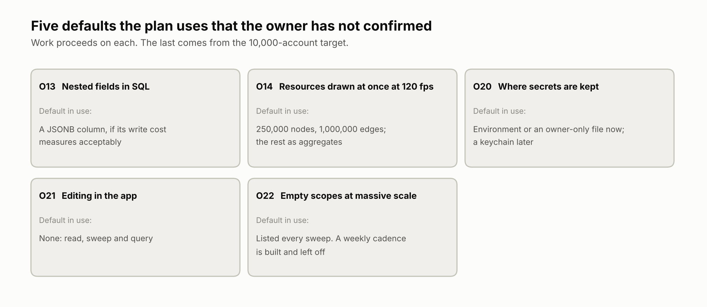

# Decisions

> Status: Ledger, 2026-11-22. Every decision the design rests on, in one
> place. V01 to V34 were made before this plan and are recorded in
> [VISION](../VISION.md) section 2; they are restated here in short form
> with what happened to each. V35 to V53 are the owner's answers of
> 2026-11-15 and 2026-11-16, V54 to V57 the answers of 2026-11-21, and
> V58 to V76 the answers of 2026-11-22. The O rows are defaults the plan uses that the
> owner has not confirmed. Where this file and VISION differ, this file
> wins until step K4.1 merges it into VISION.

Status words: **Kept** (unchanged), **Amended** (still stands, changed by a
later row), **Superseded** (replaced).

## 1. Decisions made before this plan

| ID | Decision, in short | Status | Changed by |
| --- | --- | --- | --- |
| V01 | Collection calls each service's own API directly | Amended | V39: Cloud Control is kept, as a checker only |
| V02 | Our own wire engine: pinned API models as data, one client that signs, sends and pages any operation | Kept | |
| V03 | Each response is parsed once, streaming, into a binary record. No JSON after the socket | Amended | V40: unless a measurement shows JSON is needed. V41 and O13 add a JSONB column for SQL readers, written at commit |
| V04 | The old Cloud Control collectors are deleted; the CloudFormation type list stays as a checklist and naming authority | Amended | V39: the Cloud Control code moves behind a verification command instead of being deleted |
| V05 | SQL holds typed columns generated from the model plus the whole record as a binary blob, in a local single-file store | Superseded in part | V51, V53: the columns and the blob stay; the store is PostgreSQL, everywhere |
| V06 | Scope is every configurable resource plus runtime parts that matter for architecture. Never content, secrets or paid calls. The deny list fails closed | Kept | Confirmed by V36 |
| V07 | Commercial AWS partition only | Kept | Confirmed by V49 |
| V08 | Runs on one laptop; Lambda is the second runtime, so collection must work in resumable slices | Amended | V54: version 1 is the laptop only. Any AWS runtime is after version 1 |
| V09 | Accounts come from local AWS profiles; first proven on about 10 accounts | Amended | V64: whole organizations, by assumed role. V69: up to 10,000 accounts |
| V10 | Freshness from fast full sweeps on an interval; change events later, as hints only | Kept | Confirmed by V44 |
| V11 | Reconciliation is by record hash: unchanged records cause no writes | Kept | |
| V12 | Config, Resource Explorer and CloudTrail may give hints and cross-checks; stored facts come from the service's own API, except tags | Kept | |
| V13 | Full send by default: use all the rate AWS grants; a cap exists for shared accounts | Kept | Sharpened by V43 |
| V14 | FalkorDB is the graph database; SQL is the truth and the graph is rebuildable | Amended | V46: Neptune later, as an optional backend. V60: the engine that ships is chosen by measurement (step E3.4) |
| V15 | Edges come from three labelled sources: model, reviewed rules, exact-match inference. Ambiguous matches are counted, not drawn | Kept | |
| V16 | The CMDB layer is owner, team and application, derived from tags through a mapping; no manual editing | Kept | Scheduled after the milestone (package G) |
| V17 | The UI is a native Makepad desktop app; no web build in the first version | Kept | |
| V18 | Build order is depth first: large services complete, then the rest | Superseded | V35: end to end first |
| V19 | "Fastest" is claimed only from head-to-head runs against CloudQuery, Steampipe and Cartography | Kept | |
| V20 | Work is executed by agents from the roadmap, with a coordinator that integrates and verifies | Kept | |
| V21 | Code is a liability: a service is data, never Rust. All product code is Rust, MIT licensed. Python is deleted | Kept | V63 restores "all MIT" after V48 had qualified it |
| V22 | No history: current state only. Deletion is still detected | Kept | Confirmed by V42 |
| V23 | The API models are pinned as a git submodule; the compiled catalog is committed | Kept | |
| V24 | Existing local databases are thrown away and re-collected; no migration from older schemas | Kept | |
| V25 | A named first wave of large services | Amended | V35, V36: it no longer limits scope. The first services are the thin slice in [BUILD_PLAN](BUILD_PLAN.md) section 4 |
| V26 | A kind is named by its CloudFormation type name | Kept | |
| V27 | Every enabled region is swept, discovered automatically | Kept | |
| V28 | The graph opens on the hierarchy: account, region, service, resources | Amended | V45: the hierarchy is how you move inside a view of the whole account, not a limit on what is drawn |
| V29 | Building starts with the early milestones in parallel | Superseded | V35 and the waves in [BUILD_PLAN](BUILD_PLAN.md) |
| V30 | The rule that turns a kind name into a SQL table name | Kept | |
| V31 | Tags come from the bulk tagging API first, the service's own call second | Kept | Scheduled after the milestone (package G) |
| V32 | The UI reads its data in process; there is no HTTP read API | Amended | V53: it reads PostgreSQL. V47: it may also start sweeps |
| V33 | Only records are hashed, not pages | Kept | |
| V34 | Records are CBOR, written with `minicbor`, chosen by benchmark | Kept | |

## 2. Decisions the owner made for this plan

| ID | Decision | Replaces or amends |
| --- | --- | --- |
| V35 | The first goal is one full end-to-end run, so the core flow is known to work before anything is widened | V18, V29 |
| V36 | Scope is every resource in the account, including every child resource. Content, secrets and paid calls are still never read | Confirms V06; V25 no longer limits scope |
| V37 | The emulator is the proving ground for this milestone | O8 stays open for the real account |
| V38 | Superseded by V51 and V53. (It read: PostgreSQL only for long-running deployments in AWS.) | |
| V39 | Cloud Control is kept to verify accuracy over the long term. It is a cross-check and never a source of stored facts or a step on the collection path | V01, V04 |
| V40 | No JSON on the hot path unless a measurement shows it is needed for performance | V03 |
| V41 | SQL is reachable from the CLI, from the UI and from external SQL clients | New |
| V42 | Change history comes later | Confirms V22 |
| V43 | Cold sweep, warm re-sweep and poll interval are each to be the fastest on the market, without making maintenance worse. Speed is a design constraint | V19 still governs claims |
| V44 | Polling only for now. EventBridge and CloudTrail come later | Confirms V10 |
| V45 | The UI renders the entire account as a DAG, at 120 frames per second | V28 |
| V46 | A graph database is required: FalkorDB now, Neptune later as an optional backend | V14 |
| V47 | Whatever the CLI can do, the UI can do, including starting a sweep. The desktop app reads the databases directly | Confirms V32 |
| V48 | Superseded by V63. (It read: collection and SQL open source; the UI, the DAG and SSO commercial; one private repository for now.) | |
| V49 | No GovCloud and no China partition | Confirms V07 |
| V50 | The mutation gate is suspended. The 95% whole-project target is not a landing condition until the owner restores it | The mutation documents |
| V51 | PostgreSQL is used from the start. The first end-to-end run stores into PostgreSQL | V38, V05 |
| V52 | Performance is the critical part of the product. Every step on the sweep, write, read or render path carries a measured budget, the benchmark exists before the speed work, and a wave does not close on a regression without a written reason | Sharpens V43 |
| V53 | PostgreSQL is the only store, everywhere: laptop, tests, CI and AWS. A local user gets it from a container (podman or docker) or from a native server. The previous local store is removed from the plan and from the code | V05 and V38 in full |
| V54 | Version 1 runs on one person's laptop: the collector, PostgreSQL, the graph database and the desktop app, all local. Running in AWS (package H) is not part of version 1 | Confirms the first half of V08. O15 and O16 are no longer needed for version 1 |
| V55 | The owner builds it, with agents as in V20. The owner is the coordinator | Answers who builds it. There is still no date |
| V56 | The 120 frames per second target is measured on two classes of machine: an Apple M3 MacBook Pro, and a machine with an RTX 3070 class GPU | Replaces "a laptop's integrated GPU" in O14. Settles O18 for the MacBook, whose built-in display refreshes at up to 120 Hz. Makes macOS a first-release platform (O19) |
| V57 | The graph database is included in version 1. Reading taken: it is installed and started as part of the laptop product, not an optional extra | Confirms V46 for version 1. See the two points under the table |
| V58 | The platforms are macOS and Linux. Windows is not a target | Settles O19 |
| V59 | The Mac for the frame test is a MacBook Pro with the M3 Pro chip | Sharpens V56. The RTX 3070 machine is still described only by its GPU |
| V60 | The graph engine ships inside the product. The user does not install it separately | Settles what "included" meant in V57. Which engine ships is chosen by measurement in step E3.4; see the note under the table |
| V61 | No SSO to start | I1.1 is not planned |
| V62 | The name is `aws-inventory`, for now | The binary already has this name |
| V63 | Everything is open source under the MIT licence, including the desktop app and the graph. There is no closed part and no commercial split | Supersedes V48. Step I2.1 (the split) is no longer needed |
| V64 | Scope is every resource of every service AWS has, in every account of an organization that its owner gives access to. Whole organizations are swept from one laptop | Sharpens V36. Amends V09. Steps H2.1 and H2.2 (accounts from AWS Organizations, the read-only role) move into version 1 |
| V65 | One full sweep a day is fresh enough | Narrows V43: the interval between sweeps is no longer a competitive target. Sweep time and the resources used are. Continuous mode (package F) becomes a daily schedule |
| V66 | PostgreSQL is used at its latest major version. On 2026-11-22 that is PostgreSQL 19, released 2026-11-19 | Sharpens V53. Not verified: that the pinned driver and the container images work with 19 |
| V67 | Overlays may be extracted from the API models by the generator; an entry does not need a person's review to make an operation callable. Reading taken of "we can exact overlays" | Settles O12. The deny list is still checked first, and the emulator probe and Cloud Control still check the result |
| V68 | Speed and efficient use of the laptop's CPU, memory and disk are the design priority, because one laptop sweeps a whole organization | Sharpens V52: peak memory and CPU time are budgets with limits, not only numbers that are recorded |
| V69 | The product must scale to as many as 10,000 accounts in one organization, from one laptop. The size is reached in stages | Amends V09 and sizes V64. The plan was sized for about 10 accounts; package S climbs from 10 to 100, 1,000 and 10,000, measuring each |
| V70 | The app should ideally show the entire organization, and what it handles grows in stages. Reading taken of "ideally the entire organizations, we will have to scale the resources as we go" | Amends V45: the whole organization is on screen as aggregates, and individual resources are loaded for what is in view (step S1.6) |
| V71 | A graph database is required, whatever an index of our own would measure | Confirms V46. In step E3.4 our own index is a yardstick and not a candidate |
| V72 | Work continues from the existing repository and adapts as it goes | Answers whether to start empty. The step files name today's files and are adjusted as the code changes |
| V73 | A sweep runs as fast as AWS allows. There is no time window it has to fit | Settles O23. Restates V13 and V43 for whole organizations |
| V74 | Whether 10,000 accounts fit on one laptop is not a concern for now. The work is to be as fast and as frugal as Rust allows; the scale ladder reports what it finds | The ladder (S2.1) reports and does not gate. The question of which laptop is set aside |
| V75 | The read-only role is not a concern for now. Access to each account is assumed to exist, however the organization grants it | Sets aside how the role is deployed. H2.2 (the role as a template) is not part of version 1 for now; H2.1 (assuming a role in each account) still is |
| V76 | Plan for massive scale. Scale is a design input from the first step that builds each part, not something added afterwards | Sharpens V69. The rule in [ARCHITECTURE.md](ARCHITECTURE.md) section 9: no cost may grow with accounts times regions times operations. Steps B1.2, B7.2, C6.3 and C6.5 carry a scale note; package S is the proof |

**The graph engine and the licence (V60, V63).** These two decisions pull
against the current engine. Our own code can be MIT whatever it talks to.
But FalkorDB, the engine in the tree today, is under the Server Side Public
License (SSPLv1), which the OSI does not count as open source. Shipping its
binary inside a product described as all-MIT means shipping software under a
different, stricter licence alongside it. Whether that is acceptable is a
question for a lawyer; this document does not answer it. Independently, the
owner asked for a faster engine that works from Rust. Step E3.4 measures the
candidates behind the one graph interface and records the choice. The
candidates and what is known about each are in
[ARCHITECTURE.md](ARCHITECTURE.md) section 7.

## 3. Defaults awaiting the owner

Work proceeds on these so that nothing is blocked. Each is one line to
change here; some would change a lot of work. The questions, with what
each choice costs, are in [OPEN_QUESTIONS.md](OPEN_QUESTIONS.md).

| ID | Question | Default used | Why this default |
| --- | --- | --- | --- |
| O13 | How nested fields are queried in SQL | Scalars are typed columns. Lists and maps go into one JSONB column written at commit. The record blob stays CBOR | External SQL clients cannot read CBOR. C2 measures the write cost first, as V40 requires |
| O14 | How many individual resources must draw at 120 fps at once (the hardware is decided, V56 and V59) | 250,000 nodes and 1,000,000 edges, as the budget for what is in view. The organization above that is drawn as aggregates (V70) | A stated target makes X8 testable |
| O20 | Where connection settings and secrets are kept | Environment or an owner-only settings file now; an operating-system keychain later | Command-line arguments are visible to other users of the machine |
| O21 | Is anything edited in the UI | No: read, sweep and query only | Editing owner mappings or saving queries is a product decision |
| O22 | At massive scale, may a scope that has stayed empty be listed weekly instead of daily | No. Everything is listed every sweep, as fast as AWS allows (V73); the slower cadence is built and left off (step S1.7) | It trades completeness for fewer requests. The ladder (S2.1) shows whether it is ever needed |

O17 (which store a local user gets) was settled by V53 and is not listed.

Settled or set aside on 2026-11-21 and 2026-11-22:

| ID | Was | Now |
| --- | --- | --- |
| O15 | Where the product runs on AWS: the customer's own account | Set aside by V54. Not needed for version 1; the default stands for later |
| O16 | First AWS runtime: a scheduled Fargate task | Set aside by V54, as above |
| O18 | Is a 120 Hz display part of the test machine: yes | Settled for the MacBook by V56. The RTX 3070 machine needs a monitor of 120 Hz or more for X8 to be shown on it; otherwise it reports headroom only |
| O12 | What makes an operation callable: a generated overlay entry | Settled by V67 |
| O19 | Platforms, in order | Settled by V58: macOS and Linux |
| O23 | How long the daily sweep may take | Settled by V73: no window; as fast as AWS allows |

## 4. Open decisions carried from VISION

| ID | Question | Default | Settled by |
| --- | --- | --- | --- |
| O2 | Overlay file format | TOML, one file per service | In use by the two overlay files in the tree |
| O7 | Competitor versions and licences for the head-to-head | The latest freely runnable release of each, run from its published image | Checked at B9.1 and J1.1 |
| O8 | A real AWS account for proof | Emulator only until the owner names an account | The owner (J2.1, R10) |

O4 (a durability setting of the previous store) and O6 (the store used from
Lambda) no longer apply: V53 makes PostgreSQL the only store, and its write
settings are chosen by measurement in B4.4.

## 5. Changes made by the outside review

A review supplied on 2026-11-18 was checked against the plan and applied;
see [REVIEW_2026-11-18.md](REVIEW_2026-11-18.md). It changed no owner
decision. It did restate three exit-test lines, which the owner should
read and accept or reject:

| Line | Before, in short | After |
| --- | --- | --- |
| X1 | One command or one UI action does everything, including seeding | The CLI command seeds, sweeps and projects. The UI action sweeps and projects an account that already exists; the UI never seeds, because the product has no code that writes to AWS |
| X4 | A second sweep writes zero rows | A second sweep writes zero rows of **resource state**. Queue, sweep and outcome rows are control data: written, and counted separately |
| X8 | The whole account at 120 frames per second | On a 120 Hz display, at a stated resolution and hardware, over a scripted path: at most 1% of frames missed, and GPU time and UI-thread time each under 8.3 ms at the 99th percentile |

## 6. Consequences already visible in the tree

- **V39.** `crates/aws/src/cloud_control*` and the Cloud Control assertions in
  `crates/harness` are no longer scheduled for deletion. They move behind a
  verification command (A6). The typed service adapters are still deleted when
  the wire engine matches them.
- **V47.** The sweep runtime lives in the binary crate (`src/sweep_runtime/`).
  It must become a library before the UI can call it (D1).
- **V63.** Every crate inherits `license = "MIT"` from `[workspace.package]`,
  including `cmdb-ui`. That is now simply correct. The one-way dependency
  rule (the app depends on the collector, never the reverse) stays, as
  ordinary layering and no longer as a licence boundary.
- **V64.** Accounts come only from local profiles today. Discovering an
  organization's accounts and assuming a role in each is step H2.1, which was
  after the milestone and is now part of version 1.
- **V53.** The current store is the only one that passes an end-to-end run
  today. Its code stays, untouched and passing, until the same scenario passes
  on PostgreSQL, and is deleted in the step after that (C6.12). The old `scan`
  path keeps the last of it in the build until that path is removed (K2).
  Local use and tests need PostgreSQL from podman, docker or a native server,
  all through one connection URL (step C6.2).
- **V50.** `moon ci` contains no mutation task, so nothing in the gate changes.
  The requirement lived only in documents.
