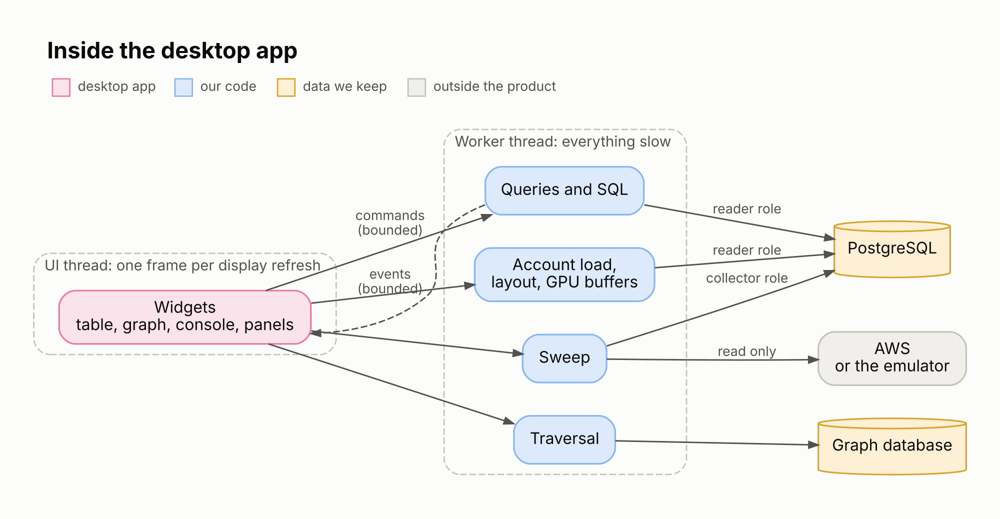
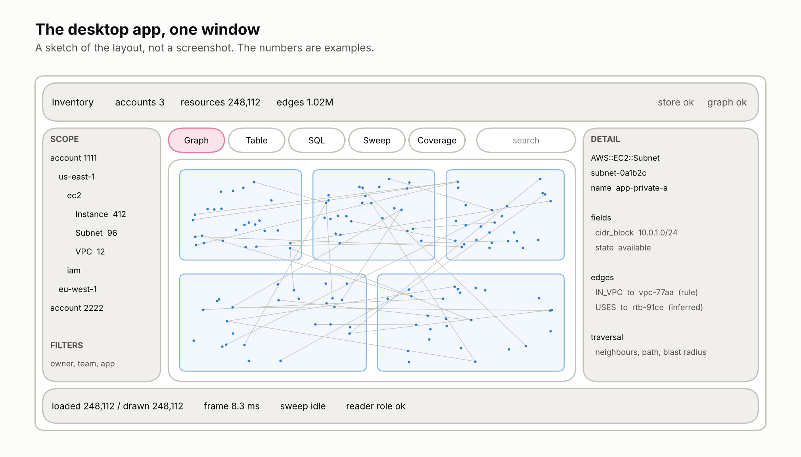

# Track D: sweep library and UI

> Status: Plan, 2026-11-15. Part of the [end-to-end milestone](README.md).
> Crates: a new sweep library crate, `cmdb-view`, `cmdb-ui`. Maps to ROADMAP
> M6.2 and M6.3, with V45 and V47 replacing parts of VISION 5.8. Makepad work
> follows the `makepad-2.0-*` skills.

This page is the one-page summary of track D. Its 34 steps are in
[build/STEPS_D.md](build/STEPS_D.md), and the step file wins where the two
differ. The app is specified in full in [MAKEPAD_UI.md](MAKEPAD_UI.md).

## Why

V47: whatever the CLI can do, the UI can do. V45: the UI renders the entire
account at 120 frames per second.

What the tree has today (`crates/cmdb-ui`):

- It reads the current store and FalkorDB on a background worker. That part of
  M6.2 and M6.3 is real, although START_HERE still says "synthetic fixture".
- The worker protocol has two commands, `Refresh` and `Expand`
  (`crates/cmdb-ui/src/worker/protocol.rs`). There is no sweep control and no SQL console.
- The table loads one page of 500 rows (`PAGE_LIMIT`).
- The graph holds at most 2,000 nodes and 4,000 edges (`crates/cmdb-ui/src/dag/graph.rs`) and
  shows the neighbourhood of one selected resource, which needs FalkorDB.
- `crates/cmdb-ui/src/dag/widget/paint.rs` walks every edge and node each frame and builds
  bezier and rectangle paths through `DrawVector`. That is fine at 2,000 nodes
  and cannot hold 120 fps on a whole account.
- There is no account, region, service hierarchy and no level of detail.

The collector now lives in `crates/sweep`, with generic `InventoryStore`
collection, caller-owned cancellation and bounded progress. CLI credential,
projection and signal wiring remains in `src/sweep_command/`.

## Packages

| ID | Work | Needs | Exit evidence |
| --- | --- | --- | --- |
| D1 | Sweep as a library. Move `src/sweep_runtime/` and the collection half of `src/sweep_command/` into a library crate. It exposes one entry that takes a configuration, a cancellation handle and a bounded channel of progress events (scopes finished, rows written, outcome counts). The CLI becomes a thin caller. | Coordinate with B3 | The existing `sweep_e2e` suite passes unchanged; no sweep logic remains in `src/`; Rust lines added and deleted are stated |
| D2 | Sweep control in the UI. New worker commands start, cancel and resume a sweep through the library, on the worker's runtime. A progress panel shows the events. The UI process still opens no listening socket. | D1 | One UI action sweeps the emulator; the counts shown equal SQL counts; cancel leaves a sweep that resume completes; exit test line X1 |
| D3 | SQL console in the UI. A text input runs one read-only statement through `cmdb-view` with the same bounds as the CLI and shows the rows. | C3 | The same statement returns the same rows in the CLI and the UI |
| D4 | Whole-account load from SQL. `cmdb-view` streams every node (identity, kind, account, region, name) and every edge in pages into compact arrays, with identities interned to integers. Rendering does not need the graph database; traversal still does (V46). | None | Load time and memory recorded for 250,000 nodes and 1,000,000 edges; the loaded counts equal SQL counts. `cmdb-bench generate` writes its own two-table copy of the schema and no edge rows today, so it first gains edge generation and creates its database through the real schema 14 code |
| D5 | Layout off the UI thread. A hierarchical layout (account, region, service, kind, resource, per V28) computed on the worker, incrementally, into flat position arrays. | D4 | Layout time recorded at the D4 size; the UI thread never waits on it for longer than one frame |
| D6 | Instanced renderer. Nodes and edges are drawn as instances whose positions are uploaded when the layout changes, not every frame. Pan and zoom are a transform, not a rebuild. Labels appear only above a zoom threshold; far zoom draws aggregates. A spatial grid answers picking. The 2,000 and 4,000 caps are replaced by a memory bound. | D5 | Frame times from D7 at the O14 size; selecting a node still opens its detail and neighbourhood |
| D7 | Frame-time harness. A scripted pan and zoom path that prints p50 and p99 frame time, with machine, GPU and window size. | D6 | The numbers are reproducible; exit test line X8 |
| D8 | Parity table. Every CLI command has a UI action or a written reason why not: sweep, sql, neighbors, path, findings, export, coverage. | D2, D3 | The table is in this directory and matches the tree |

## Added on 2026-11-18

The whole app is outlined in [MAKEPAD_UI.md](MAKEPAD_UI.md). The packages
below complete it; their steps are in [build/STEPS_D.md](build/STEPS_D.md).

| ID | Work | Exit evidence |
| --- | --- | --- |
| D6.0 | A spike on a machine with a GPU: retained instance blocks, a uniform update on a retained draw item, and a headless start, at the pinned Makepad revision | A report with numbers at 50,000 to 4,000,000 instances, or the fallback named |
| D7.3 | An unpaced throughput check for CI | A row labelled "unpaced, no display"; not evidence for X8 |
| D9 | The scope rail built from the data, search with fly-to, one filter for table and graph | No account, region or kind name is written in `ui.rs`; a seeded resource is found by ID, name and ARN |
| D10 | The table: paging by key past 500 rows, typed columns for the selected kind, server-side sorting | Every row is reachable; a kind's seeded value shows under its column |
| D11 | Detail and traversal: the whole record as a tree, edges with their source, neighbours, path and blast radius on the account view | No field of a seeded record is missing; the three traversals are visible; "graph unavailable" when it is |
| D12 | The coverage tab | Its totals equal the sweep's outcome counts; exit test line X3 is visible in the UI |
| D13 | Two database URLs and roles, checked and failing closed; a screen for every state | A writer URL is refused as a reader; no failure leaves an empty panel |
| D14 | The platform matrix; packaging after the milestone | A recorded row per platform |

Three packages above changed on the same day: D2 and D3 use separate
collector and reader connections; D6 is written against Makepad calls that
were read in the pinned source; D7 measures presented frames, GPU time and
UI-thread time, and X8 is restated for a 120 Hz display.

## Notes for the worker

- The frame budget at 120 fps is 8.3 ms. Anything proportional to the number
  of nodes must not run per frame on the UI thread.
- Measure before optimizing: D7 can be built against the current painter first,
  to record the baseline and the size at which it falls below 120 fps.
- The detail panel keeps reading the CBOR record for the selected resource.
- With the graph database down, tables, details, the SQL console, the sweep
  and the whole-account render still work. Traversal reports "graph
  unavailable", as today.
- V63: this crate is MIT like the rest. It may depend on the collector,
  store and SQL crates. Nothing may depend on it.

## Wave 0 implementation evidence (2026-11-22)

D1.1 now has separate `sweep` and adapter-inclusive `aws` features, with a
dependency-graph regression for each and an unconditional bounded IAM
trust-summary parser required by the current sweep. Build time, peak RSS and
binary sizes are recorded in [RUN_HERE](RUN_HERE.md#wave-0-feature-split-2026-11-22).
The measurements use `-j2` and warm caches, not the step's proposed `-j1`
clean comparison.

The ignored end-to-end suite uses the pinned, checksum-verified emulator and
Redis/FalkorDB. Its first run exposed a stale test-local 16 MiB catalog bound:
`compiled catalog exceeds its 16 MiB bound`. The E2E helper now reads with
the production `inventory_core::catalog::MAX_CATALOG_BYTES` bound (64 MiB),
without changing the generated catalog or production limits. The coordinator
must still run the workspace-wide all-target/all-feature gate after integration.

The rerun after that fix reached the sweep CLI, but both scenarios failed:
`sweep CLI exceeded its 60-second deadline` (0 passed, 2 failed, 135.34 s).
This remains an unresolved end-to-end blocker; no deadline was increased.

## Wave 1 library status (2026-11-23)

D1.2 and D1.3 are implemented. D1.4 is **HELD**, not complete: a coverage
probe adding `crates/sweep/src` and excluding nested `*_tests/` helpers found
88 violations across 35 sweep files, plus 730 findings outside the sweep.
The captured command output is `local://12542.log` in the implementation
session. The gate script remains unchanged; the coordinator will schedule
the sweep refactor separately to avoid overlapping the metrics work.
The existing ignored E2E timeout above remains unverified, and P1/P6
measurements await the benchmark lane. No completion or performance claim
is made for D1.4.
