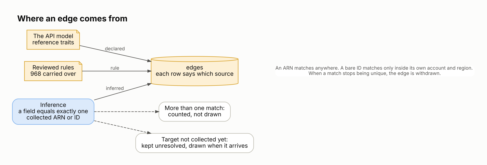
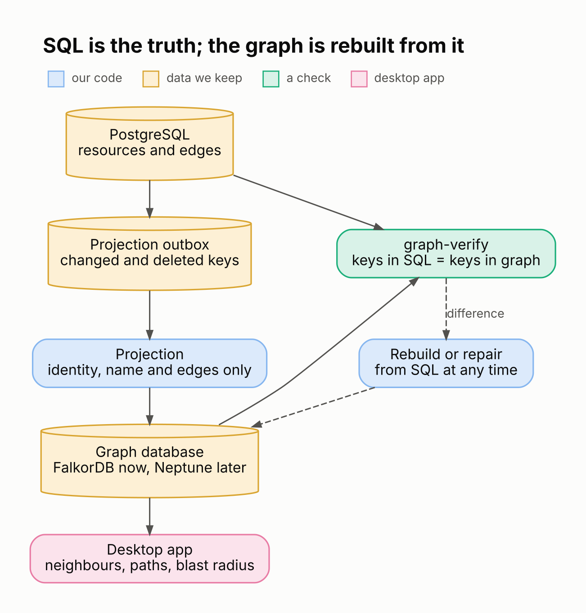

# Track E: relationships and graph

> Status: Plan, 2026-11-15. Part of the [end-to-end milestone](README.md).
> Crates: `inventory-engine` (edge extraction, projection), `cmdb-view` (graph
> queries). Maps to ROADMAP M3.7 and M6.1, with V46 amending V14.

This page is the one-page summary of track E. Its 13 steps are in
[build/STEPS_E.md](build/STEPS_E.md), and the step file wins where the two
differ. E4.3 (repairing the graph after the store lost commits) and the withdrawal of inferred edges in E1.2 were added after this page was first written, and so was E3.4, which
chooses the graph engine that ships by measurement (V60, V63).

## Why

A DAG of the whole account is only as good as its edges. Today
`catalog/kinds.tsv` has 42 relation rows (34 EC2, 5 RDS, 2 ELBv2, 1 Lambda)
and one of them is live, because only two EC2 kinds are swept:
`Subnet.VpcId` to `VPC.VpcId`. The 968 reviewed rules exist against Cloud
Control property paths and have not been remapped to API field paths.

V46 keeps a graph database required and adds Neptune later as an option, so
graph access needs one interface now.

## Packages

| ID | Work | Needs | Exit evidence |
| --- | --- | --- | --- |
| E1 | All three edge sources on for every kind (V15): declared by the model (VISION section 3 counts 534 reference traits and 200 ARN-reference traits, but the catalog compiler does not retain them today, `crates/catalog-tool/src/smithy/model/traits/retained.rs`, so keeping them is the first step), reviewed rule, and inferred where a field value exactly equals a collected resource's ARN or unique ID. Each edge carries its source. An ambiguous match is counted, not drawn. An unresolved reference becomes an edge when its target is collected later. | A2 | Fixture tests for each source and for the ambiguous and late-target cases (the M3.7 evidence); the sweep summary prints edge counts by source |
| E2 | Remap the 968 rules from CloudFormation property paths to API field paths. A tool reports mapped and unmapped per type; an unmapped rule keeps its reason. | A2 | The report; every target of a mapped rule resolves to a kind in `catalog/kinds.tsv`; for pairs the emulator can seed, the rule yields the seeded edge |
| E3 | Graph interface (V46). Projection and traversal (neighbors, path, blast radius) go through one trait. Cypher text lives in one module and stays inside the openCypher subset that FalkorDB and Neptune share. FalkorDB is the only implementation now. | None | The existing FalkorDB tests pass through the trait; no Cypher string exists outside the one module |
| E4 | Projection at scale. Measure the pending-projection drain and a full rebuild at 250,000 nodes and 1,000,000 edges from `cmdb-bench`. | E3 | Recorded throughput and rebuild time; a rebuilt graph equals the incrementally updated one (the M6.1 evidence) |
| E5 | Graph equals SQL. A command compares node and edge keys between SQL and the graph database and prints the difference. | E3 | Zero difference after a sweep and after a re-sweep with one seeded change; exit test line X5 |

## Notes for the worker

- SQL is the source of truth. The graph can always be rebuilt from it.
- The graph holds identity, kind, account, region, name and edges. Full
  records stay in SQL.
- The UI draws the whole account from SQL (D4). The graph database answers
  traversal questions and returns keys, whose details come from SQL.
- With the graph database stopped, a sweep completes and the outbox drains
  when it returns. `tests/sweep_e2e` already proves that for the EC2 slice.
