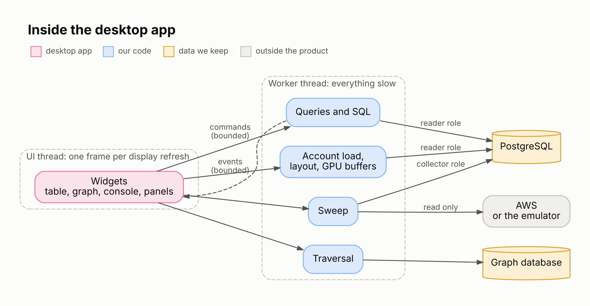
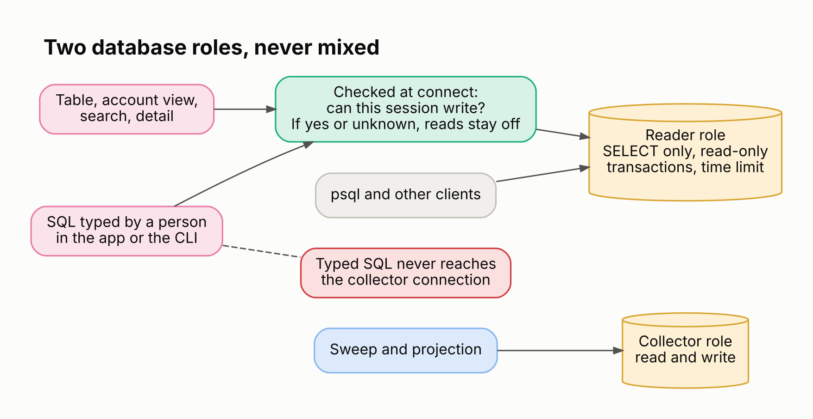
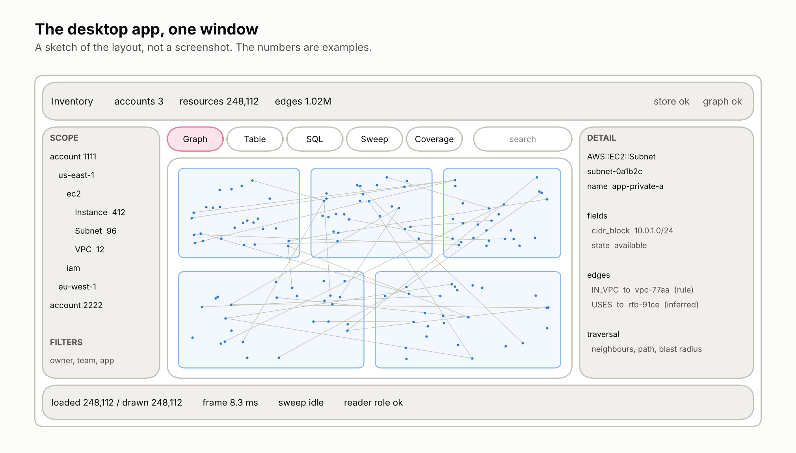
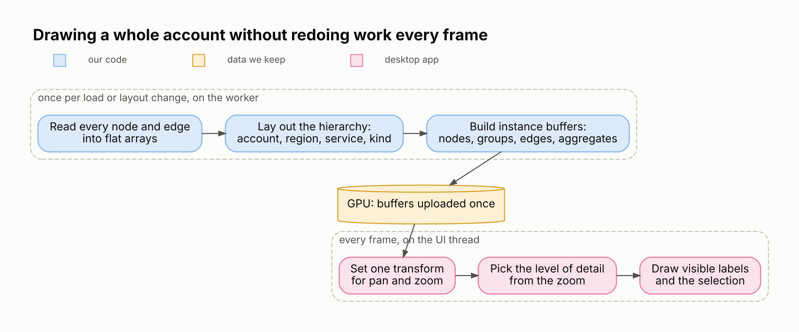
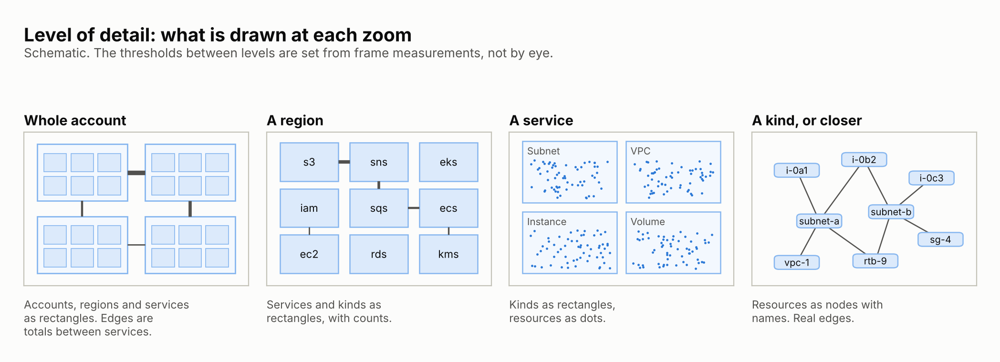
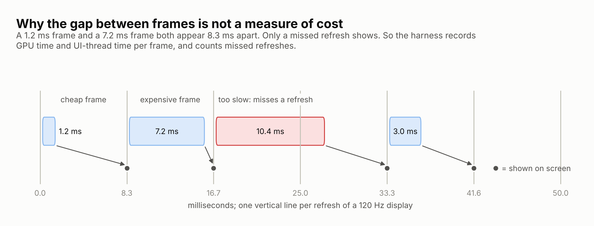

# The Makepad UI, in full

> Status: Design outline, 2026-11-18. It describes the whole desktop app: what
> exists, what it becomes, how it draws an entire account, how frame rate is
> measured, and which step builds each part. The Makepad facts below were read
> from the pinned source (`makepad-widgets` at revision `506ec05`, the one in
> `crates/cmdb-ui/Cargo.toml`); file paths under "Makepad:" are in that
> checkout. Nothing here has been built or run: this machine has no display.
> Steps are in [build/STEPS_D.md](build/STEPS_D.md).

## 1. What the app is for

One desktop window that can do everything the CLI can (V47) and shows the
whole account as a graph at 120 frames per second (V45):

- start, watch, cancel and resume a sweep;
- browse every resource in a table, with the typed columns of its kind;
- run SQL;
- see the entire account as a DAG and move through it by account, region,
  service and kind;
- open any resource: its record, its edges, its neighbours, paths and blast
  radius;
- see what was not collected and why.

It is MIT like everything else (V63). It depends on the collector, store
and SQL crates, and nothing depends on it.

## 2. What exists today

`crates/cmdb-ui`, 4,599 lines of Rust in 31 files. Paths in this table are
inside that crate unless they name another.

| Part | Files | State |
| --- | --- | --- |
| Window and widget tree | `src/ui.rs` (278 lines), `chrome.rs`, `templates.rs` | One window, 1440 by 900. Header with a summary line and a status chip. Left rail 184 wide. Center with Table and Graph tabs and a search input. Detail panel on the right |
| Left rail | `src/ui.rs` | Filter chips written into the widget tree by hand: accounts ("All", "prod" and two more), two regions, four kinds with count labels (`ec2_count`, `s3_count`, `rds_count`, `lambda_count`), and three exact-match text inputs. It is not built from the data |
| App state and actions | `src/app.rs` (304 lines, over the limit), `app/actions.rs` | Holds the worker handle and a `SignalToUI` |
| Table | `src/table.rs` (300 lines) | A `PortalList` over one page of 500 rows (`PAGE_LIMIT`); no second page |
| Data model | `src/data/mod.rs` | `Row`, `Edge`, `Graph`, `Filter`, `Counts`, `Data` |
| Worker | `src/worker.rs`, `worker/` | A thread with its own tokio runtime. Commands come in on a bounded tokio channel, events go out on a bounded `std::sync::mpsc` channel, and `SignalToUI` wakes the UI. Two commands: `Refresh` and `Expand` |
| Graph model | `src/dag/graph.rs`, `builder.rs` | `DagGraph` of at most 2,000 nodes and 4,000 edges (`MAX_NODES`, `MAX_EDGES`) |
| Layout | `src/dag/layout/` | A layered layout. `DagView::set_dag` calls `DagLayout::compute` on the UI thread |
| Graph widget | `src/dag/widget/mod.rs`, `paint.rs`, `input.rs` | `DagView` holds `DrawColor`, `DrawVector` and `DrawText`. `paint.rs` walks every edge and node on every draw and builds bezier and rectangle paths; labels are capped at 200 |
| View transform | `src/dag/view.rs` | Pan and zoom applied on the CPU to every point each frame |
| Reads | `crates/cmdb-view` | Its own queries against the current store, and FalkorDB for the neighbourhood of one selected resource |

What it cannot do: start a sweep, run SQL, show more than 500 rows, show more
than one neighbourhood, show an account, work without the graph database for
anything graph-shaped.

## 3. Makepad facts this design rests on

Read from the pinned source. "Verified" means the code says so; none of it
was executed here.

| Fact | Where (Makepad:) | Used for |
| --- | --- | --- |
| A block of instance data can be built on any thread and never copied on the UI thread: `RetainedInstances::new(slots, Arc<[f32]>)` | `platform/src/retained_instances.rs` | The worker builds node and edge buffers |
| A draw item can bind such a block without copying it into a draw vector, and re-recording the same block uploads nothing: `CxDraw::add_retained_instances(&draw_vars, &block)` | `draw/src/draw_list_2d.rs` | Positions go to the GPU once per layout, not once per frame |
| A retained draw item can be kept with a count of zero while its level of detail is inactive, and brought back without a copy: `add_retained_instances_count` | same | Switching between edge levels |
| A uniform on one retained draw item can be changed without touching its instances: `Cx::set_draw_item_uniform(list, item, name, value)` | `platform/src/cx_api.rs` | Pan and zoom as a transform |
| `add_retained_instances_count` asserts that the block's stride equals the shader's instance slots, and that the count is not above the block's | `draw/src/draw_list_2d.rs` | A mismatch panics. The stride is checked before the call, in our code |
| Per-frame instancing also exists: `begin_many_instances` and `end_many_instances` on `DrawQuad` | `draw/src/shader/draw_quad.rs` | Small dynamic layers: selection, hover, the highlighted path |
| With a window on a display, a frame is drawn once per vsync after a frame request; an idle app draws nothing | `platform/src/os/hal/event_loop.rs` | Frame intervals are multiples of the display's refresh period. 120 frames per second needs a 120 Hz display |
| Whole-frame GPU time is available: `gpu_frame_timer::set_enabled`, `take_frames`, giving `busy_ms` and a per-pass breakdown | `platform/src/gpu_frame_timer.rs` | GPU cost per frame in the harness |
| A presentation timeline with a `Presented` stage is available as trace topic `present`; `MAKEPAD_TRACE=frames` prints a frame-clock histogram | `platform/src/present_trace.rs`, `frame_trace.rs`, `log.rs` | Presented-frame evidence |
| A per-frame monitor with app-defined CPU channels and a `PerfGraph` widget exists: `cx.perf_monitor_channel`, `cx.perf_monitor_add` | `platform/src/perf_monitor.rs`, `widgets/core/src/perf_graph.rs` | A live overlay, and our own channels (layout apply, label build) |
| GPU backends: Metal, Direct3D 11, Vulkan, OpenGL, WebGL, headless. Linux defaults to desktop Vulkan and macOS to Metal; `MAKEPAD_HAL_BACKEND=headless\|offscreen\|metal\|vulkan` selects one | `platform/src/cx.rs`, `platform/src/os/hal/event_loop.rs` | The platform matrix, and a run without a display |
| Without a display the loop beats 60 times a second, or as fast as the GPU completes frames for a hidden batch renderer (`MAKEPAD_HIDE_WINDOWS` with `MAKEPAD_PAINT_INTERVAL`) | `platform/src/os/hal/event_loop.rs` | A throughput regression check in CI. It is not evidence for 120 fps |

Not verified, and the first renderer step (D6.0) exists to settle them:

- how a shader written in this app declares its instance layout so that the
  stride of our block equals the shader's instance slots;
- how a draw item's list and index are obtained for `set_draw_item_uniform`;
- that a block of 250,000 instances, and one of 1,000,000, is accepted on an
  integrated GPU. A newer path, `Cx::publish_instances`, charges blocks to a
  device memory envelope and can refuse with `PublishError::NoRoom`; its
  module says nothing is drawn through it yet at this revision;
- that the app starts under the headless or offscreen backend;
- the default backend on Windows;
- that no Makepad example at this revision uses retained instances outside
  `draw_list_2d.rs`. There is no working example to copy.

## 4. Threads and data flow



```mermaid
flowchart LR
    subgraph UI thread, paced by the display
        W[Widgets] -->|Command, bounded| Q[(command channel)]
        S[SignalToUI] --> W
    end
    subgraph Worker thread, tokio runtime
        Q --> R[Runner]
        R --> T1[Table and SQL tasks]
        R --> T2[Account load]
        R --> T3[Layout and instance build]
        R --> T4[Sweep task]
        R --> T5[Traversal]
    end
    T1 & T2 & T3 & T4 & T5 -->|WorkerEvent, bounded| E[(event channel)]
    E --> S
    T1 & T2 -->|reader role| PG[(PostgreSQL)]
    T4 -->|collector role| PG
    T4 --> AWS[AWS or emulator]
    T5 --> G[(Graph database)]
```

Rules:

- The UI thread never waits on a store, the graph database, AWS, a layout or
  a buffer build. Its work per frame does not grow with the number of nodes.
- Every command carries a revision. The newest revision wins; a result for an
  older one is dropped. A newer load cancels an older one.
- Large results cross to the UI as `Arc`s of immutable data: the account
  arrays, the layout, the instance blocks. Nothing large is copied on the UI
  thread.
- Both channels are bounded. A terminal event (finished, failed, cancelled)
  is never dropped; progress events may be.
- The UI process opens no listening socket.
- One sweep at a time. A second start is refused.

## 5. Connections and roles



Finding 2 of the 2026-11-18 review is right: the plan had the sweep and the
SQL console on one database URL. A read-only account cannot sweep, and a
writer account makes typed-in SQL dangerous.

| Connection | Role | Used by | Rights |
| --- | --- | --- | --- |
| Collector | `inventory_collector` | The sweep task and the projection, nothing else | Read and write in the inventory schema |
| Reader | `inventory_reader` | Table, account load, detail, search, SQL console, `aws-inventory sql`, external clients | `SELECT` only, read-only transactions, a statement timeout |
| Graph | graph database credentials | Projection (write), traversal (read) | As the graph database allows |

- The app takes two database URLs. With only a reader URL it runs as a
  viewer: the sweep panel is disabled and says why.
- At start, the reader connection is checked: the app asks the server whether
  the session can write. If it can, or the check cannot be made, the SQL
  console and every external-facing read stay disabled. It fails closed.
- Typed-in SQL never reaches the collector connection, whatever the UI state.
- URLs are not accepted on the command line of a release build, where other
  users of the machine can read them. They come from the environment or a
  settings file with owner-only permissions. Where secrets are finally kept
  (an operating-system keychain) is an owner decision; see section 13.

## 6. The window



```
+----------------------------------------------------------------------------+
| Inventory   accounts 3  resources 248,112  edges 1.02M   [store] [graph]   |
+-----------+----------------------------------------------------+-----------+
| SCOPE     | Graph | Table | SQL | Sweep | Coverage     [search]| DETAIL    |
| account   |                                                    | kind, id  |
|  region   |                                                    | name      |
|   service |            the selected view                       | fields    |
|    kind   |                                                    | edges     |
|           |                                                    | traversal |
| FILTERS   |                                                    |           |
+-----------+----------------------------------------------------+-----------+
| loaded 248,112 / drawn 248,112   frame 8.3 ms   sweep idle   reader role ok |
+----------------------------------------------------------------------------+
```

| Area | Content | Step |
| --- | --- | --- |
| Header | Totals from the store, a chip for the store connection and one for the graph database | D13.2 |
| Scope rail | A tree built from the data: account, region, service, kind, each with its count. Selecting a level filters the table and frames the graph on that group | D9.1 |
| Filters | Exact-match inputs that exist today, plus derived owner, team and application once tags exist (G3) | D9.3 |
| Search | By ID, name or ARN. A bounded query through the reader; choosing a result selects the resource and moves the graph to it | D9.2 |
| Graph tab | The whole account (section 7) | D4 to D6 |
| Table tab | Every row, paged by key, with the typed columns of the selected kind | D10 |
| SQL tab | One statement, bounded, read-only, with the result in the table widget | D3 |
| Sweep tab | Start, cancel, resume; scopes, rows, writes, outcome counts | D2 |
| Coverage tab | What was complete, partial, denied, unsupported, failed or throttled, by account, region and service; and kinds that are implemented but not verified | D12.1 |
| Detail | The selected resource: identity, name, decoded record as a field tree, edges in and out with their source (model, rule or inferred) | D11.1 |
| Traversal | Neighbours to a depth, the path between two selections, blast radius; shown as a highlight on the graph. Says "graph unavailable" when it is | D11.2 |
| Status line | Loaded and drawn counts (nothing is dropped silently), last frame time, sweep state, which role each connection has | D13.2 |

Every state has a designed screen: store unreachable, graph database
unreachable, reader role not established, empty account, account larger than
the load limits, sweep failed, statement refused, statement cut at its bound.

## 7. Drawing a whole account



### 7.1 Data

`cmdb-view` reads every node and edge inside one snapshot into flat arrays
with identities interned to integers (`AccountGraph`, D4.2). At 250,000 nodes
and 1,000,000 edges the arrays are a few tens of megabytes; the exact figure
is recorded by D4.2, not assumed.

### 7.2 Layout

The layout is the hierarchy of V28: account, region, service, kind, resource.
Resources of one kind sit in a grid; kinds are packed into their service,
services into their region, regions into their account. It is a pure function
of the account arrays, computed on the worker, account by account, so the
first account can be shown before the last is placed (D5).

Edges are not routed. An edge is a straight segment between two node
positions. At 1,000,000 edges, routing is neither affordable nor readable.

### 7.3 Buffers

The worker turns the layout into instance blocks and hands them to the UI:

| Block | One instance is | Rebuilt when |
| --- | --- | --- |
| Nodes | position, size, color index, state bits | The layout changes |
| Group rectangles, one block per level | rectangle, color index | The layout changes |
| Edges at resource level | two endpoints, relation color index | The layout changes |
| Aggregated edges, one block per level | two group centers, width from the count | The layout changes |
| Selection, hover, highlighted path | a handful of instances | Every time the selection changes; drawn with per-frame instancing |

The stride of each block is fixed in one place and checked against the
shader's instance slots before any draw call, because Makepad asserts on a
mismatch.

### 7.4 Per frame

On pan or zoom the app sets one transform uniform on each retained draw item
and asks for a redraw. It does not touch a buffer and does not walk the
nodes. What a frame does on the CPU:

1. choose the level of detail from the zoom: which group level is drawn as
   rectangles, whether resource nodes are drawn, which edge block is active
   (the others stay bound with a count of zero);
2. choose labels: group labels for groups larger than a threshold on screen,
   resource labels only when fewer than a measured number are in view;
3. draw the small dynamic layers.

Cost per frame is bounded by the number of visible groups and labels, not by
the size of the account.

### 7.5 Level of detail



| Zoom | Nodes | Edges | Labels |
| --- | --- | --- | --- |
| Whole account | Account, region and service rectangles | Aggregates between services | Accounts, regions |
| A region | Service and kind rectangles | Aggregates between kinds | Services, kinds with counts |
| A service | Kind rectangles, resources as dots | Aggregates between kinds, or resource edges if few | Kinds |
| A kind or closer | Resources as nodes | Resource edges | Names, capped by measurement |

The thresholds are numbers set from the frame harness, not from taste. A
million edges on screen at once will not hold the budget on a laptop's
built-in GPU by any draw path; aggregation is what makes the target reachable.

### 7.6 Picking and interaction

- A uniform grid over the layout, built on the worker, answers a click or
  hover in a bounded number of comparisons (D6.4).
- Drag pans. Wheel and pinch zoom around the cursor. A key fits the view.
  Double-click on a group frames it.
- Selecting a resource fills the detail panel from the store. Traversal
  results come from the graph database as keys and are drawn as a highlight
  layer over the same view.
- Selecting in the table or the search selects in the graph, and the other
  way round.

### 7.7 Memory

Budgets are in bytes as well as counts. The account load has `LoadLimits`
(nodes, edges, bytes). The instance blocks get their own bound, stated in
bytes for CPU and for GPU, and an account over a bound is refused with the
bound named. Nothing is truncated quietly.

## 8. Frame rate: what "120 fps" means and how it is measured



Finding from the review, and from the Makepad source: with a window on a
display, Makepad draws once per vsync. So:

- On a 60 Hz display no frame interval can be under 16.7 ms. 120 frames per
  second can only be shown on a display that refreshes at 120 Hz or more.
- The interval between draw events is not a measure of cost. On a 120 Hz
  display it reads 8.3 ms for a frame that took 1 ms and for one that took
  8 ms, and 16.7 ms for one that missed.

What the harness (D7) records for every run:

| Measure | Source |
| --- | --- |
| Display refresh rate, resolution and scale factor; window size | The platform, and stated by the operator |
| GPU, driver, backend (Metal, Vulkan, Direct3D 11, OpenGL) | `GpuBackend`, system information |
| Presented frames over the scripted path, and missed ones (an interval over 1.5 refresh periods) | The `present` trace |
| GPU busy time per frame, p50, p95, p99 | `gpu_frame_timer` |
| CPU time per frame on the UI thread, and our own channels (level of detail, labels, uniform updates) | `perf_monitor` |
| Node, edge, visible-label and draw-item counts along the path | The app |
| Vsync on or off, power source, thermal state where known | Stated by the operator |

X8 is restated in the README: on a 120 Hz display at a stated resolution and
on stated hardware, over the scripted path at the stated size, no more than
1% of frames are missed, and p99 GPU busy time and p99 UI-thread time each
leave room inside the 8.3 ms period. The hardware is decided (V56, V59): a MacBook Pro with the M3 Pro chip,
whose built-in display refreshes at up to 120 Hz, and a machine with an RTX
3070 class GPU, which needs a monitor of 120 Hz or more. The size (250,000
nodes and 1,000,000 edges) is still the unconfirmed default O14, and with
whole organizations in scope (V64) it is open whether that is one account
or everything at once. Which 3070, and whether both machines must pass, are
also open; see [OPEN_QUESTIONS.md](OPEN_QUESTIONS.md).

A second, different check runs in CI without a display: the hidden batch
renderer mode gives frames per second unpaced by vsync. It catches a
regression. It is not evidence for X8.

## 9. The other tabs

**Table (D10).** Pages by key through the reader, both directions, with a
count. With a kind selected, the columns are that kind's typed columns from
the catalog; with none, the common columns. Sorting is by key or by one typed
column, done by the server. The 500-row limit goes.

**SQL (D3).** One statement at a time, on the reader connection, inside a
read-only transaction with a statement timeout and row and byte bounds. The
result is shown in the table widget with the truncation notice. History of
statements is kept in memory only.

**Sweep (D2).** Uses the collector connection. Start, cancel, resume. While
it runs: scopes done and pending, rows, resource writes, and the six outcome
counts, refreshed at most ten times a second. The emulator is seeded by the
harness, not by the app: the product has no write capability against AWS.

**Coverage (D12).** Reads `scope_outcomes` and the catalog. Per account,
region and service: complete, partial, inaccessible, unsupported, failed,
throttled. Kinds the emulator could not verify are listed by name.

## 10. Tests

| Level | What | Runs where |
| --- | --- | --- |
| Pure model | Layout, level-of-detail selection, label choice, grid picking, instance block contents and stride, panel and connection state machines | Anywhere, in the gate |
| Worker | Commands and events against the emulator and a test database: sweep, cancel, resume, SQL, account load, layout, traversal | Anywhere with PostgreSQL; ignored tests |
| Headless start | The app starts, draws one frame and exits under the headless backend | CI, if D6.0 shows it works |
| Frame harness | Section 8 | The owner's two test machines (V56), each on a 120 Hz display |

`crates/cmdb-ui/src` is under the 300-line and 25-line guards. `app.rs` is
over the first today and `ui.rs` is close; both are split before they grow
(A0.4, D13.2).

## 11. Platforms and packaging

| Platform | Backend | State |
| --- | --- | --- |
| Linux | Vulkan (Makepad's default) | The development platform |
| macOS | Metal (Makepad's default) | A target (V58). The frame test runs on a MacBook Pro with the M3 Pro chip, whose display refreshes at up to 120 Hz (V59) |
| Windows | | Not a target (V58) |

Packaging, signing and updates are after the milestone (D14). There is no
SSO to start (V61). The
platform matrix itself (the app builds and starts on each) is recorded during
it.

## 12. Budgets

| Number | Target | Measured by |
| --- | --- | --- |
| P12 account load | Recorded, then held | `cmdb-bench load` |
| P13 layout, and buffer build | Recorded, then held; first account visible before the last is placed | `cmdb-bench layout` |
| P14 frames | Section 8 | `cmdb-ui --frame-harness` |
| UI-thread work per frame | Independent of account size | `perf_monitor` channels |
| Longest UI-thread stall during load, layout or a sweep | Under one refresh period | The harness, during those phases |
| Bytes held for the account, CPU and GPU | Recorded, bounded | The app's own accounting |

## 13. Decisions still with the owner

| ID | Question | Default used |
| --- | --- | --- |
| O14 | Size of the graph for the frame target. The hardware is decided: a MacBook Pro with the M3 Pro chip and an RTX 3070 class machine (V56, V59) | 250,000 nodes and 1,000,000 edges |
| O20 | Where connection settings and secrets are kept | Environment or an owner-only settings file now; an operating-system keychain later |
| O21 | Is anything edited in the UI (owner mappings, saved queries) | No. Read, sweep and query only |

## 14. Which step builds what

| Package | What | Steps |
| --- | --- | --- |
| D2 | Sweep control | D2.1, D2.2 |
| D3 | SQL console | D3.1, D3.2 |
| D4 | Whole-account load | D4.1 to D4.3 |
| D5 | Layout on the worker | D5.1, D5.2 |
| D6 | Renderer | D6.0 (spike), D6.1 to D6.4 |
| D7 | Frame measurement | D7.1 to D7.3 |
| D8 | CLI parity | D8.1 |
| D9 | Scope rail, search, filters | D9.1 to D9.3 |
| D10 | Table | D10.1, D10.2 |
| D11 | Detail and traversal | D11.1, D11.2 |
| D12 | Coverage | D12.1 |
| D13 | Connections, roles, states | D13.1, D13.2 |
| D14 | Platforms and packaging | D14.1, D14.2 |
