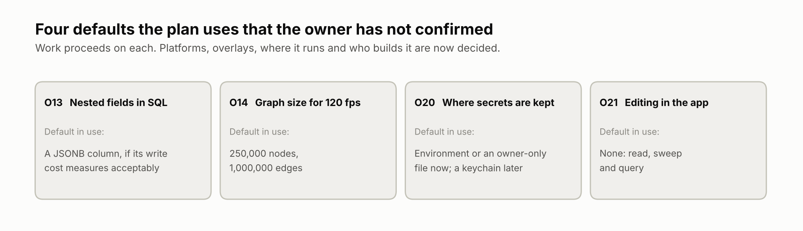

# Open questions

> Status: 2026-11-22. What the design has still not been told, after the
> owner's answers of 2026-11-21 and 2026-11-22. Section 1 is decided and is
> here only so a reader can see what is settled. Section 2 has defaults the
> plan is using. Sections 3 and 4 have no default. Section 5 is what was
> written from reading and has not been run.

## 1. Answered

| Question | Answer | Decision |
| --- | --- | --- |
| Where does version 1 run | One person's laptop, macOS or Linux | V54, V58 |
| Who builds it | The owner, with agents | V55 |
| What is the frame test run on | A MacBook Pro with the M3 Pro chip, and an RTX 3070 class machine | V56, V59 |
| Does the graph engine ship with it | Yes, inside the product | V57, V60 |
| Is there SSO | Not to start | V61 |
| What is it called | `aws-inventory`, for now | V62 |
| What is open source | All of it, MIT. There is no closed part | V63 |
| What does "everything" mean | Every resource of every service, in every account of an organization that gives access | V64 |
| How fresh | One sweep a day | V65 |
| Which PostgreSQL | PostgreSQL 18, pinned 18.7 | V66 |
| May overlays be generated without a review of each | Yes | V67 |
| How big an organization | Up to 10,000 accounts, reached in stages | V69 |
| One account or the whole organization on screen | The whole organization, ideally; what is handled grows in stages | V70 |
| Is a graph database still required if our own index is faster | Yes | V71 |
| Existing repository or an empty one | The existing one, adapted as it goes | V72 |
| How long may a sweep take | As fast as AWS allows; no window | V73 |
| Which laptop must 10,000 accounts fit on | Not a concern for now; the ladder reports | V74 |
| How the read-only role reaches every account | Not a concern for now; access is assumed | V75 |
| How far to design for | Massive scale, from the start | V76 |

Three of these were read from short answers, and the owner should say if a
reading is wrong: "we can exact overlays" was read as V67; "M3 Pro laptop
version" was read as the Mac only, leaving the RTX 3070 machine
undescribed; and "ideally the entire organizations, we will have to scale
the resources as we go" was read as V70: the whole organization on screen
as aggregates, with individual resources loaded for what is in view.

## 2. Defaults in use that the owner has not confirmed

| ID | Question | Default in use | If the answer is different |
| --- | --- | --- | --- |
| O13 | Are nested fields (lists and maps) exposed to SQL as one JSONB column per table? | Yes, if the write cost measures acceptably | Without it, SQL users can filter on scalar fields only. The alternative is child tables per list, which is far more schema |
| O14 | How many individual resources must draw at 120 frames a second at once? | 250,000 nodes, 1,000,000 edges, with the rest of the organization drawn as aggregates | If every resource of every account must be interactive at the same moment, the app's design (S1.6) is not enough |
| O20 | Where are connection settings and secrets kept? | Environment or an owner-only file now; a keychain later | A keychain per platform is extra work in the app before release |
| O21 | Is anything edited in the app? | No: read, sweep and query | Saved queries, owner mappings or annotations each need storage and a place in the data model |
| O22 | At massive scale, may a scope that has stayed empty be listed weekly instead of daily? | No: everything, every sweep. The weekly cadence is built and left off | It is the first lever if a full sweep of everything takes too long. Turning it on means a resource created in a long-empty service can go unseen for up to a week |

The three exit-test lines an outside review reworded (X1, X4, X8) are also
still waiting for the owner to accept or reject; see
[DECISIONS.md](DECISIONS.md) section 5.

## 3. Questions the new answers raise

| # | Question | Why it matters |
| --- | --- | --- |
| U10 | Roughly how many resources does an account hold, on average and at the largest? | It multiplies the store, the graph and the sweep. Nothing in the plan assumes a number, and nothing waits on it: the bench organization (S1.1) takes it as a setting |
| U4 | Which graph engine ships? | FalkorDB's licence (SSPLv1) sits badly with an all-MIT product that includes it. Step E3.4 measures the alternatives; the owner chooses, and a lawyer should look at the FalkorDB option if it stays |
| U6 | Is the RTX 3070 a desktop card or a laptop one, does it have a monitor of 120 Hz or more, and must **both** machines pass X8? | The frame numbers are only meaningful with the machine stated, and the weaker machine sets the level-of-detail thresholds |
| U7 | With SSO and running in AWS out, what else is in version 1 beyond the milestone and the release gate: tags and ownership (package G), the head-to-head (J1)? | The plan has these after the milestone and does not say which version 1 needs |
| U8 | When does the repository become public? | Everything is MIT but the repository is private. The release gate assumes a release; it does not say when the source opens |

## 4. Questions with no default

| # | Question | Blocks |
| --- | --- | --- |
| Q2 | Who is the first organization to run it on, and how many accounts does it have? | Which rung of the ladder gets live evidence, and the real-account run |
| Q7 | Which real AWS account or organization may be used for the first live run, and with what role? | J2.1 and release-gate line R10 |
| Q8 | Which versions of CloudQuery, Steampipe and Cartography are compared, and is publishing a comparison acceptable under their licences? | B9.1, J1.1 |
| Q9 | Are AWS-managed resources (AWS-managed policies, service-linked roles, default VPCs) and resources shared in from outside the organization collected like any other? "Every single resource" says yes, and the plan now assumes yes | How noisy the tables and the graph are; whether they need a label so they can be filtered |
| Q10 | Are opt-in regions swept when enabled? The plan sweeps every enabled region | The planner's region discovery |
| Q15 | Is there a date for the milestone or for version 1, and how many agents work in parallel? | The plan has no durations. A date would turn the waves into a schedule and force cuts |
| Q17 | When is the mutation-testing gate restored? It is suspended (V50) | The landing rule for every step |
| Q18 | How technical are the cofounders reading this? [OVERVIEW.md](OVERVIEW.md) assumes no code; everything else assumes an engineer | Whether a shorter summary or a deck is also wanted |

## 5. Written from reading, not run

These statements in the plan come from reading source or documentation and
have not been executed. Each is marked "not verified" where it appears.

| Area | What is not verified | Where it gets settled |
| --- | --- | --- |
| PostgreSQL driver | That the pinned `sqlx` revision builds with its PostgreSQL feature, and that it offers COPY | C6.1, C6.7 |
| PostgreSQL in a container | The container path and image; the machine used had a Docker client and no daemon, so only a native server was run | C6.2 |
| Wide tables | That a row with about 1,000 non-null 8-byte columns fits; the limit was computed, not tested | C1.2 |
| Thousands of tables | Schema creation time and lock usage with one table per kind | C6.3 |
| Makepad instancing | That retained GPU instances can be drawn from this app at the pinned revision; the API was read, and no example in the pinned tree uses it | D6.0, which exists to find out before the renderer is built |
| 120 frames a second | Never measured at any size | D7 |
| The emulator | How many of the 436 services it actually serves | A5 |
| PostgreSQL 18 | That the pinned driver, the container image and the plan's SQL work on 18.7 | C6.1, C6.2 |
| The graph candidates | The Rust API, query coverage and stability of Grafeo and LadybugDB; any claim that one is faster | E3.4 |
| The other tools | That CloudQuery, Steampipe and Cartography can be pointed at the emulator | B9.1 |
| The rate targets | That the adaptive rate settles within the stated margin of a limit | B2.3 |
| Every speed gain | No speed step has a measured number; the reasons the tree is slow were read from the code | B0 and B5 |

## 6. What would change the plan most

In order of how much work moves:

1. **U4**, the graph engine.
2. **O22**, if everything need not be listed every sweep.
3. **Q15**, any fixed date.
4. **U7**, what version 1 contains.
