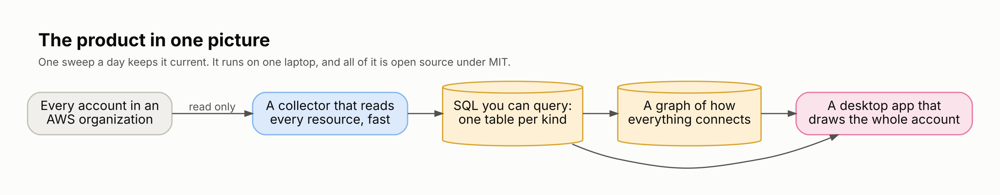
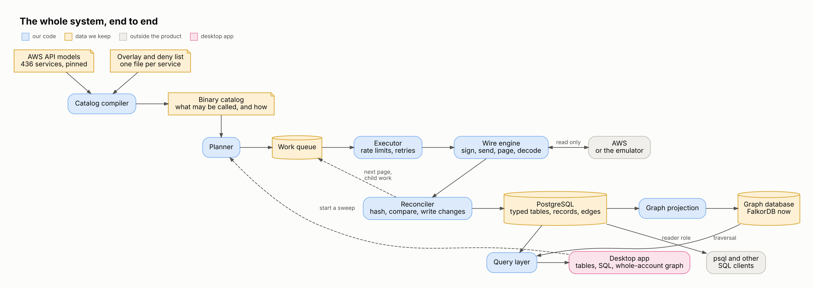
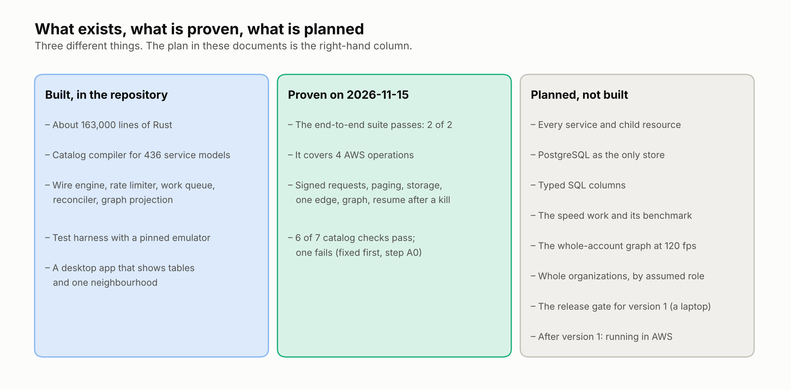
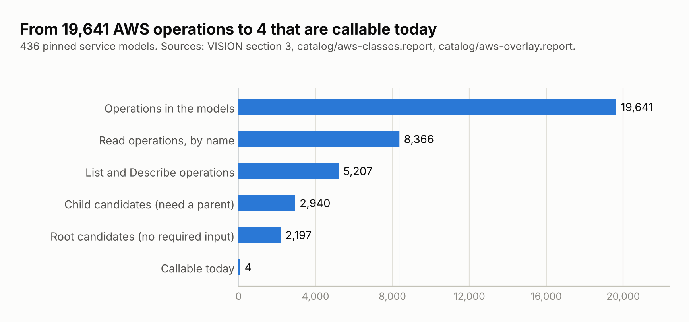
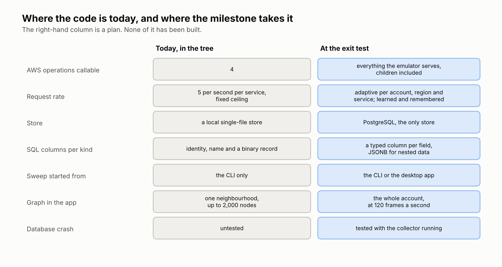
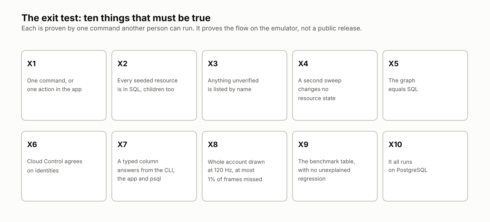
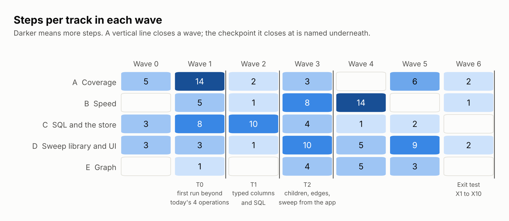
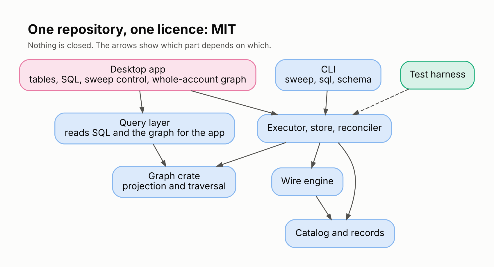
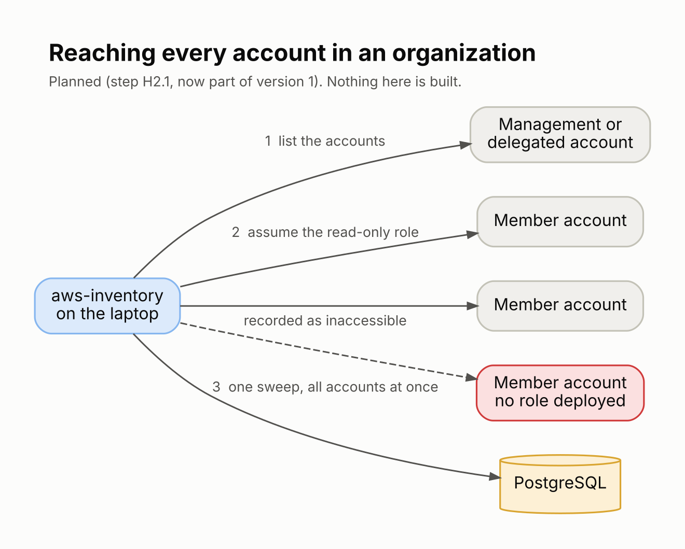

# Overview

> Status: Design summary, 2026-11-22. Written for a cofounder who has not
> read the code. It describes a plan. Where something is already built or
> already measured, it says so; everything else is not built yet.

## What it is

`aws-inventory` (the name for now) reads everything in every AWS account a
company owns and turns it into two things people can use:

1. **SQL tables.** One table per kind of AWS resource (`aws_ec2_instance`,
   `aws_iam_role`, and so on), in PostgreSQL. Anyone who knows SQL can ask
   "which load balancers have no targets" or "which roles can be assumed
   from outside the organization".
2. **A picture.** A desktop app that draws the whole account as a graph of
   connected resources, and stays smooth while you move around in it.

It only reads. It never changes anything in AWS, and it never reads the
contents of what it finds (objects in buckets, secret values, messages in
queues) or makes calls that cost money.

## Who it is for

Teams that run a lot of AWS and cannot answer simple questions about it
quickly: platform and infrastructure engineers, security teams, and whoever
gets asked "what do we actually have, and what is connected to what".

## Why build it

Tools that do the SQL half already exist. CloudQuery and Steampipe put AWS
into SQL; Cartography puts it into a graph. The bet here is on three
differences:

| Difference | What it means |
| --- | --- |
| Speed | Collect a whole organization as fast as AWS allows, from one laptop, using as little of it as possible, and re-collect an unchanged organization while writing almost nothing. The aim is the fastest tool on the market for a first sweep and a repeat sweep |
| Completeness | Every resource, including the children that only exist under a parent (the rules of a listener, the policies of a role), not just the top-level types |
| The graph | The whole account drawn at once at 120 frames a second, with SQL and graph traversal in the same app |

**None of the three is proven yet.** No head-to-head run against the other
tools has been done. The plan builds the benchmark before the speed work so
that every claim is a measured number, and the rule is that "fastest" is
only said after running all the tools on the same data on the same machine.

## How it works, in six sentences

1. AWS publishes a machine-readable description of every API of every
   service. The product compiles 436 of those descriptions into one catalog
   of what can be called and what comes back.
2. A deny list and a per-service review file decide which of those calls are
   allowed. Anything not explicitly cleared is not called.
3. The collector works through every account, region and service at the same
   time, each at the highest rate AWS will give it, and decodes each response
   straight into a compact binary record.
4. Each record is compared with what is already stored. Only changes are
   written, so a repeat sweep of an unchanged account writes nothing about
   resources.
5. Relationships between resources are stored in SQL and copied to a graph
   database, which answers "what is connected to this" and "what breaks if
   this goes away".
6. The desktop app reads both databases directly and can start a sweep
   itself.

The full version is in [ARCHITECTURE.md](ARCHITECTURE.md).

## Where it stands today

There is a real codebase: about 163,000 lines of Rust in one private
repository. On 2026-11-15 its end-to-end test was run from a clean machine
and passed (2 of 2 tests): signed requests to an AWS emulator, paging,
storage, one relationship, the graph database, and resuming after being
killed. The record of that run is in [RUN_HERE.md](RUN_HERE.md).

That test covers **4 AWS operations out of 19,641**. The machinery is
general; almost none of AWS has been switched on yet.

## The first milestone

One command, or one action in the app, that takes an AWS emulator full of
seeded resources and produces a complete, queryable, drawn account. It is
done when ten things are true, each provable by a command someone else can
run.

Three limits on what that milestone means:

- It runs against an **emulator**, not real AWS. The emulator proves the
  requests, paging, decoding, storage and graph. It does not prove real
  permissions, real rate limits or real endpoints.
- "Everything" means everything the emulator can serve. The rest is listed
  by name as implemented but unverified until a real account is authorized.
- It is **not** a release. What must hold before anyone outside is handed
  the product is a separate list, the [release gate](RELEASE_GATE.md).

The work is 136 steps in five tracks (collecting everything, speed, SQL and
the store, the app, the graph), ordered into seven waves with a working
end-to-end run kept green at every checkpoint. After the milestone come 37
more steps: organization-wide access, the daily schedule, tags and
ownership, the head-to-head, a real account, the release gate, and, after
version 1, running in AWS. The plan is
[BUILD_PLAN.md](BUILD_PLAN.md).

**There is no schedule in this set.** The owner builds it, with agents
(V55), but no step has a duration and there is no date. That is one of
the questions in [OPEN_QUESTIONS.md](OPEN_QUESTIONS.md).

## Licence

All of it is open source under the MIT licence: the collector, the SQL, the
graph and the desktop app (V63). There is no closed part and no paid
edition. It is built in one private repository for now; when that
repository is made public is not decided.

One loose end: the graph engine ships inside the product (V60), and the one
in use today, FalkorDB, is under a stricter licence (SSPLv1) that is not
counted as open source. Whether it can ship with an all-MIT product is a
question for a lawyer. The plan measures permissively licensed alternatives
before release (step E3.4).

## Where it runs, and what it reaches

- **On one person's laptop, macOS or Linux. This is version 1** (V54,
  V58). The collector, PostgreSQL 19, the graph engine and the app, all
  local. PostgreSQL comes from a container (podman or docker) or a native
  install. The graph engine ships inside the product.
- **It reaches a whole AWS organization** (V64). The organization gives it
  one read-only role in every account; it finds the accounts, assumes the
  role in each, and sweeps them all in one run. That is why speed and a
  small footprint on the laptop are the first design priority (V68).
- **Once a day** (V65). One full sweep a day is fresh enough.
- **Not in version 1:** running the collector inside AWS, SSO, Windows.

AWS commercial regions only. No GovCloud and no China.

## The biggest risks

| Risk | Why it matters | What the plan does about it |
| --- | --- | --- |
| The emulator is not AWS | A green milestone can still fail on a real account | Three separate labels for every operation (implemented, verified on the emulator, verified live); the real-account run is a named step with a written list of differences |
| About 5,000 operations are switched on by a generator, not reviewed one by one (V67) | A wrong entry could collect the wrong thing, or miss resources | The generator can only ever switch a call on if the deny list allows it; what it cannot classify with confidence is deferred with a reason; the emulator and Cloud Control check the result from outside |
| 120 frames a second for a whole account | It is the headline of the app and has never been measured | The frame-measurement harness is built before the renderer; the test machines are named (an M3 MacBook Pro and an RTX 3070 class machine, V56); the fallback (less detail when zoomed out) is designed in |
| "Fastest" is unmeasured | It is the reason to exist | The benchmark precedes the speed work; no wave closes on an unexplained slowdown |
| One database for everything | PostgreSQL becomes a hard requirement, including on a laptop | A deliberate choice: one store to build, test and tune. The cost is one more thing to install |
| A whole organization on one laptop | Nobody has said how many accounts and resources that is; memory, disk and sweep time all scale with it | Peak memory and CPU are budgets with limits (V68); the size question is open |
| The graph engine's licence | The engine in use is under a stricter licence than MIT and ships inside the product | Alternatives are measured behind one interface (E3.4); a lawyer is asked before release |
| The emulator serves less than hoped | The proof for a service is only as good as what the emulator can answer, and that is not known until the probe runs | A pinned version; a list of substitute services; whatever it cannot serve is listed by name as unverified, not hidden |

The full register is in [BUILD_PLAN.md](BUILD_PLAN.md) section 9.

## What is not decided

Four defaults the plan uses without the owner's confirmation, and a short
list of questions (how big an organization, what is drawn at once, which
graph engine, dates). All of it is in
[OPEN_QUESTIONS.md](OPEN_QUESTIONS.md).

## Words used in this set

| Word | Meaning |
| --- | --- |
| Account, region, service | AWS's own three levels: who owns it, where it is, which product it belongs to |
| Operation | One API call a service offers, such as `DescribeVpcs`. AWS has 19,641 |
| Kind | One type of resource, named the way CloudFormation names it: `AWS::EC2::Instance`. In SQL it is the table `aws_ec2_instance` |
| Child resource | A resource that can only be listed by naming its parent, such as the rules of one listener |
| Catalog | The compiled file that says which operations exist, which may be called, and how to read the answers |
| Overlay | A small reviewed file per service that says which operations list resources, how they page, and what identifies a resource |
| Deny list | Operations that are never called, checked before anything else |
| Sweep | One complete pass over everything that may be collected |
| Scope | One listing to run: one operation in one account and region, for one parent if it is a child listing |
| Record | One resource as stored: a compact binary encoding (CBOR) of everything AWS returned for it |
| Reconcile | Compare a new record with the stored one by hash, and write only if it changed |
| Edge | A relationship between two resources, such as "this subnet is in that VPC" |
| Projection | Copying resources and edges from SQL into the graph database |
| Emulator | A local program that behaves like AWS, used so tests never touch a real account |
| Cloud Control | A separate AWS API that can list many resource types. Used only to double-check identities, never as a source of stored data |
| Makepad | The Rust toolkit the desktop app is built with; it draws with the GPU |
| Exit test | The ten lines, X1 to X10, that close the first milestone |
| Release gate | The eleven lines, R1 to R11, that must hold before a public release |
| Version 1 | The first release: everything on one person's laptop, macOS or Linux, reaching a whole organization, once a day, all MIT |
| Organization | AWS's grouping of all the accounts one company owns |
| V-number, O-number | A decision the owner has made (V01 to V53), or a question still open (O-numbers). The ledger is [DECISIONS.md](DECISIONS.md) |

## Read next

[ARCHITECTURE.md](ARCHITECTURE.md) for how it works,
[DECISIONS.md](DECISIONS.md) for every choice made and why, and
[OPEN_QUESTIONS.md](OPEN_QUESTIONS.md) for what a cofounder can help decide.
