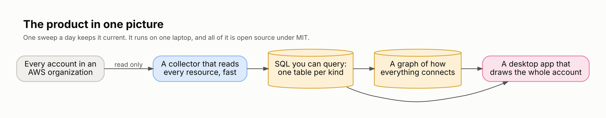
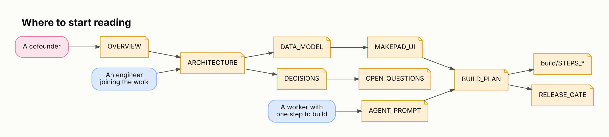
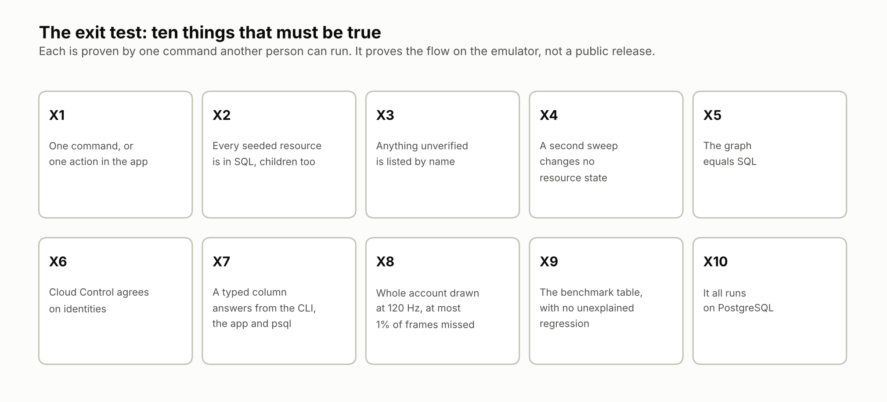
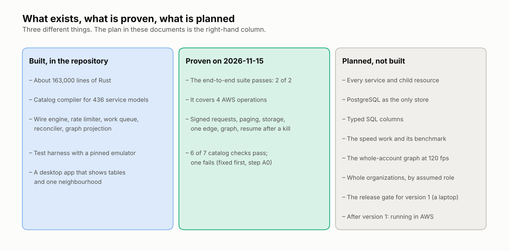
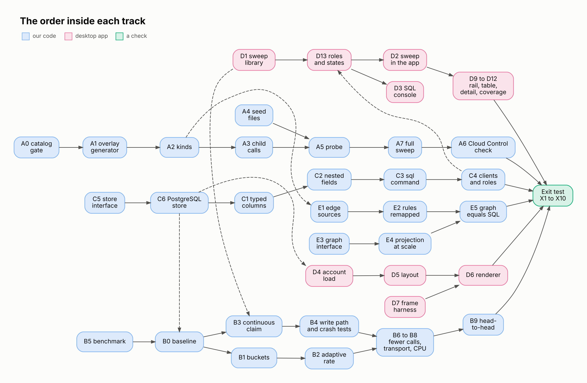
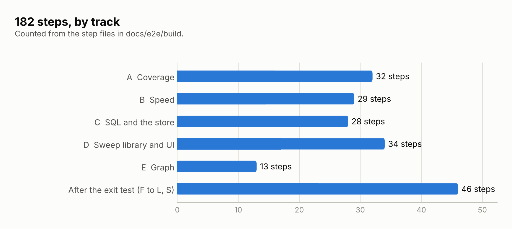
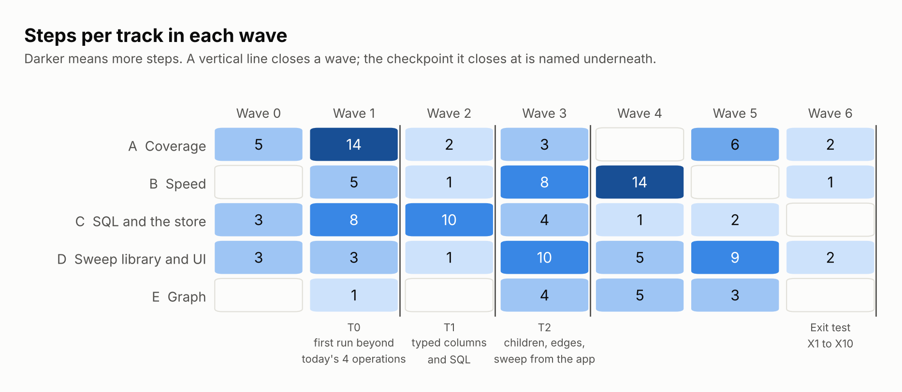

# The design and the plan, end to end

> Status: 2026-11-22. This directory is the whole design in one place: what
> the product is, how it works, every decision, what is still open, and the
> step-by-step plan to build it. It is a plan. The only things already
> built or measured are the ones each document marks as such. It amends
> [VISION](../VISION.md) through the ledger in [DECISIONS](DECISIONS.md);
> where the two differ, DECISIONS wins until step K4.1 merges them.

Version 1 in one line: `aws-inventory` runs on one laptop (macOS or Linux),
reaches every account of an AWS organization (up to 10,000) through a
read-only role,
sweeps everything once a day into PostgreSQL 19, and draws it. All of it is
MIT. The core is one page: the first section of
[ARCHITECTURE](ARCHITECTURE.md).

## Start here

| If you are | Read, in this order |
| --- | --- |
| A cofounder | [OVERVIEW](OVERVIEW.md), then [OPEN_QUESTIONS](OPEN_QUESTIONS.md). [ARCHITECTURE](ARCHITECTURE.md) if you want the how |
| An engineer joining | [OVERVIEW](OVERVIEW.md), [ARCHITECTURE](ARCHITECTURE.md), [DATA_MODEL](DATA_MODEL.md), [MAKEPAD_UI](MAKEPAD_UI.md), [DECISIONS](DECISIONS.md), then [BUILD_PLAN](BUILD_PLAN.md) |
| A worker with one step | [AGENT_PROMPT](AGENT_PROMPT.md), the step in [build/](build/), and the sections of BUILD_PLAN it names |
| Checking a claim | [RUN_HERE](RUN_HERE.md) is the only record of something actually run |

## What is in this directory

| File | What it answers |
| --- | --- |
| [OVERVIEW.md](OVERVIEW.md) | What is it, who is it for, where does it stand, what are the risks. Plain language, with a glossary |
| [ARCHITECTURE.md](ARCHITECTURE.md) | How it works: the catalog, a sweep, speed, the store, the graph, the app, where it runs, security, failure, proof |
| [DATA_MODEL.md](DATA_MODEL.md) | Every table, what a record is, how changes and deletions are written, the graph, the database roles |
| [MAKEPAD_UI.md](MAKEPAD_UI.md) | The desktop app in full: every screen, how a whole account is drawn, how frame rate is measured |
| [DECISIONS.md](DECISIONS.md) | Every decision, V01 to V53, with what happened to each, and the defaults not yet confirmed |
| [OPEN_QUESTIONS.md](OPEN_QUESTIONS.md) | Everything not decided or not verified, and what each answer would change |
| [BUILD_PLAN.md](BUILD_PLAN.md) | The order of work: performance budgets, the thin slice, seven waves, every step, the risk register |
| [build/](build/) | 182 steps, one file per track, each with its goal, files, change, tests, budget and proof |
| [A_COVERAGE.md](A_COVERAGE.md) to [E_GRAPH.md](E_GRAPH.md) | A one-page summary of each track. The step files are the detail and win where they differ |
| [AFTER.md](AFTER.md) | What comes after the milestone: whole organizations, the daily schedule, tags, proof, removal, the release gate, and running in AWS after version 1 |
| [RELEASE_GATE.md](RELEASE_GATE.md) | The eleven things that must hold before anyone outside is handed the product |
| [REVIEW_2026-11-18.md](REVIEW_2026-11-18.md) | An outside review of the plan: each finding and where it was fixed |
| [RUN_HERE.md](RUN_HERE.md) | How to build and run the flow, and the record of the run of 2026-11-15 |
| [AGENT_PROMPT.md](AGENT_PROMPT.md) | The kickoff prompt for a worker |
| [img/](img/) | 42 diagrams and charts used by these files, and the Graphviz source of the diagrams in `img/src/` |

About the pictures: they are diagrams and charts drawn by code from the
facts in these documents. The wireframe of the app is a sketch of the
layout, not a screenshot; the app in that form does not exist yet.

## The goal

One command, or one button in the UI, takes an empty directory to a rendered
account:

1. Seed the pinned emulator.
2. Sweep every callable operation of every service, children included.
3. Store typed SQL tables in PostgreSQL (V51) that any SQL client can query.
4. Project the relationships into the graph database.
5. Render the whole account as a DAG at 120 frames per second.

Only after that run is proven does the work widen (whole organizations, the
daily schedule, tags, head-to-head, a real account, and, after version 1,
running in AWS).

## Exit test for the milestone

Every line is a result another agent can reproduce with one named command.

| # | Evidence |
| --- | --- |
| X1 | From an empty directory, one CLI command seeds the emulator, sweeps, projects and exits 0. In the UI, one action sweeps and projects an account that already exists (an emulator the harness seeded, or a real one). The UI never seeds: the product has no write capability against AWS. |
| X2 | Every seeded resource of every kind the emulator serves is in SQL, children included: per-kind counts equal the seed. |
| X3 | Kinds the emulator does not serve are listed by name as implemented, not verified. None is skipped silently. |
| X4 | A second sweep of the unchanged account changes no resource state: zero rows written to resources, kind tables, edges, memberships, parent links and scope evidence. Queue, sweep and outcome rows are control data; they are written, and counted separately. Today the first part holds only for `resources`; the build plan removes the other writes. |
| X5 | The graph equals SQL: node and edge keys match exactly ([E5](E_GRAPH.md)). |
| X6 | The Cloud Control cross-check reports no unexplained identity difference for seeded kinds ([A6](A_COVERAGE.md)). |
| X7 | A query on a typed column of a swept kind returns the seeded value from the CLI, the UI console and `psql` ([C3, C4](C_SQL.md)). |
| X8 | The UI renders the whole account. On a 120 Hz display, at a stated resolution and on stated hardware, over the scripted path: at most 1% of presented frames are missed, and p99 GPU busy time and p99 UI-thread time are each under 8.3 ms. The harness records display refresh, resolution, GPU, driver and backend with the rows ([MAKEPAD_UI.md](MAKEPAD_UI.md) section 8, D7). The size, 250,000 nodes and 1,000,000 edges on an integrated GPU, is still the unconfirmed default O14. |
| X9 | The sweep benchmark table exists, from a release build, with the before and after of each speed package ([B5](B_SPEED.md)). No recorded number regressed without a written reason (V52). |
| X10 | The run above stores into PostgreSQL (V51). |

The exit test proves an emulator milestone. It is not a release gate; that is
[RELEASE_GATE.md](RELEASE_GATE.md).

"Everything" in this milestone means everything the emulator serves. The probe
in A5 produces that list. What the emulator cannot serve stays unverified until
a real account is authorized (O8).

## Where the tree stands (read on 2026-11-15)

Taken from the tree, not from older documents.

| Area | State | Source |
| --- | --- | --- |
| Callable operations | 4: EC2 `DescribeVpcs`, `DescribeSubnets`, `DescribeRegions`; STS `GetCallerIdentity` | `catalog/aws-overlay.report` |
| Services with an overlay file | 2 of 436 | `catalog/overlay/` |
| Unreviewed candidates | 2,026 enumerate, 2,915 expand, 3,045 unclassified reads | `catalog/aws-overlay.report` |
| Child operations ever run | 0 (`callable_expand=0`) | same |
| Rate per bucket | 5 requests per second; the adaptive rate cannot exceed its starting value | `crates/engine/src/limiter/policy.rs` |
| Bucket key | service name only | `src/sweep_runtime/call.rs` |
| Sweep concurrency | default 16, maximum 128 | `src/cli/sweep.rs`, `src/sweep_runtime/config.rs` |
| Work loop | claims a batch, waits for the whole batch | `src/sweep_runtime/execution/draining.rs` |
| Writer | one transaction per claim and per page, each flushed to disk | `crates/engine/src/inventory/connection.rs`, `work.rs` |
| Learned rates | table created, never read or written | `crates/engine/src/inventory/schema.rs` |
| SQL columns per kind | identity, name and relation-target columns, plus the record blob | `crates/catalog-tool/src/runtime_catalog/schemas.rs` |
| Query command | opens the schema 13 store only | `src/main.rs` (`query`) |
| Sweep runtime | inside the CLI binary, not a library | `src/sweep_runtime/` |
| UI | reads the current store and FalkorDB; no SQL console, no hierarchy, 2,000-node cap, per-frame vector paths | `crates/cmdb-ui/src/` |
| Relations live | 1 of 42 mapped rows (`Subnet.VpcId` to `VPC.VpcId`) | `catalog/kinds.tsv` |
| Catalog gate | `models compile --check` fails on this archive; the other six catalog checks pass | [RUN_HERE.md](RUN_HERE.md), package A0 |
| Size guard | 5 Rust files are over 300 lines and 17 comment lines exist, so `source-size` and the no-comments rule do not hold on this archive | [BUILD_PLAN.md](BUILD_PLAN.md) section 10, steps A0.3 and A0.4 |
| Baseline end-to-end suite | 2 passed, 0 failed against the pinned emulator and FalkorDB | [RUN_HERE.md](RUN_HERE.md) |
| PostgreSQL | absent: no PostgreSQL code exists and `sqlx` is built without its `postgres` feature. It becomes the only store (V53); the current store's code is deleted once the baseline scenario passes on PostgreSQL | `Cargo.toml` |
| Continuous mode, AWS runtime | absent | |

## Tracks

The order of work, wave by wave and step by step, is in
[BUILD_PLAN.md](BUILD_PLAN.md). It puts the store interface, PostgreSQL and the benchmark
first (V51, V52) and adds packages B6 to B9 and C6.

Five tracks run in parallel. Each owns different crates, so workers do not
collide.

| Track | File | Owns |
| --- | --- | --- |
| A Coverage | [A_COVERAGE.md](A_COVERAGE.md) | `crates/catalog-tool`, `catalog/overlay/`, `catalog/kinds.tsv`, harness seeding and verification |
| B Speed | [B_SPEED.md](B_SPEED.md) | `crates/engine/src/limiter`, `crates/engine/src/inventory`, `crates/cmdb-bench` |
| C SQL | [C_SQL.md](C_SQL.md) | `crates/catalog-tool/src/runtime_catalog/schemas*`, `crates/engine/src/inventory/{schema,typed}.rs`, CLI `sql` |
| D Library and UI | [D_LIBRARY_UI.md](D_LIBRARY_UI.md) | new sweep library crate, `crates/cmdb-ui`, `crates/cmdb-view` (SQL reads) |
| E Graph | [E_GRAPH.md](E_GRAPH.md) | edge extraction in `crates/engine`, graph interface in `crates/cmdb-view` |

Shared files need one owner at a time: `src/sweep_runtime/` (B3 before D1, or
D1 first and B3 inside the new crate) and
`crates/engine/src/inventory/schema.rs` (B2, B4 and C1 each change it; land
them one after another).

What comes after the exit test is in [AFTER.md](AFTER.md).

## Rules that still hold

- Workspace lints: no `unsafe`, `unwrap`, `expect`, `panic`, `todo`, unchecked
  indexing or lossy casts. Files at or under 1000 lines, functions under 60
  lines. No Rust comments.
- Everything is bounded. One retry owner. State that matters is in the store.
- Collection is read-only. The deny list fails closed and always wins.
- Implemented, emulator-verified and live-verified are separate facts.
- Performance claims come from measurements.
- The product writes nothing to AWS. The write capability used for seeding
  exists only in the harness crate.

## Rules that changed

See [DECISIONS.md](DECISIONS.md). In short: end to end first, performance as
the critical constraint with a measured budget on every step, PostgreSQL from
the start as the only store, generated overlays, Cloud Control kept as a checker, the UI may
start sweeps, one private repository for now, mutation gate suspended.
