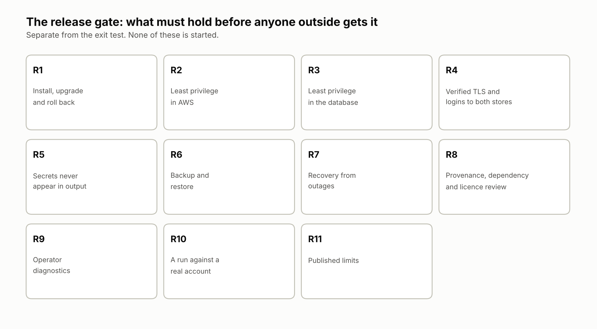

# Public-release gate

> Status: Plan, 2026-11-18. Added after the review of the same day. The exit
> test in [README.md](README.md) (X1 to X10) proves that the flow works on the
> emulator. It does not prove the product is safe to hand to someone else.
> These lines do. None is started. Each line has one step, L1.1 to L6.2, in
> [build/STEPS_AFTER.md](build/STEPS_AFTER.md).

The gate is for version 1, which runs on one person's laptop (V54), on macOS
and Linux (V58), with the graph engine shipped inside it (V60), all under
MIT (V63).

A line passes on evidence another person can reproduce, the same rule as the
exit test.

| # | Line | Evidence | Step |
| --- | --- | --- | --- |
| R1 | Clean installation, upgrade and rollback | On a clean machine per supported platform: install, sweep, upgrade to the next build with data in place (C1.7's journal), roll back, remove. Recorded runs | L1.1 |
| R2 | Least privilege in AWS | A published read-only policy that is exactly what the callable operations need, generated from the catalog; a test that a sweep succeeds with it and that no call outside it is attempted | L2.1 |
| R3 | Least privilege in the database | Three roles (owner, collector, reader) with tested limits; the product never needs a superuser after setup | L2.2 |
| R4 | Authentication to both stores, and verified TLS off the local machine | Version 1 is one laptop (V54): PostgreSQL and the graph database listen on the local machine only and require a password. A store that is not local is refused unless the connection is TLS with a verified certificate; tests with a wrong password, a wrong certificate, and a store bound to a public address | L3.1 |
| R5 | Secrets are redacted | No password, token, access key or signed header in logs, errors, crash output, exports or the UI; a test that seeds known secret values and searches every output for them | L3.2 |
| R6 | Backup and restore | A documented backup of PostgreSQL, a restore into an empty server, and the graph rebuilt from it; the result equals the original by E5.1's comparison | L4.1 |
| R7 | Outage recovery | PostgreSQL down, graph database down, AWS unreachable, each during a sweep and at rest: the app says what is wrong, loses nothing, and recovers without a restart where B4.6 and E4.3 say it should | L4.2 |
| R8 | Provenance, dependencies and licences | Reproducible release artifacts with checksums and a signed manifest; a dependency and advisory audit that is clean; a licence review of every dependency, and of the graph engine that ships, against a product that is MIT throughout (V63) | L5.1 |
| R9 | Operator diagnostics | One command that reports versions, connections and roles, last sweep, coverage, queue depth and store health without printing a secret | L5.2 |
| R10 | An authorized real-account run | The first run against a real account the owner names (O8), read-only, with coverage and every difference from the emulator written down | L6.1 |
| R11 | Stated limits | A published list of what is not collected, what is implemented but not verified, and the tested scale | L6.2 |

What this gate does not cover: SSO (not planned, V61) and
support. Those are product decisions outside the plan.
