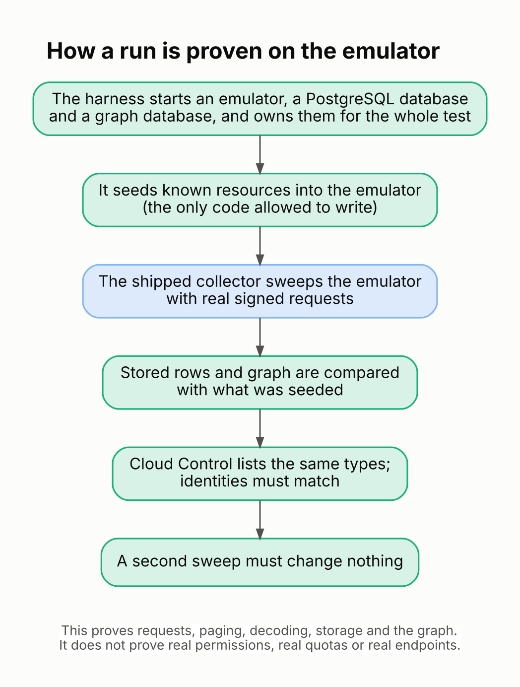
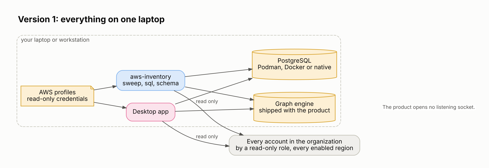

# Running the flow

> Status: Record of an actual run on 2026-11-15, on a 2-CPU Linux x86_64
> machine with 8 GB of memory and a 6 GiB process limit, from the `main`
> archive of this repository. Emulator evidence only. Nothing here touched real AWS.

## Wave 0 checkout differences (2026-11-22)

The A0.1–A0.3 work started at commit
`e560dc72f96a52b02d1615534da8bf29621b22bc`, not the archive described below.
Kinds and relations are reviewed Rust tables under
`crates/catalog-tool/src/kind_map/`; there is no `catalog/kinds.tsv`.

Emission-aware live/pending relation compilation and its inactive-relation
report already exist in this checkout. Additional emissions and classified
kinds count as producers; replacing this with the archive's proposed
`RelationSplit` would regress those behaviors. Security groups are callable,
so the archive's expected SecurityGroup compile failure is obsolete.

The generated, ignored catalog is 19,051,875 bytes, with SHA-256
`9a420c28bfd22fb5b14a9a1c25f8bcd294eede6b8b02c2fc44e0808618c36ec8`.
It was not regenerated or committed by this change. The runtime reader and
`src/sweep_command/enabled.rs` already share the 64 MiB catalog bound.
The historical seven-check and size-guard results below are not evidence
for this checkout; only commands explicitly reported with the change were run.

With the same pinned models and generated inputs,
`cargo run --locked -p catalog-tool -j2 -- models compile --check`
reaches publication and reports `catalog differs; run catalog-tool models compile --write`.
The identical command at baseline `e560dc72` reports the same drift, so this
is pre-existing generated-output drift, not a new capability-validation failure.
The comparison used a private target directory and a temporary detached
baseline worktree, which was removed afterward.

The contextual diagnostics preserve catalog decoder errors. Invalid reviewed
paths name the kind and path; callable-plan failures name the service,
operation and actual offending member path. Fixed-input validation retains
bounded, iterative traversal and maps its internal rejection to the fixed path.

Scoped verification used `HOME=/home/lewis` and
`CARGO_TARGET_DIR=/home/lewis/.cache/cargo-target-a0c`:

- `cargo check --locked -p catalog-tool -j2`: passed.
- `cargo test --locked -p catalog-tool --lib runtime_catalog -j2`:
  37 passed, 0 failed.
- `cargo clippy --locked -p catalog-tool --lib -j2 -- -D warnings`: passed.
- Explicit changed-file formatting used `rustfmt --edition 2024 --config skip_children=true`.

No workspace suite, emulator sweep, PostgreSQL check, real-AWS call or binary
regeneration was run for this change.

## One command





```sh
scripts/e2e-baseline.sh
```

It installs the pinned runtime if it is missing, builds, and runs the ignored
`sweep_e2e` suite. The suite starts its own emulator and its own Redis with
the FalkorDB module, seeds VPCs and subnets through `aws-wire`, runs the
shipped `aws-inventory sweep`, projects into FalkorDB and compares the stored
rows and the graph with the seed.

Run here as written, with the runtime already installed: exit 0, 2 passed,
247.29 s.

Tools it needs on `PATH`: `cargo` (rustup reads `rust-toolchain.toml`), a C
toolchain, `git`, `curl`, `gpg`, `dpkg-deb`, `bsdtar`, `make`.

## The steps, as run

| Step | Command | Result here |
| --- | --- | --- |
| Toolchain | `rustup toolchain install nightly-2026-11-11` | `rustc 1.102.0-nightly (9c5648833 2026-11-10)` |
| Models | Fetch `github.com/aws/api-models-aws` at `46135f8468cd5cb60d983b97290c9f6661e359c6` into `.local/aws-models` | 436 model files, 188 MB. In a clone, `git submodule update --init --depth 1 .local/aws-models` does this |
| Core crates | `cargo check --locked -p inventory-core -p aws-wire -p inventory-engine` | Clean, no warnings |
| Harness | `cargo build --locked -p inventory-harness` | Built in 2 min 5 s |
| Emulator | `inventory-harness install .local/runtime` | Version 1.0.348; package SHA-256 `279a243a…d4a8` matched the pin; signature step passed |
| Graph runtime | `inventory-harness install-graph .local/runtime/graph` | Redis 8.10.3 built from source, `falkordb.so` 6.0.4 fetched, pinned digests matched |
| Collector and test binary | `cargo test --locked --features aws --test sweep_e2e --no-run -j1` | Built on the third attempt; see "Memory" below |
| End-to-end suite | `cargo test --locked --features aws --test sweep_e2e -j1 -- --ignored --test-threads 1` | **2 passed, 0 failed**, 258.69 s |

The two tests that passed:

- `production_sweep_persists_and_projects_real_seeded_inventory`
- `controlled_tls_403_preserves_existing_inventory`

What the suite covers, as [VERIFICATION](../VERIFICATION.md) describes it: for
the 4 callable operations, signed requests, pagination, decoding, storage in
schema 14, the `IN_VPC` edge, projection into FalkorDB, a zero-write re-sweep,
resume after a kill, and no deletion on partial or denied sweeps. Both tests
passing here means that flow works on this machine. It says nothing about any
other service, about speed, or about real AWS.

## Catalog checks

Run from the repository root with the models in place, using the built
`catalog-tool`.

| Check | Result here |
| --- | --- |
| `models report --check` | pass |
| `models fields --check` | pass |
| `models endpoints --check` | pass |
| `classes --check` | pass |
| `plans --check` | pass |
| `overlay --source .local/aws-models --root . --check` | pass |
| `models compile --check` | **fail**: `runtime capability metadata is invalid or unsupported` |

The failing check is the `binary-catalog` task of `moon ci`. Narrowed in a
scratch copy of `catalog/`:

- With every `relation` row of `catalog/kinds.tsv` removed except
  `AWS::EC2::Subnet VpcId`, the compile succeeds, and then reports that the
  committed `catalog/aws-api.catalog` differs from the result.
- Adding back one more row, `AWS::EC2::SecurityGroup VpcId`, makes it fail
  again. That kind has no callable operation.

So in this archive `catalog/kinds.tsv` is ahead of `catalog/overlay/`: 41 of
its 42 relation rows have a source or target kind other than VPC and Subnet,
the only two kinds an operation can enumerate today, and the committed binary
catalog was compiled from an earlier, consistent state. One such row was
tested; the other 40 were not tested one by one. The
sweep works because it reads that committed catalog. This could not be checked
against git history, which the archive does not carry. It is package A0 in
[A_COVERAGE.md](A_COVERAGE.md), and it blocks every other catalog change.

The error also names no service, kind or path. `RuntimeCatalogCompileError`
has a `CapabilityContext` variant that does; the bare `Capability` variant is
returned from about 60 places.

## Size guard

`scripts/check-source-size.sh` lists files through git, so it could not run in
the archive. Counting the same way by hand (`wc -l` over every `.rs` file), 5
files are over the 300-line limit:
`crates/catalog-tool/src/runtime_catalog/model_path.rs` (302),
`crates/core/src/catalog/runtime/decode/plans.rs` (305),
`crates/cmdb-ui/src/app.rs` (304),
`crates/harness/src/install/graph/installer_tests.rs` (305) and
`crates/cmdb-ui/src/worker/tests.rs` (327). On a clone in this state the
`source-size` task of `moon ci` would fail. Steps A0.1 and A0.4 fix them.

## PostgreSQL

V51 and V53 arrived after the run above, which used the current store, not
PostgreSQL. To see what running a server on this machine needs, PostgreSQL 16.15 was installed here
(`apt-get install postgresql`), and a throwaway server was started on a
private unix socket, queried with `psql` and stopped:

```sh
initdb -D <dir>/data --auth=trust -U inv
pg_ctl -D <dir>/data -o "-c listen_addresses='' -c unix_socket_directories=<dir>" -w start
psql -h <dir> -U inv -d postgres -Atc 'select version()'
pg_ctl -D <dir>/data -m fast -w stop
```

`initdb` refuses to run as root. This machine runs as root, as most CI
containers do, so the server ran as the `postgres` user through `runuser`. The
binaries are under `/usr/lib/postgresql/16/bin` and are not on `PATH`. No
project code talks to PostgreSQL yet.

## Memory

`aws-sdk-ec2` is the largest crate in the build. With two jobs `rustc` was
killed at 4.3 GB; with `-j1` it was killed at 6.0 GB against the 6 GiB limit.
The build passed with `-j1` after adding swap. Use `-j1` and allow more than
6 GB for that one crate.

The sweep itself does not use the EC2 SDK. It is linked because the `aws`
feature brings in all of `inventory-aws`, including the 19 typed SDK crates of
the old `scan` path. Putting the profile loader that the sweep needs behind
its own feature would remove them from this build; that fits package D1.

## Not run

- `moon ci` as a whole, `cargo test --workspace`, Clippy and the size guards.
- The `emulator_live` suites of the harness (the old `scan` path and Cloud
  Control).
- `cmdb-ui`. This machine has no display.
- Any benchmark. The 258.69 s is the wall time of the test suite on 2 CPUs in
  a debug build, not a measure of sweep speed.
- Anything against real AWS.

## Sizes

`.local/runtime` 3.8 GB (the emulator's full source clone is most of it),
`.local/aws-models` 188 MB, Cargo target directory 3.8 GB.
